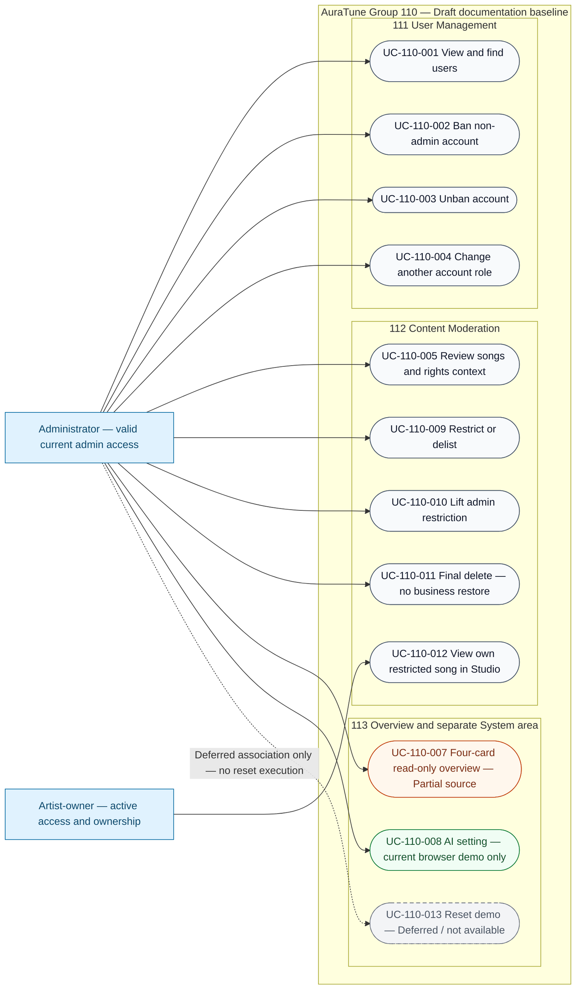

# Group 110 — Use-Case Diagram

Updated: 2026-11-04. Draft; Reviewer: Not assigned. Owner session decisions Q01–Q11 are applied as documented in the [inventory](./use-case-inventory.md#decision-register); no pre-existing source/collective approval claim is made.

## Reading the diagram

- Solid lines associate available documented actor goals; they do not assert implementation, approval or complete prototypes.
- Administrator and Artist-owner are distinct. Artist-owner has only the ownership-limited Studio goal here, not Admin moderation access. General Listener/Guest/non-owner requests are denial cases, not extra administrative goals.
- UC-110-007 has source gaps in count hints; its four-card overview is read-only.
- UC-110-008 applies only to the current browser demo and persists through reload. It does not control remote/shared AI services or satisfy the source’s platform-wide clause.
- UC-110-013’s dashed association is a deferred source allocation, **not an available reset action or execution flow**.
- Restrict/delist and final delete are distinct goals. Only reversible admin restriction can be lifted; final deletion has no business restore and specifies no physical cleanup.
- Lifting a restriction preserves Artist self-hide/private preference and existing eligibility rules. Cross-check [090 visibility](../090-artist-profile-studio/UC-090-007-hide-or-unhide-track.md); no forced public placement is implied.
- No include/extend relation is asserted. Internal database/auth/UI modules are not external actors. Reserved shared ID 006 is outside these feature specs, so no comment moderation is added.

## Rendering verification

Verified with Mermaid 11 in the browser: syntax parse and SVG rendering succeeded, with **14 nodes (2 actors + 12 UC goals), 12 association edges and 0 overlapping node bounding boxes** in the rendered layout. Reset is dashed/deferred; Admin and Artist-owner remain separate. This is a browser render/geometry check, not a runtime UI test or a claim that every text layout was manually reviewed. No PNG/SVG export of this diagram is saved. The six conceptual UI storyboards are separately listed in the prototype register and do not demonstrate runtime behavior.

## Links

See the [twelve actual Drafts](./README.md#draft-specification-files), [74-FR ledger](./use-case-inventory.md#complete-fr-traceability) and [source and new-mockup evidence register](./prototypes/README.md). Read behavioral status separately from visual completeness.
