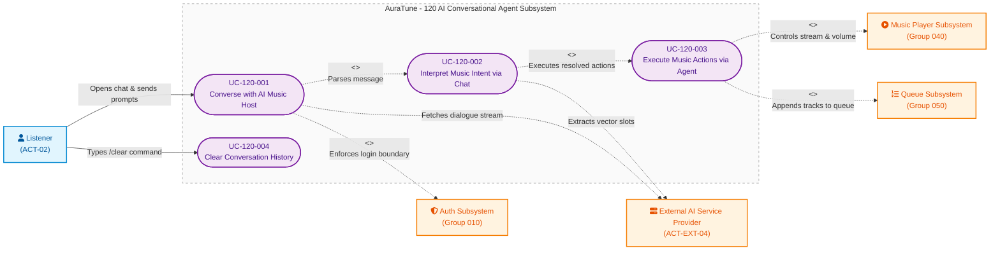

# Functional Group 120: AI Conversational Agent – Use-Case Documentation

---

## 5.1. Group Overview

| Attribute | Details |
|---|---|
| **Group ID** | 120 |
| **Group Name** | AI Conversational Agent |
| **Group Owner** | Lê Công Minh Nhựt |
| **Module Purpose** | Provides an intelligent, interactive conversational music host ("AuraTune Agent") allowing listeners to control playback, manage queues, discover music, inquire about songs/artists, and interact with the platform using natural language. |
| **Documentation Status** | Draft — Baseline for Sprint 3 (PA3) Review |
| **Primary Actor** | Listener (`ACT-02`) |
| **Supporting Actors** | External AI Service Provider (`ACT-EXT-04`) |
| **Boundary Actor** | Guest / Visitor (`ACT-01`) |
| **Related Spec Kit** | [`specs/120-ai-conversational-agent/`](file:///F:/CSC_HCMUS/Chuy%C3%AAn%20ng%C3%A0nh/NM%20SE/AuraTune/specs/120-ai-conversational-agent/) |

---

## 5.2. Functional Scope

### 5.2.1 Required Functionality (Spec Kit Baseline)
The approved scope of Group 120 encompasses three closely integrated subfeatures:

1. **Conversational Interface (Feature 121)**:
   - Floating chat window accessible across platform views.
   - Chronological message stream displaying user messages and assistant responses.
   - Real-time processing indicators (thinking spinner, elapsed duration timer, expandable reasoning thoughts).
   - In-memory conversation lifecycle with quick terminal commands (`/clear` to reset log, `/help` for shortcut documentation).
   - Command history navigation (up to 30 recent prompts via `↑` / `↓` arrow keys).
   - Resilient degradation when AI services are offline (`● tạm ngưng` status, disabled input, non-blocking music playback).

2. **Music Intent Understanding (Feature 122)**:
   - Natural language comprehension categorizing prompts into 5 core intents: `play_music`, `search_music`, `query_music_info`, `manage_library`, and `general_chitchat`.
   - Entity slot extraction: song title, artist, album, genre, mood, activity, volume level, and target routes.
   - Context awareness: resolving contextual references ("bài này", "ca sĩ này") using current player state.
   - Compound command decomposition: parsing multi-clause commands separated by commas or "rồi" / "sau đó" (e.g., *"phát nhạc chill rồi giảm âm lượng"*).
   - Smart heuristic defaults: resolving vague requests (e.g., *"bật nhạc đi"*) without blocking on clarification.
   - Strict privacy sanitization: stripping Personally Identifiable Information (PII) before external AI processing (Decree 13/2023/ND-CP).

3. **Real-Time Music Assistance (Feature 123)**:
   - Client-side tool dispatching architecture (`agentTools.js`) coordinating directly with the Persistent Bottom Player (`040`) and Queue Management (`050`).
   - Executing core playback operations: `play_playlist`, `play_tracks`, `playback` (`pause`, `resume`, `next`, `previous`), and `set_volume`.
   - Queue and library mutations: `queue_add`, `like_track`, and in-app route `navigate`.
   - Destructive action confirmation: interactive `[y/N]` confirmation required before executing irreversible commands like `clear_queue`.
   - Fault isolation: AI backend errors or streaming failures never halt or interrupt background audio playback.

### 5.2.2 Current Implementation Status
The AuraTune frontend has implemented Group 120 as a **CLI / Terminal-style Agent** in:
- `src/frontend/src/components/chat/AIHostChat.jsx`: Main terminal floating panel component.
- `src/frontend/src/components/chat/agentTools.js`: Client action executor for player and store manipulation.
- `src/frontend/src/utils/agentService.js`: Async generator simulating the backend Server-Sent Events (SSE) contract (`thinking`, `tool_call`, `text`, `playlist`, `error`, `done`).

### 5.2.3 Unconfirmed / Out-of-Scope Capabilities
- **Voice Recognition / Speech-to-Text**: Unconfirmed in Project Plan Section 2.3.1; established as strictly text-based for MVP.
- **Persistent Server-Side Chat Storage**: The current database schema does not feature a `chat_messages` table. Conversations are session-based in client component memory, reset upon page reload or `/clear`.

---

## 5.3. Use-Case Inventory Summary

| UC ID | Use-Case Name | Primary Actor | Supporting Actors | Related FRs | Implementation Status | Specification Link |
|---|---|---|---|---|---|---|
| **UC-120-001** | Converse with AI Music Host | Listener | External AI Service | `121-FR-001` to `121-FR-012` | Implemented (CLI Agent UI) | [`UC-120-001`](./UC-120-001-converse-with-ai-music-host.md) |
| **UC-120-002** | Interpret Music Intent via Chat | Listener | External AI Service | `122-FR-001` to `122-FR-012` | Implemented (Intent Parser) | [`UC-120-002`](./UC-120-002-interpret-music-intent-via-chat.md) |
| **UC-120-003** | Execute Music Actions via Conversational Agent | Listener | External AI Service | `123-FR-001` to `123-FR-014` | Implemented (Client Tools) | [`UC-120-003`](./UC-120-003-execute-music-actions-via-conversational-agent.md) |
| **UC-120-004** | Clear Conversation History | Listener | None | `121-FR-008` | Implemented (`/clear` command) | [`UC-120-004`](./UC-120-004-clear-conversation-history.md) |

---

## 5.4. Use-Case Relationships

1. **`UC-120-001` <<include>> `UC-120-002`**:
   - *Condition/Behavior*: Every natural language prompt entered into the conversational interface is unconditionally processed by the intent understanding pipeline to detect musical intents, entity slots, and suggested actions.
2. **`UC-120-002` <<include>> `UC-120-003`**:
   - *Condition/Behavior*: When intent analysis resolves an actionable command (e.g., playback, volume adjustment, queue addition), the agent automatically dispatches client tools to execute real-time music assistance.
3. **`UC-120-003` <<include>> `UC-050-002` (Add Track to Queue)**:
   - *Condition/Behavior*: Queue addition commands (`queue_add`) directly update the platform playback queue managed by Group 050.
4. **`UC-120-003` <<extend>> `UC-040-001` (Control Audio Playback)**:
   - *Extension Point*: `Chat Action Directive`.
   - *Condition/Behavior*: The agent controls play/pause/skip and volume through client tool execution while audio streams in the persistent player.
5. **`UC-120-004` (Clear Conversation History)**:
   - *Behavior*: Triggered as an in-session maintenance action via the `/clear` CLI command, resetting the log without disconnecting the user.

---

## 5.5. Use-Case Diagram



> **Note**: This is a conceptual Use-Case Diagram rendered using Mermaid `flowchart LR` syntax to represent UML Use-Case structures within Markdown renderers.

---

## 5.6. UI Overview (CLI Terminal Agent Interface)

Based on the latest implementation in `src/frontend/src/components/chat/AIHostChat.jsx`:

```
+-------------------------------------------------------------+
| [AuraTune Mark]  AuraTune Agent                             |
|                  ~/auratune · ● online                 [X]  |
+-------------------------------------------------------------+
| [Banner]                                                    |
| ✻ Chào mừng đến với AuraTune Agent                          |
|   › phát nhạc chill rồi giảm âm lượng                       |
|   › thêm nhạc năng lượng vào hàng chờ                       |
|   /help để xem phím tắt                                     |
|                                                             |
| ❯ phát nhạc chill rồi giảm âm lượng                         |
|                                                             |
| ⠋ Đang suy nghĩ… (0.8s · esc để dừng)                       |
| ✻ Đã suy nghĩ 1.2s >                                        |
|   Đọc yêu cầu                                               |
|   Phân tích tâm trạng trong yêu cầu                         |
| ● play_playlist("chill_vibes")                              |
|   ⎿ Đang phát 12 bài từ “Chill Vibes”                       |
| ● set_volume(30)                                            |
|   ⎿ Âm lượng 30%                                            |
|                                                             |
| Đang phát “Chill Vibes” và đã giảm âm lượng xuống 30% cho bạn.  |
| [PlaylistCard: Chill Vibes]                                 |
| ✓ xong trong 1.5s                                           |
+-------------------------------------------------------------+
| [Suggestions: phát lofi | bài đang phát là gì? | ...]       |
| ❯ [ Bạn muốn nghe gì, hay cần mình làm gì?                ] |
| ⏎ gửi   ↑↓ lịch sử   esc dừng/đóng   /help                  |
+-------------------------------------------------------------+
```

1. **Panel Container**: Floating modal anchored on the right edge (`bottom-[96px] right-2 top-2`, max width 460px, rounded corners, dark theme `bg-[#0c0d12]`, subtle border).
2. **Header Bar**:
   - Brand logo (`auratune-mark.png`).
   - Title "AuraTune Agent" and status line: `~/auratune · ● online` (emerald) or `● tạm ngưng` (amber).
   - Dismiss button (`X` icon, keyboard shortcut `Esc`).
3. **Conversation Log Area**:
   - Welcome banner with syntax hints.
   - User command lines prefixed by terminal prompt `❯`.
   - Thinking indicator with animated spinner `⠋`, dynamic elapsed timer, and expandable thought trace.
   - Tool execution status dots: `●` (green for `ok`, amber for `confirm`, red for `error`, pulsating for `running`).
   - Confirmation widget for destructive actions: `? confirm [y/N]` with buttons `y · Đồng ý` and `n · Hủy`.
   - Streamed Markdown assistant dialogue text with pulsating cursor `█`.
   - Embedded interactive `PlaylistCard` for playlist recommendations.
   - Execution summary badge: `✓ xong trong [N]s` or `■ Đã dừng`.
4. **Input Footer Area**:
   - Suggestion chips carousel for quick prompt selection.
   - Terminal prompt textarea with auto-resize, max 500 characters.
   - Command history navigation (`↑` for older, `↓` for newer, preserving up to 30 items).
   - Special slash commands: `/help` displays shortcuts; `/clear` resets view.
   - Shortcut legend: `⏎ gửi`, `↑↓ lịch sử`, `esc`, `/help`.

---

## 5.7. Traceability

| Functional Requirement | Specification Document | Mapped Use Case ID | Frontend Component / Handler |
|---|---|---|---|
| `121-FR-001` to `121-FR-007` | `121-conversational-interface` | **UC-120-001** | `AIHostChat.jsx` (panel, message stream, markdown rendering) |
| `121-FR-008` | `121-conversational-interface` | **UC-120-004** | `AIHostChat.jsx` (`/clear` command handler) |
| `121-FR-009`, `121-FR-011` | `121-conversational-interface` | **UC-120-001** | `AIHostChat.jsx` (offline alert, disabled textarea) |
| `122-FR-001` to `122-FR-007` | `122-music-intent-understanding` | **UC-120-002** | `agentService.js` (`planClause`, intent classification, slot extraction) |
| `122-FR-008` | `122-music-intent-understanding` | **UC-120-002** | PII stripping before external AI submission |
| `123-FR-001` to `123-FR-009` | `123-real-time-music-assistance` | **UC-120-003** | `agentTools.js` (`playback`, `set_volume`, `play_playlist`) |
| `123-FR-013` | `123-real-time-music-assistance` | **UC-120-003** | `AIHostChat.jsx` (`askConfirm`, `[y/N]` modal for `clear_queue`) |
| `123-FR-014` | `123-real-time-music-assistance` | **UC-120-003** | `agentService.js` (clause decomposition and sequential execution) |

---

## 5.8. Open Issues and Architecture Clarifications

1. **Persistent Message Storage (`Q-120-01`)**:
   - *Status*: Confirmed for MVP.
   - *Resolution*: Message threads exist in client component memory during the user's active session. Cross-session conversation persistence requires adding a `conversations` and `messages` table in a future database schema revision.
2. **Backend SSE Streaming Contract (`Q-120-02`)**:
   - *Status*: Frontend simulated; backend API pending.
   - *Resolution*: The frontend `runAgent` generator defines the target Server-Sent Events contract (`thinking`, `tool_call`, `text`, `playlist`, `error`, `done`). Backend engineers must implement `POST /api/agent` complying with this event contract.
3. **Voice Input Integration (`Q-120-03`)**:
   - *Status*: Post-MVP candidate.
   - *Resolution*: Voice synthesis and speech recognition remain out-of-scope for the initial course submission.

---

## 5.9. References

- `docs/proposal/Auratune_Vision_Document.md` – Feature Group G12 & Section 3.5
- `docs/proposal/proposal.md` – Section 6.12: AI Conversational Agent
- `docs/requirements/use-case-model.md` – System-Level Use-Case Model
- `docs/requirements/use-cases/README.md` – Use-Case Documentation Standards
- `specs/120-ai-conversational-agent/121-conversational-interface/spec.md`
- `specs/120-ai-conversational-agent/122-music-intent-understanding/spec.md`
- `specs/120-ai-conversational-agent/123-real-time-music-assistance/spec.md`
- `src/frontend/src/components/chat/AIHostChat.jsx`
- `src/frontend/src/components/chat/agentTools.js`
- `src/frontend/src/utils/agentService.js`
- `docs/requirements/use-cases/120-ai-conversational-agent/prototypes/README.md`
