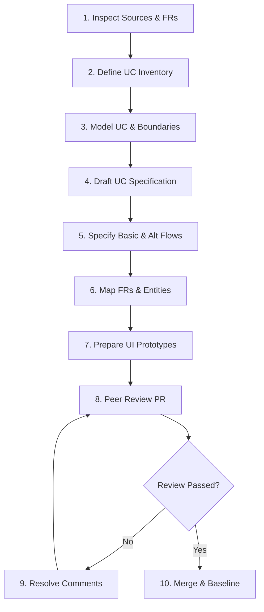

# AuraTune Use-Case Documentation Guide

---

## 1. Purpose and Scope

This document defines the single, standardized guideline for authoring, reviewing, and organizing all **Use-Case Models**, **Use-Case Inventories**, and **Use-Case Specifications** across the **AuraTune** project.

Adherence to this guide is mandatory for all team members across all **12 functional groups** (from `010 – Authentication` to `120 – AI Conversational Agent`). It establishes a rigorous, uniform methodology for translating product vision and functional specifications into testable, actor-oriented use cases for **Project Assignment 3 (PA3)** and subsequent project milestones.

---

## 2. Relationship with Spec Kit

AuraTune utilizes **Spec Kit** for specification-driven implementation and **RUP/UML Use Cases** for behavioral requirement analysis. These artifacts serve fundamentally different purposes in the Software Development Life Cycle (SDLC) and are **not interchangeable**:

| Artifact | Location | Primary Purpose | Primary Audience | Key Contents |
|---|---|---|---|---|
| **System Use-Case Model** | `docs/requirements/use-case-model.md` | System-wide functional scope and boundary definition | Course Evaluators, All Team Members, Lead Architect | System boundary, Actor catalog, Mermaid system diagrams, Consolidated UC catalog, FR matrix |
| **Use-Case Specification** | `docs/requirements/use-cases/[group]/UC-*.md` | User-goal oriented behavioral requirement specification | QA / Testers, Feature Developers, Product Evaluators | Actor-System dialogue (Basic Flow, Alternative Flows), Pre/Postconditions, Prototype screenshots |
| **Spec Kit `spec.md`** | `specs/[group]/[subfeature]/spec.md` | Feature-level user stories, acceptance criteria, and technical constraints | Feature Lead, Implementing Engineer, AI Coding Agent | User stories (Gherkin syntax), detailed acceptance scenarios, key entities, edge cases |
| **Spec Kit `plan.md`** | `specs/[group]/[subfeature]/plan.md` | Technical architecture, component design, and integration strategy | Implementing Engineer | Architecture breakdown, API contract mapping, database tables, sequence diagrams |
| **Spec Kit `tasks.md`** | `specs/[group]/[subfeature]/tasks.md` | Granular, dependency-ordered engineering task breakdown | Implementing Engineer | Atomic coding tasks, verification commands, file changes |

### Distinction Rules
1. **Goal vs. Task**: A Use Case describes *what goal an external actor achieves through interacting with the system*. A Spec Kit specification describes *how a specific software feature satisfies acceptance criteria*, and `tasks.md` lists *the developer tasks required to build it*.
2. **Persistence Integrity**: Do NOT delete, move, or modify existing `specs/` artifacts when authoring use-case documentation.
3. **Conflict Resolution**: If a Use Case scenario conflicts with a Spec Kit `spec.md`, do not silently alter either document. Record the conflict as an open issue and resolve it with the functional group owner during weekly Scrum meetings.

---

## 3. Use-Case Writing Principles

Every Use-Case Specification authored for AuraTune must adhere to five core principles:

1. **One User Goal**: Each use case must capture a single, complete, and meaningful goal from the perspective of an actor (e.g., *"Create Playlist"*, not *"Click save button on playlist modal"*).
2. **Actor–System Dialogue**: Flows must be written strictly as alternating, numbered interactions between an **Actor** (intent/input) and the **System** (validation/response). Avoid passive voice or vague statements.
3. **Implementation Agnostic**: Flows must describe functional behavior, not technical internals. Do not reference internal classes, SQL queries, database columns, or API routes inside Basic and Alternative flows (e.g., state *"System saves the new playlist"*, not *"System executes INSERT INTO playlists"*).
4. **Consistency in Terminology**: Use standardized catalog terms across all documents (e.g., *Song/Track*, *Album*, *Artist*, *Playlist*, *Queue*, *Mini Player*, *Full Player*).
5. **No Duplication or Fragmentation**: Do not split simple validation errors or button clicks into separate use cases. Validation failures and cancel actions must be modeled as **Alternative Flows** or **Exception Flows** of the parent use case.

---

## 4. Naming and Identification Convention

### 4.1 Functional Group Directory Structure
All use cases must be stored within their dedicated group directory:

```text
docs/
└── requirements/
    ├── use-case-model.md
    └── use-cases/
        ├── README.md
        ├── 010-authentication/
        ├── 020-home-dashboard/
        ├── 030-search/
        ├── 040-music-player/
        ├── 050-queue-management/
        ├── 060-playlist-management/
        ├── 070-listening-history/
        ├── 080-album-interaction/
        ├── 090-artist-profile-studio/
        ├── 100-ai-recommendations/
        ├── 110-admin-functions/
        └── 120-ai-conversational-agent/
```

### 4.2 Use-Case Identifier Format
Use-case identifiers must strictly follow the format:

$$\text{UC-[GROUP]-[SEQUENCE]}$$

- `[GROUP]`: Three-digit group code (`010` to `120`).
- `[SEQUENCE]`: Three-digit sequence number starting at `001` (e.g., `001`, `002`, `003`).

### 4.3 Use-Case File Naming Convention
Every Use-Case Specification file must follow the kebab-case pattern:

$$\text{UC-[GROUP]-[SEQUENCE]-[short-name].md}$$

*Examples:*
- `UC-010-001-register-account.md`
- `UC-040-001-control-audio-playback.md`
- `UC-060-010-generate-playlist-with-ai.md`

---

## 5. Actor Guidelines

Use cases must only associate with verified actors defined in the [System-Level Use-Case Model](../use-case-model.md):

1. **Primary Human Actors**:
   - `Guest / Visitor`: Unauthenticated user browsing public sections and streaming public audio.
   - `Listener`: Authenticated standard user with a personal library, playlists, and history.
   - `Artist`: Musician holding the `artist` role, managing uploads via AuraTune Studio.
   - `Administrator`: System operator holding the `admin` role, managing users and moderation.
2. **Supporting Human Actors**:
   - `Playlist Collaborator`: An authenticated listener invited by an owner to co-edit a shared playlist.
3. **External Systems**:
   - `Google OAuth Provider`: Handles third-party OAuth 2.0 authentication.
   - `Facebook Login Provider`: Handles third-party social sign-on.
   - `Cloud Media Storage (CDN)`: Cloudflare / Cloudinary storing and streaming audio bytes.
   - `External AI Service Provider`: Language models and vector database providing AI completions.
4. **Internal Components are NOT Actors**:
   - Do NOT model internal software modules (e.g., "Database", "Auth Middleware", "Frontend UI", "Timer") as actors.

---

## 6. Standard Use-Case Specification Template

Every use-case specification file must follow this exact 17-section structure:

```markdown
# UC-[GROUP]-[SEQUENCE] – [Use Case Name]

---

## 1. Document Information
- **Use Case ID**: UC-[GROUP]-[SEQUENCE]
- **Use Case Name**: [Use Case Name]
- **Functional Group**: [Group ID – Group Name]
- **Primary Actor**: [Primary Actor Name]
- **Supporting Actors**: [Supporting Actor / External System or None]
- **Author**: [Team Member Full Name]
- **Reviewer**: [Peer Reviewer Full Name]
- **Status**: [Draft / Needs Review / Approved]
- **Last Updated**: [YYYY-MM-DD]

---

## 2. Description
[Provide a concise 2–3 sentence summary of the user's goal and the system capability that fulfills it.]

---

## 3. Preconditions
- [State conditions that must be true before the use case can start, e.g., user authentication state, catalog data availability.]

---

## 4. Trigger
[State the exact event or user action that initiates this use case, e.g., "User clicks 'Đăng ký' button on the navigation bar."]

---

## 5. Basic Flow (Main Success Scenario)
1. **Actor:** [Actor action, e.g., enters email, display name, and password.]
2. **System:** [System response, e.g., validates input format and password complexity.]
3. **Actor:** [Actor confirms action.]
4. **System:** [System executes action, persists state, and presents success feedback.]

---

## 6. Alternative Flows

### AF-01 – [Descriptive Alternative Flow Name]
- **Branching Point**: Step [X] of Basic Flow.
- **Condition**: [Describe condition, e.g., user opts to sign in via Google instead of local credentials.]
1. **Actor:** [Action.]
2. **System:** [Response.]
- **Continuation / Exit**: [Resume at Step [Y] of Basic Flow / Use case terminates successfully.]

---

## 7. Exception Flows

### EF-01 – [Descriptive Exception Flow Name]
- **Branching Point**: Step [X] of Basic Flow.
- **Condition**: [Describe failure condition, e.g., network timeout, duplicate unique field, service 503.]
1. **System:** [System detects error, displays user-friendly message, and preserves entered form data.]
2. **Actor:** [Actor acknowledges error or retries.]
- **Continuation / Exit**: [Use case terminates in failure / Re-enters Basic Flow at Step [X].]

---

## 8. Postconditions
### 8.1 Success Postconditions
- [State of system and data after successful execution, e.g., new user record created in database; JWT access token issued to client.]

### 8.2 Failure Postconditions
- [State of system when execution fails, e.g., no database records created; session state remains unchanged; error logged.]

---

## 9. Special Requirements
- **Performance**: [e.g., Response time under 2 seconds.]
- **Security & Privacy**: [e.g., Passwords hashed using bcrypt; no PII transmitted to external AI services; HTTPS TLS 1.3 enforced.]
- **Accessibility**: [e.g., Keyboard navigable; WCAG compliant contrast.]

---

## 10. Related Functional Requirements
- `[GROUP]-FR-[XXX]`: [Requirement description from spec.md]

---

## 11. Related Use Cases
- **Includes**: `UC-XXX-XXX` [Use Case Name] *(if applicable)*
- **Extended by**: `UC-XXX-XXX` [Use Case Name] *(if applicable)*
- **Preceding Use Case**: `UC-XXX-XXX` [Use Case Name] *(if applicable)*

---

## 12. Source References
- `specs/[group]/[subfeature]/spec.md` – Section [X]
- `docs/proposal/Auratune_Vision_Document.md` – Section [X]
- `docs/analysis-and-design/api-contract.md` – Section [X]

---

## 13. Prototype and Screenshot References

### Basic Flow Prototype

*Figure 1: UI interface illustrating Basic Flow Step [X].*

### Alternative / Exception Flow Prototypes

*Figure 2: UI interface showing validation error state for AF-01.*
```

---

## 7. Basic Flow and Alternative Flow Guidelines

### 7.1 Numbered Step Rules
- Steps must be numbered sequentially (`1.`, `2.`, `3.`, ...).
- Always identify the active party in bold: `**Actor:**` or `**System:**`.
- Each step should contain exactly one major user action or one cohesive system reaction.

### 7.2 Alternative Flow Rules
- Give every Alternative Flow a distinct code: `AF-01`, `AF-02`, etc.
- Explicitly identify the **Branching Point** (e.g., *"Step 3 of Basic Flow"*).
- Explicitly state the **Continuation / Exit point** (e.g., *"Resumes at Step 5 of Basic Flow"* or *"Use case ends successfully"*).

### 7.3 Exception Flow Rules
- Give every Exception Flow a distinct code: `EF-01`, `EF-02`, etc.
- Focus on business exceptions and validation rejections (e.g., *"Invalid email syntax"*, *"Account temporarily locked"*, *"External AI service timeout"*).
- Describe how the system preserves user input and recovers gracefully.

---

## 8. Preconditions and Postconditions

Conditions must be **objective and verifiable**:
- *Good Precondition*: "Listener is signed in with an active JWT session."
- *Bad Precondition*: "User likes music."
- *Good Postcondition*: "The track is appended to `playlist_songs` with an incremented position index."
- *Bad Postcondition*: "The playlist is better."

---

## 9. Functional Requirements (FR) Traceability

Every Use-Case Specification must explicitly link to the **exact requirement IDs** defined in `specs/`:
- Format: `[GROUP]-FR-[SEQUENCE]` (e.g., `011-FR-001`, `041-FR-005`, `064-FR-001`).
- If a requirement in a source document does not have an official ID, reference the document section (e.g., `Vision Document Section 5.2 G01`).
- **Never invent non-existent FR IDs**.

---

## 10. Mermaid Diagram Guidelines

When embedding Mermaid diagrams inside use-case documentation:
1. **Diagram Types**: Use `flowchart TD` / `flowchart LR` for flowcharts, `sequenceDiagram` for complex actor-system interactions, and `classDiagram` for actor hierarchies.
2. **Special Characters**: Always enclose labels containing parentheses, brackets, or punctuation in double quotes (e.g., `id["Play Track Next (Index 0)"]`).
3. **No HTML**: Avoid raw HTML tags inside node labels.

---

## 11. Prototype and Screenshot Guidelines

1. **Storage Location**: When screenshots are added in subsequent tasks, they will be stored in `docs/requirements/use-cases/[group]/prototypes/`.
2. **File Naming Pattern**:
   - Basic Flow: `UC-[GROUP]-[SEQUENCE]-basic-flow.png`
   - Alternative Flow: `UC-[GROUP]-[SEQUENCE]-AF-[NN]-[short-desc].png`
   - Exception Flow: `UC-[GROUP]-[SEQUENCE]-EF-[NN]-[short-desc].png`
3. **Asset Sourcing**:
   - Reusable high-fidelity UI assets exist under `specs/[group]/[subfeature]/ui/`.
   - When referencing existing UI assets, specify whether the image is a **conceptual wireframe**, **UI prototype**, or **implementation screenshot**.
   - Do not present mockups as finished production code.

---

## 12. Team Responsibilities and Ownership

In strict compliance with the **AuraTune Team Contract** (`docs/management/team-contract.md`), functional group ownership is allocated as follows:

| Group ID | Functional Group Name | Feature Lead / Group Owner | Primary Responsibilities |
|---|---|---|---|
| `010` | Authentication | **Mai Đăng Khoa** (Member B) | Specifications, flows, and prototypes for Local Auth, OAuth2, and Sessions |
| `020` | Home Dashboard | **Nguyễn Thanh Huy** (Member E) | Specifications, flows, and prototypes for Home Layout, Recommendations, Charts, and Releases |
| `030` | Search | **Nguyễn Khánh Đăng** (Member C) | Specifications, flows, and prototypes for Text Search, AI Lyrics, and Semantic Vector Search |
| `040` | Music Player | **Nguyễn Thanh Huy** (Member E) | Specifications, flows, and prototypes for Controls, Seeking, Volume, Lyrics, and Mini/Full Player |
| `050` | Queue Management | **Nguyễn Thanh Huy** (Member E) | Specifications, flows, and prototypes for View Queue, Add/Remove, Reorder, and Play Next |
| `060` | Playlist Management | **Mai Đăng Khoa** (Member B) | Specifications, flows, and prototypes for Playlist CRUD, Song Management, AI Playlists, and Collaboration |
| `070` | Listening History | **Mai Đăng Khoa** (Member B) | Specifications, flows, and prototypes for Play Recording, Recently Played, and Analytics |
| `080` | Album Interaction | **Nguyễn Khánh Đăng** (Member C) | Specifications, flows, and prototypes for Album Details, Tracklists, Album Play, and Library Saving |
| `090` | Artist Profile & Studio | **Thái Hoàng** (Member D) | Specifications, flows, and prototypes for Public Profiles, Following, and Artist Studio Track Management |
| `100` | AI Recommendations | **Lê Công Minh Nhựt** (Member A) | Specifications, flows, and prototypes for Taste Profile Analysis, Recommendations, and Mood Tags |
| `110` | Admin Functions | **Thái Hoàng** (Member D) | Specifications, flows, and prototypes for User Bans, Content Moderation, KPIs, and System Reset |
| `120` | AI Conversational Agent | **Lê Công Minh Nhựt** (Member A) | Specifications, flows, and prototypes for Chat Interface, Intent Resolution, and Player Assistance |

*Note: Group owners may delegate individual use cases to teammates, but remain accountable for group completeness and review.*

---

## 13. Documentation and Review Workflow

The development of use-case specifications follows a strict 10-step peer-reviewed workflow:



1. **Step 1 — Inspect Sources**: Review `Auratune_Vision_Document.md`, `specs/`, and `api-contract.md`.
2. **Step 2 — Define UC Inventory**: Establish agreed use-case list in group inventory before writing details.
3. **Step 3 — Model Boundaries**: Verify actor associations and relationships (`include`, `extend`).
4. **Step 4 — Draft Specification**: Create `UC-[GROUP]-[SEQUENCE]-[name].md` using the standard template.
5. **Step 5 — Specify Flows**: Detail Basic Flow, Alternative Flows (AF), and Exception Flows (EF).
6. **Step 6 — Map Traceability**: Link each use case to confirmed FR IDs.
7. **Step 7 — Prepare Prototypes**: Select or draft matching UI screenshots for Basic and Alternative flows.
8. **Step 8 — Open Pull Request**: Push changes to feature branch (`doc/PA3-use-cases-[group]`) and open PR targeting `develop`.
9. **Step 9 — Peer Review**: A non-author teammate reviews against the Quality Checklist.
10. **Step 10 — Approval & Merge**: Group owner approves and merges into `develop`.

---

## 14. Quality Checklist

Before submitting a Use-Case Specification for review, verify:

- [ ] **ID & Naming**: File and heading use `UC-[GROUP]-[SEQUENCE]-[name]` format.
- [ ] **Single Goal**: Captures one complete user goal, not a technical sub-task.
- [ ] **Actor Accuracy**: Uses only confirmed actors from the Actor Catalog.
- [ ] **Pre/Postconditions**: Conditions are clear, objective, and testable.
- [ ] **Flow Numbering**: Steps are sequentially numbered with bold `**Actor:**` and `**System:**` tags.
- [ ] **Branching Points**: Every Alternative/Exception Flow explicitly identifies its starting step and continuation point.
- [ ] **Implementation Free**: No SQL, classes, internal functions, or database column names in flow steps.
- [ ] **FR Coverage**: Mapped to verified FR IDs without inventing new ones.
- [ ] **Prototype Links**: Markdown image links resolve correctly without broken links.
- [ ] **Spelling & Style**: Professional English, adhering to GitHub Flavored Markdown.

---

## 15. Definition of Done (DoD)

A Use-Case Specification is **Done** and ready for PA3 submission when:
1. The specification file strictly follows the 17-section template.
2. The Basic Flow and all necessary Alternative/Exception Flows are fully detailed.
3. Relevant functional requirements are linked and traceable to `specs/`.
4. Supporting prototype screenshots are provided and correctly linked for Basic Flow and key Alternative Flows.
5. The use case is recorded in the group inventory and system Use-Case Model.
6. The specification has passed cross-review by an assigned peer reviewer and received approval from the Group Owner.

---

## 16. PA3 Compliance

This documentation framework fulfills the formal requirements of **Project Assignment 3 (PA3)**:
- Provides the overarching **System-Level Use-Case Model** (`docs/requirements/use-case-model.md`).
- Establishes a shared, repeatable **Use-Case Specification Standard** (`docs/requirements/use-cases/README.md`).
- Guarantees 100% coverage of functional requirements across all 12 functional groups without scope creep.
- Prepares the repository structure for individual use-case specification authoring during Sprint 3.
