# Feature Specification: Local Authentication

**Feature Branch**: `011-local-authentication-spec`

**Created**: 2026-10-24

**Status**: Draft

**Input**: User description: "Đặc tả tính năng Local Authentication (011) cho AuraTune. Tính năng này cho phép người dùng đăng ký và đăng nhập bằng tài khoản email cục bộ. Yêu cầu cụ thể: 1. Đăng ký (Sign up): Người dùng cung cấp email (duy nhất), mật khẩu và tên hiển thị. Cần kiểm tra định dạng email và độ mạnh của mật khẩu. 2. Đăng nhập (Log in): Xác thực người dùng bằng email và mật khẩu đã đăng ký. 3. Phân quyền (Roles): Mặc định người dùng mới có role là 'user'. Hệ thống cần hỗ trợ các role 'artist' và 'admin' như đã nêu trong ER Diagram. 4. Tiêu chí chấp nhận: - Đăng ký thành công tạo mới một record trong bảng 'users'. - Đăng nhập thành công trả về thông tin người dùng và phiên làm việc (token). - Xử lý lỗi khi email đã tồn tại, sai mật khẩu hoặc định dạng không hợp lệ. 5. Ràng buộc: Tuân thủ cấu trúc database PostgreSQL đã thống nhất (bảng users, cột email UNIQUE)."

## Clarifications

### Session 2026-10-24
- Q: Is email verification (via a link/code) required before a user can log in for the first time? → A: Instant access.
- Q: Is password recovery (reset via email) within the scope of this specific feature (011)? → A: Out of scope.
- Q: Should the system implement account locking (e.g., after 5 failed attempts) to prevent brute-force attacks? → A: Basic locking.
- Q: Does the authentication system require a Refresh Token mechanism, or is a single Access Token sufficient for now? → A: Access token only.
- Q: Does the `display_name` need to be unique across all users? → A: Not unique.

## User Scenarios & Testing *(mandatory)*

### User Story 1 - New User Registration (Priority: P1)

As a new listener, I want to create an account using my email and password so that I can have a personalized music experience and save my favorite songs.

**Why this priority**: Essential for onboarding and establishing user identity.

**Independent Test**: Can be tested by filling out the registration form with a new email and verifying a new record is created in the `users` table.

**Acceptance Scenarios**:

1. **Given** the registration page is open, **When** I enter a valid unique email, a strong password, and a display name, **Then** my account is created and I am redirected to the login or home page.
2. **Given** an email address that is already registered, **When** I attempt to sign up, **Then** the system displays an error message "Email already in use".

---

### User Story 2 - User Login (Priority: P1)

As a registered user, I want to log in using my credentials so that I can access my library and personalized recommendations.

**Why this priority**: Core functionality to access the application's personalized features.

**Independent Test**: Can be tested by entering valid credentials and verifying that a session token is issued and the user profile is accessible.

**Acceptance Scenarios**:

1. **Given** valid registered credentials, **When** I log in, **Then** I receive a success message and an authentication token.
2. **Given** an incorrect password for a valid email, **When** I attempt to log in, **Then** the system displays "Invalid email or password".
3. **Given** an account that has exceeded the maximum number of failed login attempts, **When** I attempt to log in, **Then** the system displays "Account temporarily locked. Please try again later."

---

### User Story 3 - Role-Based Access (Priority: P2)

As a user with a specific role (User, Artist, or Admin), I want the system to recognize my role upon login so that I can access the appropriate features for my account type.

**Why this priority**: Necessary for supporting Artist Studio and Admin functions later.

**Independent Test**: Can be tested by logging in with different account types and checking the `role` field in the returned user data.

**Acceptance Scenarios**:

1. **Given** a user with the 'artist' role, **When** they log in, **Then** their profile data includes `role: 'artist'`.

---

### Edge Cases

- **Email Validation**: How does the system handle invalid email formats (e.g., missing @ or domain)? (Should reject with "Invalid email format").
- **Password Strength**: What happens when a user provides a very weak password (e.g., "123")? (Should reject with "Password does not meet complexity requirements").
- **Database Connection**: How does the system handle a failure to reach the PostgreSQL database during auth? (Should return a generic "Service temporarily unavailable" error).
- **Account Locking**: System MUST temporarily lock accounts after 5 consecutive failed login attempts to mitigate brute-force risks.

## Requirements *(mandatory)*

### Functional Requirements

- **FR-001**: System MUST allow users to register with a unique email address, password, and a non-unique display name.
- **FR-002**: System MUST validate that the email address follows a standard format.
- **FR-003**: System MUST enforce password complexity (e.g., minimum 8 characters, combination of letters and numbers).
- **FR-004**: System MUST allow users to log in using their email and password, with account locking after 5 failed attempts.
- **FR-005**: System MUST assign the role of 'user' by default to new registrations.
- **FR-006**: System MUST securely hash passwords before storing them in the PostgreSQL database.
- **FR-007**: System MUST support roles: 'user', 'artist', and 'admin'.
- **FR-008**: System MUST allow users to log in immediately after successful registration without email verification.
- **FR-009**: System MUST issue a single JWT access token upon successful authentication.

### Key Entities *(include if feature involves data)*

- **User**: Represents a person registered on AuraTune. Attributes: `user_id` (UUID), `email` (Unique), `password_hash`, `display_name` (Non-unique), `role` (user/artist/admin), `failed_login_attempts`, `locked_until`, `created_at`.

## Success Criteria *(mandatory)*

### Measurable Outcomes

- **SC-001**: 100% of registrations result in a new record in the `users` table with a hashed password.
- **SC-002**: Login response time for credential validation is under 1 second.
- **SC-003**: 100% of duplicate email registration attempts are blocked.
- **SC-004**: Authentication token is issued and valid for 24 hours.

## Assumptions

- **JWT for Authentication**: JSON Web Tokens (JWT) will be used for session management.
- **Bcrypt Hashing**: Bcrypt or a similar industry-standard algorithm will be used for password hashing.
- **Stable Database**: The PostgreSQL database schema for `users` is ready and accessible.
- **Frontend Integration**: The frontend will handle the display of error messages returned by the auth service.
- **Password Recovery**: Out of scope for this feature (handled separately).

## UI Screenshots

### 1. Registration Page - Initial State

Corresponding User Story: User Story 1 – New User Registration.

This screenshot shows the initial registration form interface with all input fields empty, including display name, email, password, and privacy policy consent checkbox.

### 2. Registration Form - Valid Input

Corresponding User Story: User Story 1 – New User Registration.

This screenshot shows the registration form populated with valid sample credentials, fulfilling password complexity rules (length, letter, number indicators all active).

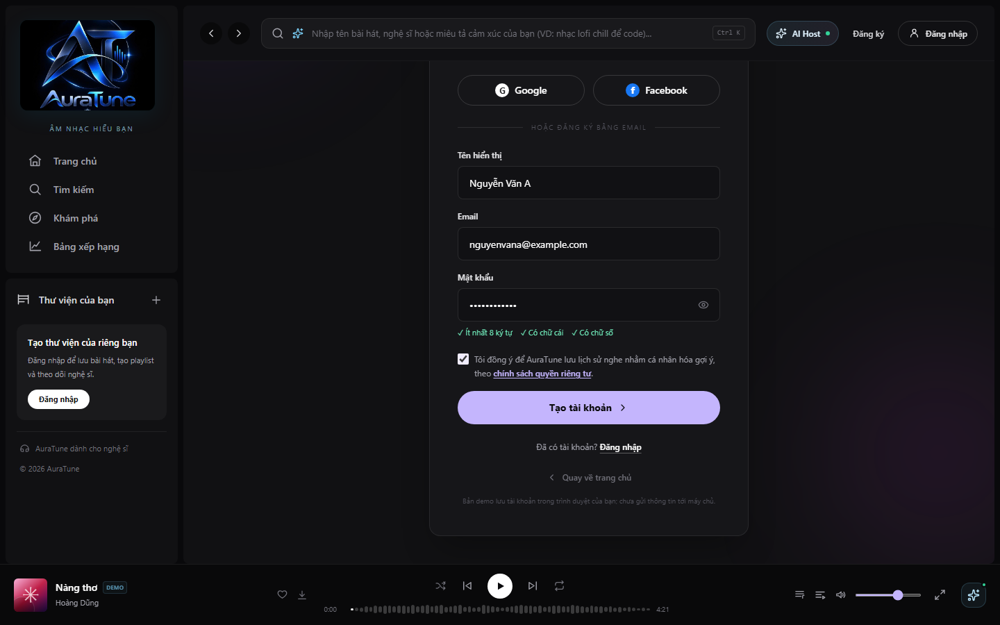

### 3. Password Visibility Toggle

Corresponding User Story: User Story 1 – New User Registration.

This screenshot demonstrates the password visibility toggle functionality, allowing users to unmask and verify their entered password.

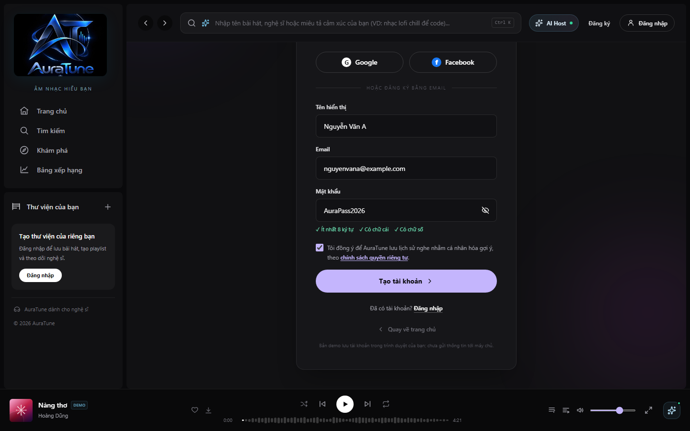

### 4. Registration Form Validation Errors

Corresponding User Story: User Story 1 – New User Registration (Edge Cases).

This screenshot shows the client-side validation errors triggered when invalid email format, weak password, or empty display name are submitted.

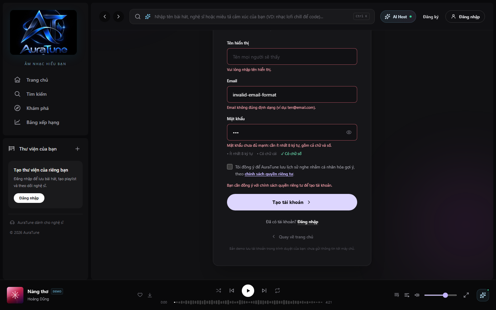

### 5. Duplicate Email Registration Error

Corresponding User Story: User Story 1 – New User Registration (Acceptance Scenario 2).

This screenshot shows the error state when attempting to register with an email address that is already registered in the system ("Email đã được sử dụng.").

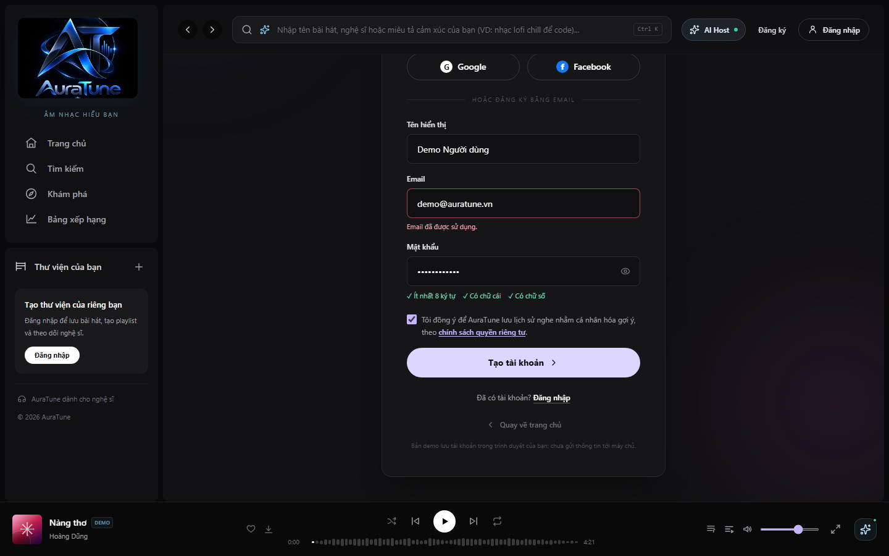

### 6. Successful Registration & Home Redirect

Corresponding User Story: User Story 1 – New User Registration (Acceptance Scenario 1).

This screenshot shows successful registration feedback (toast notification) and immediate redirection to the authenticated home page without requiring email verification.

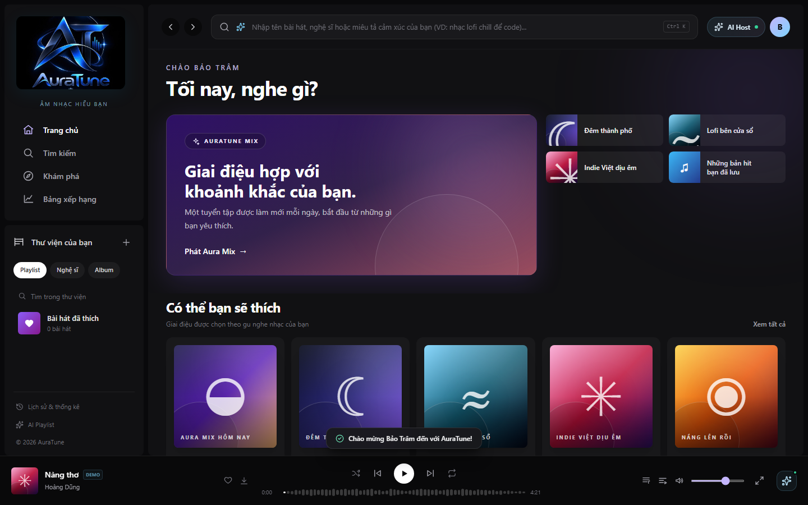

### 7. Login Page - Initial State

Corresponding User Story: User Story 2 – User Login.

This screenshot shows the local authentication login page in its default state, displaying email and password fields, remember me checkbox, and quick demo credentials.

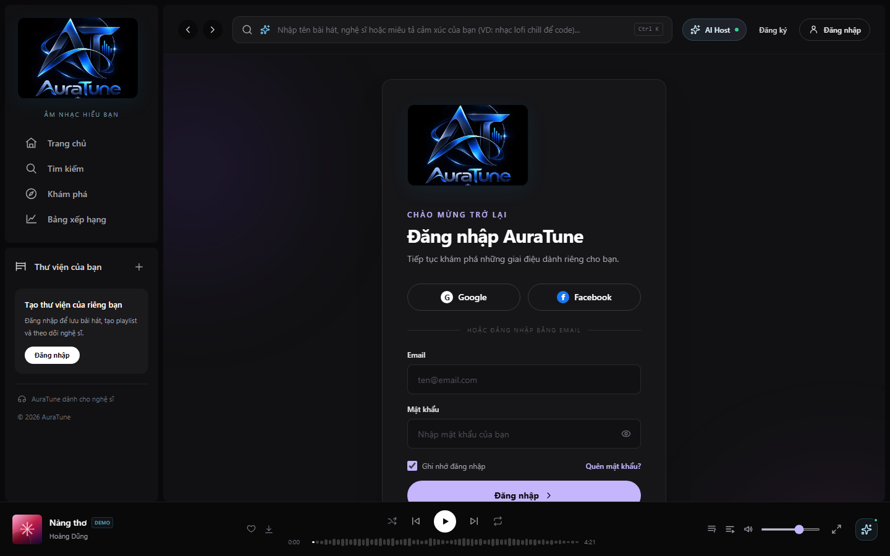

### 8. Login Form - Valid Input

Corresponding User Story: User Story 2 – User Login.

This screenshot shows the login form filled with valid credentials ready for submission.

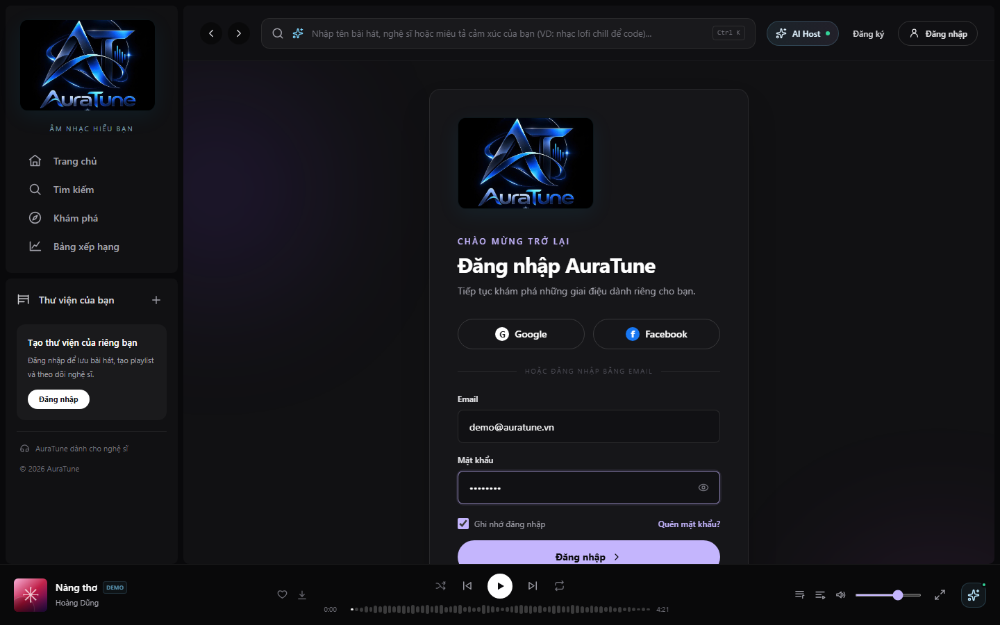

### 9. Login Error - Invalid Credentials

Corresponding User Story: User Story 2 – User Login (Acceptance Scenario 2).

This screenshot shows the error alert displayed upon entering incorrect credentials, indicating remaining attempts before temporary lockout.

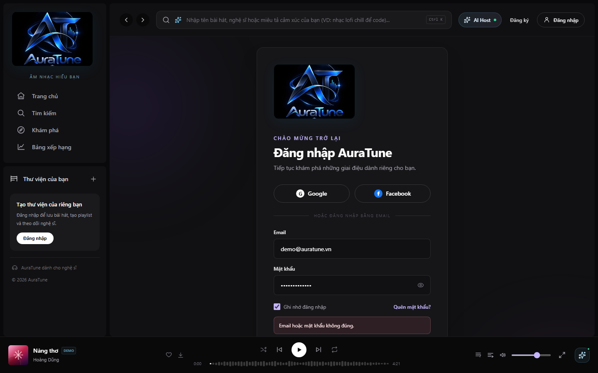

### 10. Login Error - Account Temporarily Locked

Corresponding User Story: User Story 2 – User Login (Acceptance Scenario 3 & Edge Cases).

This screenshot shows the account lockout security alert triggered after 5 consecutive failed login attempts, preventing further brute-force attempts.

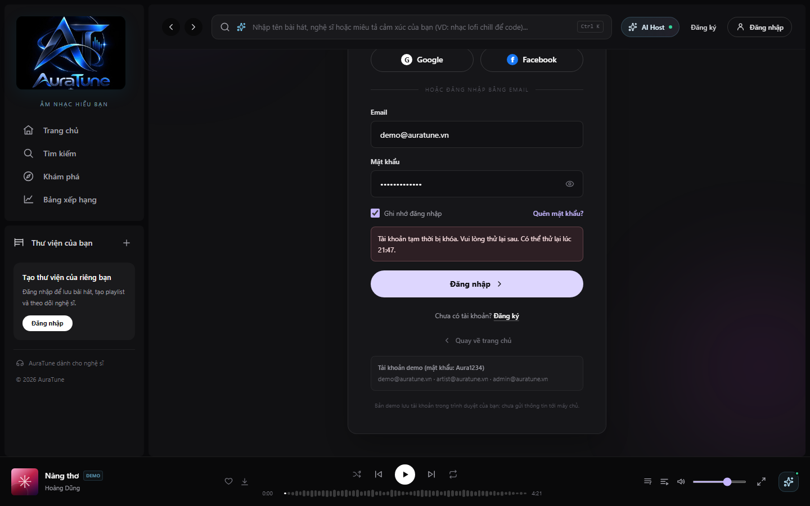

### 11. Successful Login & Home Navigation

Corresponding User Story: User Story 2 – User Login (Acceptance Scenario 1).

This screenshot shows the authenticated home view following successful login, featuring the user profile avatar in the navigation bar and confirmation toast.

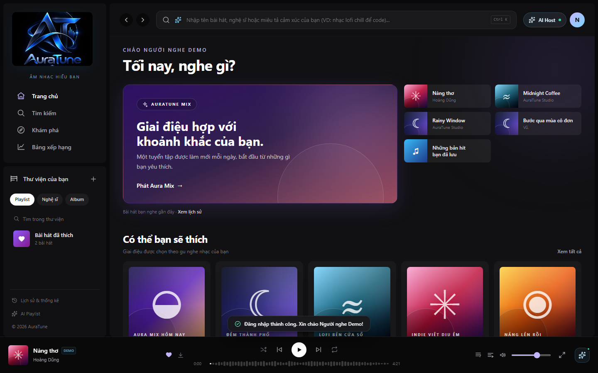

### 12. Role-Based Navigation - User Role

Corresponding User Story: User Story 3 – Role-Based Access.

This screenshot shows the user account dropdown menu for a standard 'user' role account ("Người nghe"), presenting library, liked songs, following, and history navigation.

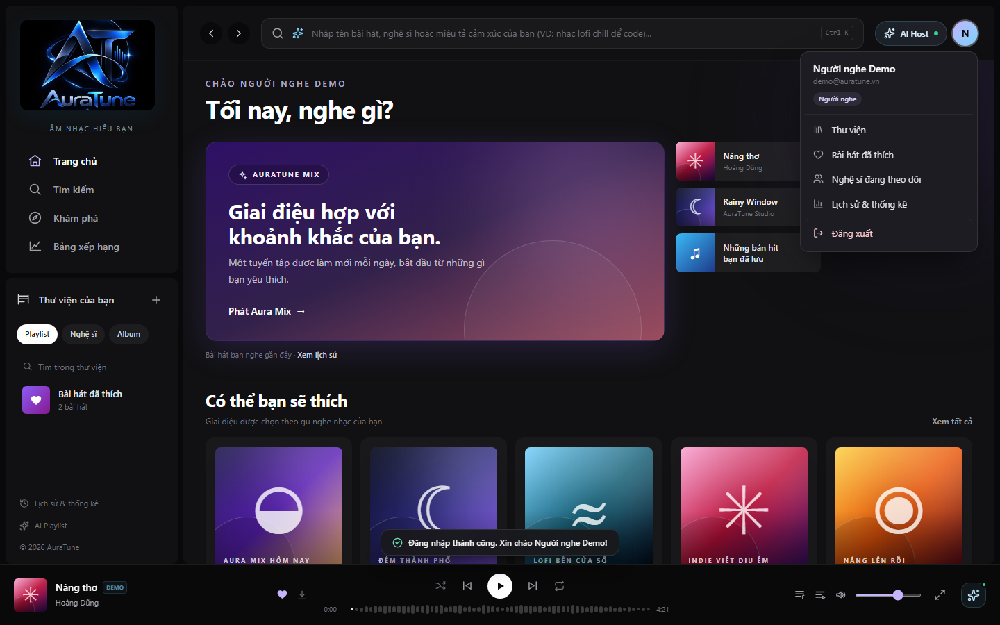

### 13. Role-Based Navigation - Artist Role

Corresponding User Story: User Story 3 – Role-Based Access (Acceptance Scenario 1).

This screenshot shows role recognition for an 'artist' account ("Nghệ sĩ"), displaying the dedicated "Artist Studio" access points in the user menu and sidebar.

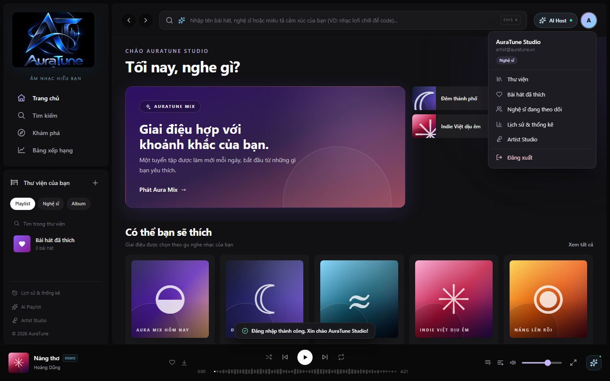

### 14. Artist Studio Dashboard

Corresponding User Story: User Story 3 – Role-Based Access.

This screenshot shows the Artist Studio dashboard accessed by an authenticated artist account, enabling music catalog and release management.

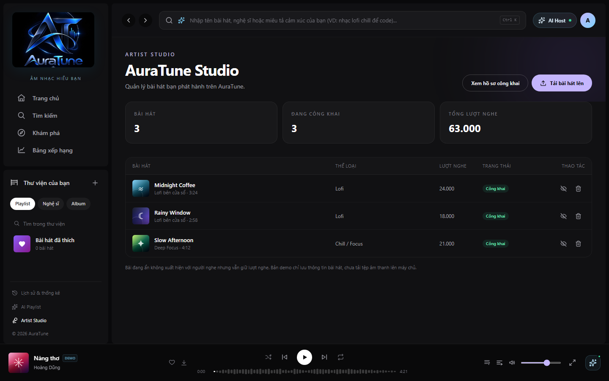

### 15. Role-Based Navigation - Admin Dashboard

Corresponding User Story: User Story 3 – Role-Based Access.

This screenshot shows the AuraTune admin dashboard accessible to users with the 'admin' role, displaying platform statistics and moderation controls.

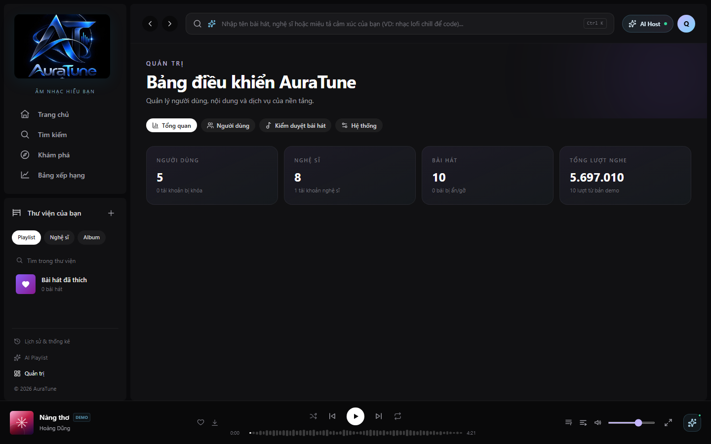
