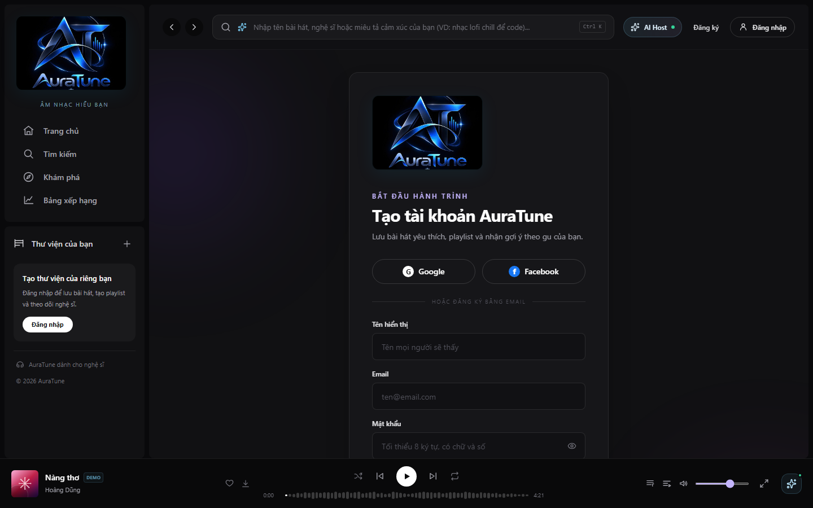
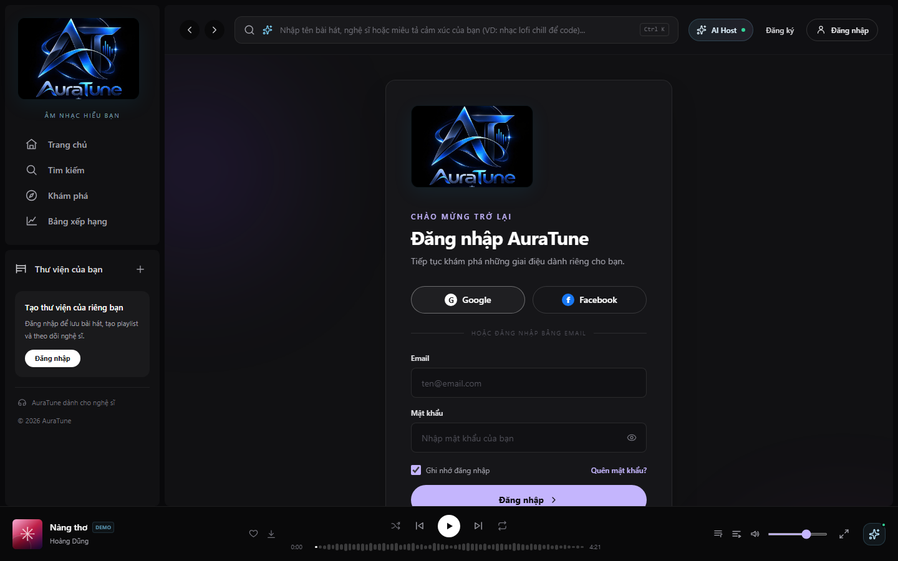
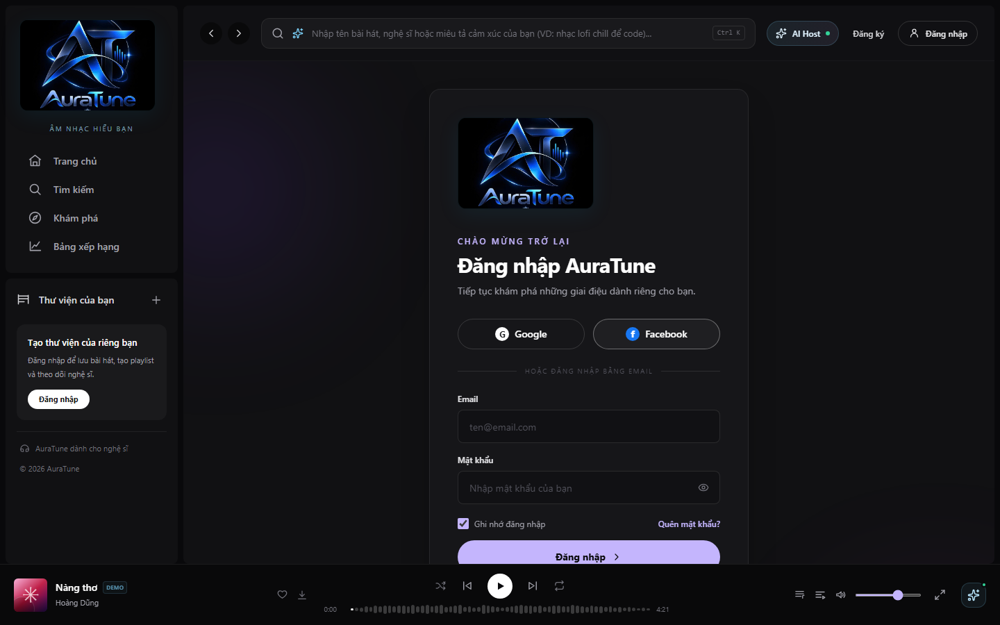

# Feature Specification: OAuth Authentication

**Feature Branch**: `012-oauth-authentication`

**Created**: 2026-10-29

**Status**: Draft

**Input**: User description: "Đặc tả tính năng OAuth Authentication (012) cho AuraTune. Tính năng này mở rộng hệ thống xác thực để cho phép người dùng đăng nhập nhanh chóng thông qua các nhà cung cấp bên thứ ba. Yêu cầu cụ thể: 1. Nhà cung cấp (Providers): Hỗ trợ đăng nhập qua Google và Facebook (theo Vision Document AD-07). 2. Quy trình (Flow): Người dùng được điều hướng đến trang của Provider. Sau khi xác thực thành công, Provider trả về code/token. Hệ thống AuraTune xử lý callback, lấy thông tin người dùng (email, display name, avatar). Nếu email chưa tồn tại, tự động tạo tài khoản mới với role mặc định là 'user'. Nếu email đã tồn tại, liên kết phiên đăng nhập với tài khoản hiện có. 3. Liên kết tài khoản (Account Linking): Cho phép một email duy nhất có thể đăng nhập bằng cả Local Password và OAuth mà không tạo trùng lặp bản ghi (dựa trên email UNIQUE). 4. Lưu trữ: Cần cập nhật bảng 'users' hoặc bảng liên quan để lưu trữ OAuth Provider ID và trạng thái liên kết. 5. Tiêu chí chấp nhận: Đăng nhập thành công trả về JWT access token tương tự như Local Auth. Thông tin người dùng (tên, avatar) từ Provider được cập nhật vào profile AuraTune trong lần đăng nhập đầu tiên. Xử lý các lỗi như người dùng hủy đăng nhập tại trang Provider hoặc Provider service bị gián đoạn. Ràng buộc: Tuân thủ cấu trúc database hiện tại. Đảm bảo tính bảo mật khi truyền tải token (HTTPS/TLS 1.3). Không gửi định danh cá nhân trực tiếp cho các dịch vụ AI bên ngoài (Security Requirement 6.2)."

## Clarifications

### Session 2026-10-29

- Q: How should AuraTune handle updates to a user's avatar or display name if they change it on the OAuth provider side after their initial registration? → A: Sync on Every Login: Update the AuraTune profile with provider data every time the user logs in.
- Q: Should users be able to unlink their Google or Facebook account from their AuraTune account through the application's user settings? → A: Conditional Unlinking: Allow users to disconnect a provider as long as they have another way to log in (Local Password or another OAuth provider).
- Q: Should AuraTune store the third-party OAuth access and refresh tokens returned by Google/Facebook for future background operations? → A: Auth-Only: Use tokens strictly for authentication and profile sync during the session to minimize security risks.

## User Scenarios & Testing *(mandatory)*

### User Story 1 - Fast Registration via Google/Facebook (Priority: P1)

As a new user, I want to sign up for AuraTune using my Google or Facebook account so that I don't have to fill out a registration form or remember another password.

**Why this priority**: Crucial for user acquisition and lowering the barrier to entry.

**Independent Test**: Can be tested by initiating the OAuth flow with a new Google/Facebook account and verifying that a new AuraTune account is created and logged in.

**Acceptance Scenarios**:

1. **Given** a guest user on the login page, **When** they click "Login with Google", **Then** they are redirected to Google's authentication page.
2. **Given** a guest user completes Google authentication, **When** they are redirected back to AuraTune, **Then** a new account is created with their Google email, display name, and avatar, and they receive a JWT access token.
3. **Given** a guest user completes Facebook authentication, **When** they are redirected back to AuraTune, **Then** a new account is created with their Facebook email, display name, and avatar, and they receive a JWT access token.

---

### User Story 2 - Account Linking for Existing Users (Priority: P1)

As an existing user with a local account, I want to log in using my Google or Facebook account (with the same email) so that I can access my account more conveniently.

**Why this priority**: Prevents duplicate accounts and ensures a seamless experience for existing users who want to switch to OAuth.

**Independent Test**: Can be tested by creating a local account first, then attempting to log in via OAuth with the same email and verifying they are logged into the same account.

**Acceptance Scenarios**:

1. **Given** an existing user with email `user@example.com` and a local password, **When** they log in via Google with the same email, **Then** their OAuth ID is linked to the existing account, and they are logged in successfully.
2. **Given** an account linked to both Local and Google auth, **When** the user logs in with either method, **Then** they access the same profile and data.

---

### User Story 3 - Profile Synchronization (Priority: P2)

As a user logging in via OAuth, I want my AuraTune profile to automatically sync my name and avatar from the provider so that my profile is always up to date.

**Why this priority**: Enhances the user experience and ensures profile consistency across platforms.

**Independent Test**: Verify that changing the display name or avatar URL on the OAuth provider and logging back into AuraTune updates the corresponding fields in the AuraTune database.

**Acceptance Scenarios**:

1. **Given** a user logging in via OAuth, **When** the authentication completes, **Then** their AuraTune profile is updated with the current name and avatar URL from the provider.

---

### User Story 4 - Unlinking Social Accounts (Priority: P3)

As a user, I want to be able to disconnect my Google or Facebook account from my AuraTune profile so that I can manage my privacy and linked identities.

**Why this priority**: Important for user control and privacy, though less critical than the core login flow.

**Independent Test**: Verify that a user with two authentication methods can successfully remove one, and verify that they can still log in using the remaining method.

**Acceptance Scenarios**:

1. **Given** a user with both Google and Local authentication linked, **When** they click "Unlink Google" in settings, **Then** the link is removed, and they can still log in with their password.
2. **Given** a user with ONLY Google authentication linked, **When** they attempt to unlink Google, **Then** the system prevents the action and explains that they need another login method first.

---

### Edge Cases

- **User Cancels Authentication**: What happens when the user clicks "Cancel" on the Google/Facebook login page? The system should redirect back to the AuraTune login page with a user-friendly error message.
- **Provider Service Interruption**: How does the system handle cases where Google or Facebook services are down? The system should display a message indicating that social login is temporarily unavailable and suggest local login.
- **Email Conflict (Different Providers)**: What happens if a user tries to log in with Google and then later with Facebook using the same email? The system should link both providers to the same account based on the unique email.
- **Incomplete Provider Data**: What if the provider does not return a display name or avatar? The system should use the email prefix as a default display name and a placeholder avatar.

## Requirements *(mandatory)*

### Functional Requirements

- **FR-001**: System MUST support OAuth 2.0 / OpenID Connect integration with Google.
- **FR-002**: System MUST support OAuth 2.0 integration with Facebook.
- **FR-003**: System MUST provide a callback endpoint to handle responses from OAuth providers.
- **FR-004**: System MUST retrieve user email, display name, and avatar URL from the OAuth provider upon successful authentication.
- **FR-005**: System MUST automatically create a new user record with role 'user' if the retrieved email does not exist in the database.
- **FR-006**: System MUST link the OAuth Provider ID to the user record.
- **FR-007**: System MUST ensure that a single email address is unique across all authentication methods (Local, Google, Facebook).
- **FR-008**: System MUST issue a JWT access token upon successful OAuth login, identical in format and permissions to the local authentication token.
- **FR-009**: System MUST use HTTPS/TLS 1.3 for all communications with OAuth providers and token transmissions.
- **FR-010**: System MUST NOT send user PII to external AI services during the authentication flow.
- **FR-011**: System MUST allow users to unlink an OAuth provider if at least one other authentication method remains.

### Key Entities *(include if feature involves data)*

- **User**: Represents the application user.
    - `email` (Unique): Primary identifier for account linking.
    - `display_name`: User's name shown in the UI.
    - `avatar_url`: Link to user's profile picture.
    - `role`: Defaulted to 'user'.
- **OAuthLink**: Represents the connection between a user and an OAuth provider.
    - `user_id`: Reference to the User entity.
    - `provider`: String identifier (e.g., 'google', 'facebook').
    - `provider_user_id`: Unique ID provided by the third party.

## Success Criteria *(mandatory)*

### Measurable Outcomes

- **SC-001**: Users can complete the entire OAuth login flow in under 20 seconds (excluding provider-side interactions).
- **SC-002**: 100% of successful OAuth logins result in a valid JWT access token.
- **SC-003**: 100% of OAuth logins correctly sync the display name and avatar URL if they have changed at the provider.
- **SC-004**: 0% duplicate accounts created for the same email address across different providers.

## Assumptions

- **HTTPS Setup**: Assumes the production and staging environments are already configured with valid SSL certificates supporting TLS 1.3.
- **Provider Availability**: Assumes Google and Facebook Developer consoles are accessible for creating Client IDs and Secrets.
- **Database Support**: Assumes the existing database schema can be extended with a new `oauth_links` table or additional columns in `users`.
- **JWT Implementation**: Assumes the existing JWT generation logic for Local Auth is reusable for OAuth.
- **Token Storage**: Assumes third-party access tokens and refresh tokens will not be persisted in the database beyond the immediate authentication session.

## UI Screenshots

### 1. OAuth Login Options (Login Page)

Corresponding User Story: User Story 1 – Fast Registration via Google/Facebook.

This screenshot shows the Google and Facebook OAuth authentication buttons displayed on the AuraTune login page, offering fast third-party sign-in alongside local email credentials.

### 2. OAuth Registration Options (Registration Page)

Corresponding User Story: User Story 1 – Fast Registration via Google/Facebook.

This screenshot shows the Google and Facebook OAuth buttons placed at the top of the registration page, allowing new listeners to sign up directly via social providers without filling the manual registration form.

### 3. Google OAuth Provider Selection

Corresponding User Story: User Story 1 – Fast Registration via Google/Facebook (Acceptance Scenario 1).

This screenshot demonstrates user interaction when selecting the Google login button. In the current frontend implementation, this displays a notice explaining that backend OAuth integration is required.

### 4. Facebook OAuth Provider Selection

Corresponding User Story: User Story 1 – Fast Registration via Google/Facebook (Acceptance Scenario 3).

This screenshot demonstrates user interaction when selecting the Facebook login button, showing the current application status notice indicating demo mode pending backend OAuth endpoints.

