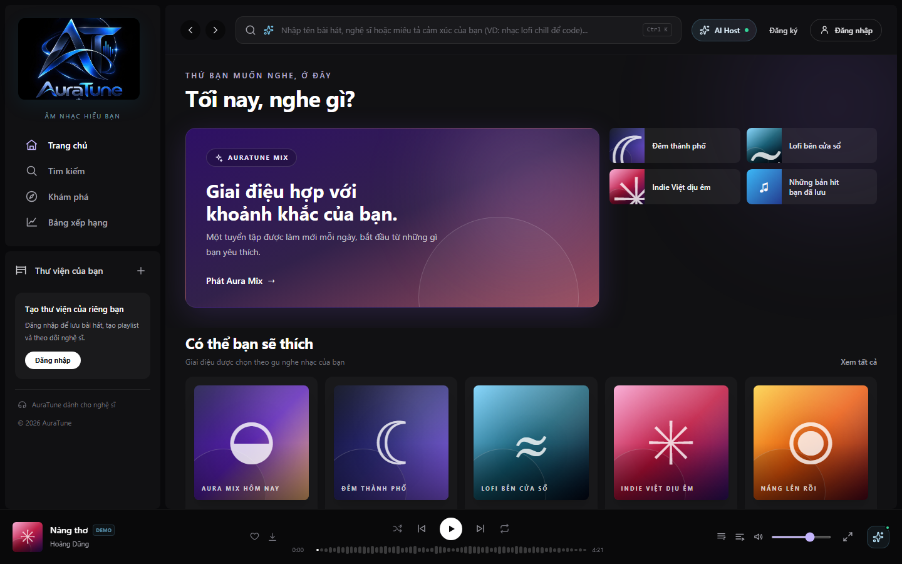
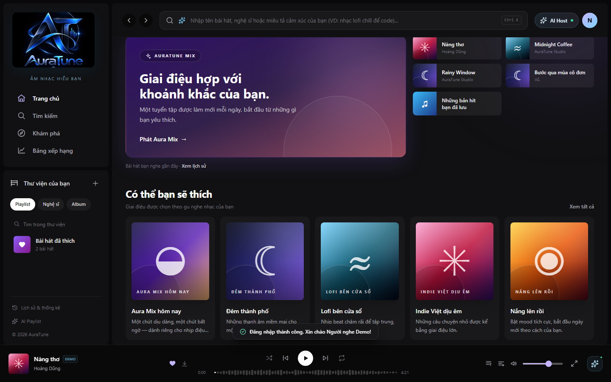
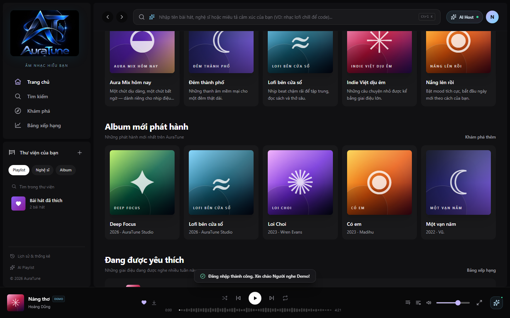
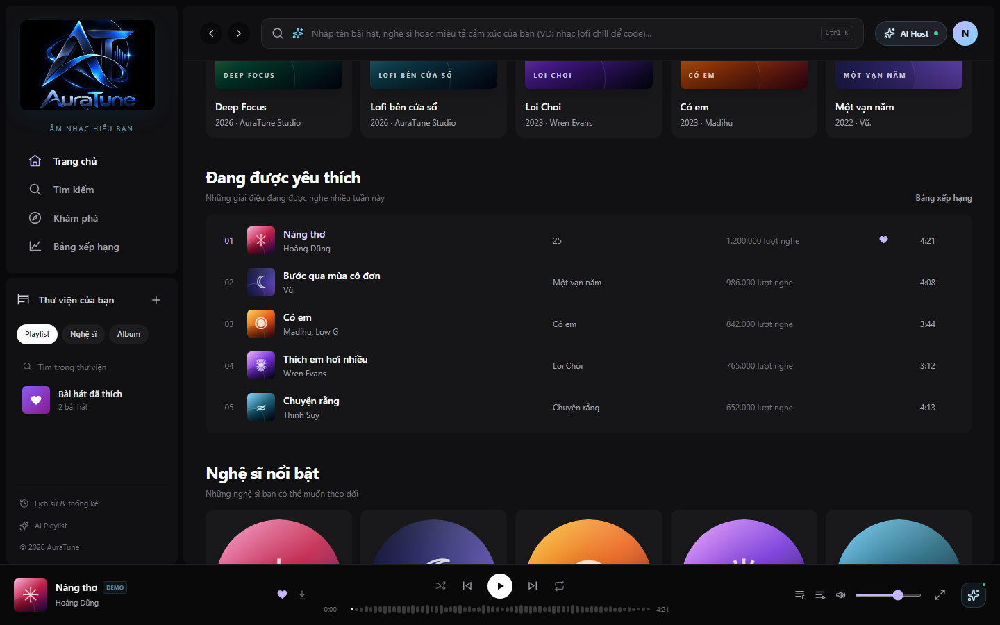
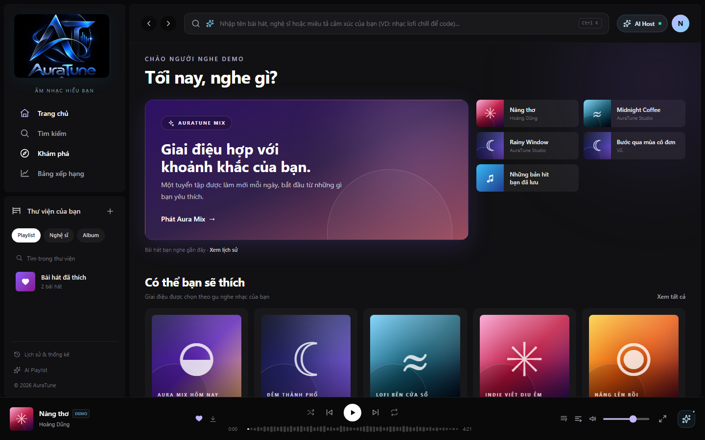

# Feature Specification: Home Content Layout

**Feature ID**: `021-home-content-layout`  
**Functional Group**: `020 – Home Dashboard`  
**Status**: Specification Missing / Pending (Frontend UI Documented)

> [!NOTE]
> The formal feature specification (`spec.md`, `plan.md`, `tasks.md`) for Feature 021 was not previously authored or committed in the repository.
> In accordance with project constraints, no artificial business requirements or synthetic acceptance criteria have been invented.
> The UI screenshots and workflows documented below reflect the actual frontend implementation discovered at `src/frontend/src/pages/Home/HomePage.jsx` and its associated components, cross-referenced with `docs/proposal/proposal.md` and `docs/design/architecture/feature-modules.md`.

---

## Documented Project Context

- **Proposal Reference**: `docs/proposal/proposal.md` (§ 6.2 Home Dashboard):
  "The home dashboard serves as a personalized music discovery hub, automatically aggregating AI-recommended playlists, trending charts, and recently played tracks into a single, organized interface."
- **Architecture Reference**: `docs/design/architecture/feature-modules.md` (§ 1 & § 3):
  "020 Home Dashboard: tổ chức nội dung trang chủ, có thể tổng hợp dữ liệu từ các module nội dung... Search, Recommendations, Album, Artist | Tổng hợp và điều hướng nội dung."
- **Navigation Reference**: `docs/design/architecture/role-navigation.md`:
  Home Dashboard provides entry navigation for both unauthenticated visitors (public exploration) and authenticated users (personalized greeting and access points).
- **Frontend Implementation**:
  - Route: `/` (managed by `AppRouter.jsx`)
  - Page Component: `src/frontend/src/pages/Home/HomePage.jsx`
  - Shared Shell: `Sidebar.jsx`, `TopBar.jsx`, `BottomPlayer.jsx`, `FullScreenPlayer.jsx`

---

## UI Screenshots

### 1. Home Dashboard Initial View (Guest State)

This screenshot captures the initial Home Dashboard view for a guest / unauthenticated visitor at standard desktop viewport (1440 × 900). It showcases the primary layout structure comprising the left sidebar navigation, top search and authentication bar, central content area with hero banner and quick access cards, and persistent bottom music player.

### 2. Home Dashboard Authenticated View

This screenshot displays the Home Dashboard view when a listener is authenticated (logged in as `demo@auratune.vn`). The hero greeting adapts dynamically to "Chào Người nghe Demo", the user profile avatar appears in the top navigation bar, and personal listening history quick cards populate the top access grid.

### 3. Home Content Organization - Top and Recommended Sections

This screenshot captures the upper section layout of the Home Dashboard, demonstrating clear visual hierarchy and consistent spacing. Elements include the AURATUNE MIX interactive hero card, the "Có thể bạn sẽ thích" recommended playlist card grid, and the "Album mới phát hành" newly released album grid.

### 4. Home Content Organization - Mid Sections (Trending and Featured Artists)

This screenshot displays the middle section of the Home Dashboard content flow. It features the "Đang được yêu thích" trending charts widget with numbered ranking rows (01–05), song metadata, play counts, and duration, followed by the "Nghệ sĩ nổi bật" circular avatar grid.

### 5. Home Content Organization - Bottom Sections (Curated Playlists and Genres)

This screenshot captures the lower section of the Home Dashboard layout, showing the "Tuyển tập dành cho bạn" mood playlist cards and the colorful 6-column "Thể loại" (Genres) tile grid, providing rich music exploration avenues.

### 6. Home Navigation and Section Exploration

This screenshot documents user interaction and navigation between Home Dashboard and platform sections. It shows sidebar menu interaction ("Khám phá", "Bảng xếp hạng", "Thư viện") and section action controls ("Xem tất cả", "Khám phá thêm") enabling rapid navigation across the application.

