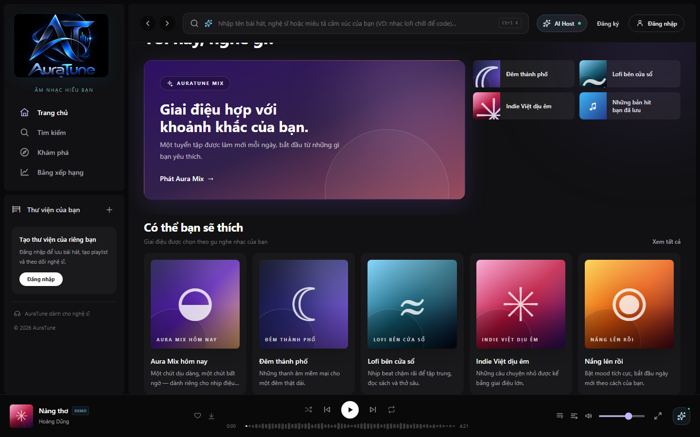
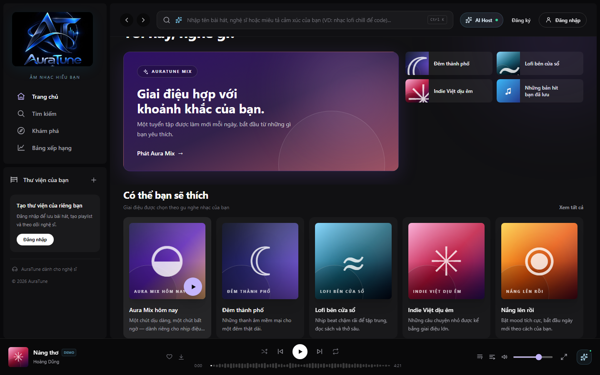
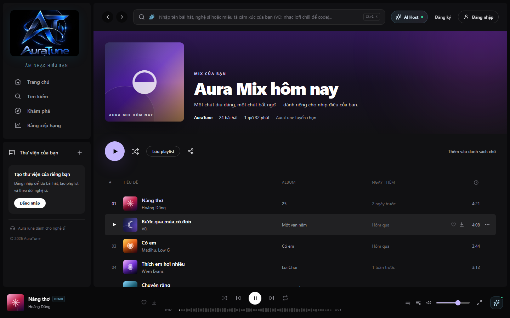
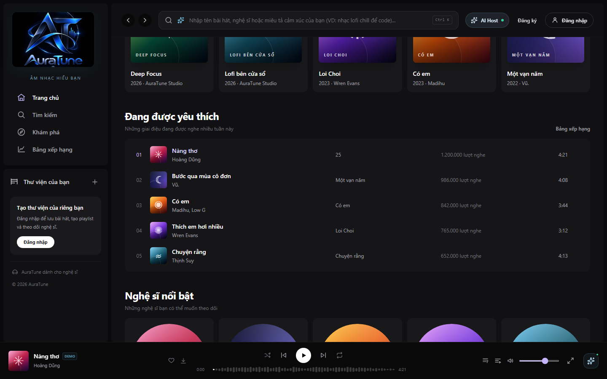
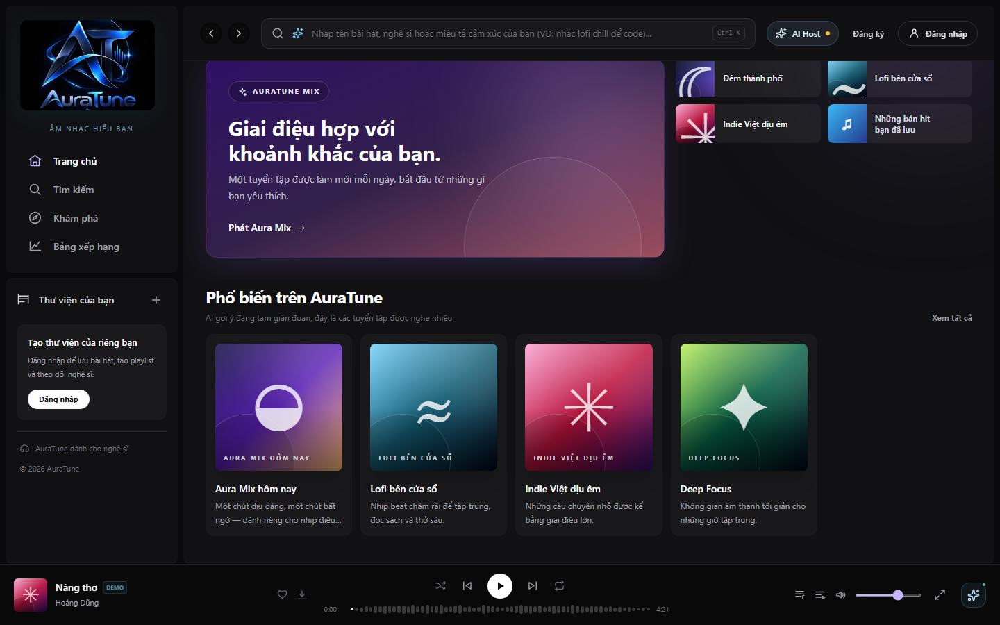

# Feature Specification: Recommended Content

**Feature ID**: `022-recommended-content`  
**Functional Group**: `020 – Home Dashboard`  
**Status**: Specification Missing / Pending (Frontend UI Documented)

> [!NOTE]
> The formal feature specification (`spec.md`, `plan.md`, `tasks.md`) for Feature 022 was not previously authored or committed in the repository.
> In accordance with project constraints, no artificial business requirements or synthetic acceptance criteria have been invented.
> The UI screenshots and workflows documented below reflect the actual frontend implementation discovered at `src/frontend/src/pages/Home/HomePage.jsx` and `src/frontend/src/components/playlist/PlaylistCard.jsx`, cross-referenced with `docs/proposal/proposal.md` and `docs/analysis-and-design/api-contract.md`.

---

## Documented Project Context

- **Proposal Reference**: `docs/proposal/proposal.md` (§ 5.1 & § 6.2):
  "Home dashboard — view AI-recommended songs and playlists... automatically aggregating AI-recommended playlists, trending charts, and recently played tracks into a single, organized interface."
- **API Contract Reference**: `docs/analysis-and-design/api-contract.md`:
  - `GET /recommendations/songs` (Role: User, AI-recommended songs)
  - `GET /playlists` (Role: Public, Public and recommended playlists)
- **Data Source & AI Service Disclosure**:
  In the current frontend implementation, recommended playlists and tracks are provided via seed mock datasets in `mockData.js` and managed through `AppStore.jsx`. Group 020 owns the presentation, categorization, and playback invocation of recommended content on the Home Dashboard. It does NOT generate or manage the deep learning recommendation models belonging to Functional Group 100 (AI Recommendation Engine).
- **Graceful Fallback Handling**:
  The frontend includes built-in fallback handling (`aiAvailable` state). When AI recommendation services are unavailable, the dashboard dynamically transitions the recommendation section to "Phổ biến trên AuraTune" and serves popular official playlists.

---

## UI Screenshots

### 1. Recommended Content Overview

This screenshot showcases the primary recommendation sections on the Home Dashboard. At the top, the interactive "AURATUNE MIX" hero banner presents a personalized daily curation ("Giai điệu hợp với khoảnh khắc của bạn"), followed immediately by the "Có thể bạn sẽ thích" recommendation grid with algorithmically suggested playlists.

### 2. Recommended Playlist Card Focus and Hover

This screenshot illustrates user interaction when hovering over an AI-recommended playlist card ("Giai điệu Chữa Lành"). The card highlights with subtle background elevation, displaying the playlist title, personalized description, and an elevated violet play button ready for instant playback.

### 3. Recommended Playlist Direct Playback

This screenshot documents the playback workflow triggered directly from recommended content ("Phát Aura Mix"). Playback begins immediately, updating the persistent BottomPlayer with the current track title, artist, audio controls, and duration indicator.

### 4. Recommended Playlist Detail Navigation

This screenshot demonstrates navigation from a recommended playlist card to its full Playlist Detail view (`/playlist/auratune-mix-1`). The full view displays curated artwork, total song count, estimated duration, complete track listing, and collaborative action controls.

### 5. Curated Mood Collections Category

This screenshot captures the mood and contextual recommendation category titled "Tuyển tập dành cho bạn" ("Mood nào cũng có một playlist vừa vặn"). It presents a diverse grid of situational playlists (Coffee & Chill, Night Ride, Gym & Energy) tailored to listener activities.

### 6. Recommendation Offline Fallback State

This screenshot documents the frontend's graceful degradation behavior when the AI recommendation service is offline or unreachable (`aiAvailable = false`). The section automatically adjusts its title to "Phổ biến trên AuraTune" with the descriptive notice: "AI gợi ý đang tạm gián đoạn, đây là các tuyển tập được nghe nhiều", ensuring continuous music discovery without breaking the layout.

