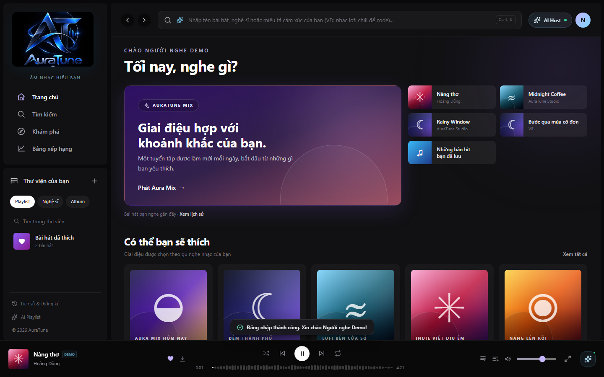
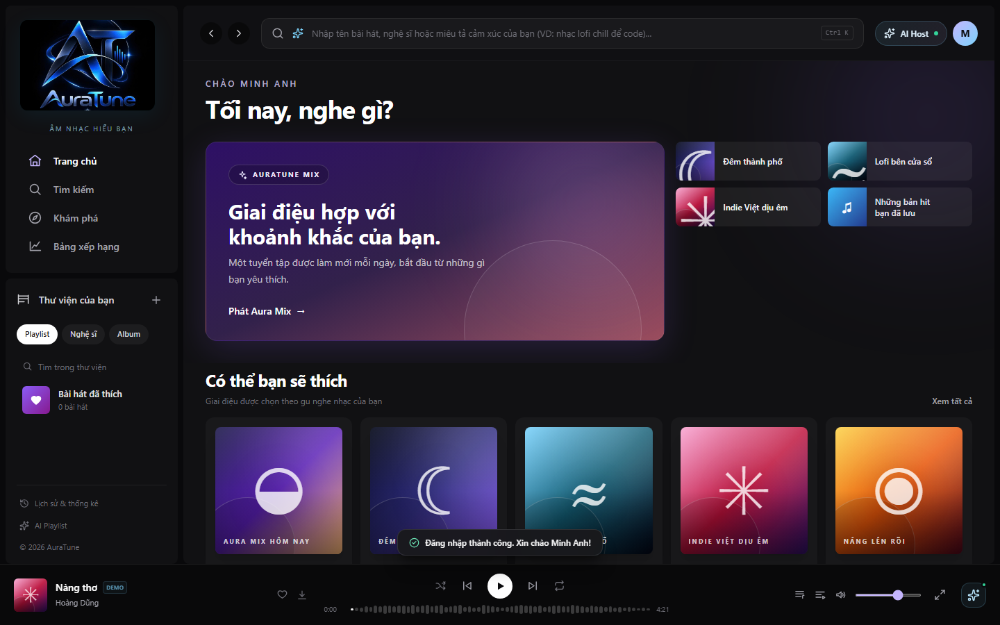
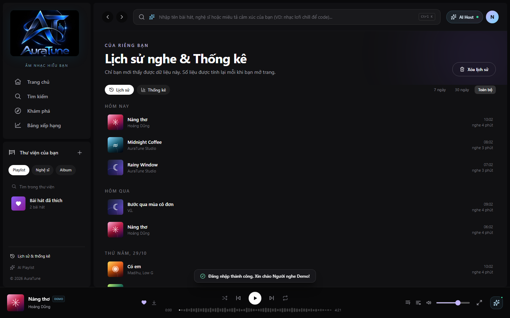

# Feature Specification: Recently Played

**Feature ID**: `023-recently-played`  
**Functional Group**: `020 – Home Dashboard`  
**Status**: Specification Missing / Pending (Frontend UI Documented)

> [!NOTE]
> The formal feature specification (`spec.md`, `plan.md`, `tasks.md`) for Feature 023 was not previously authored or committed in the repository.
> In accordance with project constraints, no artificial business requirements or synthetic acceptance criteria have been invented.
> The UI screenshots and workflows documented below reflect the actual frontend implementation discovered at `src/frontend/src/pages/Home/HomePage.jsx` and `src/frontend/src/pages/History/HistoryPage.jsx`, cross-referenced with `docs/proposal/proposal.md` and `docs/design/architecture/feature-modules.md`.

---

## Documented Project Context

- **Proposal Reference**: `docs/proposal/proposal.md` (§ 5.1 & § 6.2):
  "Home dashboard — view recent plays... allowing listeners to instantly jump back into familiar music the moment they open the app."
- **Data Ownership & Module Separation**:
  Group 020 owns the presentation, quick-access display, and immediate playback resumption of recently played tracks directly from the Home Dashboard. Group 020 does NOT duplicate or implement the underlying streaming telemetry, analytics aggregation, or history management belonging to Functional Group 070 (Listening Analytics).
- **Frontend Implementation**:
  - Home Dashboard Component: `src/frontend/src/pages/Home/HomePage.jsx`
  - History Component: `src/frontend/src/pages/History/HistoryPage.jsx`
  - Integration: `useStore()` reading `library.history`, computing distinct playable tracks, and routing to `/history`.
- **Mock Data Disclosure**:
  In the current frontend implementation, listening history entries are seeded via `seedHistory` in `src/frontend/src/context/AppStore.jsx` and updated locally via browser `localStorage`. Real database persistence will be wired to backend history endpoints upon server integration.

---

## UI Screenshots

### 1. Recently Played Section (Authenticated User)

This screenshot captures the Recently Played quick-access grid on the Home Dashboard when an authenticated user is logged in (`demo@auratune.vn`). The top grid populates with recently listened tracks, displaying cover artwork, track title, artist name, and a dedicated status prompt: "Bài hát bạn nghe gần đây · Xem lịch sử".

### 2. Recently Played Direct Playback Interaction

This screenshot documents the direct playback workflow from the Recently Played grid. Clicking a recent track card immediately initiates playback, updating the persistent BottomPlayer with the song's details, real-time playback progress, and audio controls.

### 3. Recently Played Guest State (Unauthenticated Visitor)

This screenshot illustrates the Home Dashboard quick-access area when visited by an unauthenticated guest. In the absence of an authenticated user session and personal history, the system displays starter playlists and a prompt to explore saved music upon login.

### 4. Recently Played Empty History State

This screenshot captures the interface state for a newly registered or authenticated user without any recorded listening history (`minhanh@example.com`). The section displays curated starter options without claiming non-existent playback history.

### 5. Navigation to Full Listening History

This screenshot documents the navigation path from the Home Dashboard "Xem lịch sử" action to the full History Page (`/history`). The dedicated history interface displays detailed playback timestamps ("Hôm nay", "Hôm qua"), total listening duration, and listening statistics.

