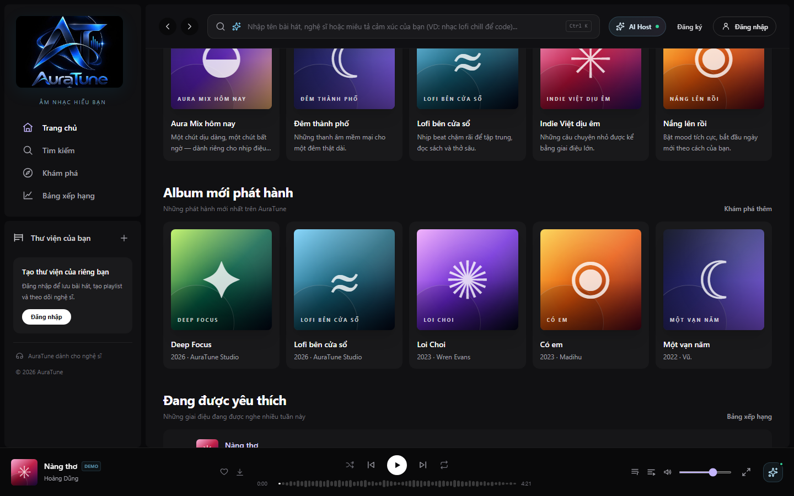
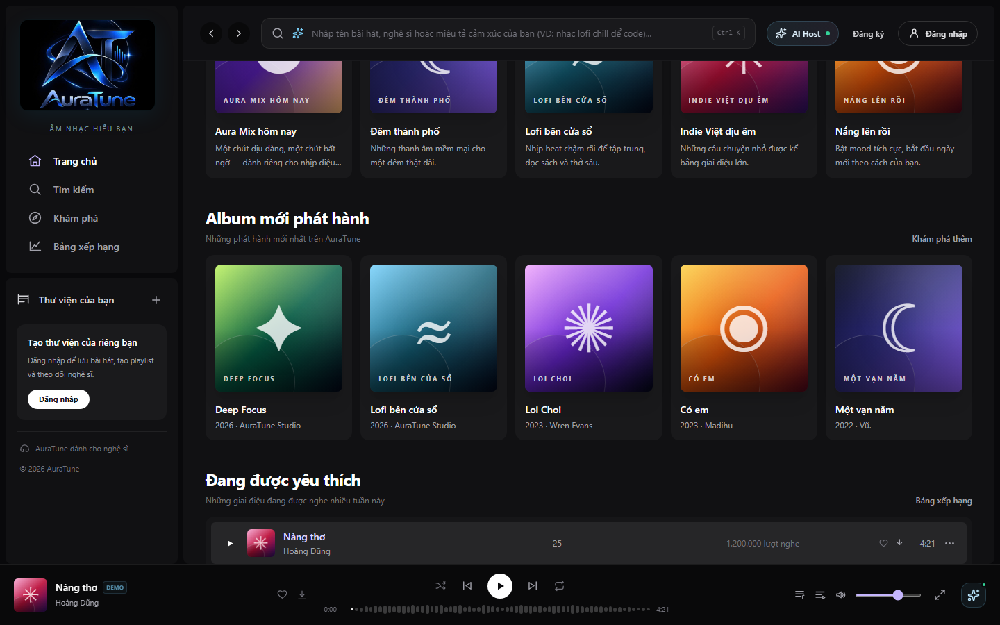
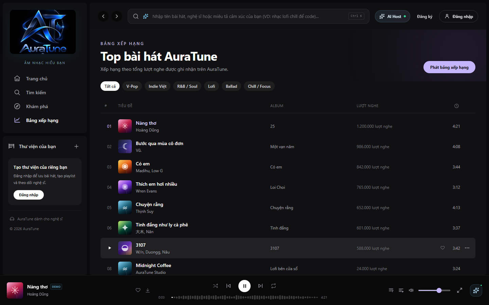

# Feature Specification: Trending Charts

**Feature Branch**: `020-home-player-queue-spec`

**Created**: 2026-10-31

**Status**: Draft — Ready for Planning

**Input**: User description: "Feature 024 defines popular tracks on Home and the full Charts page. Rankings use AuraTune's own play counts, as stated in the Vision Document, and never use external popularity data."

## Clarifications

### Session 2026-10-31

- Q: What determines a track's rank? → A: AuraTune's own recorded play counts, highest first. Ties use a stable order so the list does not shuffle between loads.
- Q: How many tracks are shown? → A: The top 5 on Home and the top 20 on the Charts page.
- Q: Which chart periods are supported? → A: Day, week, and month, as defined by the API Contract. Week is the default, matching the Home section wording.
- Q: Can charts be filtered? → A: Yes, the Charts page can be filtered by genre.

## User Scenarios & Testing *(mandatory)*

### User Story 1 - See What Is Popular on Home (Priority: P1)

As a listener, I want a short list of popular tracks on Home so that I can see what others are listening to.

**Why this priority**: Trending content is part of the Home scope in the proposal.

**Independent Test**: Open Home and confirm 5 ranked tracks appear with rank, title, artist, plays, and duration.

**Acceptance Scenarios**:

1. **Given** popular tracks exist, **When** I open Home, **Then** I see the top 5 in rank order.
2. **Given** a ranked track, **When** I play it, **Then** the ranked list becomes the queue.

---

### User Story 2 - Browse the Full Chart (Priority: P2)

As a listener, I want a full Charts page so that I can explore more ranked tracks.

**Why this priority**: The full chart extends the Home preview.

**Independent Test**: Open Charts from Home, change the genre and period, and confirm the ranking updates.

**Acceptance Scenarios**:

1. **Given** I am on Home, **When** I select the chart action, **Then** the Charts page opens.
2. **Given** I am on Charts, **When** I select a genre, **Then** only tracks in that genre are ranked.
3. **Given** I am on Charts, **When** I change the period, **Then** the ranking reflects that period.
4. **Given** I am on Charts, **When** I select play all, **Then** the ranked list plays in order.

---

### Edge Cases

- **Tied play counts**: Tied tracks keep a stable order.
- **Genre with no tracks**: The page shows an empty state.
- **Removed or hidden track**: It is left out of rankings.
- **Chart cannot load**: The page shows an error with a retry action.
- **Fewer tracks than the limit**: All available tracks are shown.

## Requirements *(mandatory)*

### Functional Requirements

- **FR-001**: The system MUST show the top 5 popular tracks on Home.
- **FR-002**: The system MUST show the top 20 tracks on the Charts page.
- **FR-003**: The system MUST rank tracks by AuraTune's own play counts in descending order.
- **FR-004**: The system MUST use a stable order for tied tracks.
- **FR-005**: The system MUST NOT use external popularity data for rankings.
- **FR-006**: The system MUST show rank, title, artist, play count, and duration for each track.
- **FR-007**: The system MUST allow filtering the Charts page by genre.
- **FR-008**: The system MUST allow selecting a day, week, or month period on the Charts page, with week as the default.
- **FR-009**: The system MUST leave unavailable tracks out of rankings.
- **FR-010**: The system MUST use the displayed ranked list as the queue when a listener plays a track from it.
- **FR-011**: The system MUST allow playing the full displayed chart in 1 interaction.
- **FR-012**: The system MUST provide an action from Home to the Charts page.
- **FR-013**: The system MUST show an empty state when a filter has no tracks and an error state with retry when loading fails.

### Key Entities *(include if feature involves data)*

- **Chart Entry**: A track with its rank, play count, and period.
- **Chart Filter**: The selected period and genre.

## Success Criteria *(mandatory)*

### Measurable Outcomes

- **SC-001**: 100% of chart lists are in descending play-count order with no unavailable tracks.
- **SC-002**: The same data always produces the same order across repeated loads.
- **SC-003**: A listener can play the full chart in 1 interaction.
- **SC-004**: Changing a genre or period updates the list without a full page reload.

## Assumptions

- Authentication and user roles are provided by group `010-authentication`.
- API alignment: `GET /songs/popular` (Public) for Home and `GET /charts/songs` (Public, `period=day|week|month`, `limit`) for Charts.
- Project documentation is maintained in English Markdown, in accordance with `docs/management/team-contract.md`.

### Known Gaps in the Current Prototype

These gaps do not change the requirements. They record where the current UI differs from this specification.

- The Charts page has no period control yet and ranks by total play count.
- The Home wording says this week, while the prototype uses total play count.

## UI Screenshots

### 1. Trending Charts Section on Home Dashboard

This screenshot captures the "Đang được yêu thích" trending charts section on the Home Dashboard. It displays the top 5 trending songs on AuraTune, featuring sequential rank numbers (01 to 05), song artwork, track title, artist link, album link, total play counts (e.g., "1.200.000 lượt nghe"), and song duration.

### 2. Trending Song Row Hover Interaction

This screenshot documents the user interaction when hovering a mouse cursor over a trending song row (#1 "Nàng thơ"). The static rank index dynamically transforms into a Play button, and action controls (like heart icon, download button) become visible for direct interaction.

### 3. Trending Song Playback Active State

This screenshot illustrates the active playback state when a trending song is selected. The active track row is prominently highlighted with violet accents, and the persistent BottomPlayer updates with the track artwork, playback progress, volume, and playback controls.

### 4. Navigation to Full Charts Page

This screenshot captures the full Charts Page view (`/charts`) reached by clicking the "Bảng xếp hạng" action in the section header. The dedicated charts page presents the complete Top bài hát AuraTune rankings, genre filtering tabs ("Tất cả", "Pop", "Ballad", "Indie", "R&B", "Hip-hop"), and a "Phát bảng xếp hạng" batch playback button.

