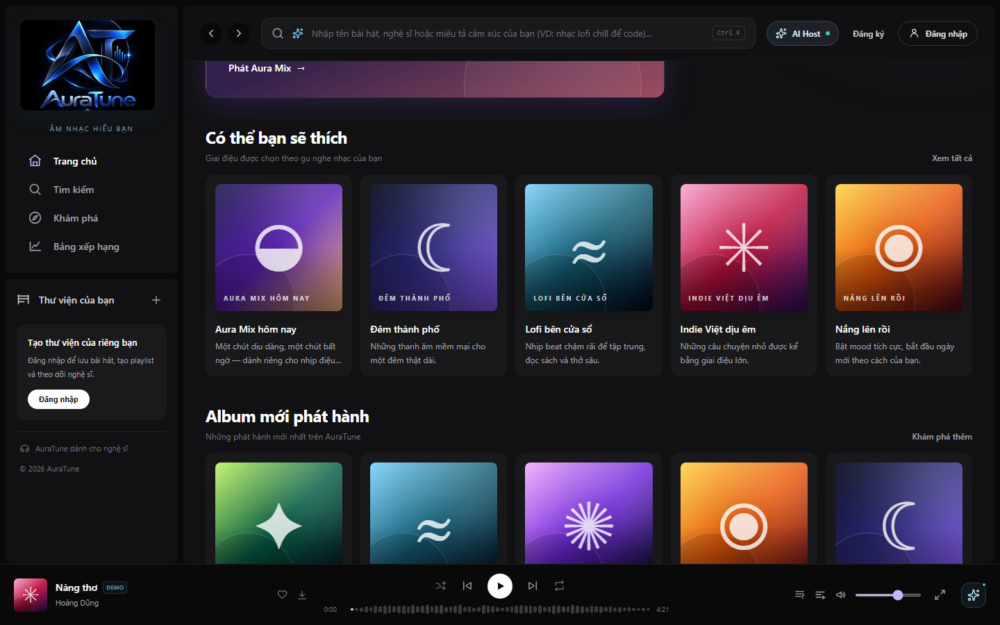
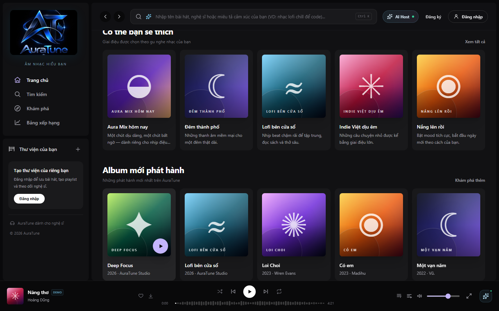
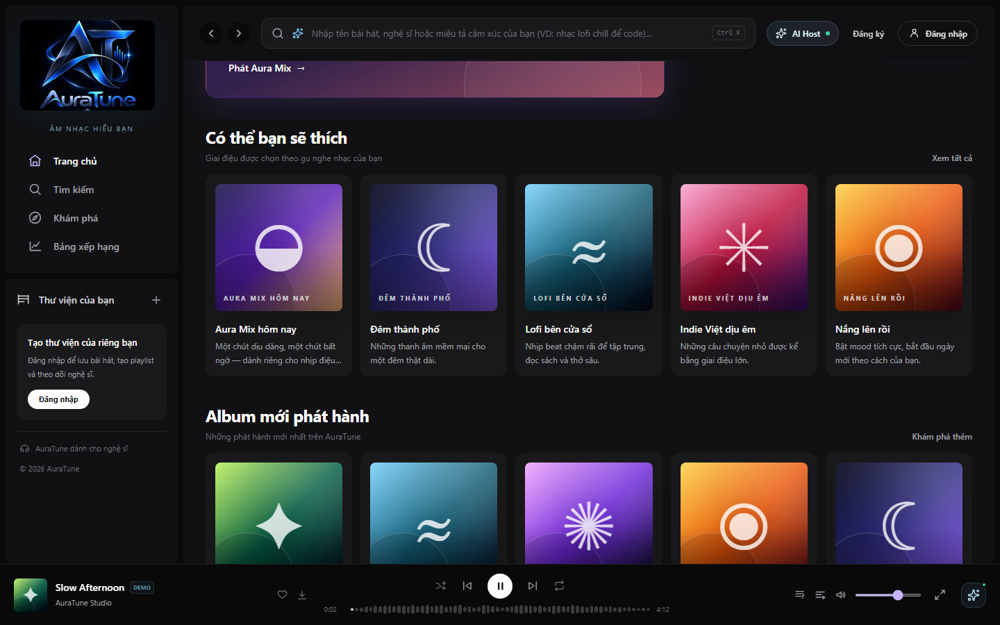
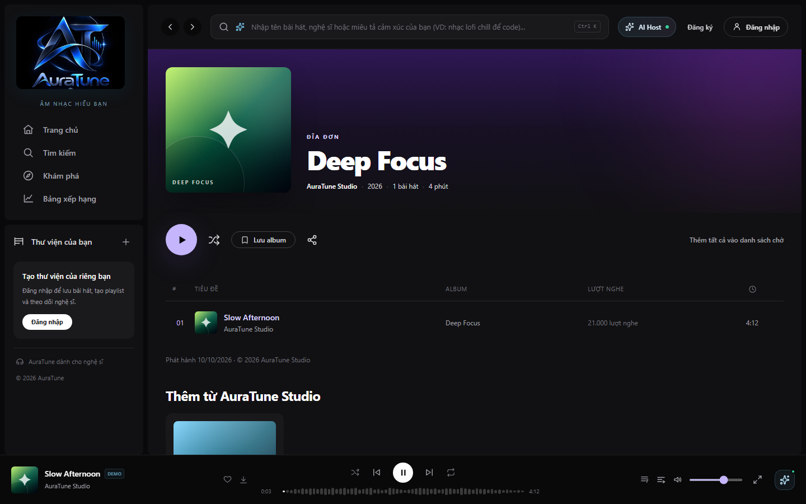
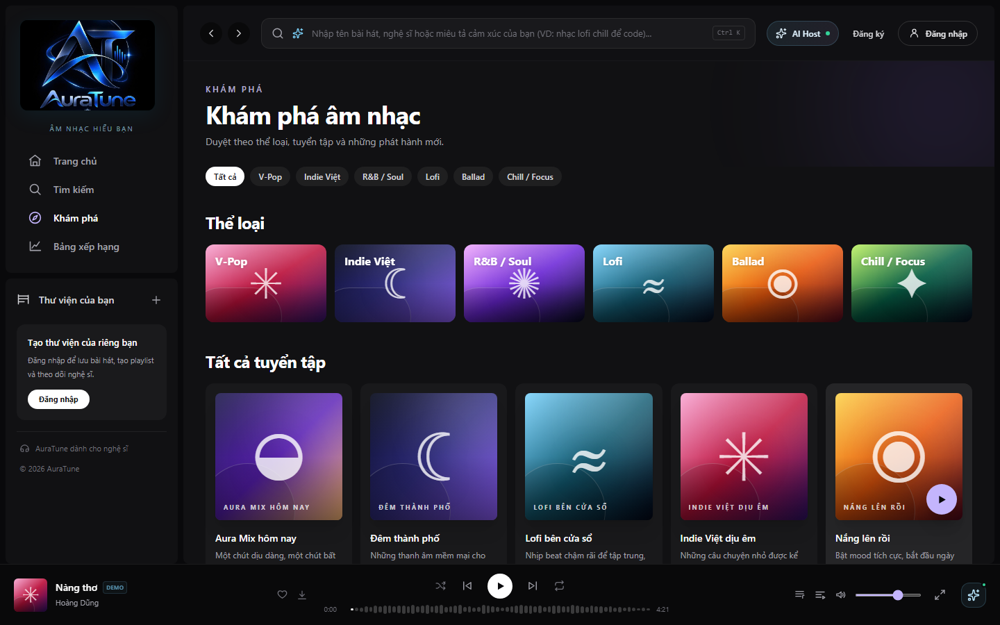

# Feature Specification: New Releases

**Feature ID**: `025-new-releases`  
**Functional Group**: `020 – Home Dashboard`  
**Status**: Specification Missing / Pending (Frontend UI Documented)

> [!NOTE]
> The formal feature specification (`spec.md`, `plan.md`, `tasks.md`) for Feature 025 was not previously authored or committed in the repository.
> In accordance with project constraints, no artificial business requirements or synthetic acceptance criteria have been invented.
> The UI screenshots and workflows documented below reflect the actual frontend implementation discovered at `src/frontend/src/pages/Home/HomePage.jsx`, `src/frontend/src/components/playlist/MediaCards.jsx`, and `src/frontend/src/pages/Album/AlbumPage.jsx`, cross-referenced with `docs/proposal/proposal.md` and `docs/analysis-and-design/api-contract.md`.

---

## Documented Project Context

- **Proposal Reference**: `docs/proposal/proposal.md` (§ 5.1 & § 6.2):
  "Home dashboard — browse trending charts and new albums... effortlessly discover new artists tailored to their distinct tastes the moment they open the app."
- **API Contract Reference**: `docs/analysis-and-design/api-contract.md`:
  - `GET /albums/new` (Role: Public, New album releases)
  - `GET /albums/:id` (Role: Public, Album details + tracklist)
- **Module Separation & Data Ownership**:
  Group 020 owns the presentation, sorting by release date, and instant playback initiation of new album releases on the Home Dashboard. Detailed album tracklisting, album saving/sharing, and complete album exploration belong to Functional Group 080 (Album Interaction).
- **Data Source Disclosure**:
  In the current frontend implementation, new releases are sorted by `releaseDate` descending from `albums` in `src/frontend/src/utils/mockData.js`. Displayed release years, album titles, and artist credits reflect existing seed mock data. No synthetic release schedules were invented.

---

## UI Screenshots

### 1. New Releases Section Overview

This screenshot captures the "Album mới phát hành" section on the Home Dashboard. It presents a 5-column grid of newly released albums sorted in descending chronological order, showing cover artwork, album title, release year, and artist credit (e.g., "Deep Focus", "Lofi bên cửa sổ", "Loi Choi", "Có em", "Một vạn năm").

### 2. New Album Card Focus and Hover State

This screenshot illustrates the desktop hover state over an album card ("Deep Focus"). The card elevates with subtle ambient lighting, the title is highlighted, and a floating circular violet Play button appears in the bottom right corner of the album artwork.

### 3. New Album Direct Playback Interaction

This screenshot documents direct album playback initiated from the album card's Play button. Playback starts immediately with the album's first track, and the persistent BottomPlayer updates with the track cover, title, artist, audio controls, and duration.

### 4. Navigation to Full Album Details Page

This screenshot captures the full Album Details view (`/album/al-deep-focus`) accessed by clicking the album cover or title. The destination page displays high-resolution cover art, artist credit, release year ("2026"), track count, formatted total duration, and complete tracklist with play counts.

### 5. Navigation to Explore Catalog via Section Action

This screenshot documents navigation to the catalog Explore page (`/explore`) triggered by clicking the "Khám phá thêm" action link in the section header, allowing users to browse full release catalogs.

