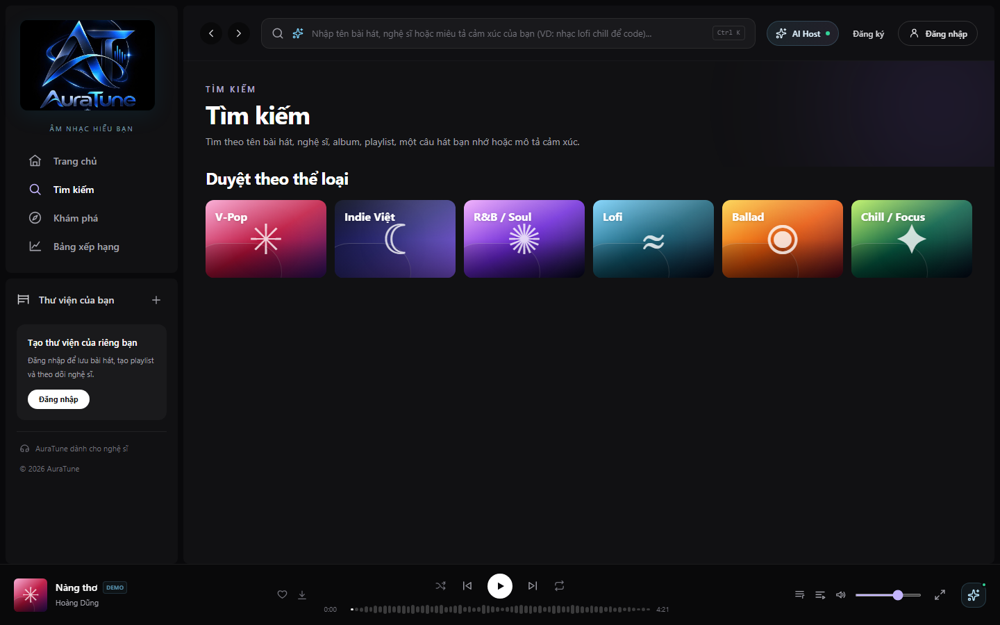
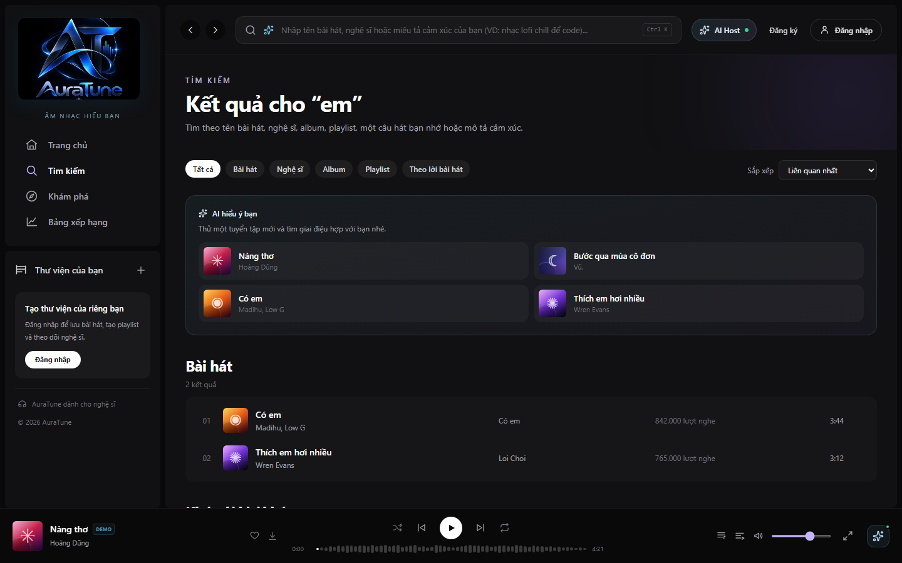
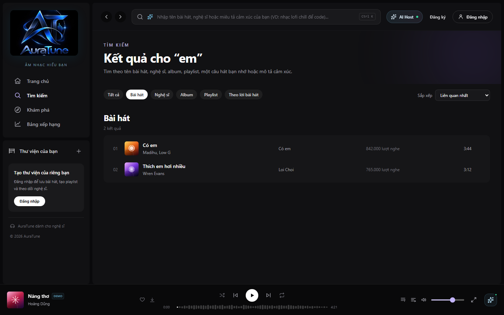
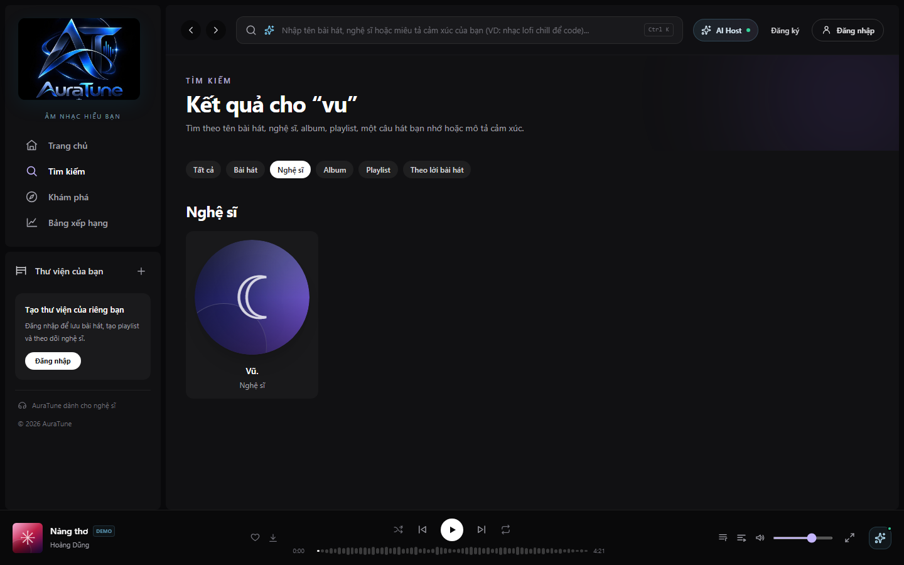
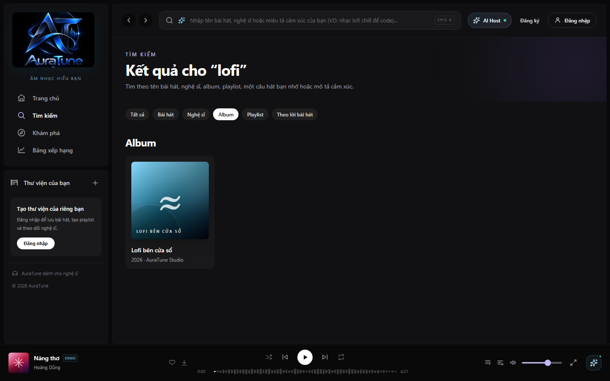
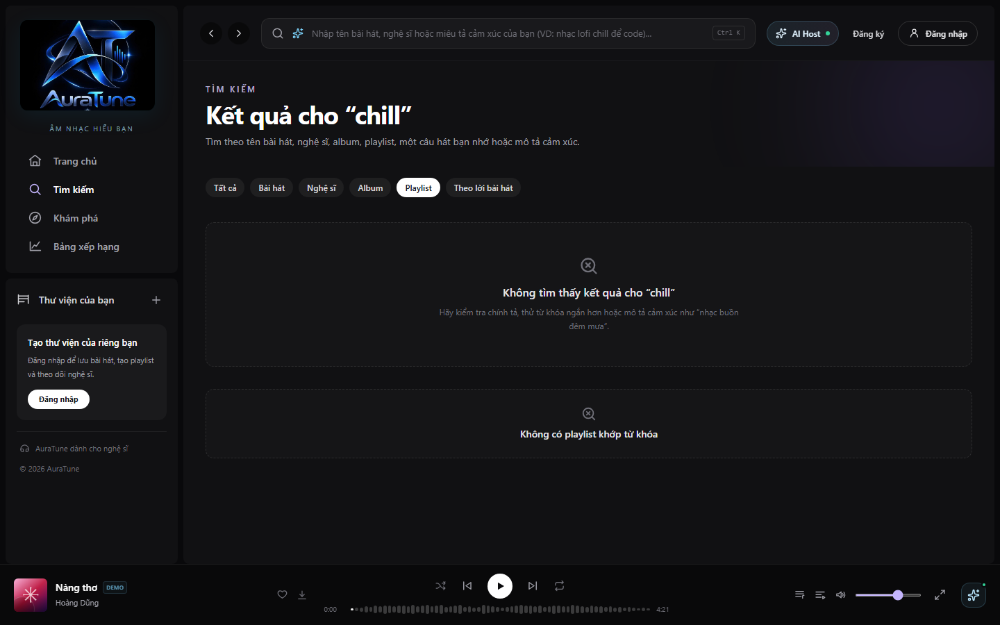
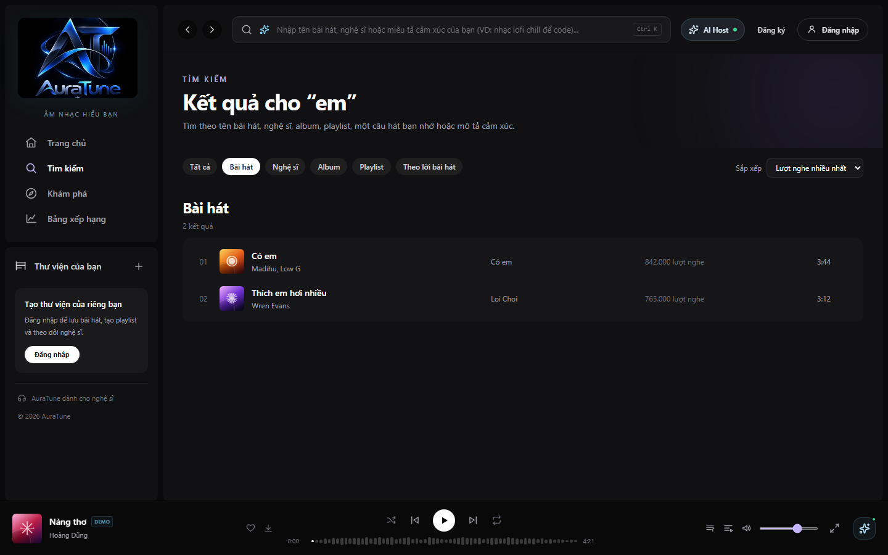
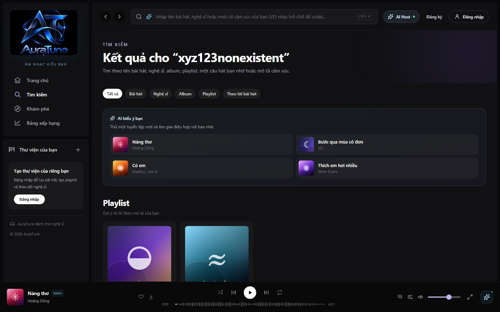
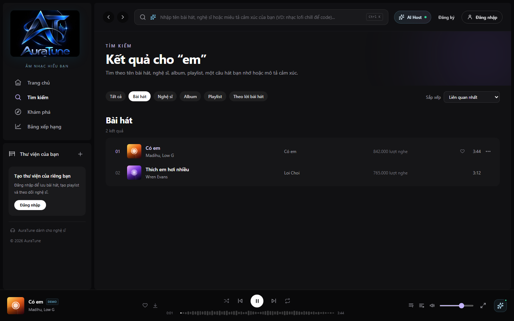

# Feature Specification: Metadata Search

**Feature Branch**: `031-metadata-search`  
**Created**: 2026-10-28  
**Status**: Draft  
**Input**: User description: "Enable Public and Listener users to search songs, artists, albums, and playlists by text metadata, with filtering and sorting, through GET /search using q, type, and limit."

## Clarifications

### Session 2026-10-28

- Q: Which result-pagination experience and API pagination mechanism should metadata search use? → A: Load More with `offset` and `limit`.
- Q: What maximum length should the `q` keyword accept before the search request is rejected or prevented from being sent? → A: 100 characters.
- Q: How many characters must the user enter before metadata search begins or sends a request? → A: 2 characters.
- Q: Should metadata search ignore differences in letter case, diacritics, and punctuation when matching keywords? → A: Ignore case, diacritics, and punctuation differences.
- Q: When a user selects a filter that does not apply to the current result type, how should the interface respond? → A: Hide filters that do not apply to the current result type.

## User Scenarios & Testing

### User Story 1 - Find music and related metadata (Priority: P1)

As a Public or Listener user, I want to search by a text keyword so that I can find songs, artists, albums, and playlists by their relevant names.

**Why this priority**: Metadata search is the primary value of this feature and is part of AuraTune's approved Advanced Search scope.

**Independent Test**: Provide a keyword that matches known metadata and verify that the returned results contain the matching songs, artists, albums, or playlists.

**Acceptance Scenarios**:

1. **Given** a Public or Listener user has entered a non-empty keyword, **When** the user searches, **Then** the system returns matching metadata results.
2. **Given** the keyword matches a song title, artist name, album name, or playlist name, **When** the user searches, **Then** the corresponding result is included and its result type is identifiable.
3. **Given** the user selects a result category, **When** the search is submitted, **Then** the results are limited to the selected category according to the approved search contract.

### User Story 2 - Refine and order results (Priority: P2)

As a Public or Listener user, I want to filter and sort search results so that I can narrow the result set and review it in a useful order.

**Why this priority**: Refinement supports the Advanced Search scope while remaining secondary to returning accurate matches.

**Independent Test**: Run a search with multiple matching results, apply an available filter, and change the available sort choice; verify that the visible results reflect both selections.

**Acceptance Scenarios**:

1. **Given** search results contain multiple result types or entries, **When** the user applies an available filter, **Then** only results matching that filter remain visible.
2. **Given** search results are displayed, **When** the user selects an available sort order, **Then** the results are displayed in that order.
3. **Given** the user changes or clears a filter or sort selection, **When** the result set refreshes, **Then** the displayed results reflect the current selections.

### User Story 3 - Understand empty and unavailable results (Priority: P2)

As a Public or Listener user, I want clear feedback when no result matches or the search cannot be completed so that I know what to do next.

**Why this priority**: Clear fallback behavior prevents a failed search from becoming a confusing or blocked experience.

**Independent Test**: Search for a keyword with no matches and separately simulate an unavailable search service; verify that each state has clear feedback and does not present stale results as current.

**Acceptance Scenarios**:

1. **Given** no indexed item matches the keyword and selected constraints, **When** the search completes, **Then** the user sees an explicit no-results state.
2. **Given** the search request cannot be completed because of a connection or service error, **When** the error is detected, **Then** the user sees an actionable error state and can retry the search.
3. **Given** a previous search displayed results, **When** a subsequent search fails, **Then** the interface clearly distinguishes the failure from a successful result set.

### Edge Cases

- The user submits an empty or whitespace-only keyword.
- The user submits a keyword longer than 100 characters.
- The keyword contains characters that require text input handling, such as spaces or punctuation.
- The requested result limit is greater than the number of matching results.
- The selected filter and sort combination leaves no matching results.
- The search service is unavailable, times out, or the connection is interrupted while results are loading.
- The user submits a new search while an earlier search is still loading.

## Requirements

### Functional Requirements

- **FR-001**: The system MUST allow Public and Listener users to search using a text keyword.
- **FR-002**: The system MUST begin or send a metadata search request only when `q` contains at least 2 characters.
- **FR-003**: The system MUST enforce a maximum length of 100 characters for `q` and provide clear feedback when the limit is exceeded.
- **FR-004**: The system MUST search the approved metadata fields: song title, artist name, album name, and playlist name.
- **FR-005**: The system MUST match metadata without distinguishing letter case, diacritics, or punctuation differences.
- **FR-006**: The system MUST support results for songs, artists, albums, and playlists.
- **FR-007**: The system MUST expose the approved search contract as `GET /search` with the query parameters `q`, `type`, `limit`, and `offset`.
- **FR-008**: The system MUST use `q` to represent the user's text keyword, `type` to represent the requested result category, `limit` to constrain the number of returned results, and `offset` to identify the result position from which the next batch is loaded, according to the approved API Contract.
- **FR-009**: The system MUST provide a “Load More” action when additional results are available, using the current search query and the next `offset` value to request the next batch.
- **FR-010**: The system MUST provide the approved filtering controls for narrowing displayed search results. This specification does not add filter fields or semantics beyond the approved project contract.
- **FR-011**: The system MUST hide filters that do not apply to the current result type.
- **FR-012**: The system MUST provide the approved sorting controls for ordering displayed search results. This specification does not add sort fields or semantics beyond the approved project contract.
- **FR-013**: The system MUST identify each result sufficiently for the user to distinguish songs, artists, albums, and playlists.
- **FR-014**: The system MUST present an explicit no-results state when no item matches the keyword and active constraints.
- **FR-015**: The system MUST present a clear error state when a search cannot be completed because of a connection or service failure.
- **FR-016**: The system MUST allow the user to retry after a connection or service failure.
- **FR-017**: The system MUST ensure that results shown after a completed search correspond to the current keyword and active constraints.
- **FR-018**: The system MUST keep all user-facing text for this feature consistent with AuraTune's responsive web application experience.

### Key Entities

- **Search Query**: The user's text keyword and the selected result category and result limit used to request search results.
- **Search Result**: A matching song, artist, album, or playlist with enough identifying metadata for the user to recognize its type and relevance.
- **Search Constraints**: The active filter and sort selections applied to the displayed search results.

## Success Criteria

### Measurable Outcomes

- **SC-001**: In acceptance testing, 100% of searches using a known matching song title, artist name, album name, or playlist name return the corresponding matching result within the requested category or combined result scope.
- **SC-002**: In acceptance testing, 100% of searches with no matching items display an explicit no-results state rather than an empty or ambiguous screen.
- **SC-003**: In acceptance testing, 100% of simulated connection or service failures display a clear error state and an available retry action.
- **SC-004**: In acceptance testing, 100% of supported filter and sort interactions update the displayed result set or ordering to reflect the current selection.
- **SC-005**: At least 90% of representative Public and Listener test users can identify the result type and understand the next action from the search result or fallback state without assistance.

## Assumptions

- Public and Listener access to search is approved; no additional role is required for this feature.
- Searchable song, artist, album, and playlist metadata already exists in the system's approved content sources.
- The API Contract is authoritative for the request parameters and response behavior; this feature specification does not invent additional query parameters or response fields.
- Additional result batches are loaded through a “Load More” interaction using `offset` and `limit`.
- Exact filter and sort choices are governed by the approved project contract or related search specifications and are not expanded here.
- The feature is scoped to metadata text search. AI lyrics search and semantic vector search remain separate search features identified in the proposal.
- The feature is designed for AuraTune's responsive web application environment.

## UI Screenshots

### 1. Metadata Search Entry

Corresponding User Story: User Story 1 – Find music and related metadata.

This screenshot shows the initial Search page (`/search`) in its empty state, displaying the header "Tìm kiếm", descriptive helper text, and the default "Duyệt theo thể loại" grid for music exploration before a search query is submitted.

### 2. Metadata Search Results Across Content Types

Corresponding User Story: User Story 1 – Find music and related metadata (Acceptance Scenario 1 & 2).

This screenshot shows search results for keyword "em" on tab "Tất cả" (`/search?q=em`), returning matching songs ("Có em", "Thích em hơi nhiều"), albums ("Có em"), and playlists with clearly distinguishable artwork and metadata labels.

### 3. Category Filter: Songs

Corresponding User Story: User Story 1 – Find music and related metadata (Acceptance Scenario 3); User Story 2 – Refine and order results (Acceptance Scenario 1).

This screenshot shows the results narrowed to the "Bài hát" category (`/search?q=em&type=tracks`). The interface renders a tabular song list displaying rank indices, song titles, artist links, album titles, play counts, and durations.

### 4. Category Filter: Artists

Corresponding User Story: User Story 1 – Find music and related metadata (Acceptance Scenario 3); User Story 2 – Refine and order results (Acceptance Scenario 1).

This screenshot shows search results filtered to the "Nghệ sĩ" category (`/search?q=vu&type=artists`). It renders circular artist profile cards with avatars, artist names, and role identification.

### 5. Category Filter: Albums

Corresponding User Story: User Story 1 – Find music and related metadata (Acceptance Scenario 3); User Story 2 – Refine and order results (Acceptance Scenario 1).

This screenshot shows search results filtered to the "Album" category (`/search?q=lofi&type=albums`). Matching albums are presented in a responsive grid featuring album cover art, album title, release year, and artist credit.

### 6. Category Filter: Playlists

Corresponding User Story: User Story 1 – Find music and related metadata (Acceptance Scenario 3); User Story 2 – Refine and order results (Acceptance Scenario 1).

This screenshot shows search results filtered to the "Playlist" category (`/search?q=chill&type=playlists`). Results are displayed with cover art, playlist title, description, and instant playback button.

### 7. Search Result Sorting Controls

Corresponding User Story: User Story 2 – Refine and order results (Acceptance Scenario 2 & 3).

This screenshot shows the sorting dropdown in action when viewing song results, with "Lượt nghe nhiều nhất" (`sort=plays`) selected, ordering the matching songs by their play counts.

### 8. Explicit No-Results State

Corresponding User Story: User Story 3 – Understand empty and unavailable results (Acceptance Scenario 1).

This screenshot shows the user-facing feedback when no indexed content matches the query (`/search?q=xyz123nonexistent`). The interface displays a clear SearchX icon with the message "Không tìm thấy kết quả cho “xyz123nonexistent”" and guidance to refine the search.

### 9. Search Result Playback Interaction

Corresponding User Story: User Story 1 – Find music and related metadata; User Story 2 – Refine and order results.

This screenshot shows playback launched directly from a search result row. The active track row is highlighted in violet, and the persistent BottomPlayer updates with the current track artwork, title, artist, audio controls, and duration.

