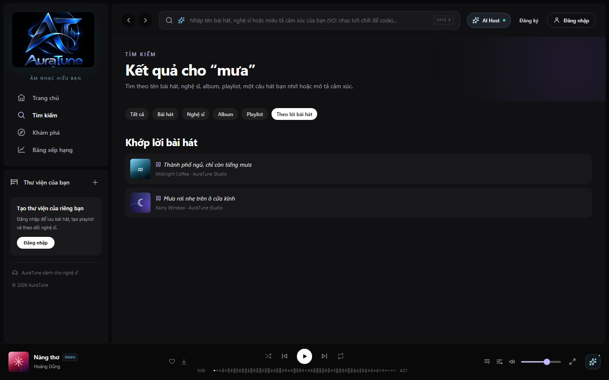
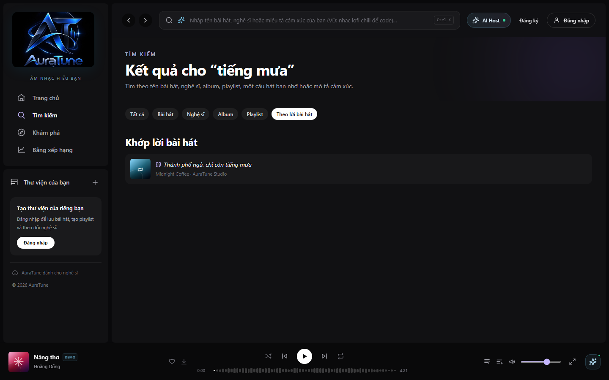
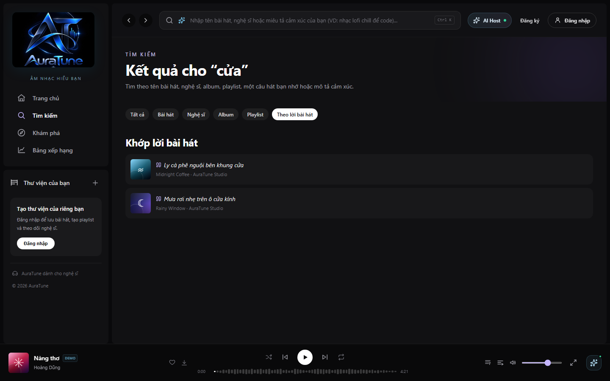
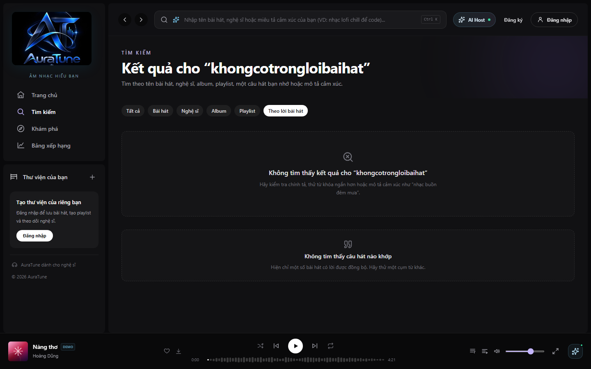
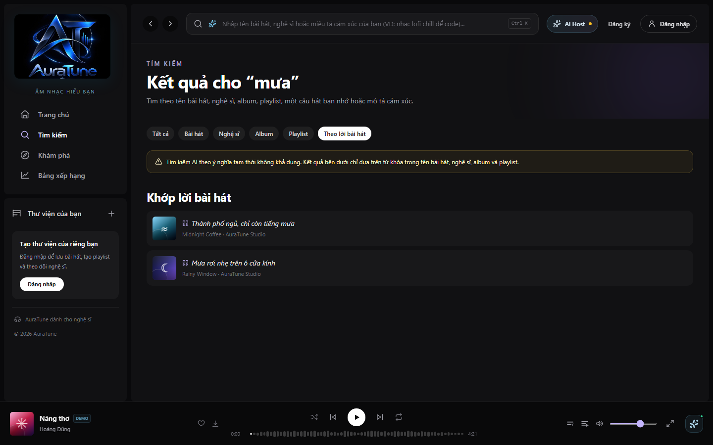
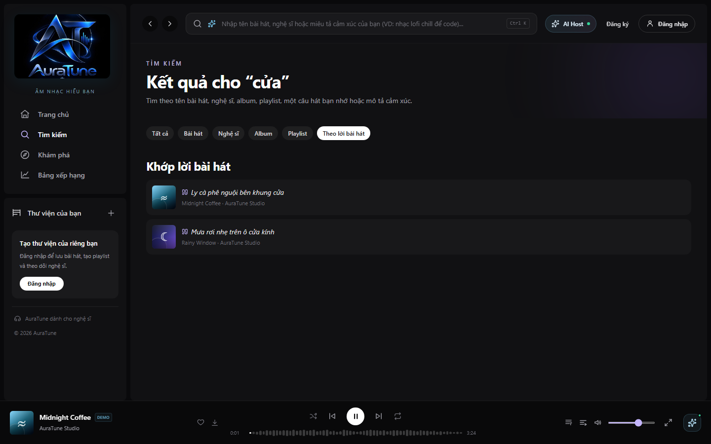

# Feature Specification: AI Lyrics Search

**Feature Branch**: `032-ai-lyrics-search`  
**Created**: 2026-10-29  
**Status**: Draft  
**Input**: User description: "Enable users to find songs from remembered lyric fragments through semantic AI analysis, with automatic keyword-search fallback when the AI service returns a 503 or times out."

## Clarifications

### Session 2026-10-29

- Q: What timeout should the AI lyrics-search request use before the system treats the service as unavailable and starts keyword fallback? → A: 5 seconds.
- Q: What lyric-fragment validation limits should the feature enforce before sending a search request? → A: At least 3 words and no more than 200 characters after trimming whitespace.
- Q: How should the user-facing notice appear when keyword fallback is used after AI search becomes unavailable? → A: A dismissible inline banner above the results that remains until the next search or until dismissed.
- Q: How should the feature display more than the initial set of matching songs? → A: Pagination with 20 songs per page.
- Q: When AI search is unavailable, which content should keyword fallback search and how should it rank matching songs? → A: Search normalized lyrics only; rank exact phrase matches above matches containing more of the query words.

The AI lyrics-search request MUST be treated as unavailable after 5 seconds without a completed response, and the keyword-search fallback MUST then begin automatically.

## User Scenarios & Testing

### User Story 1 - Find a song from a lyric fragment (Priority: P1)

As a Listener or Public user, I want to search using a fragment of lyrics that I remember so that I can find a song even when I do not know its title or artist.

**Why this priority**: Finding a song from incomplete remembered lyrics is the primary value of this feature and is part of AuraTune's approved AI-powered Advanced Search scope.

**Independent Test**: Enter a partial lyric fragment from a known song, submit the search, and verify that the matching song is returned with enough information to identify and open it.

**Acceptance Scenarios**:

1. **Given** the lyric catalog contains a song whose lyrics include the meaning of the submitted fragment, **When** the user submits an incomplete lyric fragment, **Then** the matching song is returned even when the fragment is not a complete lyric line.
2. **Given** the user enters a lyric fragment with ordinary differences in spacing, capitalization, or punctuation, **When** the user searches, **Then** the system still considers the fragment and returns relevant matching songs.
3. **Given** multiple songs are relevant to the fragment, **When** the search completes, **Then** the results are presented in an order that helps the user identify the most relevant song first.

---

### User Story 2 - Understand search results and empty matches (Priority: P1)

As a Listener or Public user, I want clear search results and feedback when no song matches my lyric fragment so that I know whether to refine my query.

**Why this priority**: Clear result and empty states are necessary for users to trust an AI-assisted search and complete the task without confusion.

**Independent Test**: Search with a known lyric fragment and with a fragment that has no match; verify that the first case shows identifiable songs and the second case shows a clear no-results state.

**Acceptance Scenarios**:

1. **Given** the search returns one or more candidate songs, **When** the result page is displayed, **Then** each result identifies the song and provides the normal action for opening or playing it.
2. **Given** no indexed song is relevant to the submitted lyric fragment, **When** the search completes, **Then** the user sees an explicit no-results message and guidance to try another fragment.
3. **Given** the user submits a new lyric fragment after a prior search, **When** the new search completes, **Then** the displayed results correspond only to the current fragment.
4. **Given** more than 20 songs match the lyric fragment, **When** the results are displayed, **Then** the system shows 20 songs on the current page and provides pagination to access additional results.

---

### User Story 3 - Continue searching when AI search is unavailable (Priority: P1)

As a Listener or Public user, I want the system to continue with a basic keyword search when AI lyrics search is overloaded or times out so that a temporary AI outage does not block song discovery.

**Why this priority**: The fallback is explicitly required by the API contract and preserves the core search journey during a 503 or timeout condition.

**Independent Test**: Simulate an AI Service response with HTTP 503, including an overload or timeout condition, and verify that keyword search runs automatically, results are shown when available, and the user is informed that fallback search was used.

**Acceptance Scenarios**:

1. **Given** the AI lyrics search request receives HTTP 503, **When** the failure is handled, **Then** the system automatically performs a basic keyword search using the submitted lyric fragment.
2. **Given** the AI lyrics search request times out and the timeout is represented by the service contract as an unavailable-service condition, **When** the failure is handled, **Then** the system automatically performs the same basic keyword-search fallback.
3. **Given** the fallback keyword search returns results, **When** the fallback completes, **Then** the results are displayed with a dismissible inline banner above them stating that AI search was unavailable and keyword search was used.
4. **Given** both AI search and keyword fallback return no matches, **When** the fallback completes, **Then** the user sees a clear no-results state that does not imply that the AI search succeeded.
5. **Given** the AI Service returns a failure other than the defined 503/unavailable-service condition, **When** the failure is handled, **Then** the system shows an appropriate error state and does not silently present unrelated or stale results as a successful search.
6. **Given** the fallback keyword search is used, **When** matching is performed, **Then** the system searches normalized lyrics only and ranks exact phrase matches above results containing more of the submitted query words.

### Edge Cases

- The user submits an empty or whitespace-only fragment.
- The fragment contains fewer than 3 words after leading, trailing, and repeated whitespace are normalized.
- The fragment contains punctuation, repeated whitespace, mixed capitalization, or diacritics.
- The fragment is longer than 200 characters after leading and trailing whitespace are removed.
- The fragment matches several songs with similar lyrics.
- The AI Service returns HTTP 503 before producing a result.
- The AI Service does not complete the request within 5 seconds.
- The fallback keyword search is unavailable or fails after the AI search is unavailable.
- The user submits a new search while an earlier AI or fallback search is still loading.
- The user repeatedly submits the same search while a request is still loading.
- The user submits a new search before an earlier request responds.
- The search service returns HTTP 429 because the request rate is too high.
- A previous search has results, but the current search fails or returns no matches.

## Requirements

### Functional Requirements

- **FR-001**: The system MUST allow Public and Listener users to submit a lyric fragment as a song search query.
- **FR-002**: The system MUST submit the lyric fragment to the approved AI lyrics-search contract through `POST /ai/search/lyrics` for semantic analysis and matching against the available lyric data.
- **FR-003**: The system MUST support matching a song when the submitted lyric fragment is incomplete rather than requiring an exact complete lyric line.
- **FR-004**: The system MUST present returned song results with enough identifying information for the user to distinguish and open or play the song.
- **FR-005**: The system MUST show an explicit no-results state when neither the AI search nor an applicable fallback search finds a relevant song.
- **FR-006**: The system MUST recognize HTTP 503 from the AI lyrics-search contract as an unavailable-service condition.
- **FR-007**: When the AI lyrics-search request returns HTTP 503, the system MUST automatically perform a basic keyword search using the submitted lyric fragment.
- **FR-008**: When the AI lyrics-search request does not complete within 5 seconds, the system MUST treat it as the defined unavailable-service condition and automatically perform the same keyword-search fallback.
- **FR-009**: When fallback keyword search returns results, the system MUST display those results without requiring the user to submit the query again.
- **FR-010**: When fallback is used, the system MUST show a clear user-facing notice that AI search was temporarily unavailable and that basic keyword search was used instead.
- **FR-011**: The fallback notice MUST be a dismissible inline banner displayed above the fallback results; it MUST remain visible until the user dismisses it or submits a new search, and it MUST NOT block the user's ability to inspect results.
- **FR-012**: The system MUST prevent stale results from a previous query from being presented as the result of the current query.
- **FR-013**: The system MUST display no more than 20 songs per result page and MUST provide pagination when additional matching songs exist.
- **FR-014**: The system MUST require at least 3 words and no more than 200 characters after trimming whitespace; it MUST show clear input feedback and MUST NOT send an empty, whitespace-only, too-short, or too-long lyric fragment.
- **FR-015**: The system MUST preserve the existing responsive web application experience for lyric search, result display, empty states, and fallback notices.
- **FR-016**: The system MUST follow the approved API contract for the AI request, response, HTTP 503 behavior, and any error information shown to the user.
- **FR-017**: When keyword fallback is used, the system MUST search normalized lyric text only; it MUST rank exact phrase matches above matches containing more of the submitted query words, and MUST NOT use title or artist matches as lyric-fallback matches.
- **FR-018**: The system MUST prevent duplicate submissions of the same search while that search is in progress; if the service returns HTTP 429, the system MUST show a retryable rate-limit message and MUST NOT treat 429 as the 503/timeout fallback condition.
- **FR-019**: When a newer search is submitted before an older request completes, the system MUST treat the newer search as current and MUST ignore any later response from the older request; the older request MAY be cancelled when supported by the request mechanism.

### Key Entities

- **Lyric Search Query**: The fragment of lyrics submitted by a user, together with the query state needed to associate results and messages with the current search.
- **AI Lyrics Search Result**: A song identified as relevant to the lyric fragment through semantic analysis, including the information needed to display and open or play it.
- **Keyword Search Result**: A song identified by the basic text-search fallback when AI lyrics search is unavailable.
- **Search Mode Notice**: User-facing feedback indicating whether results came from AI lyrics search, keyword fallback, no matches, or an error state.
- **Result Page**: A page of up to 20 matching songs associated with the current lyric query and search mode.

## Success Criteria

### Measurable Outcomes

- **SC-001**: In acceptance testing, 100% of representative incomplete lyric fragments from the test catalog return the correct song within the visible result set.
- **SC-002**: In acceptance testing, 100% of simulated HTTP 503 responses trigger an automatic keyword-search fallback without requiring a second user submission.
- **SC-003**: In acceptance testing, 100% of simulated AI-service timeouts handled as unavailable-service conditions trigger the same automatic fallback behavior.
- **SC-004**: In acceptance testing, 100% of fallback searches that return results display both the results and a clear notice that keyword search was used because AI search was unavailable.
- **SC-008**: In acceptance testing, 100% of fallback result sets display the notice above the results, allow the user to dismiss it, and remove it when a new search is submitted.
- **SC-009**: In acceptance testing, 100% of result sets containing more than 20 matching songs display no more than 20 songs per page and provide working pagination to the remaining results.
- **SC-010**: In acceptance testing, 100% of fallback searches rank exact normalized lyric-phrase matches before partial lyric matches and exclude title-only or artist-only matches.
- **SC-011**: In acceptance testing, 100% of duplicate in-flight submissions are prevented, 100% of stale responses from superseded searches are ignored, and 100% of simulated HTTP 429 responses show a retryable rate-limit message without invoking 503 fallback.
- **SC-005**: In acceptance testing, 100% of searches with no match display an explicit no-results state, and 100% of failed searches avoid presenting stale results as current.
- **SC-006**: At least 90% of representative Public and Listener test users can identify the relevant song or understand the next action after a lyric search or fallback search without assistance.
- **SC-007**: In acceptance testing, 100% of lyric fragments with fewer than 3 words or more than 200 characters are rejected locally with clear feedback and do not trigger a search request.

## Assumptions

- Public and Listener users are allowed to use song search without an additional feature-specific permission.
- Searchable lyric data is already available through AuraTune's approved content sources.
- The AI Service contract defines HTTP 503 as the unavailable-service response for overload and timeout handling required by this feature.
- The AI lyrics-search request timeout is 5 seconds; a request that does not complete within that time is treated as unavailable and triggers keyword fallback.
- Basic keyword search already exists or is available as the approved fallback capability for the same search input.
- Lyric fragments are validated after whitespace trimming; valid input contains at least 3 words and no more than 200 characters.
- Only HTTP 503 and a 5-second AI response timeout trigger keyword fallback; other failures, including HTTP 429, use their own error handling.
- The latest submitted search is authoritative; cancelling an older request is optional because stale responses are ignored.
- Exact request and response fields beyond the explicitly approved `POST /ai/search/lyrics` route are governed by the API contract and are not invented in this specification.
- The feature is scoped to finding songs from lyric fragments; searching by mood, audio characteristics, or general conversational descriptions remains outside this feature.
- The feature is designed for AuraTune's responsive web application environment.

## UI Screenshots

### 1. Lyrics Search Tab Selection

Corresponding User Story: User Story 1 – Find a song from a lyric fragment.

This screenshot shows the dedicated "Theo lời bài hát" category tab active on the Search Page (`/search?q=mưa&type=lyrics`), scoping search results specifically to lyric matches across the song catalog.

### 2. Matching Lyric Results Presentation

Corresponding User Story: User Story 1 – Find a song from a lyric fragment (Acceptance Scenario 1 & 2); User Story 2 – Understand search results and empty matches (Acceptance Scenario 1).

This screenshot shows search results matching a remembered lyric fragment ("tiếng mưa"). The interface presents the "Khớp lời bài hát" section with a distinctive quote icon, the highlighted matching lyric line ("Thành phố ngủ, chỉ còn tiếng mưa"), and song details ("Midnight Coffee · AuraTune Studio").

### 3. Multiple Matching Lyrics Across Catalog

Corresponding User Story: User Story 1 – Find a song from a lyric fragment (Acceptance Scenario 3).

This screenshot demonstrates multiple song results returned for a lyric query ("cửa"). It displays matching lines from both "Midnight Coffee" ("Ly cà phê nguội bên khung cửa") and "Rainy Window" ("Mưa rơi nhẹ trên ô cửa kính"), allowing listeners to distinguish between relevant tracks.

### 4. Lyrics Search No Results State

Corresponding User Story: User Story 2 – Understand search results and empty matches (Acceptance Scenario 2).

This screenshot shows the explicit empty state when no synchronized lyrics match the query (`/search?q=khongcotrongloibaihat&type=lyrics`). The screen displays a Quote icon with the title "Không tìm thấy câu hát nào khớp" and guidance noting that only songs with synchronized lyrics are searchable.

### 5. AI Search Unavailable Fallback Banner

Corresponding User Story: User Story 3 – Continue searching when AI search is unavailable (Acceptance Scenario 1, 2, & 3).

This screenshot illustrates the graceful degradation state when the AI recommendation/search service is unavailable (`aiAvailable = false`). An amber inline banner informs the user: "Tìm kiếm AI theo ý nghĩa tạm thời không khả dụng. Kết quả bên dưới chỉ dựa trên từ khóa trong tên bài hát, nghệ sĩ, album và playlist."

### 6. Playback Integration from Lyric Match

Corresponding User Story: User Story 2 – Understand search results and empty matches (Acceptance Scenario 1).

This screenshot shows direct playback initiated by selecting a matching lyric search result. Playback begins immediately and updates the persistent BottomPlayer with song metadata and controls.

