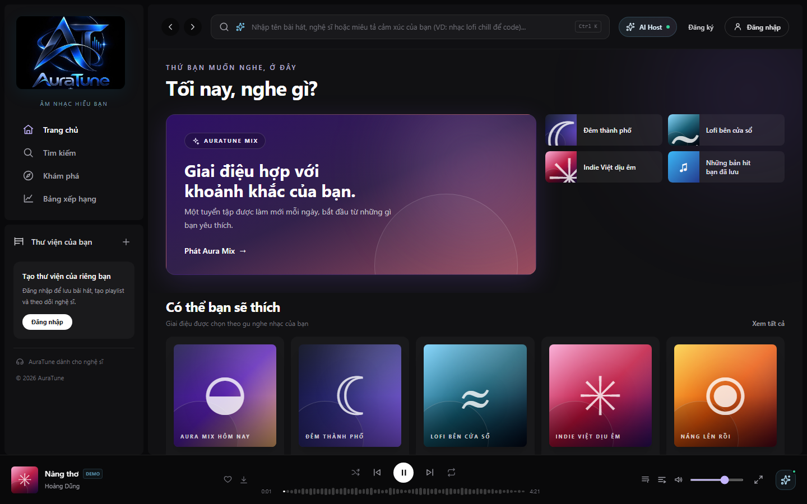
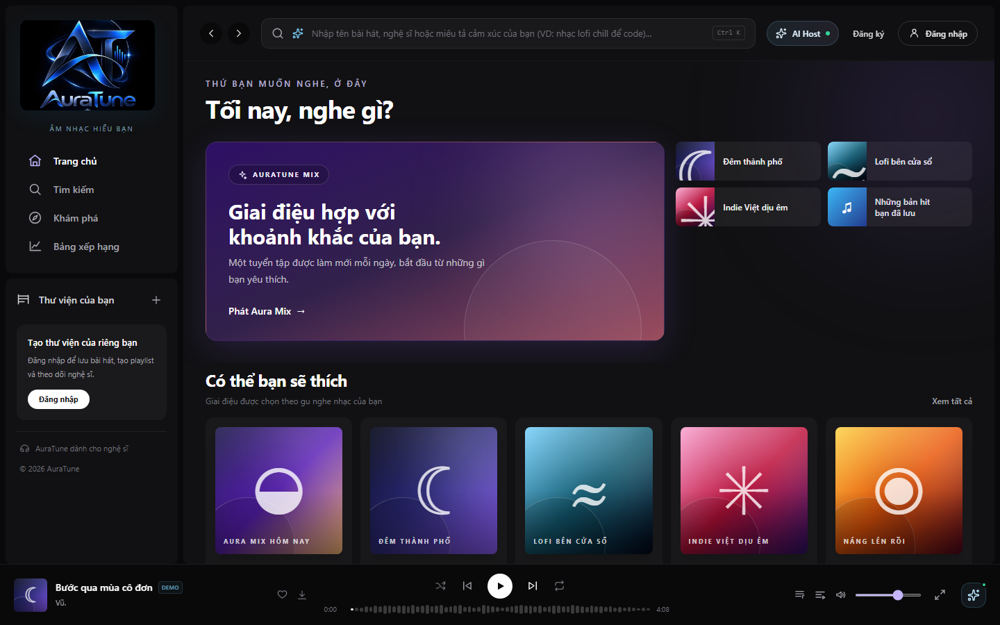
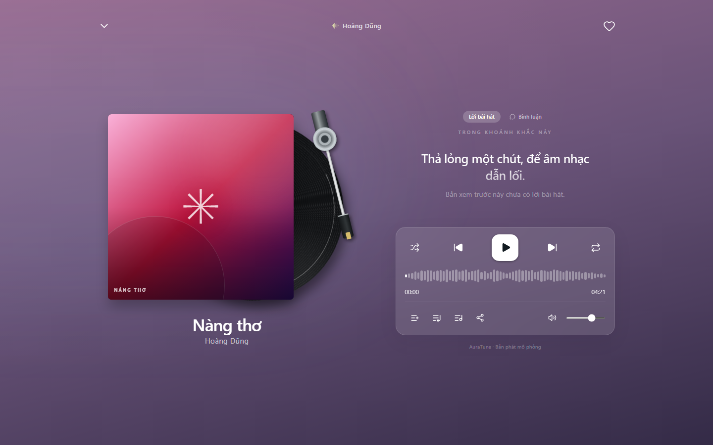

# Feature Specification: Playback Controls

**Feature Branch**: `020-home-player-queue-spec`

**Created**: 2026-10-31

**Status**: Draft — Ready for Planning

**Input**: User description: "Feature 041 defines play, pause, next, and previous controls, and automatic advance through the queue. The same state applies wherever controls appear, in the mini player and the full player. Audio is delivered by the backend stream defined in the API Contract."

## Clarifications

### Session 2026-10-31

- Q: What does Previous do during a track? → A: If more than 3 seconds have played, it restarts the track. Otherwise it goes to the previous track in the queue.
- Q: What happens when the last track ends and repeat is off? → A: Playback stops at the end of that track, and the listener can start it again.
- Q: What happens when a stream fails? → A: Playback stops, a message is shown, and the listener can retry or skip to another track.
- Q: Can unavailable tracks be played? → A: No. The system refuses to start them and shows a message.

## User Scenarios & Testing *(mandatory)*

### User Story 1 - Control Playback (Priority: P1)

As a listener, I want to play and pause music so that I control what I hear.

**Why this priority**: Playback is the core function of the product.

**Independent Test**: Start a track, pause it, resume it, and confirm it continues from the same position.

**Acceptance Scenarios**:

1. **Given** a track is loaded, **When** I press play, **Then** audio starts and the control shows pause.
2. **Given** a track is playing, **When** I press pause, **Then** audio stops at the current position.
3. **Given** a track is paused, **When** I press play, **Then** it resumes from the same position.

---

### User Story 2 - Move Between Tracks (Priority: P1)

As a listener, I want next and previous controls so that I can move through my queue.

**Why this priority**: Moving through a queue is part of every listening session.

**Independent Test**: With a queue of 3 tracks, use next and previous and confirm the order.

**Acceptance Scenarios**:

1. **Given** a queue, **When** I press next, **Then** the next track starts from the beginning.
2. **Given** more than 3 seconds have played, **When** I press previous, **Then** the track restarts.
3. **Given** 3 seconds or less have played, **When** I press previous, **Then** the previous track starts.

---

### User Story 3 - Continuous Listening (Priority: P1)

As a listener, I want the next track to start automatically so that my music continues without action.

**Why this priority**: The Vision Document requires automatic advance when a track ends.

**Independent Test**: Let a track end and confirm the next one starts.

**Acceptance Scenarios**:

1. **Given** a track ends and more tracks are queued, **When** it finishes, **Then** the next track starts automatically.
2. **Given** the last track ends with repeat off, **When** it finishes, **Then** playback stops.

---

### Edge Cases

- **Stream failure**: Playback stops with a message and a retry option.
- **Unavailable track**: The system refuses to start it and shows a message.
- **Browser blocks autoplay**: The player stays paused and waits for a listener action.
- **Temporary network drop**: Playback continues from buffered audio when possible.
- **Rapid repeated presses**: The final selected track wins, and tracks do not overlap.

## Requirements *(mandatory)*

### Functional Requirements

- **FR-001**: The system MUST allow a listener to play and pause the current track.
- **FR-002**: The system MUST resume a paused track from its paused position.
- **FR-003**: The system MUST allow moving to the next track in the queue.
- **FR-004**: The system MUST restart the track when previous is pressed after more than 3 seconds of playback.
- **FR-005**: The system MUST go to the previous track when previous is pressed within the first 3 seconds.
- **FR-006**: The system MUST start the next track automatically when the current track ends.
- **FR-007**: The system MUST stop playback at the end of the last track when repeat is off.
- **FR-008**: The system MUST refuse to play unavailable tracks and inform the listener.
- **FR-009**: The system MUST inform the listener when a stream fails and allow retrying or skipping.
- **FR-010**: The system MUST keep control state identical in the mini player and the full player.
- **FR-011**: The system MUST show the current track's cover art, title, artist, and duration.
- **FR-012**: The system MUST allow Public and signed-in users to play available tracks.
- **FR-013**: The system MUST NOT implement shuffle, repeat, or queue editing rules within this feature.

### Key Entities *(include if feature involves data)*

- **Current Track**: The track loaded in the player, with its metadata and availability.
- **Playback State**: Whether the player is playing, paused, or stopped, with the current position.

## Success Criteria *(mandatory)*

### Measurable Outcomes

- **SC-001**: Audio starts within 500 ms of pressing play for a buffered track.
- **SC-002**: 100% of tracks that end with a next track queued advance without listener action.
- **SC-003**: Unavailable tracks never start in any test scenario.
- **SC-004**: Controls show the same state in both player views in 100% of test runs.

## Assumptions

- Authentication and user roles are provided by group `010-authentication`.
- Frontend integration of the audio stream is planned in `specs/130-frontend/131-frontend-foundation/plan.md`.
- API alignment: `GET /songs/:id` and `GET /songs/:id/stream` (Public). The stream returns `audio/mpeg` and supports `Range`.
- Project documentation is maintained in English Markdown, in accordance with `docs/management/team-contract.md`.

### Known Gaps in the Current Prototype

These gaps do not change the requirements. They record where the current UI differs from this specification.

- The prototype simulates playback with a timer, so no real audio plays.
- Stream errors, buffering, and autoplay restrictions cannot occur in the prototype and have no UI yet.

## UI Screenshots

### 1. Player Initial State in Bottom Player

This screenshot captures the persistent BottomPlayer in its initial idle / paused state docked at the bottom of the screen. It displays the current loaded song artwork, title ("Giai điệu mùa thu"), artist ("AuraTune Studio"), a circular white Play button, previous and next track controls, and the compact waveform seek bar.

### 2. Player Active Playing State

This screenshot illustrates the active playback state in the BottomPlayer. Upon clicking the Play button, playback initiates, the central control dynamically transitions from a Play icon to a Pause icon, and the waveform progress begins filling with white indicators.

### 3. Player Paused State

This screenshot demonstrates the paused playback state. When the listener clicks the Pause button, playback suspends at the current position, the icon reverts back to the Play symbol, and progress increments halt.

### 4. Next Track Transition

This screenshot captures the transition to the next song in the active queue when clicking the Next Track button (`SkipForward`). The player immediately loads the next track ("Nàng thơ" · Hoàng Dũng), updating the title, artist metadata, and cover art seamlessly.

### 5. Previous Track Transition

This screenshot shows the transition when selecting the Previous Track button (`SkipBack`), navigating back to the preceding track in the listening queue.

### 6. Full-Screen Player Controls Interface

This screenshot captures the expanded FullScreenPlayer interface (`FullScreenPlayer.jsx`). It showcases the vinyl tonearm deck (`RecordDeck.jsx`), song typography, and the dedicated playback controls cluster featuring central play/pause, skip controls, and quick action buttons.

