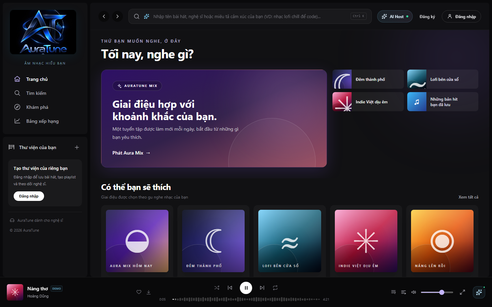
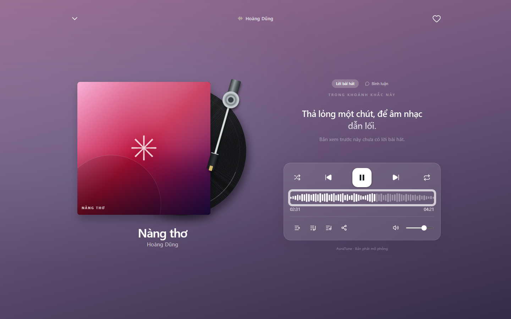
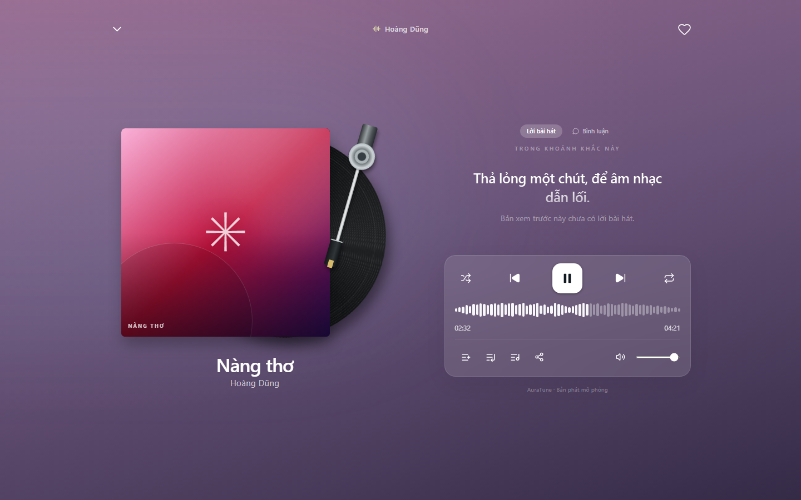
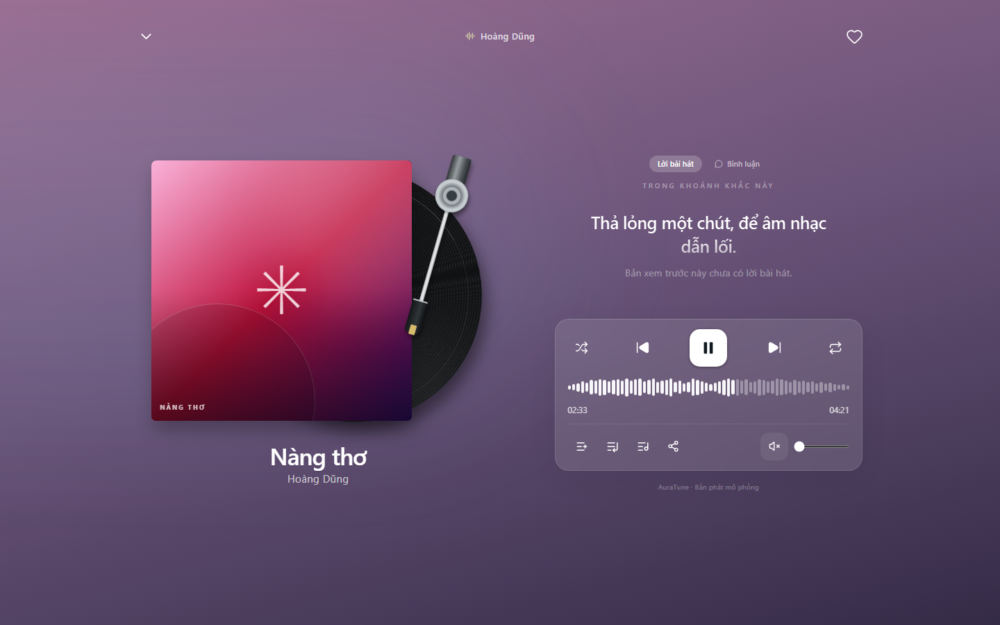

# Feature Specification: Playback Progress and Volume

**Feature Branch**: `020-home-player-queue-spec`

**Created**: 2026-10-31

**Status**: Draft — Ready for Planning

**Input**: User description: "Feature 042 defines the progress display, seeking, volume, and mute controls in the mini player and the full player."

## Clarifications

### Session 2026-10-31

- Q: How is time displayed? → A: Elapsed time and total duration in minutes and seconds.
- Q: What does mute do to the volume level? → A: Mute silences audio and remembers the level. Moving the volume slider turns mute off.
- Q: What is the volume range? → A: 0 to 100, and it stays the same when the track changes.
- Q: Does the volume survive a page reload? → A: No. It applies to the current session.

## User Scenarios & Testing *(mandatory)*

### User Story 1 - See and Change Position (Priority: P1)

As a listener, I want to see progress and seek so that I can jump to any part of a track.

**Why this priority**: Seeking is named in the core player scope.

**Independent Test**: Play a track, seek to the middle, and confirm playback continues from that point.

**Acceptance Scenarios**:

1. **Given** a track is playing, **When** time passes, **Then** the progress and elapsed time update.
2. **Given** a track is loaded, **When** I seek, **Then** playback continues from the selected position.
3. **Given** I seek while paused, **When** I press play, **Then** playback starts from that position.

---

### User Story 2 - Adjust Volume (Priority: P1)

As a listener, I want to change the volume so that it suits my environment.

**Why this priority**: Volume control is named in the core player scope.

**Independent Test**: Change the volume, mute, and unmute, and confirm the previous level returns.

**Acceptance Scenarios**:

1. **Given** audio is playing, **When** I move the volume control, **Then** the loudness changes.
2. **Given** audio is playing, **When** I mute, **Then** audio is silent and the control shows muted.
3. **Given** audio is muted, **When** I unmute, **Then** the previous level returns.

---

### Edge Cases

- **Seek past buffered audio**: A buffering state is shown until playback resumes.
- **Seek past the end**: The position is limited to the track duration.
- **Volume at 0**: The control shows a muted appearance.
- **Moving volume while muted**: Mute turns off.
- **Track change**: Progress resets and volume stays the same.

## Requirements *(mandatory)*

### Functional Requirements

- **FR-001**: The system MUST show elapsed time and total duration for the current track.
- **FR-002**: The system MUST update progress while the track plays.
- **FR-003**: The system MUST allow seeking to any position within the track.
- **FR-004**: The system MUST limit the seek position to between the start and the track duration.
- **FR-005**: The system MUST show a buffering state when seeking to audio that is not yet available.
- **FR-006**: The system MUST allow setting volume from 0 to 100.
- **FR-007**: The system MUST allow muting and unmuting.
- **FR-008**: The system MUST restore the previous volume level when unmuted.
- **FR-009**: The system MUST turn mute off when the listener moves the volume control.
- **FR-010**: The system MUST keep the volume level when the track changes.
- **FR-011**: The system MUST make seek and volume controls operable by mouse, keyboard, and touch.
- **FR-012**: The system MUST expose the current position to assistive technology as readable text.

### Key Entities *(include if feature involves data)*

- **Playback Position**: Elapsed time within the current track.
- **Audio Level**: The volume value and mute state.

## Success Criteria *(mandatory)*

### Measurable Outcomes

- **SC-001**: Playback resumes from the selected position after 100% of seeks in test runs.
- **SC-002**: Unmuting restores the previous level in 100% of test runs.
- **SC-003**: Seek and volume controls work with keyboard alone.
- **SC-004**: The displayed elapsed time stays within 1 second of the actual position.

## Assumptions

- Authentication and user roles are provided by group `010-authentication`.
- API alignment: `GET /songs/:id/stream` (Public) supports `Range` requests for seeking.
- Project documentation is maintained in English Markdown, in accordance with `docs/management/team-contract.md`.

### Known Gaps in the Current Prototype

These gaps do not change the requirements. They record where the current UI differs from this specification.

- Position is simulated, and volume changes have no audible effect in the prototype.

## UI Screenshots

### 1. Playback Progress at Beginning (0:00)

This screenshot captures the compact waveform seek bar in the BottomPlayer at the beginning of a track (`0:00` / `4:21`). The waveform bars remain in their unfilled, dimmed state indicating playback has not yet commenced.

### 2. Playback Progress During Active Playback

This screenshot illustrates the waveform seek bar advancing during playback. The waveform segments progressively fill with solid white color corresponding to the elapsed time ratio, and the numerical timestamp updates in real time.

### 3. Seeking to an Advanced Playback Position

This screenshot captures the seeking interaction in the FullScreenPlayer. Dragging the waveform seek bar jumps playback immediately to the target timestamp (`2:30` of `4:21`), updating the waveform fill state and time indicators synchronously.

### 4. Volume Adjustment in Full-Screen Player

This screenshot shows volume control adjustment in the FullScreenPlayer controls tray. The volume slider is set to high volume (95%), providing granular auditory control for the listener.

### 5. Volume Muted State

This screenshot demonstrates the muted audio state. Clicking the speaker icon toggles the mute state, updating the icon from a speaker to a crossed-out speaker (`VolumeX`) and dropping the visual volume slider to zero.

