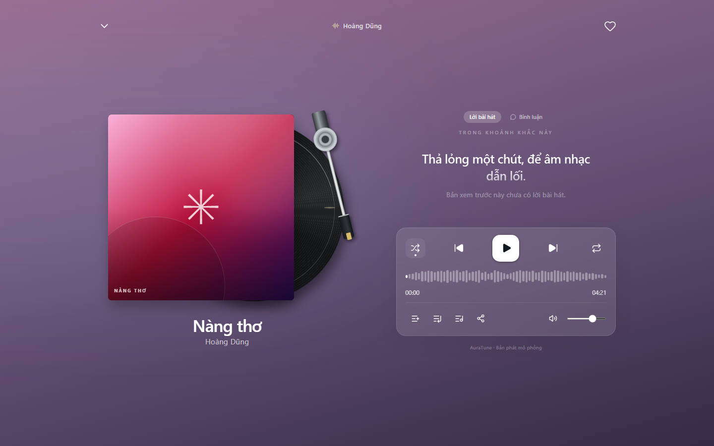

# Feature Specification: Shuffle and Repeat

**Feature Branch**: `020-home-player-queue-spec`

**Created**: 2026-10-31

**Status**: Draft — Ready for Planning

**Input**: User description: "Feature 043 defines shuffle and repeat modes and how they change the next track selected by the player."

## Clarifications

### Session 2026-10-31

- Q: What repeat modes exist? → A: Off, repeat all, and repeat one. The control cycles through them in that order.
- Q: How does shuffle choose the next track? → A: It picks a random track from the queue other than the current one. The displayed queue order does not change.
- Q: Does repeat one block the next button? → A: No. Repeat one applies when a track ends naturally, and next still moves on.
- Q: What does the shuffle play action on a collection do? → A: It turns shuffle on and starts the collection in a random order.

## User Scenarios & Testing *(mandatory)*

### User Story 1 - Listen in Random Order (Priority: P1)

As a listener, I want shuffle so that my music plays in a less predictable order.

**Why this priority**: Shuffle is named in the core player scope.

**Independent Test**: Turn on shuffle with 5 queued tracks and confirm next selects another queued track.

**Acceptance Scenarios**:

1. **Given** shuffle is off, **When** I select shuffle, **Then** the control shows it is active.
2. **Given** shuffle is on, **When** the player advances, **Then** it selects a different track from the queue.
3. **Given** shuffle is on, **When** I turn it off, **Then** the player follows queue order from the current track.

---

### User Story 2 - Repeat Music (Priority: P1)

As a listener, I want repeat modes so that I can keep hearing a track or a list.

**Why this priority**: Repeat is named in the core player scope.

**Independent Test**: Cycle the three modes and confirm the behavior at the end of a track and queue.

**Acceptance Scenarios**:

1. **Given** repeat is off, **When** I select repeat three times, **Then** the mode moves to all, one, and off.
2. **Given** repeat all is on, **When** the last track ends, **Then** the first track starts.
3. **Given** repeat one is on, **When** a track ends, **Then** it starts again.
4. **Given** repeat one is on, **When** I press next, **Then** the next track starts.

---

### Edge Cases

- **One track in the queue with shuffle on**: The player follows the repeat mode.
- **Shuffle and repeat one together**: Repeat one decides what happens when a track ends.
- **Mode changes during playback**: Current playback is not interrupted.
- **Track change**: Both modes stay as selected.
- **Page reload**: Both modes return to off.

## Requirements *(mandatory)*

### Functional Requirements

- **FR-001**: The system MUST allow turning shuffle on and off.
- **FR-002**: The system MUST select a random queued track other than the current one when advancing with shuffle on.
- **FR-003**: The system MUST NOT change the displayed queue order when shuffle is turned on.
- **FR-004**: The system MUST provide repeat modes off, all, and one.
- **FR-005**: The system MUST cycle repeat modes in the order off, all, one, off.
- **FR-006**: The system MUST restart the queue from its first track when it ends with repeat all on.
- **FR-007**: The system MUST replay the current track when it ends with repeat one on.
- **FR-008**: The system MUST allow next to change tracks while repeat one is on.
- **FR-009**: The system MUST give repeat one priority over shuffle when a track ends.
- **FR-010**: The system MUST show the active shuffle and repeat modes in both player views.
- **FR-011**: The system MUST NOT interrupt the current track when a mode changes.
- **FR-012**: The system MUST allow a collection to start in shuffle mode.

### Key Entities *(include if feature involves data)*

- **Shuffle Mode**: Whether random track selection is on.
- **Repeat Mode**: One of off, all, or one.

## Success Criteria *(mandatory)*

### Measurable Outcomes

- **SC-001**: With shuffle on and 2 or more queued tracks, the next track is never the current one.
- **SC-002**: 100% of mode changes leave current playback uninterrupted.
- **SC-003**: Repeat modes behave as defined in 100% of end-of-track test cases.
- **SC-004**: Mode indicators match in both player views in all test runs.

## Assumptions

- Authentication and user roles are provided by group `010-authentication`.
- API alignment: Modes are client-side and need no API.
- Project documentation is maintained in English Markdown, in accordance with `docs/management/team-contract.md`.

### Known Gaps in the Current Prototype

These gaps do not change the requirements. They record where the current UI differs from this specification.

- With shuffle on and repeat off, the prototype keeps selecting tracks and does not stop.

## UI Screenshots

### 1. Shuffle Mode Disabled (Default State)

This screenshot captures the player controls in FullScreenPlayer with Shuffle mode disabled (`shuffle = false`). The Shuffle icon appears in its neutral translucent styling without an indicator dot.

### 2. Shuffle Mode Enabled

This screenshot shows the Shuffle mode activated (`shuffle = true`). The button highlights with subtle background elevation and a distinctive white indicator dot beneath the shuffle arrows, signaling that upcoming track order is randomized.

### 3. Repeat Mode Off

This screenshot illustrates the repeat control in its inactive state (`repeatMode = 'off'`). Playback proceeds sequentially through the queue without repeating tracks.

### 4. Repeat All Mode Active

This screenshot demonstrates the Repeat All mode (`repeatMode = 'all'`). The repeat button displays an active white indicator dot, signaling that the entire listening queue or playlist will loop indefinitely.

### 5. Repeat One Mode Active

This screenshot captures the Repeat One mode (`repeatMode = 'one'`). The interface dynamically replaces the standard repeat loop icon with the dedicated `Repeat1` (single track repeat) icon accompanied by an active indicator dot.

