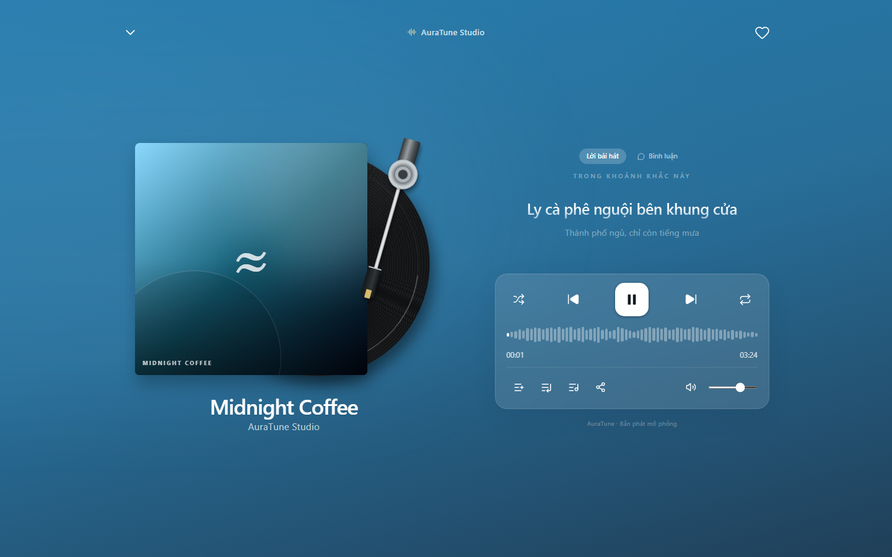
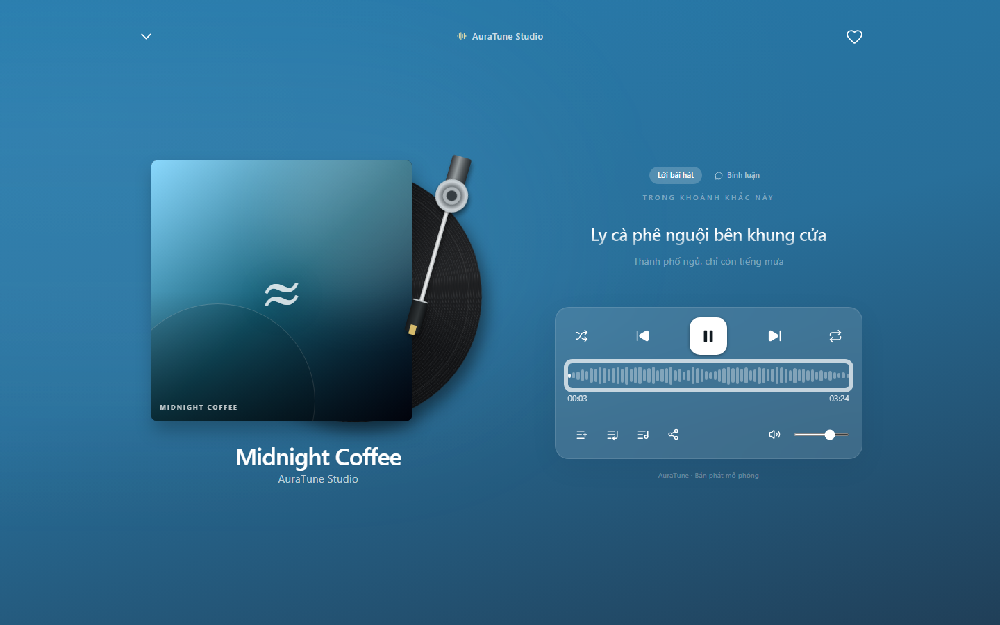
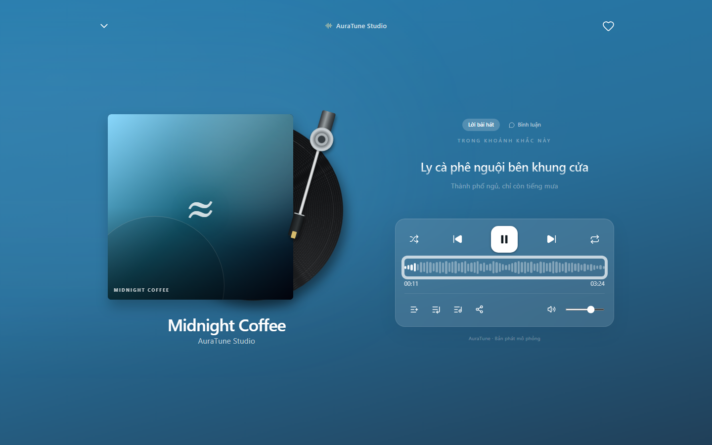
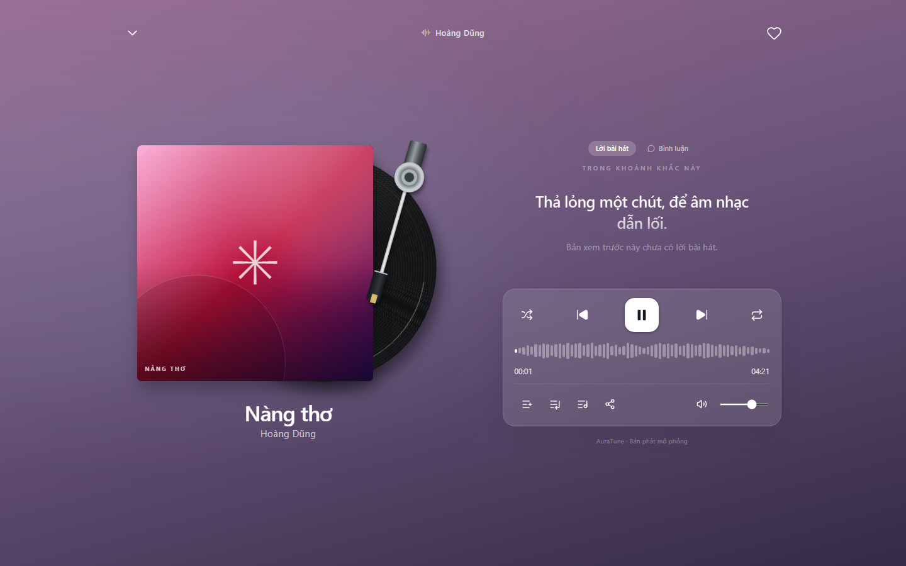

# Feature Specification: Synchronized Lyrics

**Feature Branch**: `020-home-player-queue-spec`

**Created**: 2026-10-31

**Status**: Draft — Ready for Planning

**Input**: User description: "Feature 044 defines how lyrics appear in the full player and follow playback. When lyrics data is available, the current line is highlighted, as stated in the Vision Document."

## Clarifications

### Session 2026-10-31

- Q: Where are lyrics shown? → A: In the lyrics panel of the full player.
- Q: What does the listener see for the current line? → A: The current line is emphasized, with the previous and next lines shown with lower emphasis.
- Q: What if a track has lyrics without timestamps? → A: The plain lyrics are shown with no line highlight, because the API Contract provides both forms.
- Q: What if a track has no lyrics? → A: A clear notice is shown, and playback is not affected.

## User Scenarios & Testing *(mandatory)*

### User Story 1 - Follow Lyrics While Listening (Priority: P1)

As a listener, I want lyrics to follow the music so that I can read along.

**Why this priority**: The Vision Document lists this as a listener need.

**Independent Test**: Play a track with timed lyrics and confirm the highlighted line changes with playback.

**Acceptance Scenarios**:

1. **Given** a track has timed lyrics, **When** I open the full player, **Then** the current line is emphasized.
2. **Given** the track continues, **When** the next line's time arrives, **Then** the emphasis moves to that line.
3. **Given** I seek, **When** the position changes, **Then** the matching line is emphasized.

---

### User Story 2 - Handle Tracks Without Timed Lyrics (Priority: P2)

As a listener, I want a clear state when timed lyrics do not exist so that I do not think something is broken.

**Why this priority**: Not every track in the catalog has lyrics, as noted in the Vision Document.

**Independent Test**: Play tracks with plain lyrics and with no lyrics, and confirm each state.

**Acceptance Scenarios**:

1. **Given** a track has plain lyrics, **When** I open the panel, **Then** I see the text with no highlight.
2. **Given** a track has no lyrics, **When** I open the panel, **Then** I see a notice.

---

### Edge Cases

- **Lyrics cannot load**: A notice is shown and playback continues.
- **Track changes**: The panel switches to the new track's lyrics.
- **Position before the first line**: The first line is shown.
- **Paused playback**: The emphasized line stays in place.
- **Very long line**: The text wraps and stays readable.

## Requirements *(mandatory)*

### Functional Requirements

- **FR-001**: The system MUST show lyrics in the full player when lyrics are available.
- **FR-002**: The system MUST emphasize the line matching the current playback position for timed lyrics.
- **FR-003**: The system MUST show the previous and next lines with lower emphasis.
- **FR-004**: The system MUST update the emphasized line as playback continues.
- **FR-005**: The system MUST update the emphasized line after a seek.
- **FR-006**: The system MUST show plain lyrics without line emphasis when no timing data exists.
- **FR-007**: The system MUST show a notice when a track has no lyrics.
- **FR-008**: The system MUST keep playback running when lyrics cannot be loaded.
- **FR-009**: The system MUST update the panel when the current track changes.
- **FR-010**: The system MUST allow switching between the lyrics and comments panels in the full player.
- **FR-011**: The system MUST NOT implement lyric-based search within this feature.

### Key Entities *(include if feature involves data)*

- **Lyric Line**: Text with an optional start time.
- **Track Lyrics**: The ordered lines for one track, with a state of timed, plain, or unavailable.

## Success Criteria *(mandatory)*

### Measurable Outcomes

- **SC-001**: The emphasized line changes within 1 second of its start time.
- **SC-002**: After a seek, the correct line is emphasized within 1 second.
- **SC-003**: 100% of tracks show lyrics or a clear notice, and never a blank panel.
- **SC-004**: A lyrics failure never interrupts playback.

## Assumptions

- Authentication and user roles are provided by group `010-authentication`.
- API alignment: `GET /songs/:id/lyrics` (Public) returns plain and time-synchronized lyrics.
- Project documentation is maintained in English Markdown, in accordance with `docs/management/team-contract.md`.

### Known Gaps in the Current Prototype

These gaps do not change the requirements. They record where the current UI differs from this specification.

- Lyrics come from mock data and only the timed form is implemented.
- The prototype shows three lines at a time; smooth scrolling through the full text is not implemented.

## UI Screenshots

### 1. Synchronized Lyrics Panel Layout

This screenshot captures the FullScreenPlayer with the "Lời bài hát" (Lyrics) tab active. The layout presents the uppercase header "TRONG KHOẢNG KHẮC NÀY", displaying the current synchronized verse in focus beside the spinning vinyl turntable.

### 2. Synchronized Active Lyric Line Highlighting

This screenshot shows the synchronized lyric line ("Ly cà phê nguội bên khung cửa") at timestamp `0:02` of "Midnight Coffee". The current sung line is prominently enlarged with glowing gradient text, providing immediate visual reinforcement of the audio playback.

### 3. Lyrics Progression During Continuous Playback

This screenshot illustrates real-time lyric advancement as playback progresses to timestamp `0:10`. The active line smoothly transitions to the second lyric verse ("Thành phố ngủ, chỉ còn tiếng mưa"), shifting the previous line upwards with reduced opacity.

### 4. Unavailable Synchronized Lyrics Fallback State

This screenshot captures the interface behavior when playing a song that currently lacks timecoded lyric data (e.g., "Nàng thơ"). The lyrics panel displays the fallback guidance message: "Bản xem trước này chưa có lời bài hát." without breaking layout integrity.

