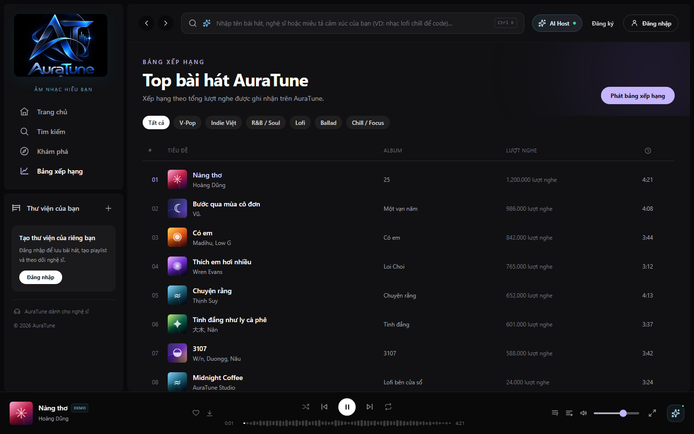
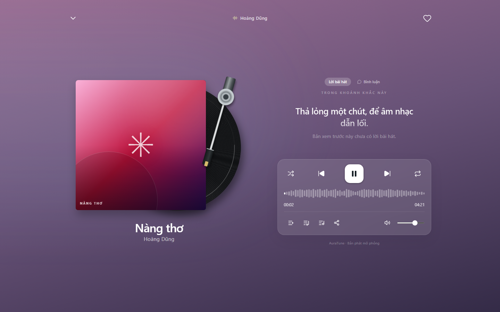

# Feature Specification: Persistent Bottom Player

**Feature ID**: `045-persistent-bottom-player`  
**Functional Group**: `040 – Music Player`  
**Status**: Specification Missing / Pending (Frontend UI Documented)

> [!NOTE]
> The formal feature specification (`spec.md`, `plan.md`, `tasks.md`) for Feature 045 was not previously authored or committed in the repository.
> In accordance with project constraints, no artificial business requirements or synthetic acceptance criteria have been invented.
> The UI screenshots and workflows documented below reflect the actual frontend implementation discovered at `src/frontend/src/App.jsx` and `src/frontend/src/components/player/BottomPlayer.jsx`, cross-referenced with `docs/proposal/proposal.md` and `docs/design/architecture/system-architecture.md`.

---

## Documented Project Context

- **Proposal Reference**: `docs/proposal/proposal.md` (§ 5.1 & § 6.4):
  "Core music player — play/pause/skip/seek... persistent bottom player..."
- **Architectural Shell Integration**:
  In `App.jsx`, `BottomPlayer` is mounted as a fixed-position root component (`fixed inset-x-0 bottom-0 z-40 h-[88px]`) sitting outside the dynamic router view `<AppRouter />`. This guarantees that internal client-side navigation between pages (Home, Search, Charts, Library, History) never unmounts the player or interrupts audio playback sessions.
- **Two-Tier Player Paradigm**:
  The frontend implements a seamless two-tier playback paradigm:
  1. Persistent Bottom Bar: Low-profile docked player allowing continuous browsing and quick access to core controls.
  2. Immersive Full-Screen Overlay: High-fidelity vinyl deck with lyrics and comments, invoked on demand without disrupting the active track.

---

## UI Screenshots

### 1. Bottom Player on Home Dashboard

This screenshot shows the persistent BottomPlayer docked at the bottom of the Home Dashboard (`/`). Listeners can browse featured playlists, trending songs, and recommendations while retaining full visibility of the current track and audio controls.

### 2. Bottom Player on Search Page

This screenshot captures the persistent BottomPlayer while navigating to the Search page (`/search`). The player remains docked, preserving the exact track and playback status while the listener enters search terms.

### 3. Persistent Playback Across Route Navigation (Charts Page)

This screenshot documents continuous playback during navigation to the Charts page (`/charts`). Active playback continues without interruption, showing the active Pause state and waveform progress bar docked beneath the charts table.

### 4. Player Expansion to Full-Screen Mode

This screenshot illustrates the player expansion interaction (`onExpand`). Clicking the expand button or album artwork smoothly transitions from the compact bottom bar into the immersive FullScreenPlayer overlay.

### 5. Player Collapse Back to Docked Bottom Bar

This screenshot shows the collapse interaction. Selecting the chevron-down button or pressing `Esc` smoothly dismisses the full-screen modal, restoring the docked BottomPlayer while maintaining active playback.

