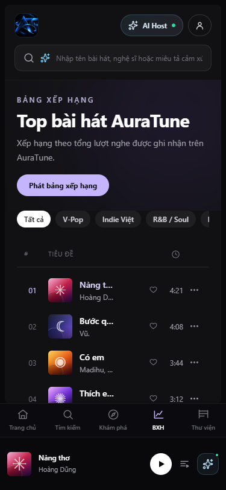

# Feature Specification: Persistent Bottom Player

**Feature Branch**: `020-home-player-queue-spec`

**Created**: 2026-10-31

**Status**: Draft — Ready for Planning

**Input**: User description: "Feature 045 defines the mini player that stays at the bottom of every page and its relationship with the full player, so that listening continues while browsing."

## Clarifications

### Session 2026-10-31

- Q: Does the player stay during page navigation? → A: Yes. It stays on every route, and playback does not restart.
- Q: How does a listener open and close the full player? → A: From the mini player's track area or expand control, and closing returns to the same page.
- Q: What is shown on phones? → A: A compact mini player with track information and play or pause, above the mobile navigation.
- Q: Does the player survive a full page reload? → A: No. After a reload, the player returns to its idle state.

## User Scenarios & Testing *(mandatory)*

### User Story 1 - Keep Listening While Browsing (Priority: P1)

As a listener, I want music to continue while I change pages so that browsing never interrupts me.

**Why this priority**: This is the main player promise in the proposal.

**Independent Test**: Start a track, visit 5 pages, and confirm playback never restarts.

**Acceptance Scenarios**:

1. **Given** a track is playing, **When** I change pages, **Then** playback continues from the same position.
2. **Given** I am on any page, **When** I look at the bottom of the screen, **Then** I see the mini player.

---

### User Story 2 - Expand and Collapse the Player (Priority: P1)

As a listener, I want to switch between the mini and full player so that I can see more when I want to.

**Why this priority**: Lyrics and comments are reached through the full player.

**Independent Test**: Open and close the full player during playback and confirm no restart.

**Acceptance Scenarios**:

1. **Given** the mini player, **When** I select expand, **Then** the full player opens.
2. **Given** the full player, **When** I minimize it or press Escape, **Then** I return to the same page.
3. **Given** either transition, **When** it completes, **Then** playback has not restarted.

---

### User Story 3 - Use the Player on a Phone (Priority: P2)

As a phone user, I want a compact player so that it does not block content.

**Why this priority**: Responsive use is a platform requirement.

**Independent Test**: Use a 375 px viewport and confirm the player does not cover page content or navigation.

**Acceptance Scenarios**:

1. **Given** a phone-width screen, **When** I browse, **Then** the mini player sits above the navigation and page content stays reachable.

---

### Edge Cases

- **Full-page reload**: The player returns to idle, and the listener can start again.
- **Sign-out during playback**: Listener data is cleared, and public playback rules apply.
- **Full player open during navigation**: The page behind cannot be used until the full player closes.
- **Overlay conflicts**: Opening the queue or AI host closes competing overlays.
- **Keyboard use**: Focus stays inside the open full player and returns to where it was when closed.

## Requirements *(mandatory)*

### Functional Requirements

- **FR-001**: The system MUST show the mini player on every route.
- **FR-002**: The system MUST keep playback running without restart when the route changes.
- **FR-003**: The system MUST keep track, queue, and position unchanged when the route changes.
- **FR-004**: The system MUST allow opening the full player from the mini player.
- **FR-005**: The system MUST allow closing the full player by a control and by the Escape key.
- **FR-006**: The system MUST return the listener to the same page and position when the full player closes.
- **FR-007**: The system MUST keep playback running when switching between player views.
- **FR-008**: The system MUST show track information and play or pause on all screen sizes.
- **FR-009**: The system MUST keep page content and navigation reachable while the mini player is shown.
- **FR-010**: The system MUST keep keyboard focus inside the full player while it is open and restore it when closed.
- **FR-011**: The system MUST provide entry points to the queue from the player.
- **FR-012**: The system MUST return to the idle player state after a full page reload.

### Key Entities *(include if feature involves data)*

- **Mini Player**: The compact player shown on all routes.
- **Full Player**: The expanded view with artwork, lyrics, comments, and all controls.

## Success Criteria *(mandatory)*

### Measurable Outcomes

- **SC-001**: Zero playback restarts across navigation between all routes.
- **SC-002**: The full player opens and closes without interrupting playback in 100% of test runs.
- **SC-003**: No page content is covered by the mini player from 375 px to 1920 px wide.
- **SC-004**: The full player can be closed with the keyboard alone.

## Assumptions

- Authentication and user roles are provided by group `010-authentication`.
- The shared shell rules are defined in `specs/130-frontend/131-frontend-foundation/spec.md`.
- API alignment: Layout behavior needs no API.
- Project documentation is maintained in English Markdown, in accordance with `docs/management/team-contract.md`.

### Known Gaps in the Current Prototype

These gaps do not change the requirements. They record where the current UI differs from this specification.

- The mini player shows a demo label because playback is simulated.

## UI Screenshots

### 1. Bottom Player on Home Dashboard

This screenshot shows the persistent BottomPlayer docked at the bottom of the Home Dashboard (`/`). Listeners can browse featured playlists, trending songs, and recommendations while retaining full visibility of the current track and audio controls.

### 2. Bottom Player on Search Page

This screenshot captures the persistent BottomPlayer while navigating to the Search page (`/search`). The player remains docked, preserving the exact track and playback status while the listener enters search terms.

### 3. Persistent Playback Across Route Navigation (Charts Page)

This screenshot documents continuous playback during navigation to the Charts page (`/charts`). Active playback continues without interruption, showing the active Pause state and waveform progress bar docked beneath the charts table.

### 4. Player Expansion to Full-Screen Mode

This screenshot illustrates the player expansion interaction (`onExpand`). Clicking the expand button or album artwork smoothly transitions from the compact bottom bar into the immersive FullScreenPlayer overlay.

### 5. Player Collapse Back to Docked Bottom Bar

This screenshot shows the collapse interaction. Selecting the chevron-down button or pressing `Esc` smoothly dismisses the full-screen modal, restoring the docked BottomPlayer while maintaining active playback.

### Additional States

#### Mini Player on a Phone

The compact mini player above the mobile navigation at 375 px wide.

