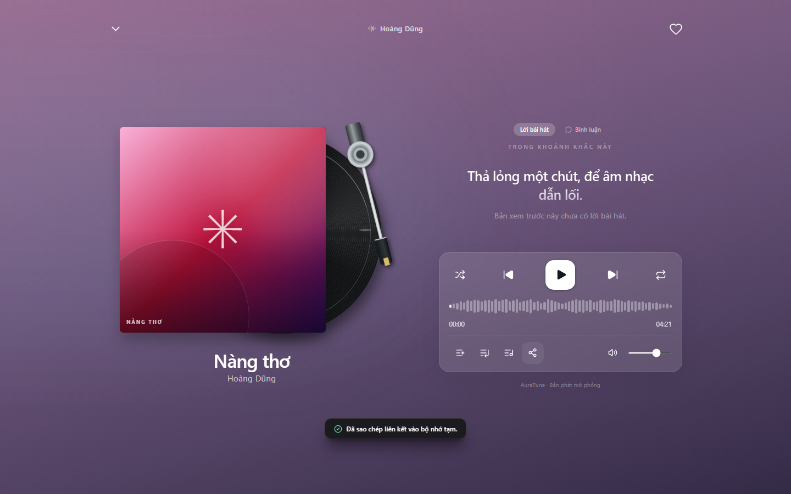
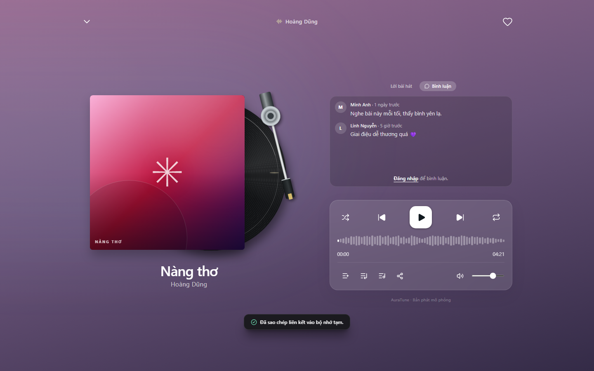
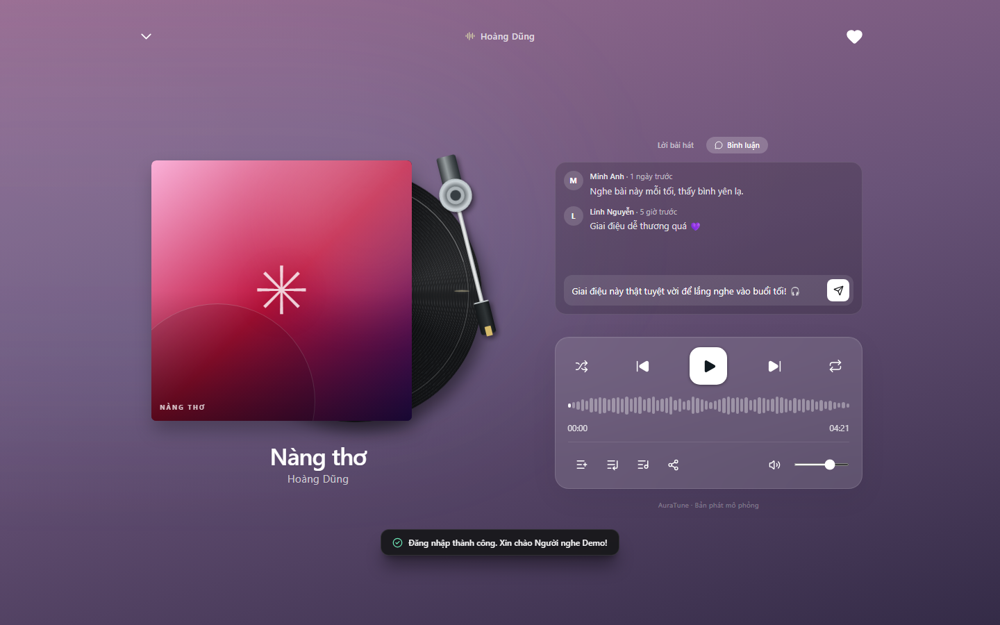
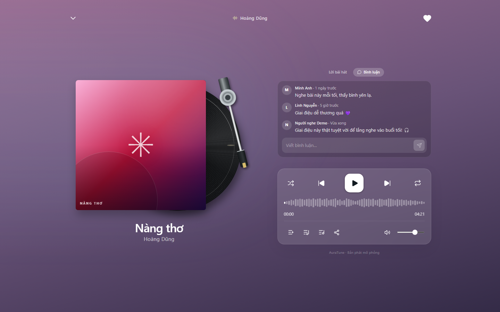
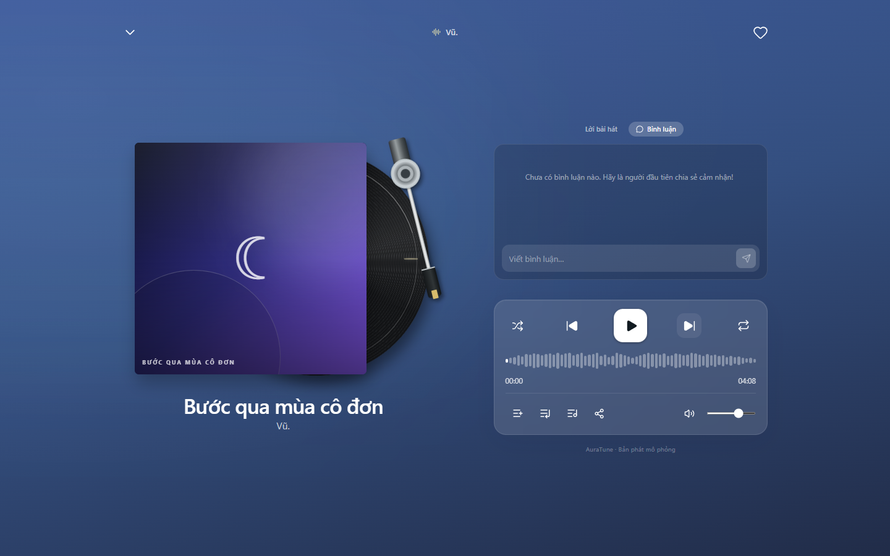
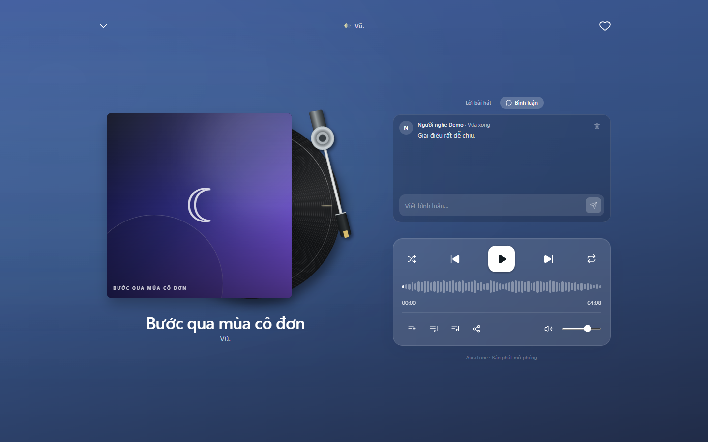

# Feature Specification: Song Sharing and Comments

**Feature Branch**: `020-home-player-queue-spec`

**Created**: 2026-10-31

**Status**: Draft — Ready for Planning

**Input**: User description: "Feature 046 defines sharing a track and reading and posting comments in the full player. Comment access follows the roles in the API Contract."

## Clarifications

### Session 2026-10-31

- Q: Who can read and post comments? → A: Anyone can read comments. Only signed-in users can post.
- Q: Who can delete a comment? → A: The comment's author and administrators.
- Q: What is the comment length limit? → A: 300 characters, and empty or whitespace-only comments are rejected.
- Q: How does sharing work? → A: The device share sheet is used when available. Otherwise the link is copied, and the listener is told the result.
- Q: Are comments linked to a moment in the track? → A: No. The API Contract makes this optional, and this feature does not use it.

## User Scenarios & Testing *(mandatory)*

### User Story 1 - Share a Track (Priority: P1)

As a listener, I want to share a track so that others can hear it.

**Why this priority**: Sharing is named in the core player scope.

**Independent Test**: Select share and confirm the link opens the correct content.

**Acceptance Scenarios**:

1. **Given** the device supports a share sheet, **When** I select share, **Then** it opens with the track link.
2. **Given** no share sheet exists, **When** I select share, **Then** the link is copied and I see a confirmation.
3. **Given** sharing fails, **When** the attempt ends, **Then** I see a clear message.

---

### User Story 2 - Read Comments (Priority: P1)

As a listener or guest, I want to read comments so that I can see what others think.

**Why this priority**: Comments are public under the API Contract.

**Independent Test**: Open the comments panel as a guest and confirm comments appear.

**Acceptance Scenarios**:

1. **Given** a track has comments, **When** I open the panel, **Then** I see author, relative time, and text.
2. **Given** a track has no comments, **When** I open the panel, **Then** I see an empty state.

---

### User Story 3 - Post and Delete Comments (Priority: P1)

As a signed-in listener, I want to post and remove my comments so that I can take part.

**Why this priority**: Posting is the core comment action.

**Independent Test**: Post a comment, then delete it, and confirm a guest sees a sign-in prompt instead.

**Acceptance Scenarios**:

1. **Given** I am signed in, **When** I post valid text, **Then** the comment appears.
2. **Given** I wrote a comment, **When** I delete it, **Then** it disappears.
3. **Given** I am a guest, **When** I view the panel, **Then** I see a sign-in prompt instead of the input.

---

### Edge Cases

- **Whitespace-only comment**: It cannot be submitted.
- **Text over 300 characters**: Input stops at the limit.
- **Post fails**: The text stays in the input with an error message.
- **Share dialog cancelled**: No message is shown.
- **Track without an album**: The share link opens a search for that track.
- **Long text without spaces**: The text wraps inside the panel.

## Requirements *(mandatory)*

### Functional Requirements

- **FR-001**: The system MUST allow sharing the current track from the full player and from track menus.
- **FR-002**: The system MUST use the device share sheet when available and copy the link otherwise.
- **FR-003**: The system MUST confirm when a link is copied and show a message when sharing fails.
- **FR-004**: The system MUST NOT show a message when the listener cancels sharing.
- **FR-005**: The system MUST provide a link that opens content containing the shared track.
- **FR-006**: The system MUST allow all visitors to read comments.
- **FR-007**: The system MUST show each comment's author, relative time, and text.
- **FR-008**: The system MUST allow only signed-in users to post comments.
- **FR-009**: The system MUST limit comments to 300 characters and reject empty text.
- **FR-010**: The system MUST allow a comment's author and administrators to delete it.
- **FR-011**: The system MUST hide delete actions from users without permission.
- **FR-012**: The system MUST enforce comment permissions on the server.
- **FR-013**: The system MUST keep unsent text when posting fails.
- **FR-014**: The system MUST show an empty state when a track has no comments.
- **FR-015**: The system MUST show a sign-in prompt to guests in place of the comment input.

### Key Entities *(include if feature involves data)*

- **Comment**: Text on a track with author, creation time, and owner.
- **Share Link**: A URL that opens content containing the shared track.

## Success Criteria *(mandatory)*

### Measurable Outcomes

- **SC-001**: 100% of share links open content containing the track.
- **SC-002**: A signed-in listener can post a comment in 2 interactions or fewer after typing.
- **SC-003**: Users without permission cannot delete comments in any test scenario.
- **SC-004**: Guests can read comments and cannot post them in 100% of test runs.

## Assumptions

- Authentication and user roles are provided by group `010-authentication`.
- Comment moderation is handled by group `110-admin-functions`.
- API alignment: `GET` and `POST /songs/:id/comments`, `DELETE /comments/:id`. The optional `timestamp_seconds` field is not used.
- Project documentation is maintained in English Markdown, in accordance with `docs/management/team-contract.md`.

### Known Gaps in the Current Prototype

These gaps do not change the requirements. They record where the current UI differs from this specification.

- Comments are stored locally in the prototype, so permissions are enforced only in the client.

## UI Screenshots

### 1. Song Sharing Action and Clipboard Feedback

This screenshot captures the song sharing action executed from the FullScreenPlayer controls bar. Clicking the Share button (`Share2`) copies the song's link to the system clipboard and displays a feedback toast notification: "Đã sao chép liên kết vào bộ nhớ tạm."

### 2. Track Comments Panel Layout

This screenshot shows the FullScreenPlayer with the "Bình luận" (Comments) tab active. It presents the existing comment thread for the playing song, displaying author initials, author display names ("Minh Anh", "Linh Nguyễn"), relative timestamps ("1 ngày trước", "Vừa xong"), and comment content.

### 3. Unauthenticated Comment Prompt

This screenshot captures the comments panel when viewed by an unauthenticated visitor. The submission form is replaced with a clear call to action: "Đăng nhập để bình luận" linking directly to the login screen.

### 4. Authenticated Comment Input

This screenshot illustrates the comment composition workflow for an authenticated user (`demo@auratune.vn`). The input field is filled with listener feedback ("Giai điệu này thật tuyệt vời để lắng nghe vào buổi tối! 🎧"), activating the white Send button.

### 5. Successful Comment Submission

This screenshot demonstrates immediate real-time rendering upon submitting the comment. The new comment appears at the top of the thread with the author display name, "Vừa xong" timestamp, and a contextual delete button (`Trash2`).

### Additional States

#### Empty Comments State

A track with no comments shows an empty state and the comment input for signed-in listeners.

#### Delete Own Comment

The author of a comment sees the delete action on that comment.

