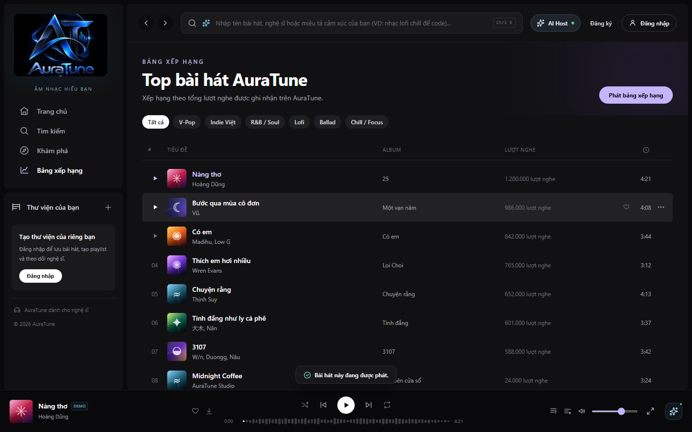

# Feature Specification: Play Next

**Feature Branch**: `020-home-player-queue-spec`

**Created**: 2026-10-31

**Status**: Draft — Ready for Planning

**Input**: User description: "Feature 054 lets listeners choose a track to play immediately after the current one, without clearing the rest of the queue."

## Clarifications

### Session 2026-10-31

- Q: Where is the queue stored? → A: On the client, for the current session. The API Contract has no queue endpoints, so the queue does not survive a page reload and does not sync across devices.
- Q: Where does the track go? → A: Directly after the current track. If it is already queued, it moves there and is not duplicated.
- Q: What if Play Next is used several times? → A: The most recent choice plays first, and earlier choices follow it.
- Q: What if the track is already playing? → A: The queue does not change, and the listener is told.
- Q: Does Play Next apply while shuffle is on? → A: Yes. An explicit Play Next choice takes priority over the next random selection.

## User Scenarios & Testing *(mandatory)*

### User Story 1 - Prioritize a Track (Priority: P1)

As a listener, I want to choose a track to play next so that I hear it soon without losing my queue.

**Why this priority**: The Vision Document names choosing a track to play next.

**Independent Test**: Select Play Next and confirm the track sits first in the upcoming list.

**Acceptance Scenarios**:

1. **Given** a track in any list, **When** I select Play Next, **Then** it becomes the first upcoming track and I see a confirmation.
2. **Given** the track is already queued, **When** I select Play Next, **Then** it moves to first and appears only once.
3. **Given** existing upcoming tracks, **When** I select Play Next, **Then** they stay in order after it.

---

### User Story 2 - Hear the Chosen Track Next (Priority: P1)

As a listener, I want the chosen track to play next so that I can rely on the queue.

**Why this priority**: The action has value only if playback follows it.

**Independent Test**: Skip or finish the current track and confirm the chosen track starts.

**Acceptance Scenarios**:

1. **Given** a Play Next track, **When** the current track ends, **Then** the chosen track starts.
2. **Given** a Play Next track, **When** I press next, **Then** the chosen track starts.
3. **Given** shuffle is on, **When** the player advances, **Then** the chosen track still starts first.

---

### Edge Cases

- **Track already playing**: The queue does not change, and the listener is told.
- **Unavailable track**: The action is refused with a message.
- **Empty upcoming list**: The track becomes the only upcoming track.
- **Repeated use**: The latest choice comes first.
- **Repeat one on**: The current track repeats until next is pressed.

## Requirements *(mandatory)*

### Functional Requirements

- **FR-001**: The system MUST provide a Play Next action in track menus.
- **FR-002**: The system MUST place the chosen track directly after the current track.
- **FR-003**: The system MUST move an already queued track and MUST NOT duplicate it.
- **FR-004**: The system MUST keep the order of other upcoming tracks.
- **FR-005**: The system MUST place the most recent choice first when Play Next is used repeatedly.
- **FR-006**: The system MUST confirm the action.
- **FR-007**: The system MUST inform the listener when the track is already playing and leave the queue unchanged.
- **FR-008**: The system MUST refuse unavailable tracks and inform the listener.
- **FR-009**: The system MUST play the chosen track next, including when shuffle is on.
- **FR-010**: The system MUST NOT interrupt the current track when Play Next is selected.

### Key Entities *(include if feature involves data)*

- **Priority Track**: A track chosen by Play Next to follow the current track.

## Success Criteria *(mandatory)*

### Measurable Outcomes

- **SC-001**: The chosen track plays next in 100% of test runs, including with shuffle on.
- **SC-002**: Zero duplicate queue entries after Play Next.
- **SC-003**: The action takes 2 interactions from a track list.
- **SC-004**: Other upcoming tracks keep their order in 100% of test runs.

## Assumptions

- Authentication and user roles are provided by group `010-authentication`.
- API alignment: Play Next is client-side and needs no API.
- Project documentation is maintained in English Markdown, in accordance with `docs/management/team-contract.md`.

### Known Gaps in the Current Prototype

These gaps do not change the requirements. They record where the current UI differs from this specification.

- With shuffle on, the prototype picks a random track and can skip the Play Next choice.
- Play Next does not refuse unavailable tracks in the prototype.

## UI Screenshots

| # | Screenshot Filename | Workflow Step / State | UI Elements & Components |
|---|---------------------|------------------------|---------------------------|
| 1 | [`01-track-menu-play-next.png`](ui/01-track-menu-play-next.png) | Track Menu "Phát tiếp theo" Option | Track options popover on "Chuyện rằng" (Thịnh Suy), highlighted "Phát tiếp theo" (`ListStart` icon) |
| 2 | [`02-play-next-toast-feedback.png`](ui/02-play-next-toast-feedback.png) | Play Next Confirmation Toast | Notification message: `“Chuyện rằng” sẽ phát tiếp theo.`, active Charts view |
| 3 | [`03-queue-position-after-play-next.png`](ui/03-queue-position-after-play-next.png) | Prioritized Queue Position #1 | QueuePanel drawer showing "Chuyện rằng" elevated to position #1 in "Tiếp theo", directly under active track |
| 4 | [`04-play-next-playback-transition.png`](ui/04-play-next-playback-transition.png) | Seamless Playback Transition | Playback transitioned: "Chuyện rằng" now rendered in "Đang phát" violet card, remaining queue intact |

### Detailed Screenshot Descriptions

#### 1. Track Menu "Phát tiếp theo" Option
- **Path**: `ui/01-track-menu-play-next.png`
- **State**: Options menu `...` opened for "Chuyện rằng" on the Charts page.
- **Description**: Shows the context menu with the top action "Phát tiếp theo" highlighted on hover, indicating the user intent to prioritize this song.

#### 2. Play Next Confirmation Toast
- **Path**: `ui/02-play-next-toast-feedback.png`
- **State**: Immediately after selecting "Phát tiếp theo".
- **Description**: Displays the toast banner confirming `“Chuyện rằng” sẽ phát tiếp theo.`, verifying responsive system feedback.

#### 3. Prioritized Queue Position #1
- **Path**: `ui/03-queue-position-after-play-next.png`
- **State**: QueuePanel open displaying updated sequence.
- **Description**: Shows "Chuyện rằng" positioned as the first item in the upcoming tracks list (#1 under "Tiếp theo · 9"), demonstrating that it was inserted ahead of all previously queued songs.

#### 4. Seamless Playback Transition
- **Path**: `ui/04-play-next-playback-transition.png`
- **State**: Next track action triggered.
- **Description**: Displays the QueuePanel after clicking next track: "Chuyện rằng" is now the active song displayed in the "Đang phát" card, confirming smooth playback execution.

### Additional States

#### Already Playing Notice

Selecting Play Next on the current track leaves the queue unchanged and shows a notice.

