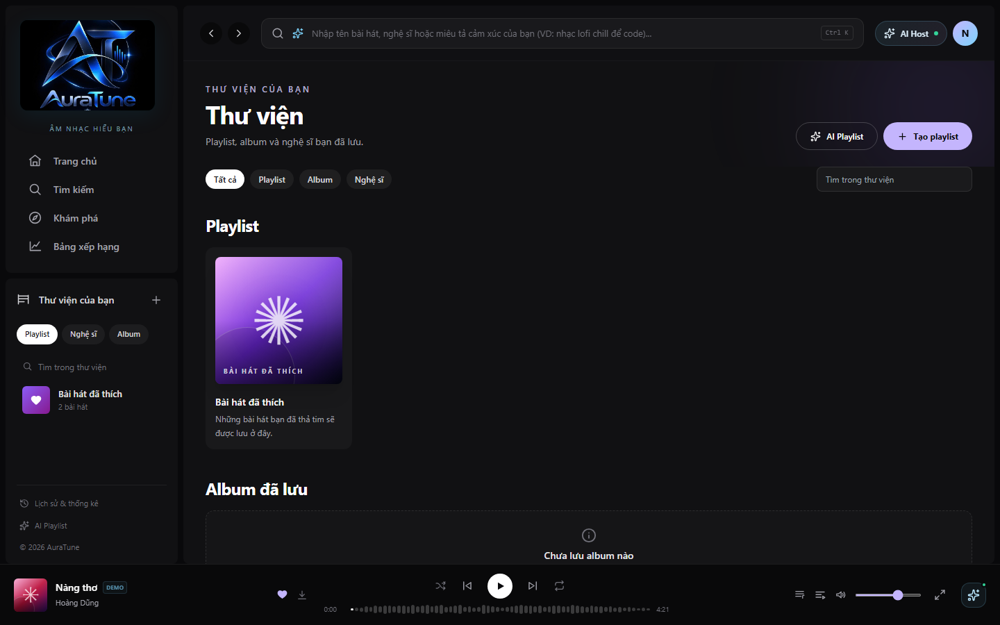
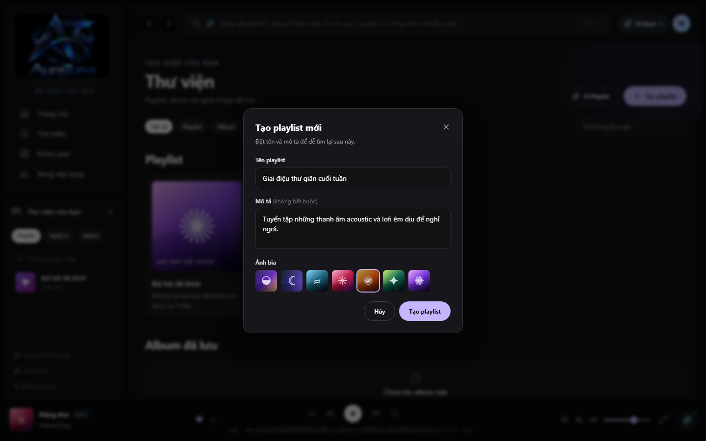
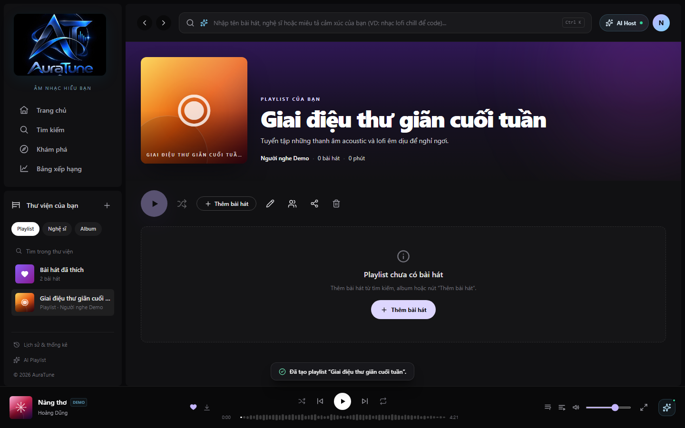
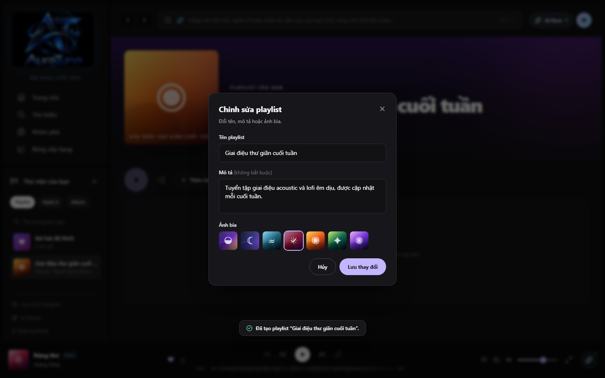
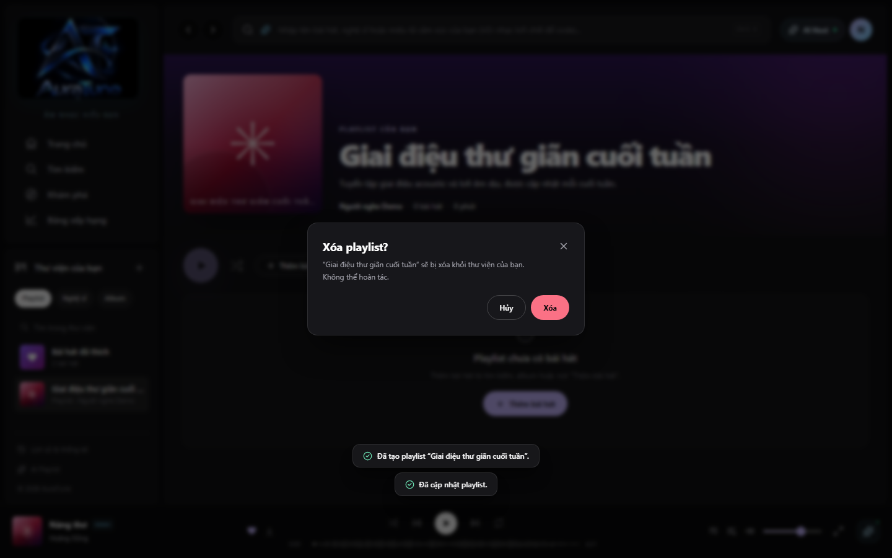

# Feature Specification: Playlist CRUD

**Feature Branch**: `061-playlist-crud`

**Created**: 2026-10-29

**Status**: Draft

**Input**: User description: "Specify feature 061-playlist-crud for the AuraTune project. This feature provides the core management for user-created playlists."

## Clarifications

### Session 2026-10-29
- Q: How should the system handle concurrent edits to the same playlist's metadata by the same user across different devices? → A: Last write wins.
- Q: Should the playlist CRUD feature include any "soft delete" mechanism or an "Undo" option for accidentally deleted playlists? → A: Immediate permanent deletion (requires user confirmation).
- Q: Are there any specific character limits or restricted characters for playlist titles and descriptions? → A: Standard limits: Title (100 characters), Description (500 characters).
- Q: Should the playlist detail view display the total number of songs and the total duration of the playlist? → A: Display both total song count and total duration (sum of all tracks).
- Q: When a user creates a new playlist, should it default to "Public" or "Private"? → A: Private (only the creator can see it until they choose to share).

## User Scenarios & Testing *(mandatory)*

### User Story 1 - Create and View Playlists (Priority: P1)

As a listener, I want to create a new playlist and see it in my library immediately so that I can start organizing my music collection.

**Why this priority**: Core functionality for the playlist management module. Users cannot organize music without a container.

**Independent Test**: Can be fully tested by creating a playlist via the "New Playlist" button and verifying it appears in the "Library" or "My Playlists" section.

**Acceptance Scenarios**:

1. **Given** I am a logged-in user on the Library page, **When** I click "Create Playlist" and enter "Mellow Vibes", **Then** a new playlist named "Mellow Vibes" is created with **Private status by default**, and I am redirected to its empty detail page.
2. **Given** I am a logged-in user, **When** I view my Library, **Then** I see all playlists I have previously created.

---

### User Story 2 - Update Playlist Metadata (Priority: P2)

As a listener, I want to edit my playlist's title, description, and visibility so that I can keep my collection organized and decide who can see it.

**Why this priority**: Essential for personalization and privacy control.

**Independent Test**: Can be tested by opening an existing playlist, entering "Edit" mode, changing the name/description, and verifying the changes persist after saving.

**Acceptance Scenarios**:

1. **Given** I own a playlist named "Old Name", **When** I change the name to "New Name" and save, **Then** the playlist detail page and my library both reflect "New Name".
2. **Given** I have a private playlist, **When** I change its status to "Public", **Then** other users (or an incognito session) can view the playlist via its direct link.
3. **Given** I am editing a playlist, **When** I enter a name longer than **100 characters** or a description longer than **500 characters**, **Then** the system prevents saving and displays a validation error.

---

### User Story 3 - Delete Playlist (Priority: P2)

As a listener, I want to delete a playlist I no longer need so that my library remains clean.

**Why this priority**: Standard CRUD requirement for resource management.

**Independent Test**: Can be tested by selecting "Delete" on a playlist and verifying it no longer appears in the library.

**Acceptance Scenarios**:

1. **Given** I own a playlist, **When** I select "Delete", **Then** the system MUST display a **confirmation warning**.
2. **Given** the confirmation warning is displayed, **When** I confirm, **Then** the playlist is **permanently deleted** and removed from my library.

---

### User Story 4 - View Public Playlists (Priority: P2)

As a listener, I want to view playlists created by others that are marked as public so that I can discover new music.

**Why this priority**: Encourages music discovery and social interaction.

**Independent Test**: Can be tested by navigating to a public playlist URL shared by another user.

**Acceptance Scenarios**:

1. **Given** User A has a public playlist, **When** User B (logged in or guest) visits the playlist link, **Then** User B can see the playlist metadata, tracks, **total song count**, and **total duration**.

---

### Edge Cases

- **Empty Title**: How does the system handle a playlist creation attempt with no title? (Should prevent creation or provide a default like "My Playlist #N").
- **Duplicate Titles**: Can a user have two playlists with the same name? (Allowed, but unique IDs must be used internally).
- **Unauthorized Edit**: What happens if a user tries to edit or delete a playlist they don't own? (System must return a Forbidden error).
- **Network Failure**: How does the UI handle a failed update or deletion request? (Should show an error toast and keep the current state).
- **Concurrent Edits**: If a user saves changes from two different devices simultaneously, the **last write wins** (the most recent request received by the server overwrites previous ones).

## Requirements *(mandatory)*

### Functional Requirements

- **FR-001**: System MUST allow authenticated users to create a playlist with a required `name` and optional `description`.
- **FR-002**: System MUST default new playlists to `Private` status.
- **FR-003**: System MUST enforce character limits: **Title (max 100)** and **Description (max 500)**.
- **FR-004**: System MUST allow users to retrieve a list of all playlists created by the current authenticated user.
- **FR-005**: System MUST allow users to view the metadata of any playlist marked as `public`, including **total song count** and **total duration**.
- **FR-006**: System MUST restrict viewing of `private` playlists to the owner only.
- **FR-007**: System MUST allow the owner of a playlist to update its `name`, `description`, `cover_url`, and `status` (Public/Private).
- **FR-008**: System MUST allow the owner of a playlist to delete the playlist permanently after a confirmation step.
- **FR-009**: System MUST provide a default cover image if no `cover_url` is provided by the user.

### Key Entities *(include if feature involves data)*

- **Playlist**: Represents a user-curated collection of songs.
    - Attributes: `playlist_id` (Unique ID), `user_id_creator` (FK to User), `name` (String, max 100), `description` (String, max 500), `cover_url` (String/URL), `status` (Enum: Public, Private).

## Success Criteria *(mandatory)*

### Measurable Outcomes

- **SC-001**: Users can create a new playlist in under 15 seconds from any page via a global "Create" action.
- **SC-002**: The "My Library" page loads the list of user playlists in under 1 second.
- **SC-003**: 100% of unauthorized attempts to edit or delete a playlist are blocked by the backend.
- **SC-004**: Successful playlist deletion is reflected in the UI across all open tabs/views within 500ms of confirmation.

## Assumptions

- Users must be authenticated to perform any action other than viewing public playlists.
- The actual management of songs (adding/removing tracks) is handled by a separate feature (062).
- Image uploads for covers are handled via a common media service (e.g., Cloudinary) providing a URL.
- The UI will use standard modals/dialogs for input as seen in `PlaylistDialogs.jsx`.
- Standard API conventions for error codes (401, 403, 404, 500) will be followed.
# Feature Specification: 061 - Playlist CRUD (Tạo, Xem, Sửa, Xóa Playlist)

> [!NOTE]
> **Contextual Note**: This specification was reconstructed and formalized based on AuraTune project requirements (Proposal, Vision Document, System Architecture, API Contract) and the existing frontend implementation in `src/frontend/src/pages/Library/LibraryPage.jsx`, `PlaylistDetailPage.jsx`, and `PlaylistDialogs.jsx`.

---

## 1. Overview & Objective

The **Playlist CRUD** feature provides listeners with full lifecycle management of their personal music collections:
1. **View Playlists**: Browse all created playlists and the default "Bài hát đã thích" in the personal Library.
2. **Create Playlist**: Modal dialog allowing listeners to specify a custom title, optional description, and select a distinctive visual cover art gradient.
3. **View Playlist Details**: Dedicated page presenting playlist metadata, duration, track count, ownership label, and action toolbar.
4. **Edit Playlist**: Inline modal to update title, description, and cover theme.
5. **Delete Playlist**: Safe deletion flow with confirmation modal to prevent accidental data loss.

---

## 2. User Stories & Acceptance Criteria

### User Story 1: View Playlists in Library
- **As a** logged-in listener,
- **I want to** view my personal playlists in the Library,
- **So that** I can easily access my curated music collections.

**Acceptance Criteria:**
- Navigating to `/library` displays the user's playlists including "Bài hát đã thích" and all custom user playlists.
- Each playlist card displays its cover art, title, owner name, track count, and quick play button.
- Users can filter library items by "Tất cả", "Playlist", "Album", or "Nghệ sĩ".

### User Story 2: Create a Custom Playlist
- **As a** listener,
- **I want to** create a new playlist with a name, description, and chosen cover art,
- **So that** I can organize songs according to my taste and occasions.

**Acceptance Criteria:**
- Clicking "Tạo playlist" opens `PlaylistFormDialog`.
- Input fields include playlist title (required, max 80 chars), description (optional, max 300 chars), and cover color palette options.
- Submitting creates the playlist in the user's library and automatically navigates to its detail page.

### User Story 3: View Playlist Details
- **As a** listener,
- **I want to** open a playlist to see its full header details and action buttons,
- **So that** I can manage and play the playlist.

**Acceptance Criteria:**
- The page renders hero cover art, label "PLAYLIST CỦA BẠN", title, description, owner, song count, and total duration.
- Action toolbar renders buttons for Play, Shuffle, Add Songs, Edit, Collaborators, Share, and Delete.
- If the playlist is empty, a helpful empty state guides the user to add songs.

### User Story 4: Edit and Delete Playlist
- **As a** playlist owner,
- **I want to** edit metadata or delete a playlist when no longer needed,
- **So that** I have full control over my library.

**Acceptance Criteria:**
- Clicking the edit button (`Pencil`) opens `PlaylistFormDialog` pre-filled with current values.
- Saving updates the playlist in real time.
- Clicking the delete button (`Trash2`) prompts a confirmation dialog before permanent removal.

---

## 3. Frontend Component Mapping

- **Library View**: [`LibraryPage.jsx`](file:///F:/CSC_HCMUS/Chuyên%20ngành/NM%20SE/AuraTune/src/frontend/src/pages/Library/LibraryPage.jsx)
- **Detail View**: [`PlaylistDetailPage.jsx`](file:///F:/CSC_HCMUS/Chuyên%20ngành/NM%20SE/AuraTune/src/frontend/src/pages/PlaylistDetail/PlaylistDetailPage.jsx)
- **Modal Dialogs**: [`PlaylistDialogs.jsx`](file:///F:/CSC_HCMUS/Chuyên%20ngành/NM%20SE/AuraTune/src/frontend/src/components/playlist/PlaylistDialogs.jsx) (`PlaylistFormDialog`)
- **State Store**: [`AppStore.jsx`](file:///F:/CSC_HCMUS/Chuyên%20ngành/NM%20SE/AuraTune/src/frontend/src/context/AppStore.jsx) (`createPlaylist`, `updatePlaylist`, `deletePlaylist`)

---

## 4. UI Screenshots

### 1. Playlist List

**Related workflow:** Workflow A - View playlists in Library.

Shows the Library collection page displaying playlist cards, including "Bài hát đã thích" and custom user playlists, along with filter tabs and creation entry points.

---

### 2. Create Playlist

**Related workflow:** Workflow B - Create a new playlist.

Shows the playlist creation modal (`PlaylistFormDialog`) with title input, description textarea, and selectable cover art color palettes (`sunset` chosen).

---

### 3. Playlist Details

**Related workflow:** Workflow C - View playlist details.

Shows the dedicated playlist detail page after creation, featuring hero cover art, ownership metadata, action toolbar (Play, Shuffle, Add Songs, Edit, Collaborators, Share, Delete), and empty state.

---

### 4. Edit Playlist

**Related workflow:** Workflow D - Edit playlist metadata.

Shows the playlist edit modal with pre-filled title and updated description and cover art variant (`rose`), ready to save changes.

---

### 5. Delete Playlist

**Related workflow:** Workflow E - Delete playlist confirmation.

Shows the confirmation dialog warning that the playlist will be permanently deleted from the library, with "Hủy" and destructive "Xóa" buttons.
