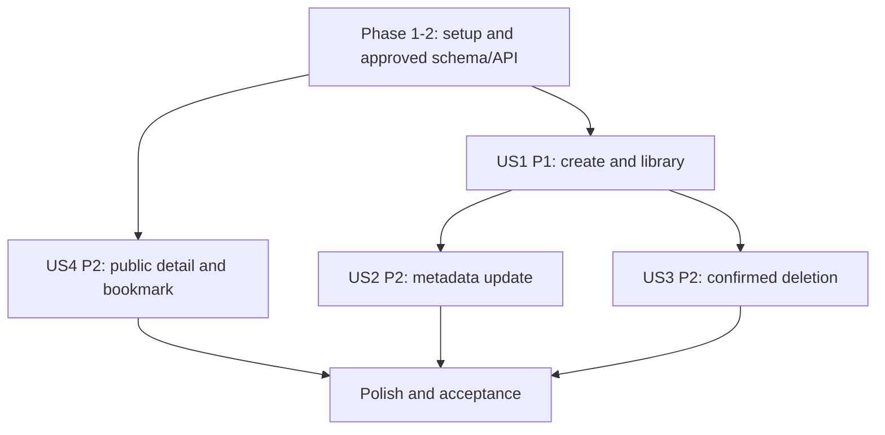

# Tasks: Playlist CRUD

**Input**: Design documents from `specs/060-playlist-management/061-playlist-crud/`

**Prerequisites**: `spec.md`, `plan.md`, `research.md`, `data-model.md`, `contracts/playlist-crud.md`, `quickstart.md`

**Tests**: No dedicated test tasks are added; the feature spec does not request test-first development and the repository has no established playlist test runner. Follow the quickstart acceptance scenarios after implementation.

**Scope**: Feature 061 only. Song membership is 062; playback 063; collaboration 065. Do not treat bookmarks as collaborators.

## Phase 1: Setup

**Purpose**: Confirm existing project boundaries and prepare feature work.

- [ ] T001 Inspect current playlist UI/store, backend route conventions, Supabase/database access, and existing migrations in `src/frontend/src/`, `src/backend/`, and `src/database/`.
- [ ] T002 [P] Confirm implementation test/verification commands from `package.json`, `src/frontend/package.json`, and `src/backend/package.json`; do not add a new test runner in this feature.

## Phase 2: Foundational Contract and Data Decisions

**Purpose**: Resolve shared decisions that block implementation.

- [ ] T003 Approve bookmark persistence and unavailable/deleted target behavior; record exact schema in `specs/060-playlist-management/061-playlist-crud/data-model.md`.
- [ ] T004 Verify playlist columns, aggregates, default cover, and delete/FK behavior against actual database migrations; update `specs/060-playlist-management/061-playlist-crud/research.md`.
- [ ] T005 Approve CRUD/bookmark routes, methods, payloads, response fields, and errors in `specs/060-playlist-management/061-playlist-crud/contracts/playlist-crud.md` and `docs/analysis-and-design/api-contract.md`.
- [ ] T006 Implement only approved playlist/bookmark schema changes in `src/database/migrations/002_playlist_crud.sql` after T003–T005.

## Phase 3: User Story 1 - Create and View Playlists (Priority: P1)

**Goal**: Authenticated listeners create a private playlist and see their playlists in the library.

**Independent Test**: Create a valid playlist and verify it appears in the owner's library with private status and detail navigation; verify 80/300 character boundaries and invalid input feedback.

- [ ] T007 [US1] Implement create and owner-library operations in `src/backend/routes/playlistRoutes.js`, `src/backend/controllers/playlistController.js`, and `src/backend/services/playlistService.js` using approved contract T005.
- [ ] T008 [US1] Enforce required name (maximum 80 characters), optional description (maximum 300 characters), private default, and default cover in `src/backend/services/playlistService.js`.
- [ ] T009 [US1] Connect `src/frontend/src/pages/Library/LibraryPage.jsx` and `src/frontend/src/context/AppStore.jsx` to `src/frontend/src/services/playlistApi.js` and route successful creation to playlist detail.
- [ ] T010 [US1] Render create validation, loading, empty-library, and recoverable service-error states in `src/frontend/src/pages/Library/LibraryPage.jsx` and `src/frontend/src/components/playlist/PlaylistDialogs.jsx`.

## Phase 4: User Story 2 - Update Playlist Metadata (Priority: P2)

**Goal**: Owners update playlist name, description, cover URL, and visibility; metadata follows last-write-wins.

**Independent Test**: Update owned playlist metadata and reload; verify persistence. Verify invalid length and non-owner update are rejected by the backend.

- [ ] T011 [US2] Implement owner-authorized metadata update with last-write-wins behavior in `src/backend/controllers/playlistController.js` and `src/backend/services/playlistService.js`.
- [ ] T012 [US2] Connect edit dialog in `src/frontend/src/components/playlist/PlaylistDialogs.jsx` and `src/frontend/src/pages/PlaylistDetail/PlaylistDetailPage.jsx` to the approved update operation and prefill current metadata.
- [ ] T013 [US2] Preserve current visible metadata and show validation/permission/network feedback when update fails in `src/frontend/src/pages/PlaylistDetail/PlaylistDetailPage.jsx`.

## Phase 5: User Story 3 - Delete Playlist (Priority: P2)

**Goal**: Owners permanently delete a playlist after confirming the destructive action.

**Independent Test**: Cancel confirmation and verify no request is sent; confirm deletion and verify the playlist is permanently absent. Non-owner deletion is rejected server-side.

- [ ] T014 [US3] Implement owner-authorized permanent delete and approved dependent-row behavior in `src/backend/controllers/playlistController.js` and `src/backend/services/playlistService.js`.
- [ ] T015 [US3] Connect delete confirmation in `src/frontend/src/components/playlist/PlaylistDialogs.jsx` to the delete service only after explicit confirmation.
- [ ] T016 [US3] Remove deleted playlist from `AppStore.jsx` and navigate away from its detail page only after server success; retain state and show error on failure.

## Phase 6: User Story 4 - View and Bookmark Public Playlists (Priority: P2)

**Goal**: Visitors can read public playlists and authenticated listeners can save a read-only reference.

**Independent Test**: Guest reads public playlist but not private playlist; authenticated listener bookmarks public playlist and sees the reference in library without edit rights.

- [ ] T017 [US4] Implement public/private detail visibility and owner/private access checks in `src/backend/controllers/playlistController.js` and `src/backend/services/playlistService.js`.
- [ ] T018 [US4] Implement duplicate-safe public-playlist bookmark and library-reference reads in `src/backend/services/playlistBookmarkService.js` using only the schema approved in T003/T006.
- [ ] T019 [US4] Connect public playlist detail and bookmark action to approved services in `src/frontend/src/pages/PlaylistDetail/PlaylistDetailPage.jsx` and `src/frontend/src/context/AppStore.jsx`.
- [ ] T020 [US4] Render public playlist song count and total duration from authoritative detail data in `src/frontend/src/pages/PlaylistDetail/PlaylistDetailPage.jsx`.
- [ ] T021 [US4] Render bookmarked playlists as read-only references in `src/frontend/src/pages/Library/LibraryPage.jsx`; resolve deleted or inaccessible references using the approved contract.

## Phase 7: Polish and Acceptance

- [ ] T022 Update `docs/analysis-and-design/api-contract.md` and `specs/060-playlist-management/061-playlist-crud/contracts/playlist-crud.md` to match implemented behavior if approved contract changed.
- [ ] T023 Execute the create, validation, visibility, owner authorization, bookmark, deletion, and network-failure scenarios in `specs/060-playlist-management/061-playlist-crud/quickstart.md`.

## Dependencies and Execution Order

- Phase 1 is inspection only. Phase 2 blocks implementation where schema/API choices are unresolved.
- US1 is the MVP and can begin after the playlist create/list contract and deployed schema are verified.
- US2 and US3 depend on the common playlist identity/authorization foundation; US4 bookmark persistence depends on T003/T006.
- Final acceptance depends on all implemented stories and the approved contracts.



## Parallel Opportunities

- T001 and T002 can proceed independently.
- After Phase 2, US2 and US3 can proceed independently if they touch separate service/UI units; coordinate if backend files are shared.
- US4 public reads can proceed independently of bookmark persistence, but bookmark tasks require T003/T006.

### Parallel Execution Examples

After T005 fixes the API contract, backend playlist route work and the create form can be developed against the same approved request/response shape:

```text
T007 Implement create/list operations in src/backend/routes/playlistRoutes.js, src/backend/controllers/playlistController.js, and src/backend/services/playlistService.js
T009 Connect LibraryPage.jsx and AppStore.jsx to the approved create/list contract
```

Connect and integrate the frontend task after the backend endpoint is available.

### Parallel Execution Examples

After T005 is approved, frontend form wiring and backend endpoint work can be prepared concurrently against the stable contract:

```text
T007 Implement create/list operations in src/backend/routes/playlistRoutes.js, src/backend/controllers/playlistController.js, and src/backend/services/playlistService.js
T009 Connect LibraryPage.jsx and AppStore.jsx to the approved create/list contract
```

The UI task must not be considered complete until T007 is integrated end to end.

## Implementation Strategy

Deliver US1 first as the MVP. Then implement metadata edit and confirmed delete, followed by public detail and bookmark integration. Keep any unapproved bookmark/API/database decision as a gate; do not implement guessed fields.
