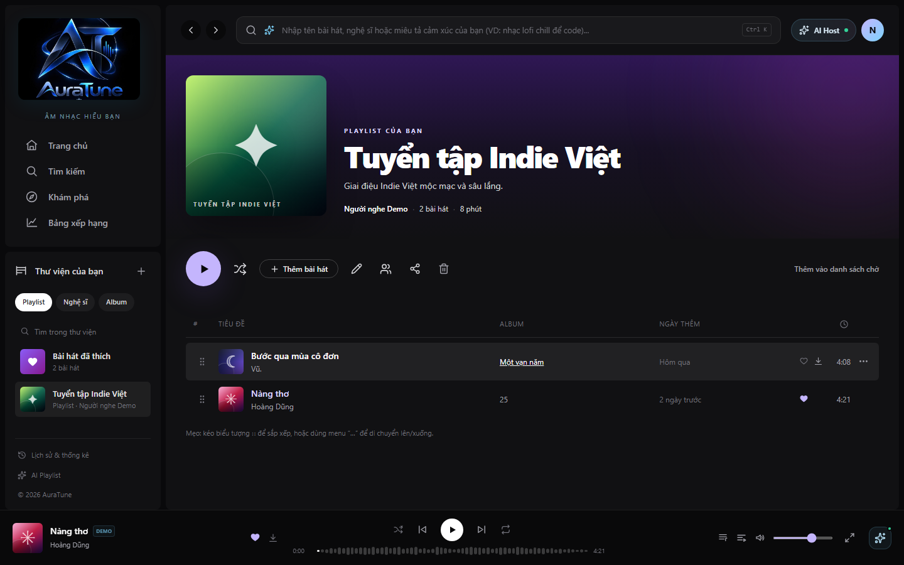
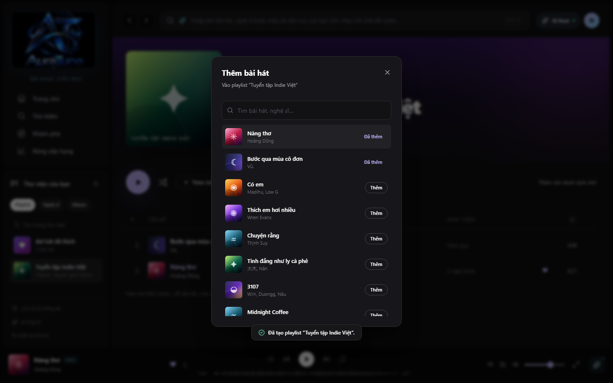
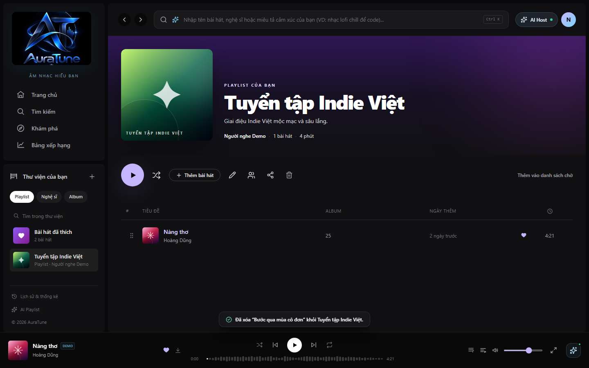

# Feature Specification: Playlist Song Management

**Feature Branch**: `062-playlist-song-management`

**Created**: 2026-10-29

**Status**: Draft

**Input**: User description: "Specify feature 062-playlist-song-management for the AuraTune project. This feature provides the logic and UI for managing the tracks within a playlist."

## User Scenarios & Testing *(mandatory)*

### User Story 1 - Add Tracks to Playlist (Priority: P1)

As a listener, I want to add songs to my playlists from anywhere in the app so that I can curate my music collection.

**Why this priority**: Essential for building playlists. Without adding songs, a playlist is just an empty container.

**Independent Test**: Can be tested by selecting "Add to playlist" on a song, picking a target playlist, and verifying the song appears in that playlist's tracklist.

**Acceptance Scenarios**:

1. **Given** I am a logged-in user viewing a song, **When** I open the `TrackMenu` and select "Add to playlist" > [Playlist Name], **Then** the song is added to the end of that playlist and I see a success notification.
2. **Given** I am a logged-in user, **When** I add a song to a playlist, **Then** the playlist's `total_song_count` increases by 1 and `total_duration` increases by the song's duration in real-time.

---

### User Story 2 - Liked Songs Integration (Priority: P1)

As a listener, I want to toggle a "Like" on any song to automatically manage my "Liked Songs" playlist.

**Why this priority**: "Liked Songs" is a core user expectation in music streaming apps for quick curation.

**Independent Test**: Can be tested by clicking the heart icon on a song and verifying it appears in (or is removed from) the "Liked Songs" playlist.

**Acceptance Scenarios**:

1. **Given** a song is not in my "Liked Songs", **When** I click the heart icon, **Then** the song is added to my "Liked Songs" playlist and the heart icon turns active.
2. **Given** a song is already in my "Liked Songs", **When** I click the heart icon, **Then** the song is removed from my "Liked Songs" playlist and the heart icon returns to its inactive state.

---

### User Story 3 - Remove and Reorder Tracks (Priority: P2)

As a listener, I want to remove songs or change their order within my playlist so that I can control the playback sequence.

**Why this priority**: Standard playlist management functionality for refining the listening experience.

**Independent Test**: Can be tested by dragging a `SongRow` to a new position or selecting "Remove from playlist" and verifying the changes persist.

**Acceptance Scenarios**:

1. **Given** I am viewing a playlist I own, **When** I drag a song from position 1 to position 3 using the `GripVertical` icon, **Then** the tracklist reorders and the new sequence is saved.
2. **Given** I am viewing a playlist I own, **When** I select "Remove from playlist" in the `TrackMenu` for a song, **Then** the song is removed from the view and the database, and the playlist metadata (count/duration) updates accordingly.

---

### Edge Cases

- **Duplicate Add**: What happens if a user adds the same song to the same playlist twice? (System should allow it but treat them as separate entries with unique sort orders).
- **Concurrent Reordering**: If a user reorders a playlist on two devices simultaneously, the last state received by the server wins.
- **Collaborative Playlists**: How do permissions work for adding/removing? (Owners and shared users with edit permissions can manage songs; specific permissions are defined in feature 065).
- **Network Failure**: If an add/remove/reorder action fails, the UI must revert to the previous state and show an error toast.

## Requirements *(mandatory)*

### Functional Requirements

- **FR-001**: System MUST allow authenticated users to add any song to their owned or collaborative playlists via the `TrackMenu` component.
- **FR-002**: System MUST automatically maintain a "Liked Songs" playlist for every user, syncing additions/removals with the song "Like" (heart) toggle.
- **FR-003**: System MUST persist the association between playlists and songs in the `playlist_songs` table, including a `sort_order` or `position`.
- **FR-004**: System MUST support drag-and-drop reordering of songs within the playlist detail view using `SongRow` with `GripVertical` icons.
- **FR-005**: System MUST allow the playlist owner to remove any song from their playlist via the `TrackMenu`.
- **FR-006**: System MUST update the playlist's `total_song_count` and `total_duration` metadata in the `playlists` table whenever songs are added or removed.
- **FR-007**: System MUST prevent users from adding songs to playlists they do not own or have collaborative access to.

### Key Entities *(include if feature involves data)*

- **PlaylistSong**: Represents the link between a playlist and a song.
    - Attributes: `playlist_id` (FK), `song_id` (FK), `added_at` (Timestamp), `sort_order` (Integer).
- **UserLikedSong**: Represents a user's liked status for a song (linked to the "Liked Songs" playlist).
    - Attributes: `user_id` (FK), `song_id` (FK), `created_at` (Timestamp).

## Success Criteria *(mandatory)*

### Measurable Outcomes

- **SC-001**: Adding a song to a playlist completes (UI feedback + persistence) in under 800ms on a standard 4G connection.
- **SC-002**: "Liked Songs" toggle updates the underlying playlist and reflects the change in the UI within 300ms.
- **SC-003**: Drag-and-drop reordering provides smooth 60fps visual feedback and persists the final state to the database within 1 second of drop.
- **SC-004**: Playlist metadata (song count and total duration) is always consistent with the actual tracks in the `playlist_songs` table (0% drift).

## Assumptions

- Users must be authenticated to add/remove/reorder songs.
- The `TrackMenu` and `SongRow` components are already available and only need integration logic.
- "Liked Songs" is a system-managed playlist created automatically upon user registration or first "Like" action.
- Collaborative playlist permissions (065) will use the same underlying management logic but with extended authorization checks.
- Metadata updates (count/duration) may be handled via database triggers or application-level logic after successful `playlist_songs` mutations.
# Feature Specification: 062 - Playlist Song Management (Quản lý Bài hát trong Playlist)

> [!NOTE]
> **Contextual Note**: This specification was reconstructed and formalized based on AuraTune project requirements (Proposal, Vision Document, System Architecture, API Contract) and the existing frontend implementation in `src/frontend/src/pages/PlaylistDetail/PlaylistDetailPage.jsx`, `SongTable.jsx`, and `TrackMenu.jsx`.

---

## 1. Overview & Objective

The **Playlist Song Management** feature enables listeners to curate and modify the tracks contained within any user-owned or collaborative playlist:
1. **View Playlist Tracklist**: Full tabular song display including track number, artwork, title, artist link, album, duration, play count, like button, download button, and options menu.
2. **Add Songs to Playlist**: An interactive search dialog (`AddSongsDialog`) allowing users to search public songs by title or artist, previewing tracks and adding them with a single click.
3. **Remove Songs from Playlist**: Removing individual songs directly through the track options menu `...` with instant toast notification feedback and dynamic list update.
4. **Reorder Songs**: In-place drag-and-drop reordering via grip handle (`⋮⋮`) or contextual controls.

---

## 2. User Stories & Acceptance Criteria

### User Story 1: View Playlist Tracklist
- **As a** listener,
- **I want to** see the complete list of songs in a playlist with metadata,
- **So that** I know the exact composition and sequence of the collection.

**Acceptance Criteria:**
- Tracklist displays all contained songs using `SongTable`.
- Each row includes order number, cover art, track title, clickable artist name, album name, duration, and action icons.
- Top metadata recalculates total song count and combined playlist duration dynamically.

### User Story 2: Search and Add Songs to Playlist
- **As a** playlist editor,
- **I want to** search for songs and add them directly into my playlist,
- **So that** I can enrich the playlist with new music easily.

**Acceptance Criteria:**
- Clicking "Thêm bài hát" opens the `AddSongsDialog` modal with search input.
- Typing in the search field dynamically filters the song catalog.
- Clicking "Thêm" appends the track to the playlist and toggles button label to disabled "Đã thêm".

### User Story 3: Remove Songs from Playlist
- **As a** playlist editor,
- **I want to** remove an unwanted song from the playlist,
- **So that** I can maintain a collection tailored to my preferences.

**Acceptance Criteria:**
- Track menu `...` on each song row includes option "Xóa khỏi playlist".
- Selecting it removes the song from the playlist state.
- A toast notification confirms: `"Đã xóa “<Tên bài hát>” khỏi <Tên playlist>."`
- The tracklist and top song counter update immediately.

---

## 3. Frontend Component Mapping

- **Playlist Page & Add Modal**: [`PlaylistDetailPage.jsx`](file:///F:/CSC_HCMUS/Chuyên%20ngành/NM%20SE/AuraTune/src/frontend/src/pages/PlaylistDetail/PlaylistDetailPage.jsx) (`AddSongsDialog`)
- **Song Table Component**: [`SongTable.jsx`](file:///F:/CSC_HCMUS/Chuyên%20ngành/NM%20SE/AuraTune/src/frontend/src/components/song/SongTable.jsx)
- **Track Options Menu**: [`TrackMenu.jsx`](file:///F:/CSC_HCMUS/Chuyên%20ngành/NM%20SE/AuraTune/src/frontend/src/components/song/TrackMenu.jsx)
- **State Store**: [`AppStore.jsx`](file:///F:/CSC_HCMUS/Chuyên%20ngành/NM%20SE/AuraTune/src/frontend/src/context/AppStore.jsx) (`addTrackToPlaylist`, `removeTrackFromPlaylist`, `moveTrackInPlaylist`)

---

## 4. UI Screenshots

### 1. Playlist Tracklist

**Related workflow:** Workflow A - View playlist tracklist.

Shows the playlist detail view with multiple curated songs displayed in `SongTable`, showing index, cover, title, artist, album, duration, action icons, and drag-and-drop reorder hint.

---

### 2. Add Songs Dialog

**Related workflow:** Workflow B - Add songs to a playlist.

Shows the `AddSongsDialog` modal with search input, song catalog search results, and "Đã thêm" indicators for added songs.

---

### 3. Remove Song from Playlist

**Related workflow:** Workflow C - Remove a song from a playlist.

Shows the resulting state after removing a song from the playlist, with confirmation toast notification: *"Đã xóa “Bước qua mùa cô đơn” khỏi Tuyển tập Indie Việt."* and updated track count.
