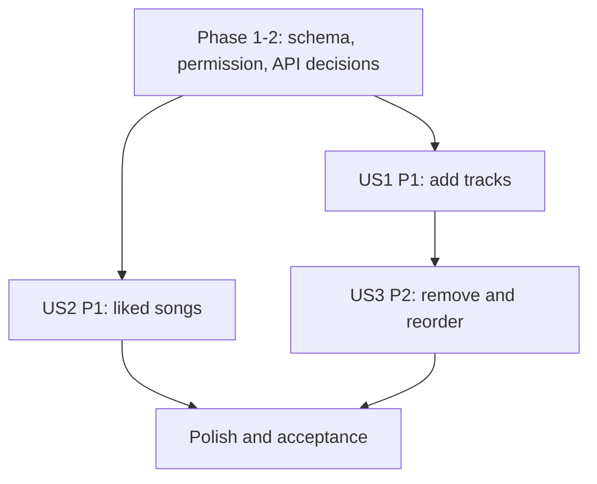

# Tasks: Playlist Song Management

**Input**: Design documents from `specs/060-playlist-management/062-playlist-song-management/`

**Prerequisites**: `spec.md`, `plan.md`, `research.md`, `data-model.md`, `contracts/playlist-songs.md`, `quickstart.md`

**Tests**: No dedicated test tasks are added because test-first work was not requested and the repo has no playlist test runner. Validate via the quickstart after implementation.

**Scope**: Feature 062 only. Playlist playback is 063; collaborative permission and contributor rules are shared with 065.

## Phase 1: Setup

- [ ] T001 Inspect current playlist membership UI/state and backend/database patterns in `src/frontend/src/`, `src/backend/`, and `src/database/`.
- [ ] T002 [P] Confirm available verification commands in root `package.json`, `src/frontend/package.json`, and `src/backend/package.json`; do not add a runner here.

## Phase 2: Foundational Data and Contract Decisions

- [ ] T003 Approve membership position representation and concurrent reorder behavior with 065; record in `specs/060-playlist-management/062-playlist-song-management/data-model.md`.
- [ ] T004 Approve collaborative contributor field and authorization rule with 065 in `specs/060-playlist-management/062-playlist-song-management/data-model.md`.
- [ ] T005 Confirm count/duration source and Liked Songs projection with 061 against actual schema/migrations; update `specs/060-playlist-management/062-playlist-song-management/research.md`.
- [ ] T006 Approve add/remove/reorder/like API methods and payloads in `specs/060-playlist-management/062-playlist-song-management/contracts/playlist-songs.md` and shared API contract.
- [ ] T007 Add only approved membership/order schema changes in `src/database/migrations/003_playlist_song_order.sql`; contributor attribution migration is coordinated with 065.

## Phase 3: User Story 1 - Add Tracks to Playlist (Priority: P1)

**Goal**: Authenticated owner/editor adds a song once and sees updated membership/count/duration.

**Independent Test**: Add a valid song to an owned playlist; verify it appears at the end exactly once and metadata updates. Retry duplicate add and verify specified feedback.

- [ ] T008 [US1] Implement duplicate-safe add-song operation and song existence validation in `src/backend/routes/playlistSongRoutes.js`, `src/backend/controllers/playlistSongController.js`, and `src/backend/services/playlistSongService.js`.
- [ ] T009 [US1] Enforce owner or active-collaborator permission on add operation in `src/backend/services/playlistAuthorizationService.js` using the approved 065 rule.
- [ ] T010 [US1] Update count/duration consistently with membership using the approved calculation/storage strategy in `src/backend/services/playlistSongService.js`.
- [ ] T011 [US1] Connect playlist selection in `src/frontend/src/components/song/TrackMenu.jsx` to the approved add-song API through `src/frontend/src/services/playlistSongApi.js` and `src/frontend/src/context/AppStore.jsx`.
- [ ] T012 [US1] Render already-added, success, loading, permission, and network-failure feedback in `src/frontend/src/components/song/TrackMenu.jsx` and related playlist dialog components.

## Phase 4: User Story 2 - Liked Songs Integration (Priority: P1)

**Goal**: Like/unlike toggle stays synchronized with the user's Liked Songs collection.

**Independent Test**: Like a song and verify active heart plus one library entry; unlike it and verify both states clear, including after reload.

- [ ] T013 [US2] Implement like/unlike operations using `user_liked_songs` and approved idempotency/response behavior in `src/backend/routes/likedSongRoutes.js` and `src/backend/services/likedSongService.js`.
- [ ] T014 [US2] Connect song heart actions in `src/frontend/src/components/song/TrackMenu.jsx` to `src/frontend/src/services/likedSongApi.js` through `src/frontend/src/context/AppStore.jsx`.
- [ ] T015 [US2] Synchronize heart state and Liked Songs library projection in `src/frontend/src/context/AppStore.jsx` without creating duplicate membership state.
- [ ] T016 [US2] Restore prior like/library UI state and show error when the server rejects the operation in `src/frontend/src/context/AppStore.jsx` and `src/frontend/src/components/song/TrackMenu.jsx`.

## Phase 5: User Story 3 - Remove and Reorder Tracks (Priority: P2)

**Goal**: Authorized editors remove tracks and persist a new track order.

**Independent Test**: Remove a track and reorder remaining tracks; reload and verify membership/order/aggregates. Verify unauthorized edit is rejected.

- [ ] T017 [US3] Implement owner/editor-authorized removal and consistent count/duration update in `src/backend/services/playlistSongService.js`.
- [ ] T018 [US3] Implement complete-order validation and persistence using approved position/conflict rules in `src/backend/services/playlistSongService.js`.
- [ ] T019 [US3] Connect remove action in `src/frontend/src/pages/PlaylistDetail/PlaylistDetailPage.jsx` and `TrackMenu.jsx` to the approved API.
- [ ] T020 [US3] Connect drag-and-drop ordering in `src/frontend/src/pages/PlaylistDetail/PlaylistDetailPage.jsx`/`SongRow.jsx` to persist order and restore prior order on failure.
- [ ] T021 [US3] Display collaborator attribution from the approved response contract in `src/frontend/src/pages/PlaylistDetail/PlaylistDetailPage.jsx` and `src/frontend/src/components/song/SongRow.jsx` when applicable.

## Phase 6: Polish and Acceptance

- [ ] T022 Update shared API/database documentation if approved contracts or schema changed in `docs/analysis-and-design/api-contract.md` and `docs/design/database/`.
- [ ] T023 Execute duplicate, like/unlike, add/remove, reorder, aggregates, permission, concurrency, and failure scenarios in `specs/060-playlist-management/062-playlist-song-management/quickstart.md`.

## Dependencies and Execution Order

- Phase 2 blocks persistence implementation until schema, 065 permissions, and API contracts are approved.
- US1 and US2 are separate increments after foundational decisions; they may proceed independently if backend files do not conflict.
- US3 depends on the same membership/order schema as US1; contributor display depends on T004 and 065.
- Final acceptance follows all stories.



## Parallel Opportunities

- T001/T002 can run in parallel. T003–T006 are decision work across separate artifacts and can be reviewed in parallel.
- After APIs are stable, US1 add flow and US2 like flow use separate endpoints and UI units.
- Avoid parallel edits to shared `AppStore.jsx` or playlist service files.

### Parallel Execution Examples

After the shared contract is approved, backend add operation and the frontend menu integration can be prepared in separate files:

```text
T008 Implement add-song route/controller/service in src/backend/routes/playlistSongRoutes.js, src/backend/controllers/playlistSongController.js, and src/backend/services/playlistSongService.js
T011 Connect TrackMenu.jsx to the approved add-song contract in src/frontend/src/components/song/TrackMenu.jsx
```

The frontend integration depends on the stable request/response contract from Phase 2.

## Implementation Strategy

Deliver add-to-playlist (US1) and like synchronization (US2) as P1 increments, then reorder/remove (US3). Keep membership/order/contributor implementation blocked until the coordinated schema decisions are recorded.
