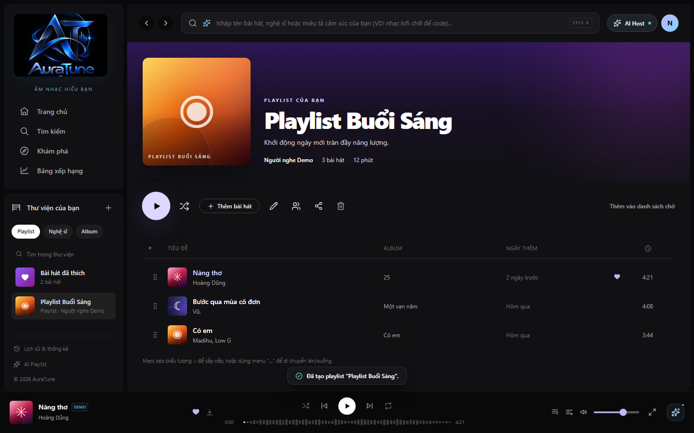
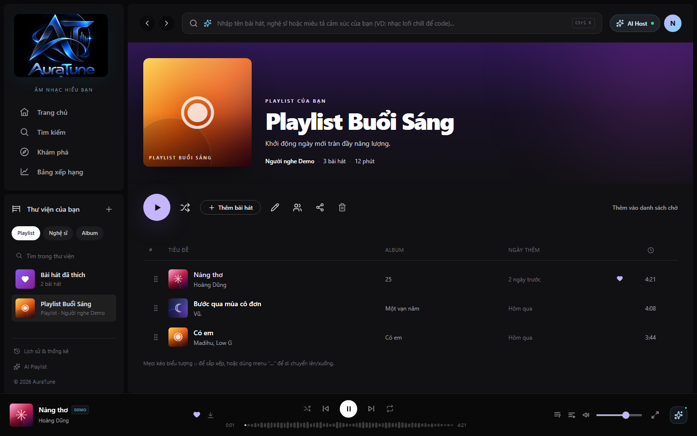
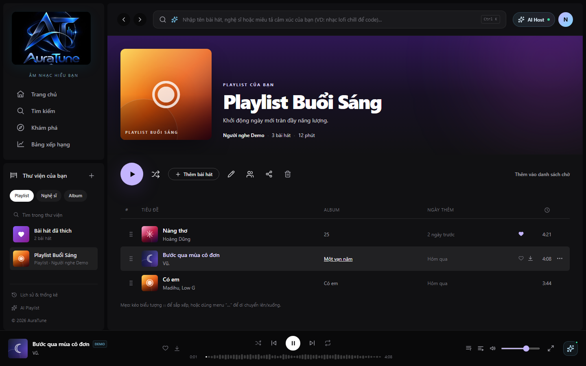

# Feature Specification: Playlist Playback

**Feature Branch**: `063-playlist-playback`

**Created**: 2026-10-29

**Status**: Draft

**Input**: User description: "Specify feature 063-playlist-playback for the AuraTune project. This feature provides the logic and UI interactions for playing music within the context of a playlist.

Core Requirements:
1. **Play Playlist**: Clicking the 'Play' button on a playlist (from its header, card, or menu) must clear the current playback queue, populate it with all tracks from the playlist in their defined order, and start playing the first track.
2. **Shuffle Playback**: Provide a 'Shuffle' button that populates the queue with all tracks from the playlist in a randomized order and starts playback immediately.
3. **Direct Track Selection**: When a user clicks a specific track within a playlist's tracklist, the system should start playing that track and populate the queue with the remaining tracks of the playlist in their original sequence.
4. **Add Playlist to Queue**: Support adding an entire playlist to the end of the current queue without interrupting the current playback.
5. **Playback Context**: The Player (BottomPlayer and FullScreenPlayer) should track and display the source of playback (e.g., "Playing from playlist: [Name]").
6. **Automatic Progression**: Ensure that when a track ends, the next track in the playlist/queue context plays automatically (leveraging G05 Queue Management).

Acceptance Scenarios:
- **Scenario 1 (Basic Play)**: Given a playlist "Focus Mode" with 5 songs, when I click "Play", the queue is replaced by these 5 songs and song #1 starts playing.
- **Scenario 2 (Shuffle)**: Given the same playlist, when I click "Shuffle", the queue contains those 5 songs in a random order and playback starts.
- **Scenario 3 (Mid-playlist Play)**: When I click the 3rd song in a playlist, that song plays immediately, and songs 4 and 5 are added to the queue after it.
- **Scenario 4 (Add to Queue)**: When I select "Add playlist to queue" for "Party Hits", its tracks are appended to the end of whatever is currently in the queue.

Integration Context:
- Integrate with `PlayerContext` for playback state and `AppStore` for retrieving playlist tracks.
- Ensure the feature handles edge cases such as empty playlists or playlists containing unavailable (non-playable) tracks."

## User Scenarios & Testing *(mandatory)*

### User Story 1 - Full Playlist Playback (Priority: P1)

As a listener, I want to play an entire playlist from the beginning so that I can enjoy a curated sequence of music without manual intervention.

**Why this priority**: Core value proposition of playlists. Fundamental playback interaction.

**Independent Test**: Can be fully tested by clicking the "Play" button on a playlist card and verifying the queue is populated and the first track starts.

**Acceptance Scenarios**:

1. **Given** a playlist "Focus Mode" with 5 songs, **When** I click "Play", **Then** the playback queue is cleared, replaced by these 5 songs in order, and song #1 starts playing.
2. **Given** a playlist is playing, **When** the current track finishes, **Then** the next track in the queue starts automatically.

---

### User Story 2 - Shuffled Playlist Playback (Priority: P1)

As a listener, I want to play a playlist in a random order to discover different sequences and keep the listening experience fresh.

**Why this priority**: Essential feature for music discovery and variety within a known collection.

**Independent Test**: Can be fully tested by clicking "Shuffle" on a playlist and verifying the queue contains all tracks but in a different order than the defined sequence.

**Acceptance Scenarios**:

1. **Given** a playlist "Focus Mode" with 5 songs, **When** I click "Shuffle", **Then** the playback queue is replaced by these 5 songs in a randomized order and playback starts immediately.

---

### User Story 3 - Selective Track Playback within Playlist (Priority: P2)

As a listener, I want to start playing a specific track within a playlist and have the rest of the playlist follow so I can start from my favorite part.

**Why this priority**: Provides flexibility in how users consume playlist content.

**Independent Test**: Can be fully tested by clicking a track row inside a playlist and verifying playback starts from that track and the queue is replaced by the playlist's tracks.

**Acceptance Scenarios**:

1. **Given** a playlist with songs [A, B, C, D, E], **When** I click song "C", **Then** the playback queue is cleared, replaced by [A, B, C, D, E], and song "C" starts playing immediately.

---

### User Story 4 - Queueing a Playlist (Priority: P2)

As a listener, I want to add an entire playlist to my current queue so that I can listen to it after my current music finishes.

**Why this priority**: Facilitates continuous listening sessions without interrupting the current vibe.

**Independent Test**: Can be fully tested by selecting "Add to Queue" from a playlist menu and verifying the tracks are appended to the existing queue.

**Acceptance Scenarios**:

1. **Given** a queue with 2 songs currently playing, **When** I select "Add to Queue" for playlist "Party Hits" (3 songs), **Then** the 3 songs from "Party Hits" are added to the end of the queue, and the current song continues playing.

---

### User Story 5 - Playback Context Awareness (Priority: P3)

As a listener, I want to see which playlist I am currently listening to in the player so I have context for what's playing.

**Why this priority**: Enhances user orientation and navigation back to the source playlist.

**Independent Test**: Can be fully tested by starting a playlist and checking the player UI for the "Playing from..." label.

**Acceptance Scenarios**:

1. **Given** a playlist "Workout Mix" is playing, **When** I view the Bottom Player or Full Screen Player, **Then** I see the text "Playing from playlist: Workout Mix".

---

### Edge Cases

- **Empty Playlist**: What happens when a user tries to play a playlist with no tracks? (System should show a notification that the playlist is empty and take no action on the queue).
- **Unavailable Tracks**: How does the system handle tracks that are no longer available (e.g., deleted or restricted)? (System should skip unavailable tracks when populating the queue or during playback progression).
- **Interrupted Connection**: How does automatic progression behave if the network is lost between tracks? (System should attempt to retry or show an error state if the next track cannot be loaded).
- **Single Track Playlist**: Behavior should be consistent with multi-track playlists.

## Requirements *(mandatory)*

### Functional Requirements

- **FR-001**: System MUST provide a 'Play' action for playlists that replaces the current queue with the playlist's tracks and starts playback of the first track.
- **FR-002**: System MUST provide a 'Shuffle' action for playlists that replaces the current queue with the playlist's tracks in a randomized order and starts playback.
- **FR-003**: System MUST support starting playback from a specific track within a playlist view, populating the queue with subsequent tracks from that playlist.
- **FR-004**: System MUST allow adding all tracks of a playlist to the end of the current queue via an "Add to Queue" action.
- **FR-005**: The playback system MUST track the source of the current playback (e.g., Playlist ID and Name).
- **FR-006**: The Player UI MUST display the name of the playlist being played when the playback source is a playlist. If the current track is not from the original playlist source (e.g., manually added), the context MUST update to "Playing from Queue" or similar.
- **FR-007**: System MUST automatically play the next track in the queue when the current track ends.
- **FR-008**: System MUST skip tracks that are marked as unavailable during queue population or playback.
- **FR-009**: System MUST show a temporary toast/notification when attempting to play an empty playlist.

### Key Entities *(include if feature involves data)*

- **Playlist**: Represents the curated collection of tracks.
- **Track**: Represents an individual song within the playlist.
- **Playback Queue**: The ordered list of tracks to be played.
- **Playback Context**: Metadata about the current playback session, including the source (Playlist).

## Clarifications

### Session 2026-10-29
- Q: When a user selects a specific track within a playlist (Selective Track Playback), should the system replace the entire playback queue with the playlist's content or only add the selected and subsequent tracks? → A: Full Replacement: Replace the entire queue with all playlist tracks and jump to the selected track.
- Q: How should the system provide the "user-friendly message" when a user attempts to play an empty playlist? → A: Toast/Notification: Show a temporary floating message (e.g., "This playlist is empty").
- Q: How should the "Playing from playlist: [Name]" context display behave if the user manually adds unrelated tracks to the queue while a playlist is playing? → A: Dynamic Transition: Update the context to "Playing from Queue" or similar if the current track is not from the original playlist source.

## Success Criteria *(mandatory)*

### Measurable Outcomes

- **SC-001**: Users can start playback of a playlist with a single click in under 200ms.
- **SC-002**: 100% of tracks in a playlist are correctly added to the queue in the expected order when "Play" is clicked.
- **SC-003**: Shuffle playback results in a randomized queue that contains all unique tracks from the playlist exactly once.
- **SC-004**: "Add to Queue" action appends tracks without interrupting the currently playing audio.
- **SC-005**: Automatic progression successfully starts the next track within 1 second of the previous track ending (network permitting).

## Assumptions

- **Stable Queue Management**: Assumes the G05 Queue Management feature is functional and provides the necessary APIs for clearing, adding, and reordering.
- **Playable Content**: Assumes that most tracks in playlists are available for playback.
- **Metadata Availability**: Assumes playlist names and track metadata are readily available via the `AppStore` context.
- **Auth State**: Assumes the user has the necessary permissions to play the tracks within the playlist.
# Feature Specification: 063 - Playlist Playback (Phát nhạc từ Playlist)

> [!NOTE]
> **Contextual Note**: This specification was reconstructed and formalized based on AuraTune project requirements (Proposal, Vision Document, System Architecture, API Contract) and the existing frontend implementation in `src/frontend/src/pages/PlaylistDetail/PlaylistDetailPage.jsx`, `BottomPlayer.jsx`, and `useMockPlayer.js`.

---

## 1. Overview & Objective

The **Playlist Playback** feature enables listeners to initiate playback directly from any playlist context:
1. **Primary Play Button**: A prominent circular button in the playlist action toolbar that initiates sequential playback from the beginning of the collection.
2. **Shuffle Play Button**: Initiates playback with randomized track ordering.
3. **In-Playlist Track Selection**: Clicking any individual song row starts playback from that exact track while establishing the entire playlist as the current playback queue.
4. **Playback State Synchronization**: The persistent bottom player, full-screen player, and tracklist highlight the actively playing track in real time.

---

## 2. User Stories & Acceptance Criteria

### User Story 1: Start Playlist Playback
- **As a** listener,
- **I want to** click the main play button on a playlist,
- **So that** I can listen to the entire playlist in order.

**Acceptance Criteria:**
- The primary play button (`button[aria-label="Phát playlist"]`) is enabled when the playlist contains at least one song.
- Clicking the play button calls `player.playPlaylist(playlist)`, loading the songs into the playback queue and starting playback from track #1.
- The play button state reflects active playback.

### User Story 2: Play a Specific Song from Playlist
- **As a** listener,
- **I want to** click on a specific song within the playlist,
- **So that** playback begins from that track while preserving the playlist queue context.

**Acceptance Criteria:**
- Clicking on a song row or its play icon initiates playback for that track.
- The active track is highlighted with violet styling and animated playing indicators.
- The persistent bottom player displays the current song title, artist, cover art, and playback progress bar.

---

## 3. Frontend Component Mapping

- **Playlist Detail Page**: [`PlaylistDetailPage.jsx`](file:///F:/CSC_HCMUS/Chuyên%20ngành/NM%20SE/AuraTune/src/frontend/src/pages/PlaylistDetail/PlaylistDetailPage.jsx)
- **Persistent Player**: [`BottomPlayer.jsx`](file:///F:/CSC_HCMUS/Chuyên%20ngành/NM%20SE/AuraTune/src/frontend/src/components/player/BottomPlayer.jsx)
- **Player State & Queue Management**: [`useMockPlayer.js`](file:///F:/CSC_HCMUS/Chuyên%20ngành/NM%20SE/AuraTune/src/frontend/src/hooks/useMockPlayer.js) (`playPlaylist`, `playTrack`)

---

## 4. UI Screenshots

### 1. Playlist Play Button

**Related workflow:** Workflow A - Start playlist playback.

Shows the playlist detail page before playback, with cursor hovering over the primary circular play button (`button[aria-label="Phát playlist"]`) and adjacent shuffle button.

---

### 2. Playback Started from Playlist

**Related workflow:** Workflow B - Playback initiated from playlist.

Shows the playlist view with playback actively running, the first track playing in the persistent bottom player dock, and playlist context established.

---

### 3. Playing Specific Playlist Track

**Related workflow:** Workflow C - Play another song from the playlist.

Shows the playlist tracklist with a selected track ("Chuyện rằng") actively playing, highlighted with violet text and synced with the bottom player controls.
