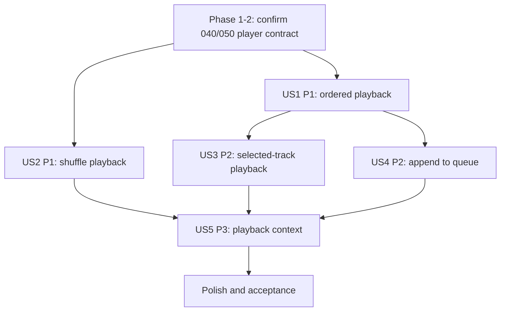

# Tasks: Playlist Playback

**Input**: Design documents from `specs/060-playlist-management/063-playlist-playback/`

**Prerequisites**: `spec.md`, `plan.md`, `research.md`, `data-model.md`, `contracts/playlist-playback.md`, `quickstart.md`

**Tests**: No new test tasks; tests were not requested. Use the quickstart scenarios and current verification commands after implementation.

**Scope**: Feature 063 composes features 040 (player) and 050 (queue); it does not implement real audio streaming or a second queue.

## Phase 1: Setup

- [ ] T001 Inspect player, queue, playlist card/detail actions, and existing notification APIs in `src/frontend/src/context/PlayerContext.jsx`, `src/frontend/src/hooks/useMockPlayer.js`, and relevant UI files.
- [ ] T002 [P] Confirm feature 040/050 public interfaces and record the agreed method/context shape in `specs/060-playlist-management/063-playlist-playback/contracts/playlist-playback.md`.

## Phase 2: Foundational Player/Queue Contract

- [ ] T003 Confirm the source playlist metadata and unavailable-track representation with 040/050 and update `specs/060-playlist-management/063-playlist-playback/data-model.md`.
- [ ] T004 Map existing player queue methods to the required actions without adding a parallel queue abstraction in `src/frontend/src/context/PlayerContext.jsx`.

## Phase 3: User Story 1 - Full Playlist Playback (Priority: P1)

**Goal**: Replace current queue with playlist order and start its first playable song; progress automatically.

**Independent Test**: Play a populated playlist and verify ordered queue replacement, first song active, then automatic next-track progression.

- [ ] T005 [US1] Implement ordered playlist replacement/start behavior in `src/frontend/src/context/PlayerContext.jsx` using the agreed queue API.
- [ ] T006 [US1] Implement empty-playlist notification with no queue/current-track mutation in `src/frontend/src/pages/PlaylistDetail/PlaylistDetailPage.jsx` or the existing shared notification owner.
- [ ] T007 [US1] Connect playlist header and card Play actions in `src/frontend/src/pages/PlaylistDetail/PlaylistDetailPage.jsx` and `src/frontend/src/components/playlist/PlaylistCard.jsx`.
- [ ] T008 [US1] Ensure end-of-track progression uses the existing 050/player mechanism and skips unavailable tracks in `src/frontend/src/hooks/useMockPlayer.js` and `src/frontend/src/context/PlayerContext.jsx`.

## Phase 4: User Story 2 - Shuffled Playlist Playback (Priority: P1)

**Goal**: Shuffle all playable playlist tracks once, replace the queue, and start playback.

**Independent Test**: Shuffle a playlist with distinct tracks; verify every playable track appears once in a randomized queue and playback begins.

- [ ] T009 [US2] Implement playlist shuffle-and-replace in `src/frontend/src/context/PlayerContext.jsx`, preserving uniqueness and using the shared queue operation.
- [ ] T010 [US2] Connect Shuffle action in `src/frontend/src/pages/PlaylistDetail/PlaylistDetailPage.jsx` and playlist card/menu entry point to the player operation.

## Phase 5: User Story 3 - Selective Track Playback (Priority: P2)

**Goal**: Start a selected playlist track while retaining the full playlist order and source context.

**Independent Test**: Select a middle track; verify full queue remains in playlist order and selected track becomes active.

- [ ] T011 [US3] Implement selected-index playlist playback in `src/frontend/src/context/PlayerContext.jsx` following the clarification in `spec.md` (full replacement with selected song active).
- [ ] T012 [US3] Connect track-row and row-play actions in `src/frontend/src/pages/PlaylistDetail/PlaylistDetailPage.jsx` to selected-index playback.
- [ ] T013 [US3] Synchronize active row styling with PlayerContext current song in `src/frontend/src/pages/PlaylistDetail/PlaylistDetailPage.jsx`.

## Phase 6: User Story 4 - Queueing a Playlist (Priority: P2)

**Goal**: Append playlist tracks without interrupting current playback.

**Independent Test**: Append a playlist during playback; verify queue tail contains its available tracks and current audio continues.

- [ ] T014 [US4] Implement append-playlist operation in `src/frontend/src/context/PlayerContext.jsx` using feature 050 queue APIs and preserving current track state.
- [ ] T015 [US4] Connect Add to Queue action in `src/frontend/src/pages/PlaylistDetail/PlaylistDetailPage.jsx` and `src/frontend/src/components/playlist/PlaylistCard.jsx` to the append operation.

## Phase 7: User Story 5 - Playback Context Awareness (Priority: P3)

**Goal**: Display playlist source while current track belongs to it and queue context after source transition.

**Independent Test**: Start playlist playback and verify playlist label in player; advance to an unrelated queue item and verify label changes.

- [ ] T016 [US5] Store and update playback source metadata in `src/frontend/src/context/PlayerContext.jsx` for play, shuffle, select, append, and unrelated queue transition.
- [ ] T017 [US5] Render current playback context in `src/frontend/src/components/player/BottomPlayer.jsx` and any existing full-player component.
- [ ] T018 [US5] Keep source context synchronized through automatic progression in `src/frontend/src/components/player/BottomPlayer.jsx` and `src/frontend/src/components/player/FullScreenPlayer.jsx` using `src/frontend/src/context/PlayerContext.jsx`.

## Phase 8: Polish and Acceptance

- [ ] T019 Update feature 040/050 integration documentation if shared player/queue interface changes in `specs/060-playlist-management/063-playlist-playback/plan.md` and relevant group docs.
- [ ] T020 Execute ordered play, shuffle, selected-track, append continuity, empty, unavailable, context transition, and progression scenarios in `specs/060-playlist-management/063-playlist-playback/quickstart.md`.

## Dependencies and Execution Order

- Phase 1–2 is blocking: all actions must use confirmed 040/050 interfaces.
- US1/US2 queue replacement actions can proceed independently after the player contract; US3 builds on the same playlist queue representation.
- US4 append is separate from replacement behavior but shares PlayerContext; coordinate changes.
- US5 context display depends on source metadata from US1–US4.
- Final acceptance follows all stories.

## Parallel Opportunities

- T001/T002 can be reviewed independently. After T004, playlist header/card actions and shuffle action can be implemented in separate UI files if shared player APIs are stable.
- Keep edits to `PlayerContext.jsx` sequential across US1–US5 to avoid merge conflicts.

### Parallel Execution Examples

No story implementation tasks are marked `[P]`: core behavior across US1–US5 changes the same `PlayerContext.jsx` state and requires sequential integration. After each player action is available, its UI wiring can be assigned separately from player-state implementation.

## Implementation Strategy

MVP is US1 sequential playback. Add shuffle (US2), selected track (US3), append (US4), then context labeling (US5). Real audio behavior remains owned by feature 040.
