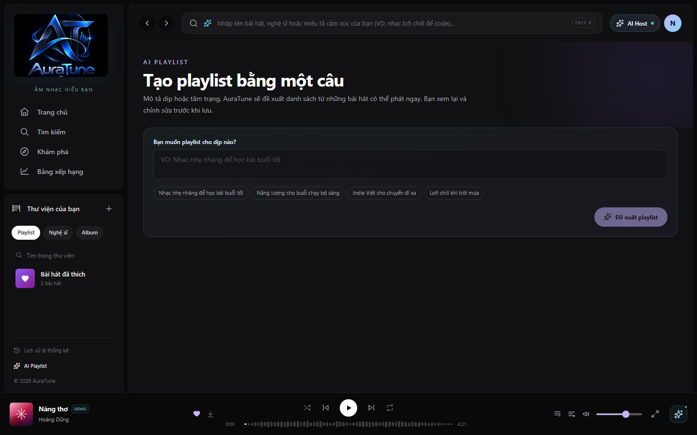
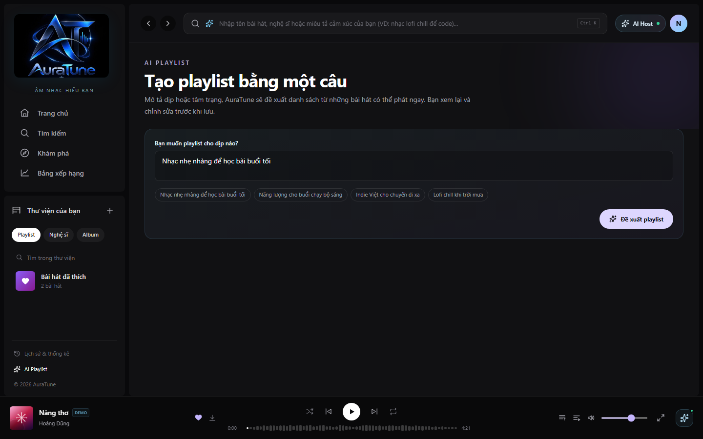
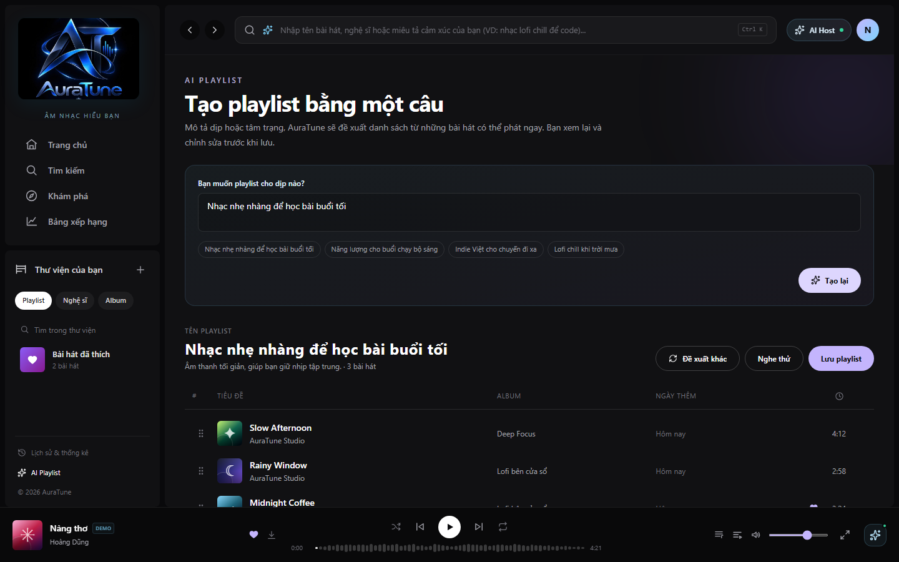
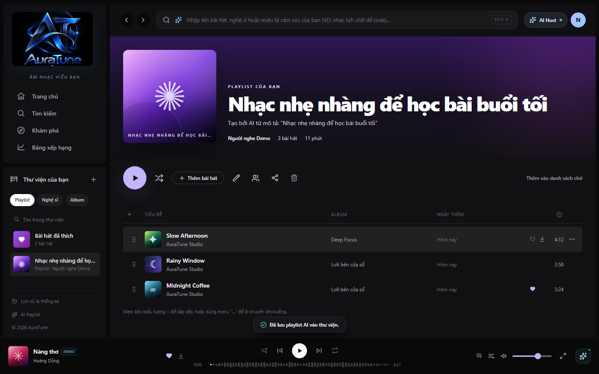

# Feature Specification: AI Playlist Generation

**Feature Branch**: `064-ai-playlist-generation`

**Created**: 2026-10-31

**Status**: Draft

**Input**: User description: "The goal of this feature is to allow users to generate custom playlists by describing a mood, occasion, or musical preference in a single sentence. AuraTune should leverage AI to propose a list of matching tracks that the user can then review, modify, and save."

## Clarifications

### Session 2026-10-31
- Q: What should be the default visibility of an AI-generated playlist when saved? → A: Private by default.

## User Scenarios & Testing *(mandatory)*

### User Story 1 - Prompt-based Playlist Generation (Priority: P1)

As an authenticated user, I want to enter a natural language prompt so that I can quickly get a list of songs matching my mood or occasion.

**Why this priority**: Core functionality of the feature. Without generation, there is no AI playlist.

**Independent Test**: Can be tested by entering a prompt and verifying that a list of 10-20 relevant tracks with an explanation is returned.

**Acceptance Scenarios**:

1. **Given** an authenticated user on the AI generation page, **When** they enter "Mellow jazz for a rainy evening" and submit, **Then** the system displays 10-20 jazz tracks and a brief explanation of why they were chosen.
2. **Given** an authenticated user, **When** they enter a prompt longer than 200 characters, **Then** the system prevents submission and displays a character limit warning.

---

### User Story 2 - Proposal Review and Refinement (Priority: P2)

As a user, I want to review and modify the AI-generated track list before saving so that the final playlist perfectly matches my preferences.

**Why this priority**: Critical for user satisfaction and control over the AI's suggestions.

**Independent Test**: Can be tested by modifying a generated proposal (remove, reorder, rename) and verifying the changes are reflected in the UI.

**Acceptance Scenarios**:

1. **Given** a generated playlist proposal, **When** the user removes a track, **Then** the track is immediately removed from the list.
2. **Given** a generated playlist proposal, **When** the user reorders tracks, **Then** the new sequence is maintained in the display.
3. **Given** a generated playlist proposal, **When** the user edits the playlist name, **Then** the new name is displayed as the proposed title.
4. **Given** a generated playlist proposal, **When** the user clicks "Regenerate", **Then** a new set of suggestions is requested and displayed.

---

### User Story 3 - Saving to Library (Priority: P1)

As a user, I want to save my finalized AI-generated playlist to my library so that I can listen to it later like any other playlist.

**Why this priority**: Essential for the value of the feature (persistence).

**Independent Test**: Can be tested by clicking "Save" on a refined proposal and verifying it appears in the user's "My Playlists" section.

**Acceptance Scenarios**:

1. **Given** a finalized playlist proposal, **When** the user clicks "Save", **Then** the playlist is created as a private playlist in their library.
2. **Given** a saved AI playlist, **When** the user navigates to their Library, **Then** the new playlist is immediately visible and playable.

---

### User Story 4 - Service Fallback (Priority: P3)

As a user, I want to be informed if the AI service is unavailable so that I understand why I can't generate a playlist and can find an alternative.

**Why this priority**: Ensures a good user experience even during failures.

**Independent Test**: Can be tested by simulating AI service downtime and verifying the error notice and "Create Manual Playlist" shortcut.

**Acceptance Scenarios**:

1. **Given** the AI generation service is unreachable, **When** a user attempts to generate a playlist, **Then** the system displays a clear "Service Unavailable" notice.
2. **Given** the "Service Unavailable" notice, **When** the user clicks the provided shortcut, **Then** they are redirected to the standard manual playlist creation flow.

### Edge Cases

- **No matches found**: If the AI cannot find relevant tracks for a niche prompt, the system should suggest broadening the prompt rather than showing an empty list.
- **Restricted tracks**: The system must ensure that tracks returned by AI are playable for the current user's region/subscription level.
- **Session timeout**: If the user's session expires during the review phase, they should be prompted to log in before saving, preserving their refined list if possible.

## Requirements *(mandatory)*

### Functional Requirements

- **FR-001**: System MUST provide a text input field for playlist descriptions limited to 200 characters.
- **FR-002**: System MUST restrict AI generation functionality to authenticated users only.
- **FR-003**: System MUST return 10-20 tracks per successful generation request.
- **FR-004**: System MUST provide a text-based "reason" or explanation for the track selection.
- **FR-005**: System MUST allow users to preview (play) any track in the proposal before saving.
- **FR-006**: System MUST allow users to remove, reorder, and rename tracks/playlists within the proposal UI.
- **FR-007**: System MUST integrate with the Playlist CRUD (061) service to persist the finalized playlist as a standard private playlist.
- **FR-008**: System MUST use semantic/vector search capabilities to map user prompts to the music library.
- **FR-009**: System MUST automatically filter out tracks that are unplayable or restricted for the user.
- **FR-010**: System MUST detect AI service failures and provide a fallback UI with a manual creation shortcut.

### Key Entities *(include if feature involves data)*

- **Playlist Proposal**: A transient collection of suggested tracks, a suggested name, and a generation reason.
- **Track**: Existing entity representing a song, including metadata and playability status.
- **Playlist**: The persistent entity created when a proposal is saved (refers to Feature 061).

## Success Criteria *(mandatory)*

### Measurable Outcomes

- **SC-001**: Users receive a generated playlist proposal within 5 seconds of submitting a valid prompt.
- **SC-002**: 100% of generated tracks in the proposal are playable for the user at the time of generation.
- **SC-003**: 100% of saved AI playlists appear in the user's Library within 1 second of clicking "Save".
- **SC-004**: System correctly handles prompts up to 200 characters without truncation errors.

## Assumptions

- **A-001**: A vector database or semantic search index of the music library is available and indexed.
- **A-002**: The AI service (LLM or recommendation engine) has access to track metadata or embeddings.
- **A-003**: User authentication state is managed by existing Auth modules (010).
- **A-004**: Playlists generated via AI are private by default, consistent with standard playlist creation (061).
# Feature Specification: 064 - AI Playlist Generation (Tạo Playlist bằng Trí tuệ Nhân tạo)

> [!NOTE]
> **Contextual Note**: This specification was reconstructed and formalized based on AuraTune project requirements (Proposal, Vision Document, System Architecture, API Contract) and the existing frontend implementation in `src/frontend/src/pages/AIPlaylist/AIPlaylistPage.jsx` and `src/frontend/src/utils/aiMockData.js`.

---

## 1. Overview & Objective

The **AI Playlist Generation** feature leverages natural language understanding to generate tailored music playlists from a single sentence describing a mood, activity, or occasion:
1. **Natural Language Prompt Input**: A conversational interface allowing users to type freeform descriptions or choose from curated mood prompts (e.g., *"Nhạc nhẹ nhàng để học bài buổi tối"*).
2. **AI Recommendation Engine**: Analyzes prompt semantics and recommends relevant songs matching the intended mood.
3. **Interactive Review**: Displays editable playlist title, generation rationale, and proposed tracklist where users can preview, remove, or reorder tracks.
4. **Save to Library**: Saves the refined playlist directly into the user's personal collection.

---

## 2. User Stories & Acceptance Criteria

### User Story 1: Access AI Playlist Interface
- **As a** logged-in listener,
- **I want to** access the AI Playlist creation page,
- **So that** I can describe the music vibe I want using plain text.

**Acceptance Criteria:**
- Navigating to `/ai-playlist` (or clicking the "AI Playlist" button in Library) opens the dedicated AI generation screen.
- The interface features prompt input textarea and quick example chips for instant selection.

### User Story 2: Generate and Review Playlist Proposal
- **As a** listener,
- **I want to** submit a mood description and review the AI-curated playlist,
- **So that** I can customize the selection before saving.

**Acceptance Criteria:**
- Clicking "Đề xuất playlist" triggers the generation process with an animated loading spinner.
- The results section renders an editable title, reason explanation, and song table of proposed tracks.
- Listeners can preview playback with "Nghe thử" or request alternative suggestions with "Đề xuất khác".

### User Story 3: Save AI Playlist to Library
- **As a** listener,
- **I want to** save the approved AI playlist,
- **So that** I can access and play it anytime from my library.

**Acceptance Criteria:**
- Clicking "Lưu playlist" persists the playlist in the user's library with the AI description attribution.
- Toast confirms `"Đã lưu playlist AI vào thư viện."` and redirects the user to the newly created playlist detail page.

---

## 3. Frontend Component Mapping

- **AI Playlist Page**: [`AIPlaylistPage.jsx`](file:///F:/CSC_HCMUS/Chuyên%20ngành/NM%20SE/AuraTune/src/frontend/src/pages/AIPlaylist/AIPlaylistPage.jsx)
- **AI Recommendation Utilities**: [`aiMockData.js`](file:///F:/CSC_HCMUS/Chuyên%20ngành/NM%20SE/AuraTune/src/frontend/src/utils/aiMockData.js) (`getMockRecommendations`)
- **State Store**: [`AppStore.jsx`](file:///F:/CSC_HCMUS/Chuyên%20ngành/NM%20SE/AuraTune/src/frontend/src/context/AppStore.jsx) (`createPlaylist`, `aiAvailable`)

---

## 4. UI Screenshots

### 1. AI Playlist Entry Point

**Related workflow:** Workflow A - Access AI playlist generation.

Shows the dedicated AI Playlist generation page with header, textarea prompt input, quick mood example chips, and submit button.

---

### 2. Enter Generation Input

**Related workflow:** Workflow B - Enter generation input.

Shows the interface populated with the selected mood prompt (*"Nhạc nhẹ nhàng để học bài buổi tối"*), ready for submission with the active "Đề xuất playlist" button.

---

### 3. View Generated Results

**Related workflow:** Workflow C - View AI-generated playlist results.

Shows the AI recommendation result: editable playlist title, explanation rationale, proposed tracklist with preview controls, and "Lưu playlist" button.

---

### 4. Saved AI Playlist Details

**Related workflow:** Workflow D - Save generated playlist to library.

Shows the newly created playlist detail page after saving, displaying the AI attribution in the description (*"Tạo bởi AI từ mô tả: “Nhạc nhẹ nhàng để học bài buổi tối”"*), hero cover, and saved tracklist.
