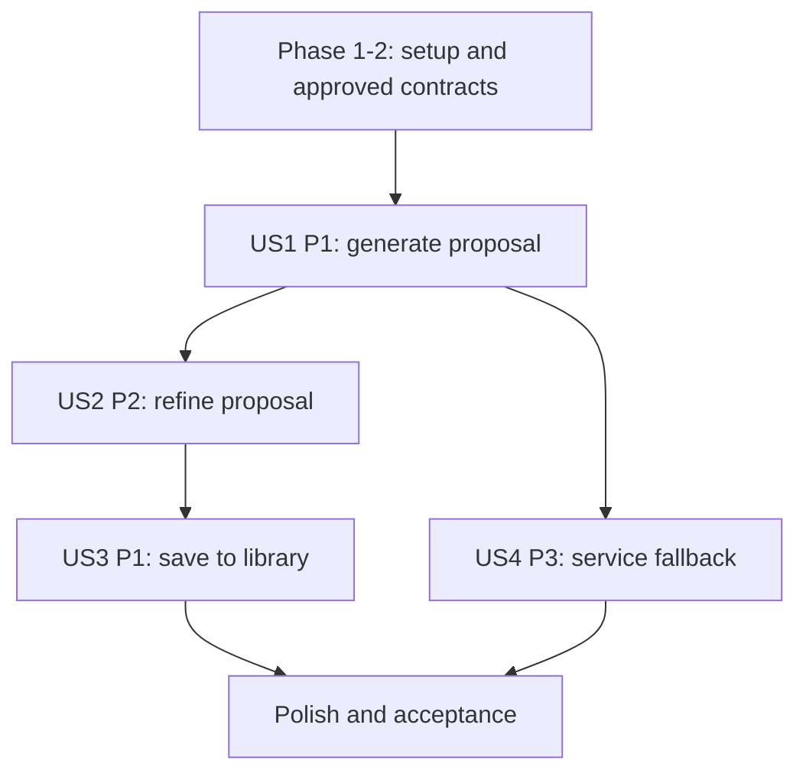

# Tasks: AI Playlist Generation

**Input**: Design documents from `specs/060-playlist-management/064-ai-playlist-generation/`

**Prerequisites**: `spec.md`, `plan.md`, `research.md`, `data-model.md`, `contracts/ai-playlist-generation.md`, `quickstart.md`

**Tests**: No dedicated test tasks; test-first work was not requested and feature-specific test tooling is unconfirmed. Validate using the quickstart scenarios.

**Scope**: Follow the primary four user stories in the Spec Kit section at the top of `spec.md`. AI/provider implementation is behind the approved service boundary; playlist persistence reuses 061/062.

## Phase 1: Setup

- [ ] T001 Inspect `src/frontend/src/pages/AIPlaylist/AIPlaylistPage.jsx`, `src/frontend/src/utils/aiMockData.js`, backend routing/service conventions, and session handling in `src/backend/` and `src/frontend/src/`.
- [ ] T002 [P] Confirm available feature verification commands in `package.json`, `src/frontend/package.json`, and `src/backend/package.json`; do not treat auth smoke coverage as AI playlist coverage.

## Phase 2: Foundational AI Contract and Data Decisions

- [ ] T003 Approve the public backend route and internal `POST /ai/playlist/generate` request/response, timeout, authentication, and error mapping in `specs/060-playlist-management/064-ai-playlist-generation/contracts/ai-playlist-generation.md`.
- [ ] T004 Confirm catalog playability/restriction fields and how successful requests return 10–20 tracks with the AI/recommendation owner; record in `specs/060-playlist-management/064-ai-playlist-generation/research.md`.
- [ ] T005 Confirm 061/062 create-and-populate behavior and partial-save recovery contract in `specs/060-playlist-management/064-ai-playlist-generation/contracts/ai-playlist-generation.md`.
- [ ] T006 Document the approved public endpoint in `docs/analysis-and-design/api-contract.md`; preserve backend-only access to `/ai/*`.

## Phase 3: User Story 1 - Prompt-based Playlist Generation (Priority: P1)

**Goal**: Authenticated listener submits a natural-language prompt and receives 10–20 playable tracks with an explanation.

**Independent Test**: Submit a prompt up to 200 characters while authenticated and verify a proposal with 10–20 playable tracks and a reason; verify over-limit input is blocked before any request.

- [ ] T007 [US1] Enforce authenticated access and prompt length of at most 200 characters in `src/backend/controllers/aiPlaylistController.js` and `src/backend/services/aiPlaylistService.js` using the established auth middleware.
- [ ] T008 [US1] Implement the approved public generation route in `src/backend/routes/aiPlaylistRoutes.js` and mount it in `src/backend/server.js` using T003's route contract.
- [ ] T009 [US1] Implement the backend-only internal AI client with the approved timeout and shared `503 AI_SERVICE_UNAVAILABLE` mapping in `src/backend/services/aiPlaylistClient.js`.
- [ ] T010 [US1] Normalize AI response and filter unplayable/restricted tracks using the approved catalog source in `src/backend/services/aiPlaylistService.js`; return 10–20 eligible tracks and the approved explanation fields.
- [ ] T011 [US1] Implement the frontend request adapter for the approved public route in `src/frontend/src/services/aiPlaylistApi.js`; do not call `/ai/*` from the browser.
- [ ] T012 [US1] Connect authenticated prompt submission and loading/result state to the public API in `src/frontend/src/pages/AIPlaylist/AIPlaylistPage.jsx` against the T003-approved contract.
- [ ] T013 [US1] Enforce the 200-character limit and display clear validation feedback in `src/frontend/src/pages/AIPlaylist/AIPlaylistPage.jsx` before sending a request.

## Phase 4: User Story 2 - Proposal Review and Refinement (Priority: P2)

**Goal**: Listener previews tracks and can remove/reorder tracks, rename the proposal, or regenerate suggestions.

**Independent Test**: Remove and reorder proposal tracks, rename the proposed playlist, and regenerate; verify edits appear in the proposal and do not mutate catalog track metadata.

- [ ] T014 [US2] Render the approved proposed title and selection reason in the result section of `src/frontend/src/pages/AIPlaylist/AIPlaylistPage.jsx`.
- [ ] T015 [US2] Implement proposal-only title editing, track removal, and reordering in `src/frontend/src/pages/AIPlaylist/AIPlaylistPage.jsx` without changing song metadata.
- [ ] T016 [US2] Connect proposal track preview to the existing playback context in `src/frontend/src/pages/AIPlaylist/AIPlaylistPage.jsx` and `src/frontend/src/context/PlayerContext.jsx`.
- [ ] T017 [US2] Implement Regenerate by submitting the current prompt through `src/frontend/src/services/aiPlaylistApi.js` and replacing the proposal only after a successful response.
- [ ] T018 [US2] Preserve the current proposal and user edits when regeneration fails in `src/frontend/src/pages/AIPlaylist/AIPlaylistPage.jsx`.

## Phase 5: User Story 3 - Saving to Library (Priority: P1)

**Goal**: Save the refined proposal as a standard private playlist and expose it immediately in Library.

**Independent Test**: Save a refined proposal; verify private visibility, final title/order, immediate library presence, and navigation to detail. Failed persistence must not show success.

- [ ] T019 [US3] Create the standard private playlist through feature 061's approved API from `src/frontend/src/pages/AIPlaylist/AIPlaylistPage.jsx` using the final proposal name and description attribution.
- [ ] T020 [US3] Persist final proposed tracks in edited order through feature 062's approved API from `src/frontend/src/pages/AIPlaylist/AIPlaylistPage.jsx`.
- [ ] T021 [US3] Apply the approved recovery behavior when playlist creation succeeds but song insertion fails in the 064 save flow and `src/frontend/src/context/AppStore.jsx`.
- [ ] T022 [US3] Refresh library state, show the success toast, and navigate to playlist detail only after save completes in `src/frontend/src/pages/AIPlaylist/AIPlaylistPage.jsx`.
- [ ] T023 [US3] Preserve refined proposal during session expiry and require login before retrying save in `src/frontend/src/pages/AIPlaylist/AIPlaylistPage.jsx`.

## Phase 6: User Story 4 - Service Fallback (Priority: P3)

**Goal**: Explain AI service unavailability and offer the standard manual playlist creation flow.

**Independent Test**: Simulate service downtime; verify clear unavailable notice and manual create shortcut opens the standard playlist creation flow.

- [ ] T024 [US4] Map internal AI failure to the approved public `503 AI_SERVICE_UNAVAILABLE` response in `src/backend/services/aiPlaylistService.js` without exposing internal diagnostics.
- [ ] T025 [US4] Render service-unavailable notice and retry state in `src/frontend/src/pages/AIPlaylist/AIPlaylistPage.jsx`.
- [ ] T026 [US4] Connect Create Manual Playlist shortcut to the standard 061 creation flow from `src/frontend/src/pages/AIPlaylist/AIPlaylistPage.jsx`.
- [ ] T027 [US4] Render no-match guidance for niche prompts without presenting an empty proposal in `src/frontend/src/pages/AIPlaylist/AIPlaylistPage.jsx`.

## Phase 7: Polish and Acceptance

- [ ] T028 Update shared API and 061/062 integration documentation if approved contracts changed in `docs/analysis-and-design/api-contract.md` and relevant feature contracts.
- [ ] T029 Execute prompt boundary, authentication, 10–20 results, availability filtering, proposal edit/preview/regenerate, private save, session expiry, no-match, and service-fallback scenarios in `specs/060-playlist-management/064-ai-playlist-generation/quickstart.md`.

## Dependencies and Execution Order

- Phase 2 blocks AI service integration and persistence assumptions.
- US1 establishes the proposal contract. US2 consumes the proposal and provides the final editable draft. US3 depends on US2's refined proposal and approved 061/062 operations. US4 handles the failure path of US1 and the manual alternative.
- Final acceptance depends on all stories and available AI/catalog configuration.

## Parallel Opportunities

- T001 and T002 can run independently.
- After T003 fixes the request/response shape, backend generation work (T008–T010) and prompt/result UI work (T012–T014) can be prepared concurrently in separate files.
- US3 must wait for the edited proposal state from US2 and the 061/062 API contract. Avoid parallel edits to `AIPlaylistPage.jsx` across stories.

## Implementation Strategy

Implement US1 first as the generation MVP, then US2 review, US3 save, and US4 failure recovery. Keep AI calls behind the backend and block integration on unapproved service/schema fields; do not substitute mock output for saved playlists.
