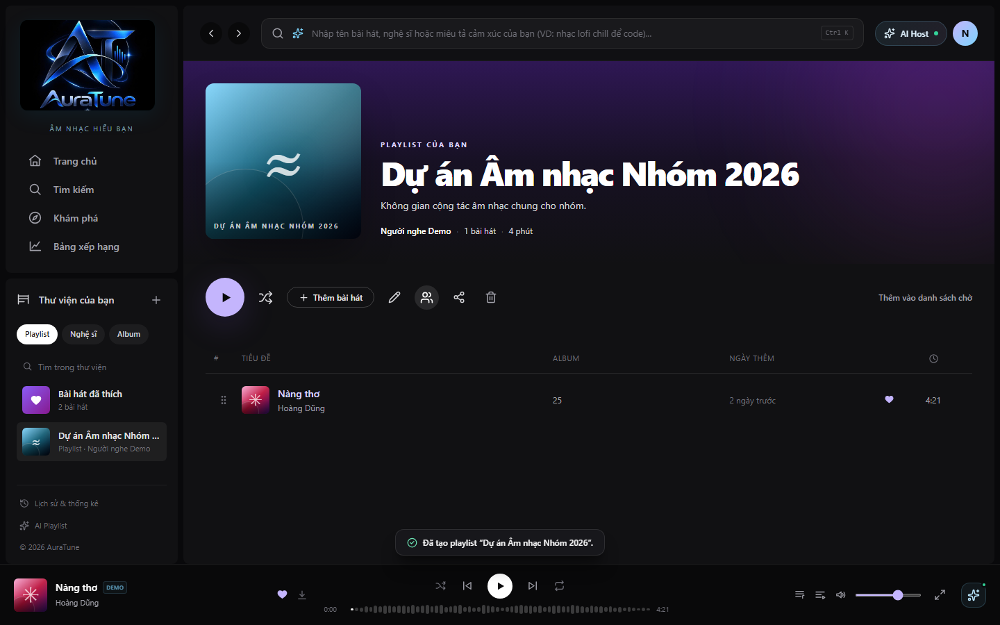
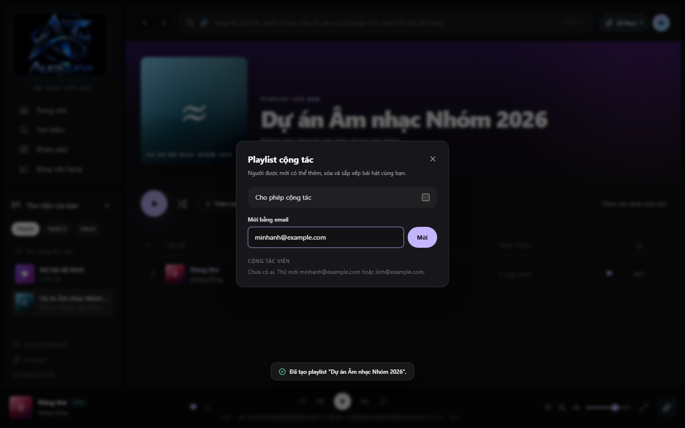
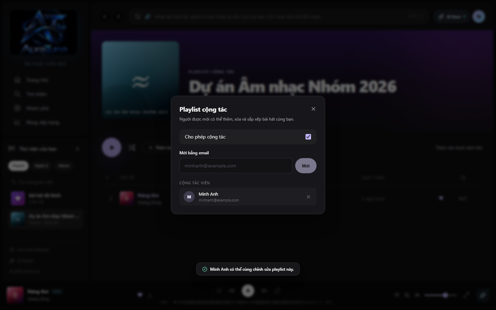

# Feature Specification: Collaborative Playlists

**Feature Branch**: `065-collaborative-playlists`

**Created**: 2026-10-31

**Status**: Draft

**Input**: User description: "Provide a detailed specification for the Collaborative Playlists feature in AuraTune. This feature allows multiple users to curate a shared music collection together. Key Requirements: Collaborative Status, Invitations, Member Management, Data Consistency, UI/UX, Security. Align with G06 module in Vision Document."

## User Scenarios & Testing *(mandatory)*

### User Story 1 - Create and Share Collaborative Playlist (Priority: P1)

As a playlist owner, I want to toggle my playlist to 'Collaborative' and invite my friends so that we can start building a music collection together.

**Why this priority**: This is the core functionality that enables collaboration. Without the ability to enable collaboration and invite others, the feature does not exist.

**Independent Test**: Can be fully tested by creating a private playlist, toggling the 'Collaborative' switch, and generating a shareable link.

**Acceptance Scenarios**:

1. **Given** a playlist owned by the user, **When** the user toggles the 'Collaborative' status to ON, **Then** the playlist state is updated in the database and a shareable invitation link becomes available.
2. **Given** a collaborative playlist, **When** the owner toggles the 'Collaborative' status to OFF, **Then** all existing collaborators (except the owner) lose their editing permissions, but the tracks they added remain in the playlist.

---

### User Story 2 - Collaborative Content Management (Priority: P1)

As a collaborator, I want to add, remove, and reorder tracks in a shared playlist so that I can contribute to the group's music selection.

**Why this priority**: Collaboration requires active participation. Adding and arranging songs is the primary way users interact with a shared playlist.

**Independent Test**: Can be tested by a non-owner user (with a valid invitation) adding a track to the playlist and verifying it appears for all members.

**Acceptance Scenarios**:

1. **Given** a user who has joined a collaborative playlist via an invitation, **When** they add a song to the playlist, **Then** the song is added with a record of who added it, and it is immediately visible to other members.
2. **Given** a collaborative playlist, **When** a collaborator reorders tracks, **Then** the new order is persisted and synchronized for all users viewing the playlist.

---

### User Story 3 - Member Management and Roles (Priority: P2)

As a playlist owner, I want to see a list of current collaborators and have the ability to remove them so that I can manage who has access to modify the collection.

**Why this priority**: Security and control are important for maintaining the quality and integrity of a shared playlist.

**Independent Test**: Can be tested by an owner viewing the 'Collaborators' list and successfully removing a member.

**Acceptance Scenarios**:

1. **Given** a collaborative playlist with multiple members, **When** the owner views the member list, **Then** they see the display names and roles (Owner/Collaborator) of everyone involved.
2. **Given** an active collaborator, **When** the owner removes them from the playlist, **Then** the removed user can no longer add, remove, or reorder tracks in that playlist.

---

### User Story 4 - Visual Contribution Indicators (Priority: P3)

As a member of a collaborative playlist, I want to see which user added each song so that I can identify individual contributions.

**Why this priority**: Enhances the social experience and transparency of the shared playlist.

**Independent Test**: Can be tested by viewing a collaborative playlist and verifying that each song row displays the name/avatar of the user who added it.

**Acceptance Scenarios**:

1. **Given** a collaborative playlist with tracks added by different users, **When** any member views the tracklist, **Then** each track row displays the contributor's identity next to the track metadata.

---

### Edge Cases

- **Concurrent Edits**: What happens when two users try to reorder the same tracks at the same time? (System should use last-write-wins or a robust ordering logic to prevent corruption).
- **Deleted User**: How does the system handle songs added by a user who later deletes their account? (Songs should remain, but the contributor indicator might change to "Former Member").
- **Private to Collaborative**: Can a private playlist be made collaborative? (Yes, toggling collaborative mode should automatically handle the transition from private to shared).

## Requirements *(mandatory)*

### Functional Requirements

- **FR-065-01**: Playlist owners MUST be able to toggle the `is_collaborative` status of any playlist they own.
- **FR-065-02**: System MUST generate a unique, shareable invitation link for collaborative playlists.
- **FR-065-03**: Users MUST be able to join a collaborative playlist by clicking a valid invitation link while signed in. Joining is open to anyone with the link (no owner approval required).
- **FR-065-04**: Authorized collaborators MUST be able to add tracks, remove any tracks (including those added by others), and reorder tracks within the shared playlist.
- **FR-065-05**: The system MUST record the `user_id` of the member who added each track to a collaborative playlist.
- **FR-065-06**: Only the playlist owner MUST be allowed to edit playlist metadata (Title, Description, Cover Art) or delete the playlist entirely.
- **FR-065-07**: Playlist owners MUST be able to view a list of all current collaborators and revoke their access.
- **FR-065-08**: The system MUST prevent non-collaborators from modifying a playlist, even if they have the link, unless they have explicitly joined.
- **FR-065-09**: Interactions with collaborative playlists MUST be synchronized via the `playlist_shared_users` table to maintain data consistency.
- **FR-065-10**: Collaborative playlists MUST be public (visible to all users) by default, but only joined collaborators can modify them.

## Clarifications

### Session 2026-10-31

- Q: Who has the authority to remove tracks added by other users in a collaborative playlist? → A: B (All collaborators)
- Q: Can any user with the invitation link join the collaborative playlist, or does the owner need to approve each request? → A: A (Open: anyone with the link can join)
- Q: What is the default visibility of a collaborative playlist to users who are NOT collaborators? → A: A (Public: anyone can find/view)

### Key Entities *(include if feature involves data)*

- **Playlist**: Existing entity, extended with an `is_collaborative` boolean flag.
- **PlaylistTrack**: Existing entity, extended with an `added_by_user_id` attribute.
- **PlaylistSharedUser**: Represents the link between a playlist and its collaborators.
  - Attributes: `playlist_id`, `user_id`, `role` (Owner/Collaborator), `joined_at`.

## Success Criteria *(mandatory)*

### Measurable Outcomes

- **SC-065-01**: Multiple users (at least 5) can concurrently modify a playlist without data loss or inconsistent state.
- **SC-065-02**: The 'Added by' indicator correctly identifies the contributor for 100% of tracks in a collaborative playlist.
- **SC-065-03**: Revoking a collaborator's access takes effect within 1 second, preventing further edits by that user.
- **SC-065-04**: Users can transition a playlist from private to collaborative and back to private in under 3 clicks.

## Assumptions

- **Existing Infrastructure**: Assumes the `playlist_shared_users` table and basic playlist CRUD (G061) are already implemented or planned in detail.
- **Real-time Sync**: Assumes that while "real-time" (socket-based) updates are ideal, the initial implementation may rely on page refreshes or standard polling for consistency if full-duplex communication is out of scope.
- **Invitation Validity**: Invitation links do not expire by default unless the owner disables collaborative mode or generates a new link.
- **Permission Hierarchy**: Collaborators cannot invite other collaborators; only the owner can manage invitations (or anyone with the link can join if the owner allows it).
# Feature Specification: 065 - Collaborative Playlists (Playlist Cộng tác)

> [!NOTE]
> **Contextual Note**: This specification was reconstructed and formalized based on AuraTune project requirements (Proposal, Vision Document, System Architecture, API Contract) and the existing frontend implementation in `src/frontend/src/pages/PlaylistDetail/PlaylistDetailPage.jsx` and `AppStore.jsx`.

---

## 1. Overview & Objective

The **Collaborative Playlists** feature empowers friends and music communities to co-curate shared music spaces:
1. **Collaboration Management Entry**: Accessible from any user-owned playlist via the "Quản lý cộng tác" button (`Users` icon).
2. **Collaborator Invitation**: An invitation modal (`CollaboratorsDialog`) enabling the playlist owner to toggle collaborative permissions and invite fellow AuraTune listeners via email.
3. **Collaborator Roster Management**: Displays active collaborators with user initial avatars, display names, email addresses, and an option for the owner to remove collaborators.
4. **Shared Collaborative Playlist Presentation**: Distinctive visual badge (`"PLAYLIST CỘNG TÁC"`) and metadata indicator (`"N cộng tác viên"`), granting invited members full rights to add, remove, and reorder songs.

---

## 2. User Stories & Acceptance Criteria

### User Story 1: Enable Collaboration on a Playlist
- **As a** playlist owner,
- **I want to** designate my playlist as collaborative,
- **So that** invited friends can contribute songs alongside me.

**Acceptance Criteria:**
- The playlist detail toolbar provides a "Quản lý cộng tác" button (`button[aria-label="Quản lý cộng tác"]`).
- Clicking it opens `CollaboratorsDialog` with a "Cho phép cộng tác" toggle.
- Enabling the toggle marks the playlist as collaborative in the state store.

### User Story 2: Invite Collaborators by Email
- **As a** playlist owner,
- **I want to** invite other registered AuraTune users using their email,
- **So that** they receive editing rights to the playlist.

**Acceptance Criteria:**
- Form includes an email input and "Mời" button.
- Submitting an existing AuraTune email (e.g., `minhanh@example.com` or `linh@example.com`) successfully links the user.
- A toast confirms: `"<Tên hiển thị> có thể cùng chỉnh sửa playlist này."`

### User Story 3: View and Manage Collaborators
- **As a** playlist owner,
- **I want to** see the list of active collaborators and remove anyone if needed,
- **So that** I maintain oversight of who can edit my playlist.

**Acceptance Criteria:**
- Active collaborators are listed with avatar, name, and email.
- Each collaborator entry features a remove button (`aria-label="Gỡ <Tên>"`).
- Removing a member revokes their editing access immediately.

### User Story 4: View Shared Collaborative Playlist
- **As a** playlist participant,
- **I want to** clearly distinguish collaborative playlists from standard ones,
- **So that** I know collaboration is active.

**Acceptance Criteria:**
- The hero header badge displays `"PLAYLIST CỘNG TÁC"` instead of `"PLAYLIST"`.
- Header subtitle reflects the collaborator count (e.g., `1 cộng tác viên`).

---

## 3. Frontend Component Mapping

- **Playlist Page & Collaborator Modal**: [`PlaylistDetailPage.jsx`](file:///F:/CSC_HCMUS/Chuyên%20ngành/NM%20SE/AuraTune/src/frontend/src/pages/PlaylistDetail/PlaylistDetailPage.jsx) (`CollaboratorsDialog`)
- **State Store & Permissions**: [`AppStore.jsx`](file:///F:/CSC_HCMUS/Chuyên%20ngành/NM%20SE/AuraTune/src/frontend/src/context/AppStore.jsx) (`addCollaborator`, `removeCollaborator`, `isCollaborative`, `collaborators`)

---

## 4. UI Screenshots

### 1. Collaborative Playlist Entry Point

**Related workflow:** Workflow A - Access collaborative playlist management.

Shows the playlist detail action toolbar with the "Quản lý cộng tác" button (`button[aria-label="Quản lý cộng tác"]`) highlighted on hover.

---

### 2. Invite Collaborators Dialog

**Related workflow:** Workflow B - Invite collaborators.

Shows the `CollaboratorsDialog` modal with the "Cho phép cộng tác" toggle, email invitation input (`minhanh@example.com`), and hint for demo accounts.

---

### 3. Active Collaborators Roster

**Related workflow:** Workflow D - View collaborators.

Shows the active collaborator list within the modal, displaying Minh Anh's initial avatar, name, email, and removal button `X`.

---

### 4. Shared Collaborative Playlist View

**Related workflow:** Workflow C - View a shared playlist.

Shows the updated playlist detail page featuring the prominent `"PLAYLIST CỘNG TÁC"` badge and metadata displaying `"1 cộng tác viên"`.
