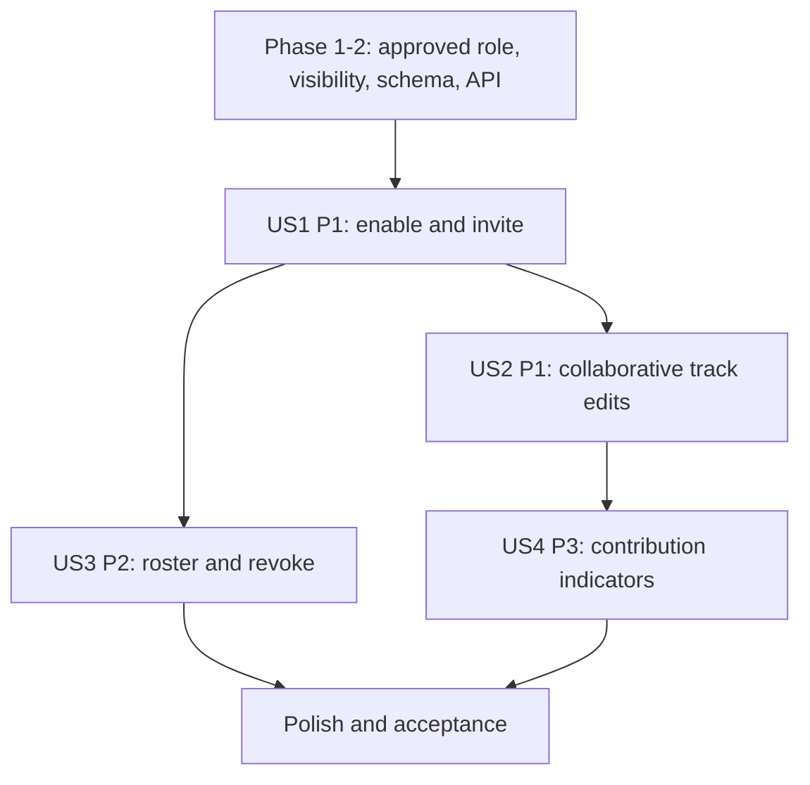

# Tasks: Collaborative Playlists

**Input**: Design documents from `specs/060-playlist-management/065-collaborative-playlists/`

**Prerequisites**: `spec.md`, `plan.md`, `research.md`, `data-model.md`, `contracts/collaborative-playlists.md`, `quickstart.md`

**Tests**: No dedicated test tasks; tests were not requested and the repo has no established collaboration test tooling. Verify using the quickstart scenarios.

**Scope**: Feature 065. Track membership/order uses 062; playlist CRUD and metadata/delete use 061.

## Phase 1: Setup

- [ ] T001 Inspect auth identity, playlist membership persistence, backend patterns, and prototype collaborator dialog/state in `src/backend/`, `src/database/`, and `src/frontend/src/`.
- [ ] T002 [P] Confirm verification commands in `package.json`, `src/frontend/package.json`, and `src/backend/package.json`, and identify existing authorization conventions without adding a new test runner.

## Phase 2: Foundational Collaboration Decisions

- [ ] T003 Approve collaboration flag, `status` visibility transition, and disable behavior in `specs/060-playlist-management/065-collaborative-playlists/data-model.md`.
- [ ] T004 Approve owner representation, membership role/timestamp, email invitation edge cases, and revocation rules in `specs/060-playlist-management/065-collaborative-playlists/data-model.md`.
- [ ] T005 Align contributor field and shared track-edit authorization with 062 in `specs/060-playlist-management/065-collaborative-playlists/contracts/collaborative-playlists.md` and `specs/060-playlist-management/062-playlist-song-management/data-model.md`.
- [ ] T006 Approve toggle/invite/list/revoke API contract in `specs/060-playlist-management/065-collaborative-playlists/contracts/collaborative-playlists.md` and `docs/analysis-and-design/api-contract.md`.
- [ ] T007 Implement only approved collaboration schema changes, including the 062-coordinated contributor field, in `src/database/migrations/004_playlist_collaboration.sql`.

## Phase 3: User Story 1 - Create and Share Collaborative Playlist (Priority: P1)

**Goal**: Owner enables collaboration and invites a registered user with immediate access.

**Independent Test**: Enable collaboration, invite a registered user, and verify membership/access; disable and verify access is revoked while tracks remain.

- [ ] T008 [US1] Implement owner-authorized collaboration enable/disable operation and approved visibility transition in `src/backend/controllers/collaborationController.js` and `src/backend/services/collaborationService.js`.
- [ ] T009 [US1] Implement registered-user lookup and duplicate-safe invitation by normalized email in `src/backend/services/collaborationService.js`.
- [ ] T010 [US1] Persist collaborator membership through approved `playlist_shared_users` representation in `src/backend/repositories/collaborationRepository.js`.
- [ ] T011 [US1] Connect collaboration toggle and email invite form in `src/frontend/src/pages/PlaylistDetail/PlaylistDetailPage.jsx` (including its `CollaboratorsDialog`) to the approved API.
- [ ] T012 [US1] Update listener library state for newly invited collaborator and owner feedback in `src/frontend/src/context/AppStore.jsx` and collaborator dialog.

## Phase 4: User Story 2 - Collaborative Content Management (Priority: P1)

**Goal**: Active collaborators add/remove/reorder tracks and other members see current state with contributor attribution.

**Independent Test**: Collaborator adds a track; verify contributor identity and updated order/content from another member session after the agreed refresh/sync.

- [ ] T013 [US2] Extend `src/backend/services/playlistAuthorizationService.js` from feature 062 to allow owner and active collaborators to add/remove/reorder while rejecting non-members.
- [ ] T014 [US2] Persist `added_by_user_id` and return contributor identity using approved schema/contract in `src/backend/repositories/playlistSongRepository.js` and `src/backend/services/playlistSongService.js`.
- [ ] T015 [US2] Ensure collaborative playlist detail reads expose public content while track mutation remains membership-protected in `src/backend/routes/playlistRoutes.js` and `src/backend/services/playlistService.js`.
- [ ] T016 [US2] Render contributor identity and collaborator edit controls in `src/frontend/src/pages/PlaylistDetail/PlaylistDetailPage.jsx` and playlist track row components.
- [ ] T017 [US2] Refresh collaborative content using the approved initial synchronization pattern in `src/frontend/src/pages/PlaylistDetail/PlaylistDetailPage.jsx` and `src/frontend/src/context/AppStore.jsx`.

## Phase 5: User Story 3 - Member Management and Roles (Priority: P2)

**Goal**: Owner sees current collaborators and revokes access.

**Independent Test**: Owner views roster and removes a collaborator; verify the member's next edit is denied within one second.

- [ ] T018 [US3] Implement owner-only collaborator list and revoke operations in `src/backend/controllers/collaborationController.js` and `src/backend/services/collaborationService.js`.
- [ ] T019 [US3] Enforce owner-only metadata edit, deletion, invitation, and revocation in `src/backend/services/playlistAuthorizationService.js`, retaining collaborator-only track rights.
- [ ] T020 [US3] Connect member roster and remove action to server state in the `CollaboratorsDialog` component in `src/frontend/src/pages/PlaylistDetail/PlaylistDetailPage.jsx`.
- [ ] T021 [US3] Reconcile member list and deny stale client edits after revoke/disable in `src/frontend/src/context/AppStore.jsx` and playlist detail UI.

## Phase 6: User Story 4 - Visual Contribution Indicators (Priority: P3)

**Goal**: Playlist members identify who added each track.

**Independent Test**: View a playlist with tracks from two members and verify each row shows its recorded contributor; former member handling follows approved data rules.

- [ ] T022 [US4] Include contributor name/avatar fields in collaborative playlist read response using approved privacy rules in `src/backend/services/playlistService.js`.
- [ ] T023 [US4] Render contributor display on collaborative track rows in `src/frontend/src/pages/PlaylistDetail/PlaylistDetailPage.jsx` and `src/frontend/src/components/song/SongRow.jsx`.
- [ ] T024 [US4] Apply approved fallback label for deleted/former members without deleting their contributed tracks in `src/backend/services/playlistService.js` and `src/frontend/src/pages/PlaylistDetail/PlaylistDetailPage.jsx`.

## Phase 7: Polish and Acceptance

- [ ] T025 Update shared API/database documentation when approved collaboration schema or endpoint behavior changes in `docs/analysis-and-design/api-contract.md` and `docs/design/database/`.
- [ ] T026 Execute owner, collaborator, non-member, public visitor, revoke, disable, contribution, and concurrent-edit scenarios in `specs/060-playlist-management/065-collaborative-playlists/quickstart.md`.

## Dependencies and Execution Order

- Phase 2 is blocking because schema/visibility/role behavior is undefined in shared references.
- US1 establishes collaboration and membership; US2 track-edit permissions depend on membership from US1 and 062 shared authorization.
- US3 depends on membership persistence; US4 depends on contributor data from US2.
- Changes that touch 062 service or schema require coordination and must not create a duplicate collaboration-specific track operation.



## Parallel Opportunities

- T001/T002 can run in parallel. T003–T006 are independent decisions across data/contract docs.
- After the contract is approved, roster UI and backend roster operations may proceed in separate files.
- Keep shared 062 authorization and membership migrations coordinated to avoid concurrent edits across features.

### Parallel Execution Examples

Once T006 approves the collaboration API, backend membership work and dialog wiring can proceed in separate files:

```text
T008-T010 Implement collaboration lifecycle in src/backend/controllers/collaborationController.js, src/backend/services/collaborationService.js, and src/backend/repositories/collaborationRepository.js
T011 Connect toggle and invite dialog in src/frontend/src/pages/PlaylistDetail/PlaylistDetailPage.jsx and the collaborators dialog component
```

The dialog must remain gated by the final request/response contract; UI-only prototype state is not completion.

## Implementation Strategy

Deliver US1 and US2 as P1 collaboration MVP (toggle/invite and shared track edits), then owner roster/revocation (US3), then contributor display polish (US4). Server authorization and approved schema gates must complete before UI affordances are treated as functional.
