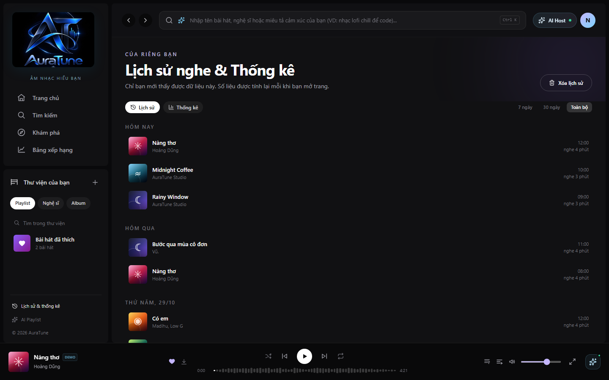
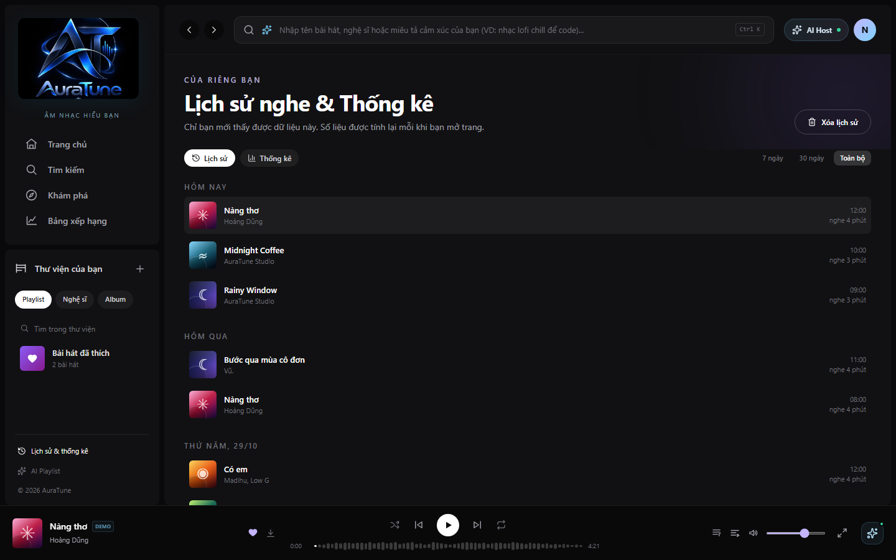
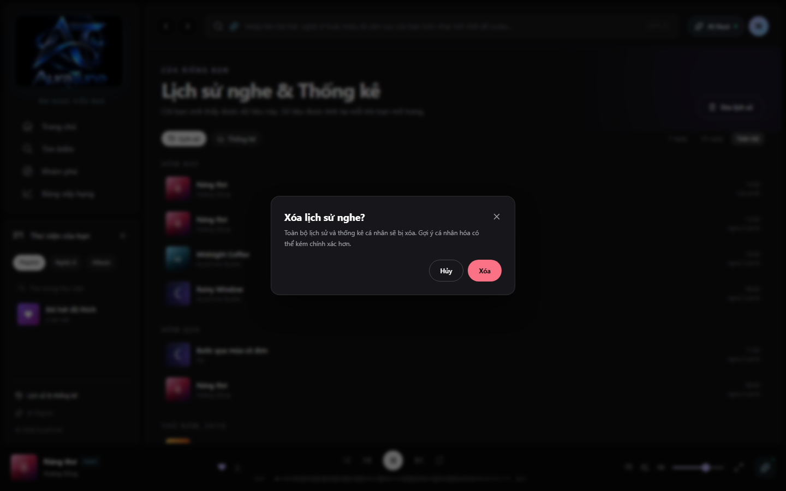
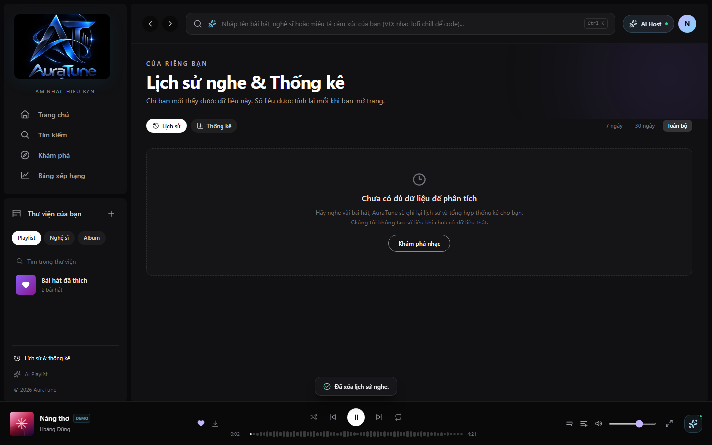

# Feature Specification: 071-listening-history

**Feature Branch**: `071-listening-history`

**Created**: 2026-10-31

**Status**: Draft

**Input**: User description: "Specify the feature **071-listening-history** for AuraTune. This feature belongs to the **G07 — Listening History and Statistics** functional group. ..."

## Clarifications

### Session 2026-10-31

- Q: How should the History page handle the empty state when a user has no listening history yet? → A: Show a dedicated empty state illustration with a "Start Listening" button leading to the Home page.
- Q: What is the data retention policy for listening history? → A: Retain only the last 365 days of history.
- Q: When a user removes an item or clears their history, should it be a hard delete (permanently removed from the database) or a soft delete (only hidden from the user)? → A: Perform a soft delete (mark as hidden) so recommendation engine can still use it.

## User Scenarios & Testing *(mandatory)*

### User Story 1 - Automatic Play Recording (Priority: P1)

As a listener, I want the system to automatically remember what I've listened to so that I don't have to manually save every song I hear.

**Why this priority**: Core functionality for G07. It provides the data foundation for history viewing and personalized recommendations (G10).

**Independent Test**: Can be tested by playing a song for more than 30 seconds and then verifying a new record appears in the `listening_history` database table for the current user.

**Acceptance Scenarios**:

1. **Given** a user is signed in and starts playing a song, **When** the playback reaches 30 seconds, **Then** the system creates a record in `listening_history` with the user ID, song ID, and current timestamp.
2. **Given** a song is played for less than 30 seconds and stopped, **When** the playback is interrupted, **Then** no record is created in the `listening_history` table.

---

### User Story 2 - Viewing Recently Played Tracks (Priority: P1)

As a listener, I want to see a list of my recently played songs so that I can easily revisit music I enjoyed.

**Why this priority**: Primary user-facing value of the history feature. Allows users to find and re-play songs without searching.

**Independent Test**: Can be fully tested by navigating to the "Recently Played" or "History" page and verifying the list matches the tracks played by the user.

**Acceptance Scenarios**:

1. **Given** a user has a listening history, **When** they navigate to the History page, **Then** they see a list of tracks ordered by play time (newest first).
2. **Given** the History page is loaded, **When** the user views a track entry, **Then** it shows the track title, artist name, duration, and the relative time since it was played (e.g., "5 minutes ago").

---

### User Story 3 - History Management and Privacy (Priority: P2)

As a listener, I want to remove specific songs from my history or clear it entirely so that I can maintain my privacy or clean up my profile.

**Why this priority**: Essential for user control and privacy, following the "Privacy & Management" requirement.

**Independent Test**: Can be tested by deleting an item from the History page and verifying it no longer appears in the list or the database.

**Acceptance Scenarios**:

1. **Given** a list of history items, **When** the user selects "Remove from history" on a specific item, **Then** that specific play record is deleted and the UI updates immediately.
2. **Given** a user has history records, **When** they select "Clear All History", **Then** all their `listening_history` records are removed after a confirmation dialog.

---

### Edge Cases

- **Offline Playback**: Since AuraTune requires a stable internet connection (AD-01), history recording will fail if the connection is lost before the 30-second mark. The system should attempt to retry or simply skip the record if the session is lost.
- **Repeated Plays**: If a user listens to the same song multiple times, each play event (meeting the 30s threshold) creates a new record in the table.
- **Short Songs**: For songs shorter than 30 seconds, the play event should be triggered when the song reaches its end (e.g., at 90% or completion).

## Requirements *(mandatory)*

### Functional Requirements

- **FR-001**: System MUST automatically record a play event in the `listening_history` table when a song has been played for at least 30 seconds.
- **FR-002**: For songs shorter than 30 seconds, the system MUST record the play event upon song completion (>= 90% duration).
- **FR-003**: Each play record MUST include `user_id`, `song_id`, and `played_at` (timestamp).
- **FR-004**: System MUST provide a dedicated History page at `src/frontend/src/pages/History/HistoryPage.jsx`.
- **FR-005**: The History page MUST display tracks in reverse chronological order (newest first).
- **FR-006**: Each history entry MUST display: Track Title, Artist Name, Album Name (optional but recommended), Track Duration, and Play Timestamp.
- **FR-007**: Users MUST be able to perform a "soft delete" of individual history entries from the UI (mark as hidden from user view).
- **FR-008**: Users MUST be able to "soft clear" their entire listening history in one action (mark all as hidden).
- **FR-013**: Soft-deleted history records MUST still be accessible to the recommendation engine and analytics service unless explicitly prohibited by global privacy settings.
- **FR-009**: History data MUST be paginated (e.g., 20-50 items per page) to ensure fast retrieval and UI responsiveness.
- **FR-011**: If the user has no history, the History page MUST display a dedicated empty state illustration with a "Start Listening" button leading to the Home page.
- **FR-012**: System MUST retain listening history for the last 365 days. Records older than 365 days MUST be automatically purged.
- **FR-010**: The Music Player (G04) MUST trigger the recording event to the backend API.

### Key Entities *(include if feature involves data)*

- **Listening History (`listening_history`)**:
    - `history_id` (Primary Key)
    - `user_id` (Foreign Key to `users`)
    - `song_id` (Foreign Key to `songs`)
    - `played_at` (Timestamp, defaults to current time)
    - `is_hidden` (Boolean, defaults to false, used for soft-delete)

## Success Criteria *(mandatory)*

### Measurable Outcomes

- **SC-001**: 100% of playback sessions meeting the 30s threshold result in a successful database entry when the user is online.
- **SC-002**: The History page loads and displays the first page of results in under 1 second for a user with up to 5,000 history records.
- **SC-003**: All "Delete" or "Clear" operations are reflected in the UI and database within 500ms of the request.

## Assumptions

- **Authentication**: History is only recorded for authenticated (signed-in) users.
- **Playback Tracking**: The frontend music player is responsible for tracking the 30-second threshold and sending the "record play" request to the server.
- **Privacy**: History is private to the user and administrators; other users cannot view a listener's history.
- **Data Usage**: History data will be used by the Analytics group (G07) and Recommendation group (G10).
# Feature Specification: 071 - Listening History (Lịch sử nghe)

> [!NOTE]
> **Contextual Note**: This specification was reconstructed and formalized based on AuraTune project requirements (Proposal, Vision Document, System Architecture, Database Schema in `docs/design/database/data-consistency.md`) and the existing frontend implementation in `src/frontend/src/pages/History/HistoryPage.jsx` and `AppStore.jsx`.

---

## 1. Overview & Objective

The **Listening History** feature gives listeners a transparent, private chronological record of their streaming activity on AuraTune:
1. **Private Access**: Listening history is strictly confidential and only visible to the authenticated listener (`/history`).
2. **Chronological Grouping**: Previously played tracks are grouped by day ("Hôm nay", "Hôm qua", "thứ hai, 27/10"...), detailing the played timestamp, track title, artist name, cover art, and actual listening duration.
3. **Playback from History**: Clicking any entry directly re-initiates playback of that track without complex navigation.
4. **History Erasure (Clear History)**: Listeners maintain full privacy control to purge their listening history with confirmation safeguard.
5. **Time Range Filtering**: Allows filtering history records by "7 ngày", "30 ngày", or "Toàn bộ".

---

## 2. User Stories & Acceptance Criteria

### User Story 1: Access and View Listening History
- **As a** logged-in listener,
- **I want to** navigate to my listening history from the sidebar or profile,
- **So that** I can review the songs I previously listened to.

**Acceptance Criteria:**
- Authenticated listeners can access the history page via the sidebar link "Lịch sử & thống kê" (`/history`).
- The "Lịch sử" tab displays played tracks organized chronologically into day sections.
- Each track item shows cover art, track title, artist, time of listening, and listened duration (e.g., *"nghe 4 phút"*).

### User Story 2: Resume Playback from History
- **As a** listener,
- **I want to** click on a historical track item,
- **So that** I can instantly replay a song I previously enjoyed.

**Acceptance Criteria:**
- Clicking on any history track item triggers `player.playTrack(track)`.
- Playback begins immediately and updates the persistent bottom player.

### User Story 3: Clear Listening History
- **As a** listener,
- **I want to** clear my listening history,
- **So that** I can reset my personal listening records for privacy reasons.

**Acceptance Criteria:**
- Clicking "Xóa lịch sử" displays a confirmation modal warning that personal history and stats will be cleared.
- Confirming deletes the history array in player state/storage and displays the empty state placeholder.

---

## 3. Frontend Component Mapping

- **History Page**: [`HistoryPage.jsx`](file:///F:/CSC_HCMUS/Chuyên%20ngành/NM%20SE/AuraTune/src/frontend/src/pages/History/HistoryPage.jsx)
- **Sidebar Link**: [`Sidebar.jsx`](file:///F:/CSC_HCMUS/Chuyên%20ngành/NM%20SE/AuraTune/src/frontend/src/components/common/Sidebar.jsx) (`user && { label: 'Lịch sử & thống kê', href: '/history' }`)
- **State Store**: [`AppStore.jsx`](file:///F:/CSC_HCMUS/Chuyên%20ngành/NM%20SE/AuraTune/src/frontend/src/context/AppStore.jsx) (`library.history`, `clearHistory`, `recordPlay`)

---

## 4. UI Screenshots

### 1. Listening History Page

**Related workflow:** Workflow A - Open listening history.

Shows the listening history page overview with sidebar navigation link highlighted, page header ("Lịch sử nghe & Thống kê"), active "Lịch sử" tab, time range filters ("7 ngày", "30 ngày", "Toàn bộ"), and "Xóa lịch sử" action button.

---

### 2. Listening History Records

**Related workflow:** Workflow B - View listening history records.

Shows the list of previously played tracks grouped chronologically by day ("Hôm nay", "Hôm qua"...), displaying artwork, title, artist name, played timestamp, and listened duration for each entry.

---

### 3. Inspect History Interactions

**Related workflow:** Workflow C - Inspect history interactions and deletion flow.

Shows the interactive state: playback initiated from history synced with bottom player, and the "Xóa lịch sử nghe?" confirmation modal dialog open.

---

### 4. Empty Listening History State

**Related workflow:** Workflow D - Empty and unavailable states.

Shows the empty state container displayed when listening history is purged or contains no records, featuring the `Clock3` icon, informational guidance, and "Khám phá nhạc" navigation button.
