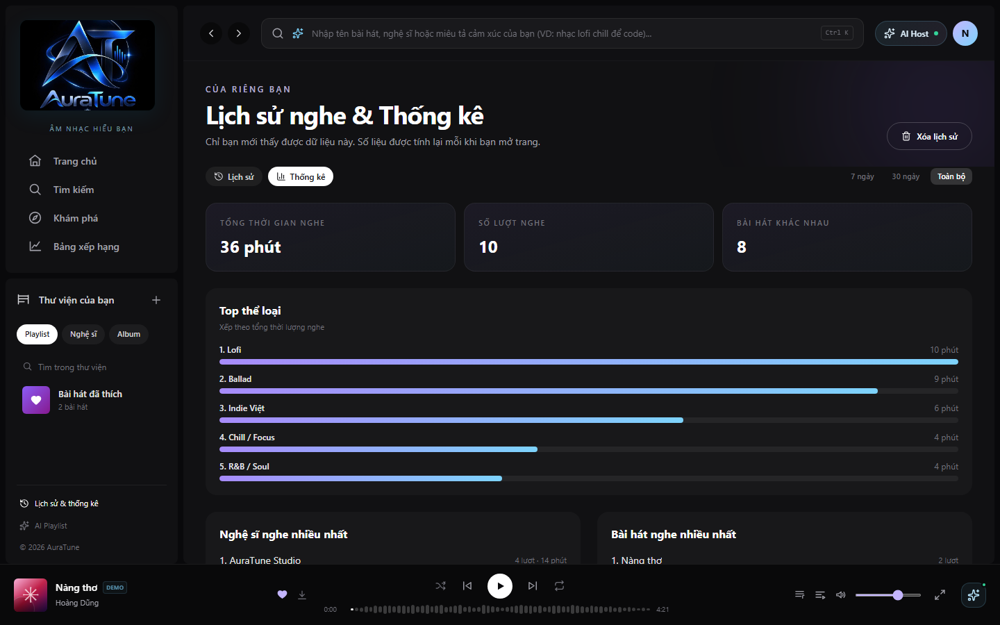

# Feature Specification: 072 - Listening Duration Analytics (Phân tích Thời lượng nghe)

> [!NOTE]
> **Contextual Note**: This specification was reconstructed and formalized based on AuraTune project requirements (Proposal, Vision Document, System Architecture, Database Schema in `docs/design/database/data-consistency.md`) and the existing frontend implementation in `src/frontend/src/pages/History/HistoryPage.jsx` and `AppStore.jsx`.

---

## 1. Overview & Objective

The **Listening Duration Analytics** feature visualizes personal playback metrics, transforming raw streaming logs into meaningful listening habit summaries:
1. **Summary Stat Cards**: Prominently displays three core streaming metrics:
   - **Tổng thời gian nghe** (Total listening duration in formatted hours/minutes).
   - **Số lượt nghe** (Total number of qualifying playback sessions).
   - **Bài hát khác nhau** (Count of distinct unique songs played).
2. **Time Range Filtering**: Dynamically recalculates duration metrics across configurable historical windows: "7 ngày", "30 ngày", and "Toàn bộ".
3. **Genre Duration Breakdown**: Displays the distribution of listening time across musical genres, featuring ranked durations and proportional gradient visual progress bars.

---

## 2. User Stories & Acceptance Criteria

### User Story 1: View Listening Duration Overview
- **As a** listener,
- **I want to** switch to the "Thống kê" tab,
- **So that** I can see how much total time I have spent listening to music.

**Acceptance Criteria:**
- The "Thống kê" tab (`button[role="tab"]:has-text("Thống kê")`) displays summary metric cards.
- Total listening duration aggregates seconds from valid history sessions and formats them as *"X giờ Y phút"* or *"X phút"*.
- Total play count and unique songs are calculated and rendered accurately.

### User Story 2: Filter Analytics by Period
- **As a** listener,
- **I want to** filter analytics by a specific time window ("7 ngày" or "30 ngày"),
- **So that** I can assess my recent listening trends versus all-time habits.

**Acceptance Criteria:**
- Time range controls allow toggling between "7 ngày", "30 ngày", and "Toàn bộ".
- Selecting a filter immediately updates the duration metrics, play counts, and breakdown lists.

### User Story 3: Inspect Duration Breakdown by Genre
- **As a** listener,
- **I want to** see which musical genres take up most of my listening time,
- **So that** I understand my musical preferences.

**Acceptance Criteria:**
- "Top thể loại" ranks genres by total duration listened (`seconds`).
- Each genre displays its position, genre name, formatted duration, and a proportional gradient progress bar (`from-violet-400 to-sky-300`).

---

## 3. Frontend Component Mapping

- **Analytics View**: [`HistoryPage.jsx`](file:///F:/CSC_HCMUS/Chuyên%20ngành/NM%20SE/AuraTune/src/frontend/src/pages/History/HistoryPage.jsx) (`Stat` component, `rankBy` aggregator)
- **Formatting Utilities**: [`AppStore.jsx`](file:///F:/CSC_HCMUS/Chuyên%20ngành/NM%20SE/AuraTune/src/frontend/src/context/AppStore.jsx) (`formatTotalDuration`)

---

## 4. UI Screenshots

### 1. Listening Analytics Overview

**Related workflow:** Workflow A - Open listening analytics.

Shows the "Thống kê" tab view with the primary duration metric cards ("Tổng thời gian nghe", "Số lượt nghe", "Bài hát khác nhau") and overview of analytical sections.

---

### 2. Listening Duration Summary (Filtered)

**Related workflow:** Workflow B - View listening duration summary with period filtering.

Shows the duration analytics recalculated under the "7 ngày" time window filter, focusing on recent listening time and session counts.

---

### 3. Listening Duration Breakdown

**Related workflow:** Workflow C - Inspect duration breakdown by genre.

Shows the "Top thể loại" section with ranked genres, listening durations (e.g., Lofi 10 phút, Ballad 9 phút...), and visual gradient progress bars proportional to total listening time.
