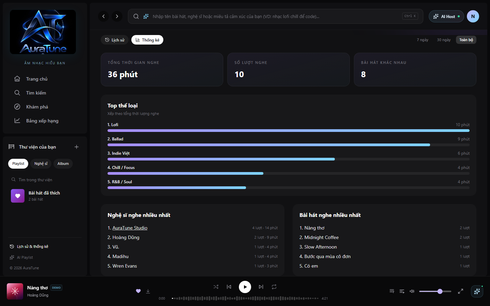

# Feature Specification: 073 - Top Artists and Genres (Nghệ sĩ và Thể loại nghe nhiều nhất)

> [!NOTE]
> **Contextual Note**: This specification was reconstructed and formalized based on AuraTune project requirements (Proposal, Vision Document, System Architecture, Database Schema in `docs/design/database/data-consistency.md`) and the existing frontend implementation in `src/frontend/src/pages/History/HistoryPage.jsx` and `AppStore.jsx`.

---

## 1. Overview & Objective

The **Top Artists and Genres** feature provides listeners with ranked insights into their most frequent musical preferences based on actual streaming history:
1. **Top Artists ("Nghệ sĩ nghe nhiều nhất")**: Ordered ranking of artists most listened to by the user, displaying artist names, total play counts, and aggregated listening durations.
2. **Top Genres ("Top thể loại")**: Ranked list of musical genres by listening time, complete with visual progress bars indicating preference distribution.
3. **Top Tracks ("Bài hát nghe nhiều nhất")**: Companion ranking of individual songs most played, allowing instant replay on click.
4. **Time Range Adaptability**: Recalculates all artist and genre rankings when switching time periods ("7 ngày", "30 ngày", "Toàn bộ").

---

## 2. User Stories & Acceptance Criteria

### User Story 1: View Top Artists Ranking
- **As a** listener,
- **I want to** see which artists I listen to the most,
- **So that** I can track my favorite creators and explore their discographies.

**Acceptance Criteria:**
- Section "Nghệ sĩ nghe nhiều nhất" ranks artists by total listening seconds and play count.
- Public artists provide clickable links leading to `/artist/:id`.
- Each artist item displays ranking number (1-5), name, play count, and total duration listened.

### User Story 2: View Top Genres Breakdown
- **As a** listener,
- **I want to** see a visual breakdown of my top music genres,
- **So that** I understand the styles and moods I listen to most often.

**Acceptance Criteria:**
- Section "Top thể loại" ranks genres by total listening duration.
- Each genre entry renders position number, genre name, formatted duration, and a proportional horizontal bar.

### User Story 3: View and Replay Top Tracks
- **As a** listener,
- **I want to** see my top tracks and play them directly,
- **So that** I can easily access my high-rotation songs.

**Acceptance Criteria:**
- Section "Bài hát nghe nhiều nhất" lists the top tracks ordered by session count.
- Clicking any song immediately starts playback.

---

## 3. Frontend Component Mapping

- **Statistics Sections**: [`HistoryPage.jsx`](file:///F:/CSC_HCMUS/Chuyên%20ngành/NM%20SE/AuraTune/src/frontend/src/pages/History/HistoryPage.jsx) (`rankBy` sorting, `topArtists`, `topGenres`, `topTracks`)
- **Metadata Resolvers**: [`mockData.js`](file:///F:/CSC_HCMUS/Chuyên%20ngành/NM%20SE/AuraTune/src/frontend/src/utils/mockData.js) (`getArtist`, `getGenre`)

---

## 4. UI Screenshots

### 1. Top Artists and Genres Overview

**Related workflow:** Workflow A - Open top artists and genres.

Shows the complete analytical overview displaying the "Top thể loại" progress section alongside the "Nghệ sĩ nghe nhiều nhất" and "Bài hát nghe nhiều nhất" ranking modules.

---

### 2. Top Artists Ranking

**Related workflow:** Workflow B - View top artists ranking.

Shows the "Nghệ sĩ nghe nhiều nhất" section displaying ranked artists (AuraTune Studio, Hoàng Dũng, Vũ., Madihu, Wren Evans) with play counts, duration, and clickable artist profile link.

---

### 3. Top Genres Breakdown & Top Tracks

**Related workflow:** Workflow C - View top genres breakdown.

Shows the detailed "Top thể loại" section with horizontal gradient progress bars illustrating duration distribution, alongside the "Bài hát nghe nhiều nhất" ranking.
