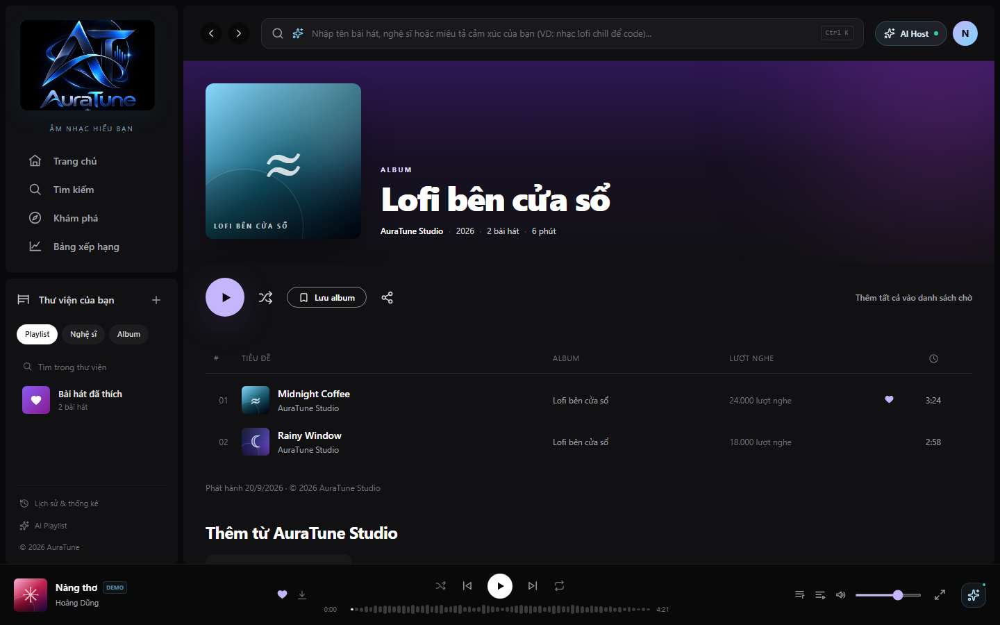
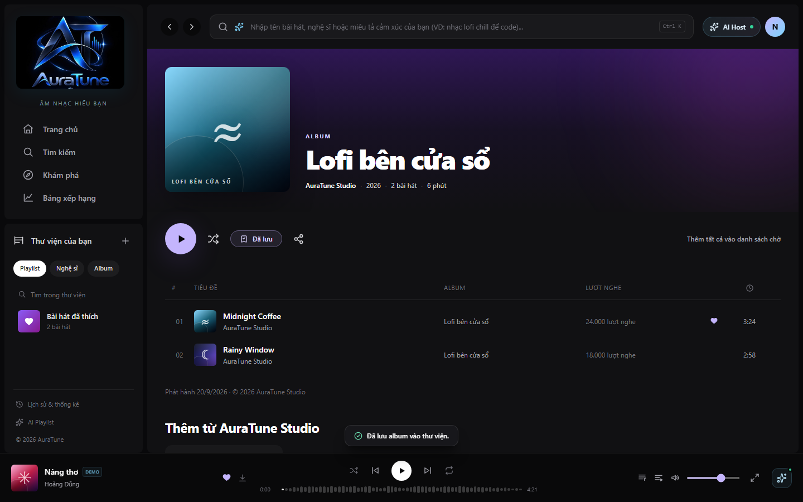
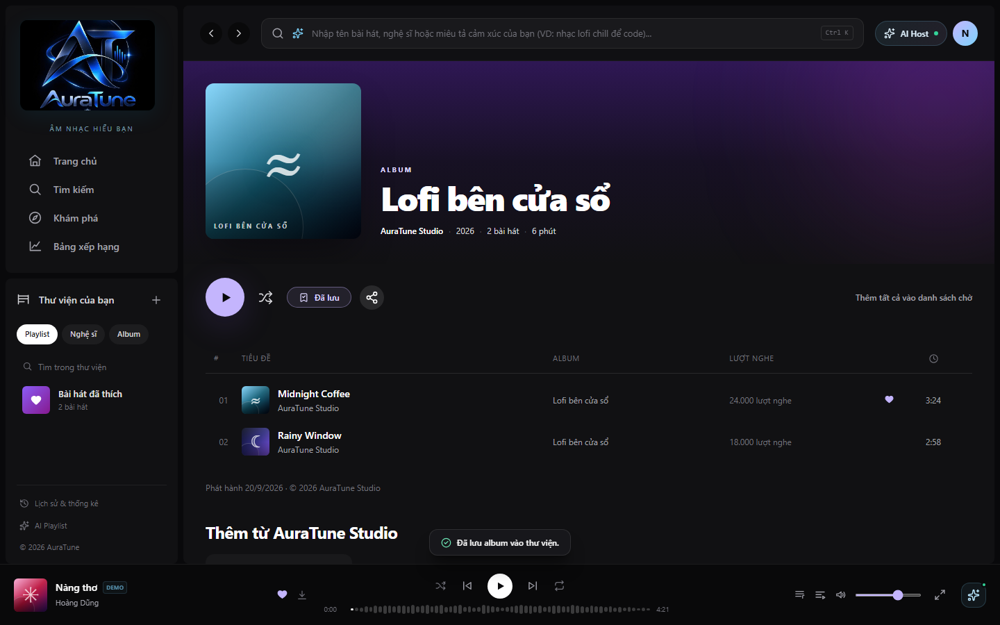
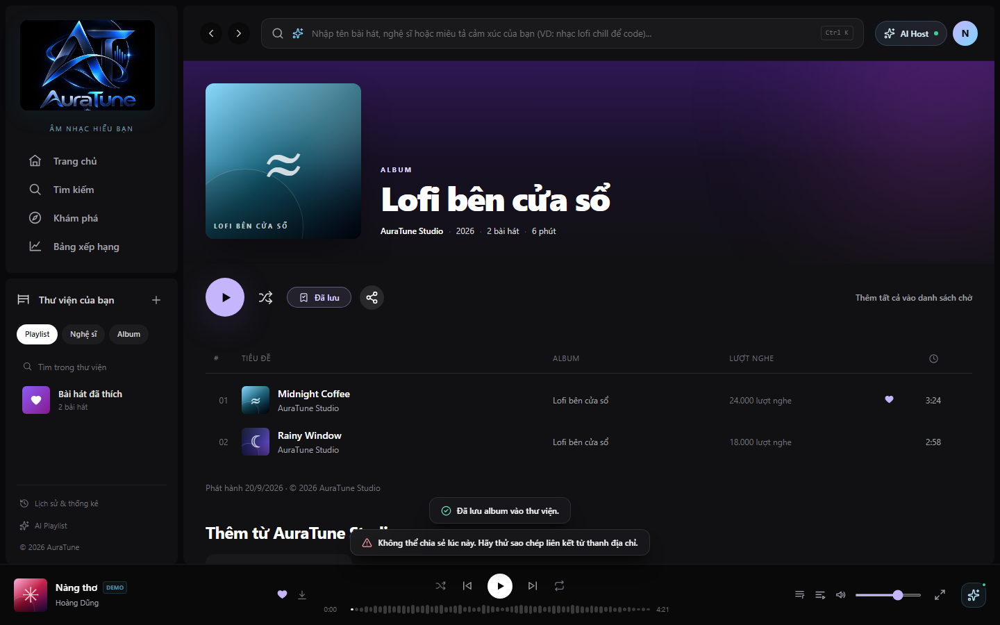

# Feature Specification: 083 - Save and Share Album (Lưu và Chia sẻ Album)

> [!NOTE]
> **Contextual Note**: This specification document was reconstructed to document the implemented UI workflows in the AuraTune frontend (`src/frontend/src/pages/Album/AlbumPage.jsx` and `AppStore.jsx`). The original specification was not provided in the repository archive (only `.gitkeep` was present). Scope is derived strictly from `docs/proposal/proposal.md` and actual application behavior.

---

## 1. Overview & Objective

The **Save and Share Album** feature enables listeners to bookmark favorite albums into their personal library and share album links with friends:
1. **Save Album to Library**: Listeners can click the "Lưu album" button in the album action toolbar to bookmark any catalog album into their personal library (`/library` under tab "Album"). The button dynamically toggles to "Đã lưu" with confirmation toast feedback.
2. **Share Album**: Listeners can share any album using the "Chia sẻ album" action button, invoking the platform's standard sharing mechanism and copying the direct URL (`/album/:id`) to the clipboard with confirmation toast feedback.
3. **Authentication Gating**: Saving an album requires an authenticated session; unauthenticated guests attempting to save are prompted to log in.

---

## 2. Implemented Frontend Workflows

### Workflow A: Save Album to Library
- **Action**: Clicking the "Lưu album" button (`Bookmark` icon) in the action toolbar.
- **State Change**: `store.toggleSaveAlbum(album.id)` updates `state.libraries[userId].savedAlbumIds`.
- **UI Feedback**:
  - The button label changes to "Đã lưu" with `BookmarkCheck` icon and violet active styling (`border-violet-300/40 bg-violet-300/10 text-violet-200`).
  - A toast notification confirms: *"Đã lưu album vào thư viện."* (or *"Đã xóa album khỏi thư viện."* when untoggled).
  - The saved album appears in the listener's Library (`/library`) under the "Album đã lưu" grid.

### Workflow B: Share Album
- **Action**: Clicking the "Chia sẻ album" button (`button[aria-label="Chia sẻ album"]` with `Share2` icon).
- **Behavior**: Calls `player.share('/album/' + album.id, album.title + ' · ' + artist.name)`.
- **UI Feedback**:
  - Leverages Web Share API or falls back to `navigator.clipboard.writeText`.
  - Toast notification confirms: *"Đã sao chép liên kết vào bộ nhớ tạm."*

---

## 3. Frontend Component Mapping

- **Album Page Toolbar**: [`AlbumPage.jsx`](file:///F:/CSC_HCMUS/Chuyên%20ngành/NM%20SE/AuraTune/src/frontend/src/pages/Album/AlbumPage.jsx) (`toggleSave`, `player.share`)
- **Library Album Grid**: [`LibraryPage.jsx`](file:///F:/CSC_HCMUS/Chuyên%20ngành/NM%20SE/AuraTune/src/frontend/src/pages/Library/LibraryPage.jsx) (`store.library.savedAlbumIds`)
- **State Store**: [`AppStore.jsx`](file:///F:/CSC_HCMUS/Chuyên%20ngành/NM%20SE/AuraTune/src/frontend/src/context/AppStore.jsx) (`toggleSaveAlbum`, `isAlbumSaved`)

---

## 4. UI Screenshots

### 1. Album Save Action

**Related workflow:** Workflow A - Save album to library.

Shows the album detail action toolbar with cursor hovering on the "Lưu album" button (`Bookmark` icon) prior to bookmarking the album.

---

### 2. Album Saved State

**Related workflow:** Workflow A - Album saved confirmation and updated state.

Shows the album page after clicking "Lưu album": the button updates to "Đã lưu" with the `BookmarkCheck` icon and violet accent border/background, accompanied by the confirmation toast *"Đã lưu album vào thư viện."*.

---

### 3. Album Share Action

**Related workflow:** Workflow B - Share album.

Shows the action toolbar with cursor hovering over the circular "Chia sẻ album" button (`button[aria-label="Chia sẻ album"]` with `Share2` icon).

---

### 4. Album Share Result

**Related workflow:** Workflow B - Share result feedback.

Shows the system toast notification *"Đã sao chép liên kết vào bộ nhớ tạm."* displayed after selecting the share action, confirming the album link was successfully copied to the clipboard.
# Feature Specification: Save and Share Albums

**Feature Branch**: `083-save-and-share-album`

**Created**: 2026-10-30

**Status**: Draft

**Input**: User description: "Allow signed-in listeners to save or like albums to their personal library, allow any visitor to share an album by URL or social sharing controls, use the specified save and unsave API contract, keep saved state synchronized with the user's account, and ensure shared links open the album details page."

## Clarifications

### Session 2026-10-30

- Q: While a save or remove request is still pending, how should the album action behave? → A: Temporarily disable the action and show a small progress indicator, while keeping the last confirmed saved state visible until the request succeeds.
- Q: When saving, removing, or sharing fails, how should AuraTune present the error to the visitor? → A: Show a short, action-specific inline message near the control, with a retry hint where appropriate.
- Q: How should the album control visually distinguish an unsaved album from a saved one? → A: Use an outlined heart with “Save” when unsaved and a filled heart with “Saved” when saved.
- Q: Which sharing destinations should AuraTune include alongside the album URL? → A: Provide Copy Link, Facebook, Instagram, X, and Zalo.
- Q: Should AuraTune set a feature-specific maximum number of albums a listener can save? → A: Do not add a feature-specific quota; existing platform limits still apply.
- Q: When a listener removes an album while viewing Saved Albums, when should that album disappear from the visible list? → A: Keep it visible while the request is pending, then remove it from the current list as soon as removal is confirmed; if removal fails, keep it visible.

## User Scenarios & Testing *(mandatory)*

### User Story 1 - Save an Album to a Personal Library (Priority: P1)

As a signed-in listener, I want to save or like an album so that I can find it again in my personal library.

**Why this priority**: Saving an album is the core authenticated action and provides lasting personal value beyond the current visit.

**Independent Test**: Sign in, save an album, navigate away and return, and verify the album is shown as saved for that account and appears in its saved album collection.

**Acceptance Scenarios**:

1. **Given** a signed-in listener views an unsaved album, **When** they select Save and the action succeeds, **Then** the album is saved to that listener's personal album library and the interface shows a filled heart with the “Saved” label.
2. **Given** a signed-in listener views an album already saved to their account, **When** the album details load, **Then** the interface shows a filled heart with the “Saved” label for that listener.
3. **Given** a signed-in listener views an album saved to their account, **When** they select Remove from Saved Albums, **Then** the album is removed from their personal album library and the interface shows an outlined heart with the “Save” label.
4. **Given** two different listeners view the same album, **When** one listener saves or removes it, **Then** only that listener's saved state changes.
5. **Given** a visitor who is not signed in views an album, **When** they attempt to save it, **Then** the save action requires sign-in and no personal library state is changed.
6. **Given** a save or remove action cannot be completed, **When** the action fails, **Then** the interface does not present an unconfirmed state as saved and shows a short, action-specific inline message near the control, with a retry hint where appropriate.
7. **Given** a save or remove request is pending, **When** the listener views the album action, **Then** the action is temporarily disabled, a progress indicator is shown, and the last confirmed saved state remains visible until the request completes.
8. **Given** a listener saves albums under ordinary account conditions, **When** they save another album, **Then** no feature-specific album count limit prevents the save.
9. **Given** a listener removes an album from the Saved Albums view, **When** the removal is pending, **Then** the album remains visible; when removal is confirmed, **Then** the album disappears from the current list without requiring a reload.
10. **Given** a listener removes an album from the Saved Albums view, **When** the removal fails, **Then** the album remains visible and the interface shows the specified inline error feedback.

---

### User Story 2 - Share an Album (Priority: P1)

As a visitor, I want to share an album through its link or a social sharing control so that other people can open the same album.

**Why this priority**: Sharing helps listeners recommend releases to others and is available regardless of sign-in status.

**Independent Test**: Open an album as a signed-in and signed-out visitor, share it using the available link or social control, and verify the resulting destination identifies that album and opens its album details page.

**Acceptance Scenarios**:

1. **Given** a visitor views an album, **When** they choose to share it, **Then** the interface provides a shareable URL that identifies that album.
2. **Given** a visitor views an album, **When** they choose Copy Link, Facebook, Instagram, X, or Zalo, **Then** the resulting link or social share refers to the same album.
3. **Given** a recipient opens a valid shared album URL, **When** AuraTune loads the destination, **Then** the URL identifies the matching album details page; any existing access requirements for album details continue to apply.
4. **Given** a visitor is not signed in, **When** they share an album, **Then** sharing remains available and does not require a personal library action or account state.
5. **Given** a share action cannot be completed, **When** the visitor attempts to share, **Then** the interface shows a short, action-specific inline message near the control, with a retry hint where appropriate, and does not indicate that an unsuccessful share completed.

### Edge Cases

- A visitor attempts to save an album while signed out; the system requests sign-in and does not change any account's saved albums.
- The listener's session expires while saving or removing an album; the system does not show a successful state unless the account change is confirmed.
- The same listener selects Save or Remove more than once; the visible state remains consistent with whether the album is in that listener's library.
- The album is no longer available when a saved album or shared URL is opened; the recipient receives an appropriate unavailable state rather than details for a different album.
- A share URL is malformed or identifies an album that does not exist; the system does not display unrelated album details.
- A social sharing destination is unavailable or the visitor cancels sharing; the album remains unchanged and the interface does not claim that sharing succeeded.
- A listener switches accounts after viewing an album; the saved state reflects the newly active account and does not carry over from the previous account.

## Requirements *(mandatory)*

### Functional Requirements

- **FR-001**: The system MUST allow a signed-in listener to save an album to that listener's personal saved album library.
- **FR-002**: The system MUST allow a signed-in listener to remove an album from that listener's personal saved album library; in an open Saved Albums view, the album MUST remain visible while removal is pending, disappear from the current list after removal is confirmed, and remain visible if removal fails.
- **FR-003**: The system MUST associate each saved album state with the account that performed the save; one listener's save or removal MUST NOT change another listener's library.
- **FR-004**: The system MUST show the saved or unsaved state that corresponds to the currently signed-in listener's account when album details are viewed; an unsaved album MUST use an outlined heart and the “Save” label, and a saved album MUST use a filled heart and the “Saved” label.
- **FR-005**: The system MUST keep the saved state consistent with the result of the save or remove action and MUST NOT show an unconfirmed change as successful; while an action is pending, it MUST temporarily disable that action and show a progress indicator while retaining the last confirmed saved state.
- **FR-006**: Saving an album MUST use the specified `PUT /albums/:id/save` contract, and removing a saved album MUST use the specified `DELETE /albums/:id/save` contract.
- **FR-007**: The system MUST require sign-in before changing a personal saved album library and MUST provide an appropriate sign-in prompt when a signed-out visitor attempts to save or remove an album.
- **FR-008**: The system MUST allow any visitor, whether signed in or not, to initiate album sharing.
- **FR-009**: The system MUST provide a shareable URL that identifies the album being shared.
- **FR-010**: Opening a valid shared album URL MUST lead to the album details page for the album identified by that URL.
- **FR-011**: The system MUST provide Copy Link and sharing controls for Facebook, Instagram, X, and Zalo; each destination MUST refer to the album's share URL.
- **FR-012**: The system MUST communicate unsuccessful save, removal, or share actions using a short, action-specific inline message near the relevant control, with a retry hint where appropriate, and MUST NOT falsely indicate success (for example, “Couldn’t save this album. Try again.”).
- **FR-013**: The system MUST handle an unavailable or invalid album destination without displaying details for a different album.
- **FR-014**: The system MUST NOT impose a feature-specific maximum number of saved albums per listener; existing general account or service limits, if any, remain in force.

### Key Entities *(include if feature involves data)*

- **Album**: A catalog release that has a unique identity and a corresponding album details page.
- **Saved Album**: The relationship between a listener account and an album that the listener has saved to their personal library.
- **Shareable Album Link**: A URL that identifies one album and directs a recipient to that album's details page.
- **Listener Account**: The signed-in identity whose saved album library is being viewed or changed.

## Success Criteria *(mandatory)*

### Measurable Outcomes

- **SC-001**: In acceptance testing, 100% of confirmed save actions make the album appear saved for the acting account and in that account's saved album library.
- **SC-002**: In acceptance testing, 100% of confirmed remove actions make the album appear unsaved for the acting account and absent from that account's saved album library.
- **SC-003**: In cross-account acceptance testing, 100% of save or remove actions by one listener leave the other listener's saved state unchanged.
- **SC-004**: In acceptance testing, 100% of valid album share links identify and open the album details page for the album they refer to, subject to existing album-detail access requirements.
- **SC-005**: At least 90% of representative listener-test participants can save an album or share its details without assistance.
- **SC-006**: In failure-state acceptance testing, 100% of unsuccessful save, remove, or share attempts avoid displaying a false success state and show an action-specific inline message near the relevant control.
- **SC-007**: Acceptance testing confirms that no feature-specific saved-album count quota prevents a listener from saving additional albums.
- **SC-008**: In acceptance testing, 100% of confirmed removals from Saved Albums remove the album from the current list without a reload, while failed removals leave the album visible.

## Assumptions

- The existing account and album catalog capabilities provide the signed-in identity and album identity required by this feature; no new identity or catalog model is introduced.
- Saved Albums is a personal collection associated with the listener's account and is distinct from the general album catalog.
- The currently open Saved Albums view reflects a confirmed removal immediately; pending or failed removals do not remove the album from the visible list.
- No feature-specific saved-album quota is introduced; any general account or service limits remain governed by existing platform behavior.
- The requested API contract is authoritative for saving and removing an album: `PUT /albums/:id/save` and `DELETE /albums/:id/save`.
- The shared URL identifies the album details page; any existing access requirements for viewing album details remain in force. This feature does not introduce new public-access or authentication rules.
- Album sharing provides Copy Link and controls for Facebook, Instagram, X, and Zalo; this specification does not prescribe the technical mechanism used to open or complete those shares.
- The album details destination is the existing 081 Album Details experience; this feature does not redefine album metadata or page content.
- The feature follows AuraTune's responsive web application environment; native application-specific sharing behavior is outside the specified scope.
