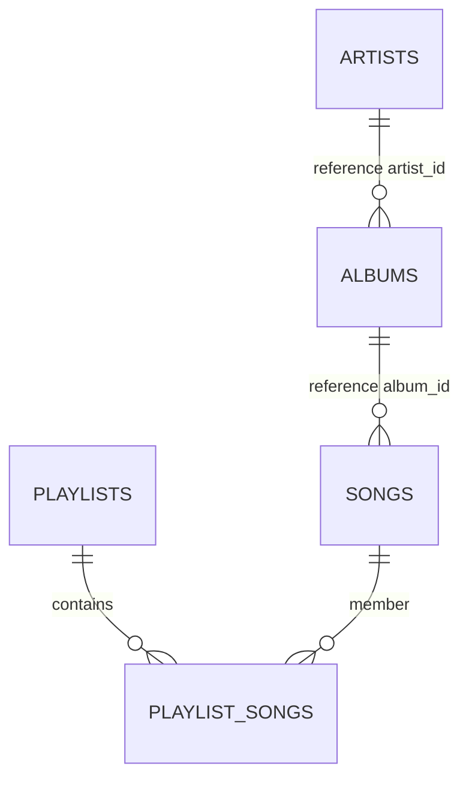

# Data Model — Feature 091 Artist Profile

**Status**: Conceptual read model, not a database migration or approved JSON schema. See [D02–D07](./research.md#unresolved-decisions-and-implementation-gates). This feature reads existing catalog data and introduces no persistent entity.

## Entities, fields and authority

The labels below describe required information; they do not prescribe physical column names or JSON keys. Only names explicitly documented as existing reference columns are shown as such.

| Read entity | Required information | Relationships / validation | Evidence and mapping gaps |
| --- | --- | --- | --- |
| Artist | Stable identity, nonempty public name, optional public image/biography; internal public-viewability decision | Public profile must exist and be permitted before any field/child is returned. Missing optional fields do not change viewability. | Reference `artists.artist_id`, optional unique `artists.user_id`; actual catalog migration, public name/image/bio fields and visibility/disabled source missing. D02. Account data is never a profile fallback. |
| Song | Stable ID, public selection metadata, artist association, displayability/playability, AuraTune all-time count, release date | Association may include multiple artists or no album; only displayable AND playable songs qualify. Counts must represent AuraTune plays, not Spotify popularity. | Reference `songs.song_id`, `songs.album_id`, `songs.total_plays`; ER derives artist via album. Mock direct `artistId`/`playCount`/`releaseDate` are not schema approval. D02/03/05. |
| Album | Stable ID, title, release date, public selection metadata, artist association, viewability | All viewable associated albums included; do not require a playable track to qualify unless shared album policy explicitly says so. | Reference `albums.album_id`, `albums.artist_id`; actual fields/release/null/visibility mapping D02/05. |
| Playlist | Stable ID, public title/image metadata, official designation, public visibility, update time, eligible membership evidence | Must be official AND public, with at least one eligible artist song. Personal/shared visibility grants alone never qualify it. | Reference `playlists.playlist_id`, `status` (`Public`, `Private`, `Shared`), `playlist_songs(playlist_id, song_id)` composite key. Official/update fields not confirmed. D04. |
| Profile section state | Route artist ID, request generation, loading/available/empty/temporary error | In-memory UI state only; identity additionally has terminal not-found; parent unavailability suppresses all children. | No new table, durable cache, section status column or wire field implied. D06 determines transport. |

This diagram describes the supplied reference ER only. It does not solve albumless or multi-artist attribution. Some reference foreign keys are nullable. Do not treat every relationship as mandatory, invent `song_artists`, or migrate the auth schema to fit a conceptual catalog.

## Eligibility and query semantics

For a given publicly eligible artist A and visitor V, define conceptual predicates `Associated`, `Viewable`, `Playable`, `Official`, and `Public`. Map these to reviewed server policy under D02–D04. An unavailable policy/source is not authorization to return records.

| Section | Eligible set before ranking | Ordering (lexicographic tuple) | Output |
| --- | --- | --- | --- |
| Featured songs | Distinct songs S with Associated(S,A) AND Viewable(S,V) AND Playable(S,V) | AuraTune all-time count DESC; song release date DESC; song ID ASC | First ≤5 |
| Albums | Distinct albums B with Associated(B,A) AND Viewable(B,V) | Release date DESC; title ASC; album ID ASC | Every eligible album |
| Related playlists | Distinct P with Official(P) AND Public(P) AND Viewable(P,V) AND EXISTS S in P where Associated(S,A) AND Viewable(S,V) AND Playable(S,V) | Update time DESC; playlist ID ASC | First ≤6 |

The qualifying song for a playlist need not be one of the five featured songs. A playlist containing only hidden/unplayable/deleted artist songs fails; one eligible artist song suffices even alongside other songs. A public nonofficial playlist fails even if all its songs qualify. Do not expose full membership/hidden-song counts as relationship evidence.

Execution order: authorize public parent → find associations → apply all eligibility predicates → remove stale links and duplicate IDs → sort complete eligible set → apply only specified maxima → project safe fields. Use an existence query for playlists to avoid multiplicative joins. Deduplication must precede limits; do not silently select one of conflicting duplicate records without resolving the authoritative source. Client deduplication can be defensive but cannot compensate for an incomplete server subset.

Dates/timestamps must compare as canonical values rather than localized display strings. Compare complete release dates, not displayed release year. ID ascending uses the confirmed canonical type; title ascending needs one agreed collation (D05). Do not rely on browser-default `localeCompare` versus database-default collation producing the same result. ID is the final tie-breaker even when titles collate equally. Missing ordering values must follow a reviewed null policy or explicit data correction; no invented fallback to current date, album release date or external popularity. A failed count read is a temporary error, not zero. Valid stored zero remains zero.

“All albums” is not an initial-page cap. If Supabase or another backend returns bounded pages, traverse the whole eligible collection using D07's approved transport; preserve global ordering and prevent duplicate/omitted IDs. Do not add a product-level album limit or “load more” requirement absent a reviewed design. Changes during traversal require a reviewed consistency strategy, such as a stable read boundary or restart policy; do not assert snapshot support that the current client lacks.

## Public projection boundary

- Artist output: only approved public identity/name/image/biography. Never join account name/email as a fallback; artists may have no linked user.
- Cards/rows: stable content identity and approved public metadata sufficient for selection. Internal sort fields are read inputs, not automatic permission to expose them.
- Exclude password hashes, email, session/token/provider IDs, account bans, internal visibility reasons, uploader/storage filenames, Studio totals, private playlist associations and raw source objects.
- Projection should use explicit select/serialization allowlists, not object spread or `select('*')` into responses.
- No totals, placeholders or labels for excluded rows. A section with no qualifying records is indistinguishable from one whose associated rows are all ineligible.

## State transitions and lifecycle

| Trigger | Identity | Sections | Persistence |
| --- | --- | --- | --- |
| New artist route | Loading; prior identity cleared | Prior sections cleared/suppressed | None |
| Public identity succeeds | Available with optional-field fallbacks | Independently loading/available/empty/error | None |
| Identity unknown/deleted/non-public | Same not-found | Suppressed; no data or counts | None |
| Identity temporary failure | Retryable full-profile error | Suppressed until identity established | None |
| One section read fails | Existing public identity preserved | Failed section error; successful peers preserved | None |
| Retry failed section | Preserved unless parent check fails | Recheck parent + items; replace only that section result | None |
| Parent becomes non-public on authoritative retry | Clear identity | Clear all; discard older successes | No follow deletion or visibility write |
| Song/playlist association changes | Current read determines eligibility | Next successful read recomputes membership/order | 093/110/060 own writes |

No live synchronization, cascade deletion, counter update or retention policy is selected here. Subsequent requests/destination access must enforce current permissions; static rendered data cannot grant access after a state change. If a predicate cannot be evaluated due to storage failure, return a safe temporary failure rather than claim not-found or expose unchecked data.

## Schema/index work gate

Do not generate catalog DDL from the conceptual fields above. First confirm deployed catalog schema/migrations, providers, policy mappings, nullable ordering values and attribution. Then review minimal migrations with affected owners. Index candidates are query access paths, not approved structures: artist→albums, artist-associated eligible songs, song→playlist membership, official-public playlist update order. Validate using actual query plans and Vision p95 targets. Existing auth tables and Firebase identity exchange remain untouched.
