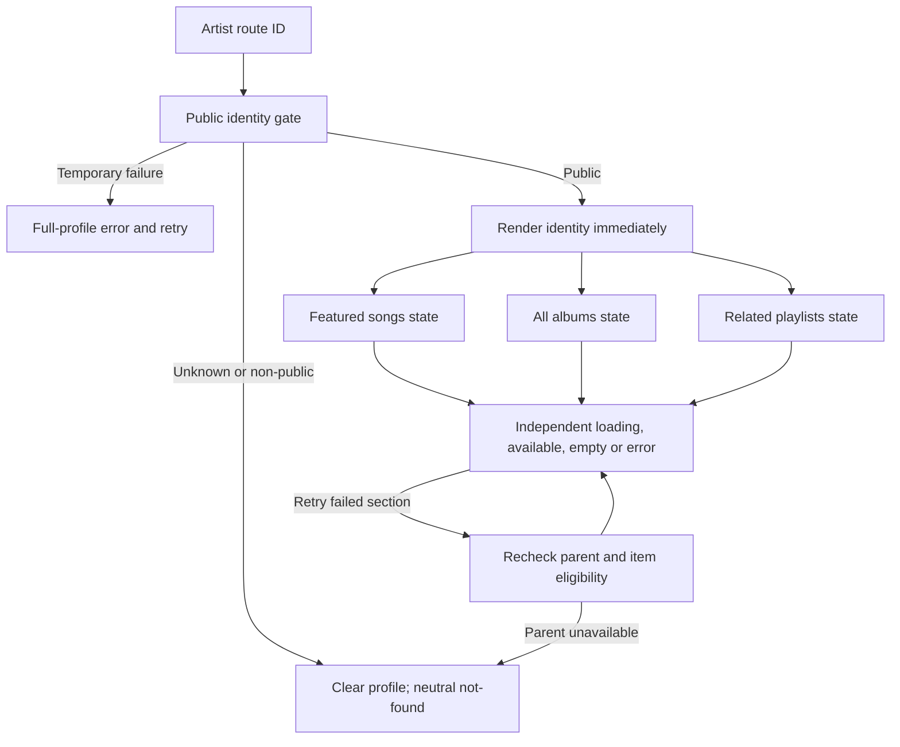

# Implementation Plan: Feature 091 — Artist Profile

**Branch**: `090-artist-profile-studio-plan-tasks` | **Date**: 2026-11-09 | **Spec**: [spec.md](./spec.md)

**Input**: [Feature specification](./spec.md) and [requirements checklist](./checklists/requirements.md) from `specs/090-artist-profile-studio/091-artist-profile/`.

**Status**: Review-ready planning package; implementation gate **HOLD** for [D01–D09](./research.md#unresolved-decisions-and-implementation-gates). This does not claim approval of missing catalog or API schemas. Settled behavior is designed below; dependent implementation must wait for the identified decisions. Specifications and application code remain unchanged. Tasks belong to the next `/speckit.tasks` step.

## Summary

Deliver a read-only public artist profile at the existing `/artist/:id` route: name, optional image/biography, at most five featured songs, every viewable associated album, and at most six qualifying official public playlists. The backend enforces eligibility before deduplication, ordering and limiting. Nonexistent and non-public artists receive identical non-disclosing not-found outcomes, including through child endpoints. Successful sections survive other section failures and visitors can retry failed sections.

Retain JavaScript React/Vite, the custom router, Express, and backend-only Supabase integration. Replace simulated profile loading and direct mock reads through a service boundary. Reuse the existing artist endpoints. No new identity system, router, database provider, AI dependency or metadata provider is selected. The current checkout supplies auth persistence but no catalog migration or artist backend route: those dependencies must be settled explicitly.

## Technical Context

**Language/Version**: JavaScript ES modules/JSX; no TypeScript migration. Node runtime is not pinned: NEEDS CLARIFICATION D08.

**Primary Dependencies**: Existing React `^18.3.1`, Vite `^5.4.11`, Tailwind `^3.4.17`, Lucide React; Express `^4.21.2`, backend Supabase JS `^2.119.0`, JWT/cookies. Native fetch suffices. Firebase identity exchange does not imply Firestore catalog storage.

**Storage**: PostgreSQL reference catalog design and existing backend Supabase client; only auth migration exists. Catalog persistence, public eligibility, IDs and associations need confirmation (D02–D05). The auth memory fallback is not a production catalog source.

**Testing**: Frontend has dev/build/preview, no test runner; backend has start/dev; root `test:backend` runs an auth smoke script. Feature 131 proposes Vitest, React Testing Library and Playwright; confirm the shared harness/runtime under D08 rather than claim they are installed.

**Target Platform**: Responsive browser SPA; HTTP JSON API under `/api/v1`; production HTTPS follows Vision. Current development defaults: frontend 5173, backend 5000.

**Project Type**: Web application with frontend/backend/database directories.

**Performance Goals**: 091 SC-006: ≥95% of normal profile attempts show identity or definitive not-found within 2 seconds. Vision §6.1: core metadata/profile queries p95 <100 ms. Identity must not wait for slow albums/playlists. Agree dataset and network conditions before benchmarking.

**Constraints**: Anonymous viewing, no private/Studio leakage, exact ranking, five-song/six-playlist maxima, complete albums, no external popularity. Project Plan PC-03/04 free-tier/student-credit and approved-content constraints apply. No profile writes, offline persistence or new infrastructure.

**Scale/Scope**: One profile route, three content sections, four existing artist GET paths. No catalog size assumption; album transfer remains D07. Following belongs to 092; Studio to 093; administration to 110.

## Constitution Check

*GATE: evaluated before Phase 0; re-evaluated after Phase 1.*

The [Constitution](../../../.specify/memory/constitution.md) is an unfilled template, without ratified principles/version. Its example comments are not enforceable project decisions. Checks below derive from actual sources, not a fabricated constitution.

| Check | Before research | After design |
| --- | --- | --- |
| Ratified constitution | Unresolved D01 | Unresolved; no constitutional sign-off claimed |
| 091 spec/checklist control behavior | Pass | Pass; screenshots/later draft UCs do not expand scope |
| Team Contract ownership, English Markdown/Mermaid | Pass | Pass; Hoàng owns 090, shared owners recorded |
| Existing architecture/API reuse | Gaps identified | Aligned design; D02–D09 still gate dependent implementation |
| Backend authorization and safe public fields | Required | Designed; tests required before release |
| Shared schema/API coordination | Pending | HOLD until applicable decisions close |
| Documentation only, fixed branch | Pass | No implementation or branch operation planned |

The [planning skill](../../../.agents/skills/speckit-plan/SKILL.md) says “ERROR on gate failures or unresolved clarifications.” Following the user's explicit instruction to identify unresolved decisions, this package records **HOLD**, not a false gate pass. Resolve D01–D09 with owners, update the planning artifacts and re-run gates before production implementation. The documentation remains reviewable in the meantime.

## Project Structure

### Documentation (this feature)

```text
specs/090-artist-profile-studio/091-artist-profile/
├── spec.md                        # authoritative; unchanged
├── checklists/requirements.md     # authoritative; unchanged
├── plan.md
├── research.md                    # source review and decision register
├── data-model.md                  # conceptual reads, mapping gaps; no DDL
├── contracts/artist-profile.md    # existing interfaces and wire-contract gates
└── quickstart.md                  # setup/validation guide and coverage
```

`tasks.md` is reserved for `/speckit.tasks`, not this command.

### Source Code (repository root)

```text
src/frontend/src/
├── pages/Artist/ArtistPage.jsx         # existing main integration surface
├── routes/AppRouter.jsx               # existing /artist/:id
├── services/sessionApiClient.js       # existing base URL/auth client
├── services/artistProfileService.js   # proposed public adapter
├── hooks/useArtistProfile.js          # proposed request/section lifecycle
├── components/playlist/               # existing presentation primitives
├── components/song/SongRow.jsx        # existing player-coupled row
├── components/common/ui.jsx           # existing fallback/error/empty states
└── utils/navigation.jsx               # existing Link/navigate
src/backend/
├── server.js                          # mount routes before fallback
├── routes/artistRoutes.js             # proposed public routes
├── controllers/artistController.js    # proposed validation/envelope
├── services/artistProfileService.js   # proposed read orchestration
└── repositories/artistRepository.js   # proposed approved catalog queries
src/database/
├── supabaseClient.js                  # existing backend-only client
└── migrations/                       # catalog work only after shared resolution
```

**Structure Decision**: Extend existing modules/service-repository separation. Proposed names are future locations, not existing files. Reuse Feature 131's eventual shared HTTP service seam if available; do not require its full refactor or create competing clients. Final test locations/commands are D08.

## Phase 0 — Research Outcome

[research.md](./research.md) separates authoritative behavior, checked-in code, proposals and unresolved conflicts. Public access, ranking, section states, endpoint reuse and feature boundaries are resolved. Catalog mappings, payloads, complete albums, comparison edge cases, song handoff and governance remain explicit decisions with owners and closure evidence. No hypothetical table or flag resolves them.

## Phase 1 — Technical Design

### Backend pipeline

1. Validate the artist ID against the confirmed domain (D02). Parameterize queries; never interpolate SQL. Malformed IDs follow shared `400 / VALIDATION_ERROR`; the UI may show neutral not-found. Unknown, deleted, non-artist and non-public IDs receive identical `404 / NOT_FOUND` responses.
2. Resolve public artist eligibility before projecting identity or related content. Every artist child request/retry repeats this check. Artist/Admin roles gain no public-surface bypass. Do not infer profile disabling from account banning until D02 defines their relationship.
3. Select only approved public fields. Never serialize raw artist/user rows, account links, visibility flags, uploader details, private memberships or storage credentials.
4. Filter each section by association and visitor permission. Songs must also be playable. A related playlist is official AND public AND contains at least one eligible artist song across the entire catalog, not only the top five. Remove stale references and deduplicate by canonical ID before sorting/limits.
5. Apply [data-model comparators](./data-model.md#eligibility-and-query-semantics) across the complete eligible candidate set on the server. Use an existence/semijoin query for playlist membership so multiple matches do not duplicate rows. Never rank only an arbitrary initial database page.
6. Return standard envelopes. Read failures are errors, never empty successes. Profile GETs never mutate follows, plays, listening history, visibility or catalog records.

The Supabase service-role client can bypass row policies; application authorization remains mandatory. Browser code must never import it. Verify approved query plans before choosing indexes: likely access paths include artist albums, song associations/eligibility, playlist-song membership and official-public update ordering. Do not create indexes on invented columns. Group 070 owns play-count production; 091 reads its canonical AuraTune count only.

### Request composition and failure isolation

The shared contract says detail includes identity plus featured songs and also defines artist songs/albums/playlists child routes. It does not specify a partial-failure schema. D06 is blocking. Recommended composition: preserve identity-plus-featured detail semantics with independent featured failure, use album/playlist child routes, and agree how the songs child route retries the exact featured subset. Do not assume undocumented `limit`, `sort`, or section-status fields.

Alternative: an approved independent identity read plus all three child requests; this must explicitly reconcile the detail endpoint's existing description. Neither recommendation is an approved wire schema. No new aggregate route is needed. The selected contract must allow identity success when featured data fails and must meet SC-006 without waiting on slow content.



Independent state must not depend on a single fail-fast `Promise.all`; use settled outcomes or equivalent. Shared storage failure may legitimately fail all reads, but a section-only query failure must not invalidate identity or another successful section.

### Frontend lifecycle and rendering

- Key state by artist ID and request generation. Abort obsolete requests and ignore late responses on route change/unmount or newer retry. Clear previous-artist identity/content before loading another artist.
- Identity: loading → available, not-found, or temporary error. Show name, optional image/biography, neutral missing/broken-image fallback and explicit missing-biography state. Treat whitespace-only biography as missing. Render text safely, wrap long content and preserve access to sections; no injected HTML.
- Sections: loading → available, empty, or temporary error. Retry only the failed section, preserving identity and successful sections. A successful empty result has section-specific copy. Failure is never “no songs/albums/playlists.” Failed/loading sections must not contribute zero-count claims.
- If any authoritative response reports parent not-found, clear all identity and section data and invalidate older successes. No restricted metadata remains in DOM, accessible labels or client state rendered as public data. Refreshes/retries recheck visibility; no live-push revocation requirement or persistent profile cache is introduced.
- Use existing responsive/keyboard-accessible primitives. Counts, if shown, describe only eligible displayed items; no hidden totals/placeholders or reasons. Errors/logs contain no secrets or private data.
- Public reads must not wait for authentication hydration, refresh or Firebase. Share `API_BASE_URL`, but use anonymous fetch with no token/cookies for this public projection, or a coordinated public mode. Current `apiFetch` automatically adds credentials and refreshes on 401, so it cannot be reused unmodified for an auth-independent screen. Future personalized access requires reviewed identity/cache handling under D06.

### Navigation and scope ownership

Use existing `/album/:id` and `/playlist/:id` routes via the custom navigation utility; card selection navigates rather than initiating collection playback. Song handoff remains D09: no song route exists; current row callbacks open the full player, while share helpers choose album-query/search URLs. Huy and Hoàng must confirm the intended existing selected-song destination. Do not invent `/song/:id` or silently route to search as a substitute.

Destinations retain authorization and unavailable-item behavior if content changes after rendering; cached profile data grants no access. Verify that handoff with destination owners. Do not redefine player, album/playlist detail, queue or stream semantics.

No follow UI/state belongs to 091. Existing mock `FollowButton` must remain owned by 092 outside the 091 presentation/service boundary; do not change its relationships or hidden-profile retention. 093/110 own mutations; subsequent profile reads must reflect hidden/deleted content without implementing their controls. No profile editing, administrative controls, new play-all or artist-share behavior is planned. Later draft UC G090-D17/D18 additions are recorded source differences, not newly adopted 091 requirements.

## Implementation Sequence and Gates

| Stage | Work for subsequent task breakdown | Exit evidence |
| --- | --- | --- |
| A — Shared decisions | Resolve D01–D09, confirm IDs/schema/policies, wire examples, album completeness, song destination and harness | Reviewed decision/contract evidence; no assumed schema |
| B — Backend reads | Public parent gate, repository projections, eligibility/dedup/ranking, existing route handlers, safe errors | Contract/integration tests, direct-child privacy checks |
| C — Frontend integration | Public adapter, request-keyed lifecycle, fallbacks, section retries and navigation | Component/request tests, anonymous browser journey |
| D — Cross-feature checks | Hidden/deleted songs, disabled artist, playlist losing final qualifying song, changed destination visibility | Safe subsequent reads, independent 092 behavior, no 091 writes |
| E — Acceptance/performance | Execute validation matrix, inspect query plans, browser/keyboard checks and usability measures | All FRs/SCs evidenced; independent review |

Fixtures/state design can be prepared against the conceptual model; production schema/API implementation waits for its dependency decisions. No estimates, Jira IDs or completion dates are invented.

## Verification and Review

[quickstart.md](./quickstart.md) defines setup limits, executable baseline commands, acceptance scenarios and FR/SC coverage. Verify backend authorization directly, ordering on shuffled/tied candidates, filtering before limits, playlists qualifying through nonfeatured songs, albums beyond default row caps, partial failure/retry, route races and visibility changes. Browser-only mock filtering is insufficient.

Planning checks cover artifact completeness, relative links, source preservation and branch reference. No application tests are claimed: catalog routes and harness do not exist. Git commands fail because macOS Command Line Tools are missing; branch identity is read from the repository reference without changing it.

## Complexity Tracking

No architectural violation is proposed. D01 is missing governance, not a waived constitution violation. No extra project, datastore, cache service or framework is introduced. Unresolved shared decisions remain implementation gates.
