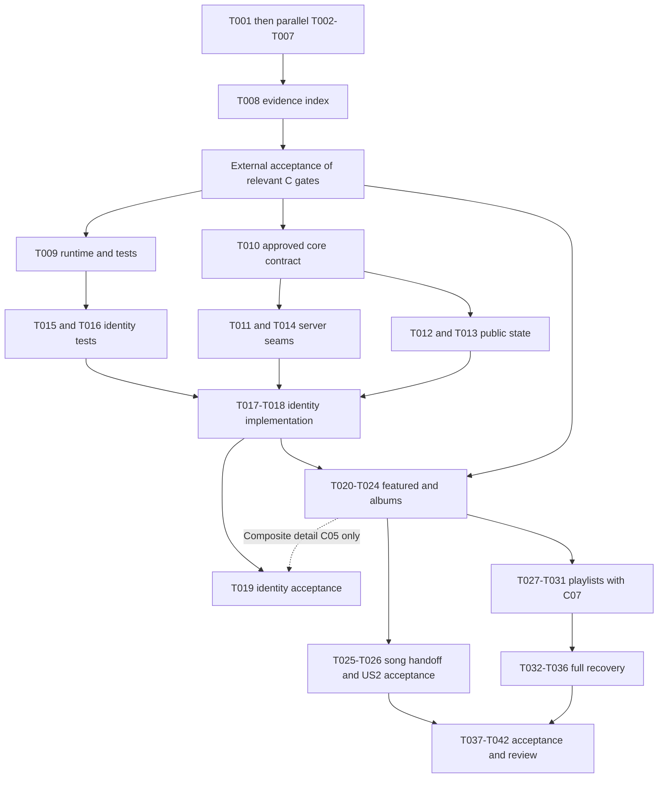

# Tasks: Feature 091 — Artist Profile

**Input:** [spec.md](./spec.md), [requirements checklist](./checklists/requirements.md), [plan.md](./plan.md), [research.md](./research.md), [data-model.md](./data-model.md), [interface contract](./contracts/artist-profile.md), [quickstart.md](./quickstart.md), and [Group 090 review](../group-090-cross-feature-review.md).  
**Branch:** `090-artist-profile-studio-plan-tasks`  
**Generated:** 2026-11-09  
**Readiness:** Review-ready, dependency-aware backlog; **not implementation-ready**. No original decision is resolved or approved by task generation.

**Prerequisites:** Plan/spec and supporting documents exist. The Constitution remains an unratified template, exact artist wire schemas and catalog mappings remain open, and no feature test runner/runtime pin is currently installed/declared. The Group 090 review permits preparatory work while implementation gates stay open.

**Tests:** Explicitly requested in this Tasks invocation. Test-case design is runnable now; executable tests wait for their stated contract/data/tooling gates. Write the relevant tests first and demonstrate meaningful failure before implementing the tested behavior after gates close. No test, application build or implementation has been executed by generating this file.

**Organization:** Setup → feature-relevant foundations → US1/P1 → US2/P2 → US3/P3 → US4/P4 → cross-cutting verification. Preparation may run before implementation gates close. Story implementation requires its own applicable prerequisites, not resolution of unrelated Group 090 features.

## Format: `[ID] [P?] [Story] Description`

- `[P]` means distinct output files that can run concurrently **after all listed predecessors and gates are satisfied**. It never bypasses an unresolved decision or permits concurrent edits to a shared file.
- `[US1]` through `[US4]` refer to the unchanged specification's four user stories. Setup/foundation/final tasks have no story label.
- **READY** means the task's investigation/design deliverable can be executed with checked-in evidence and ordinary text tools, after its task predecessors. No new product approval or Node runtime is required. It does not mean its proposed technical solution is approved.
- **GATED Cxx…** means the task cannot yet execute. Each listed cluster must have its relevant closure evidence accepted, plus the task's predecessors. A checked preparatory task alone does not close a gate.
- Dependencies are task IDs, not implied checkbox order. All tasks start unchecked. Task completion requires the stated deliverable/assertions; implementation or approval cannot be inferred from a file merely existing.

## Path Conventions and Scope

All task paths are repository-relative. Existing application directories are `src/frontend/`, `src/backend/`, and `src/database/`; retain JavaScript React/Vite, the custom router and current backend architecture. Do not initialize another app/framework/auth system.

`specs/090-artist-profile-studio/091-artist-profile/preparation/` and `validation/` paths below are **proposed future work-product locations**. No files/directories there are created by this command. Proposed `.test.js`/`.test.jsx` and browser test destinations must be confirmed in C15 evidence before their tasks unlock; they do not select a test library. If approved tooling requires other destinations, revise this Tasks document explicitly before execution rather than silently choosing a framework.

This generation creates only this file. Executing a later task that changes application files, adds supporting documents or installs tooling is separate work; no such work is performed now. Protected specifications, checklists, plans, research and existing contracts are not task-generation outputs and remain unchanged. No task authorizes changing another feature's requirements, generating 092/093 Tasks, or creating/switching/merging/committing/pushing branches. Any later change to an authoritative planning artifact needs an explicit authorized alignment pass.

## Gate Register and Closure Evidence

Use the original [091-D register](./research.md#unresolved-decisions-and-implementation-gates) and [consolidated review](../group-090-cross-feature-review.md#3-consolidated-decision-register-with-traceability). The table records required evidence, not new decisions. Close only the relevant 091 portion of a bundled cluster; do not require unrelated Studio storage or follow-schema choices to implement public identity.

| Gate | Original traceability | Required closure evidence for these tasks | Established coordination responsibilities |
| --- | --- | --- | --- |
| C01 | 091-D01 | Ratified Constitution or recorded governance disposition through the established team process; no fabricated waiver. Acknowledge the implementation HOLD until disposition exists. | Nhựt/team |
| C02 | 091-D02 | Reviewed canonical artist/account-ID mapping, ID validation, current public/hidden/disabled predicate, ban/profile relationship and allowlisted public identity fields, with representative eligible/ineligible records. Public permission cannot be inferred from Artist/Admin role or mock defaults. | Hoàng/Đăng; Khoa for account policy |
| C03 | 091-D02/D03/D05 | Approved catalog source/mapping for song/album associations including standalone/multiple artists; playability/viewability, AuraTune all-time counts, release dates, missing-value rules, typed ID order and album title collation. No guessed tables/columns or fallback dates/counts. | Đăng/Hoàng; Khoa for history/counts |
| C05 | 091-D06/D07 | Reviewed per-operation wire contract/examples and public projection, identity-plus-featured failure isolation and retry composition, shared envelopes/errors and complete album transport under row caps/concurrent changes. Confirm public fetch mode and identity-MVP feasibility. No undocumented fields/parameters/endpoints. | Hoàng/Đăng; coordinate shared frontend/auth seam with assigned owner |
| C07 | 091-D04 | Authoritative official-playlist designation, public visibility and update timestamp/membership mappings; confirm existence query across all eligible artist songs and safe limits/dedup. | Khoa/Hoàng/Đăng |
| C12 — 091 scope slice | Review source-lineage conflict affecting 091; recorded G090-D17/D18 | Written delivery/source-precedence disposition for later selection-return/share owner supplements versus the current 091 plan. Do not reopen recorded decisions as if nonexistent; do not add them to this backlog silently. If delivery expands, amend authorized source/task scope first. | Hoàng/Nhựt/team |
| C13 | 091-D09 | Hoàng/Huy confirmation of the existing selected-song destination/handoff and its unavailable-content handling; demonstrate that it satisfies FR-015 without inventing a song route or changing player behavior. | Huy/Hoàng |
| C15 | 091-D08 | Supported Node/runtime, approved existing/shared test runner and exact scripts/layout, working local environment and executable checks. Feature 131 proposals alone are not installation evidence. | Nhựt architecture, Hoàng feature verification; team assigns unnamed foundation responsibility |

All implementation/test tasks inherit C01 through their foundation dependencies, even when a task lists only its narrower technical gates. Gate evidence must be reviewed/accepted and linked in the future preparation record; neither this file nor a proposed OpenAPI document proves approval. C04 is relevant only if public-mode integration requires a shared auth-client change: obtain that slice's reviewed design before such a change; do not expand 091 into personal refresh/replay work. C08–C11/C14 Group 090 mutation/media/count/timing work is not a 091 prerequisite except existing destination enforcement evidence at handoff; create no such implementation tasks here.

## Phase 1: Setup — Executable Evidence and Preparation

**Purpose:** Produce concrete reviewable evidence with current repository files. No database connection, new dependency, product choice or source-spec edit is needed. These are document/audit tasks, not implementation approvals.

- [X] T001 **READY** — Create `specs/090-artist-profile-studio/091-artist-profile/preparation/source-and-scope-ledger.md` mapping every FR-001–027 including FR-010A/010B/014A/018A and SC-001–008 to current sources; record C01 template status and C12 G090-D17/D18 lineage, current branch reference and the no-code/no-other-feature baseline. Identify decisions needing review without declaring them closed. **Depends:** none.
- [X] T002 [P] **READY** — Create `specs/090-artist-profile-studio/091-artist-profile/preparation/public-policy-cases.md` with anonymous/User/Artist/Admin public-access cases, unknown/non-public equivalence, malformed/encoded IDs, safe identity allowlist, hidden child-endpoint bypass and no-count-inference expectations from FR-006–008/018/018A/023; separate fixed behavior from C02 mappings. **Depends:** T001.
- [X] T003 [P] **READY** — Create `specs/090-artist-profile-studio/091-artist-profile/preparation/ordering-and-completeness-cases.md` with shuffled conceptual candidates, ties, duplicates/stale associations, ineligible high-ranked candidates, a nonfeatured qualifying playlist song and albums beyond a database row cap. Quote the three exact comparator/limit rules from the data model and list unresolved null/type/collation/source mappings rather than fill them with defaults. **Depends:** T001.
- [X] T004 [P] **READY** — Create `specs/090-artist-profile-studio/091-artist-profile/preparation/public-interface-options.md` comparing the existing artist detail/children with identity/featured partial-failure and targeted-retry requirements; include successful/empty/error outcomes, anonymous-fetch isolation, album completeness and consequences for identity-only MVP. Deliver alternatives and explicit C05 questions, not final API fields/queries/schemas or a new endpoint. **Depends:** T001.
- [X] T005 [P] **READY** — Create `specs/090-artist-profile-studio/091-artist-profile/preparation/catalog-source-audit.md` tracing actual mock/reference/auth-migration evidence for artist identity, song attribution/playability/count/release, albums and official playlists. Record exact source paths and absent catalog mappings for C02/C03/C07; do not invent DDL or treat mock `artistId`, `official`, `playCount`, `releaseDate` as approved persistence. **Depends:** T001.
- [X] T006 [P] **READY** — Create `specs/090-artist-profile-studio/091-artist-profile/preparation/song-navigation-audit.md` inspecting `src/frontend/src/routes/AppRouter.jsx`, `src/frontend/src/App.jsx`, `src/frontend/src/components/song/SongRow.jsx` and `src/frontend/src/utils/share.js`; demonstrate existing song callback and album/playlist links, lack of a song route, and unavailable-selection evidence needed from Hoàng/Huy for C13. No player behavior or route change. **Depends:** T001.
- [X] T007 [P] **READY** — Create `specs/090-artist-profile-studio/091-artist-profile/preparation/tooling-audit.md` recording actual runtime availability, manifest scripts and shared Feature 131 tooling proposals; specify C15 runner/layout/script evidence and proposed checks without installing packages or claiming build/tests ran. **Depends:** T001.
- [X] T008 **READY** — Assemble `specs/090-artist-profile-studio/091-artist-profile/preparation/gate-evidence-index.md` linking T001–T007 evidence to original D01–D09 and C01/C02/C03/C05/C07/C12/C13/C15, listing reviewers by documented responsibility, missing closure evidence and affected task IDs. Record accepted evidence only when supplied; otherwise leave the gate open and submit the package for review. **Depends:** T002–T007.

**Checkpoint:** Preparation can be complete while implementation remains blocked. T008 is an evidence index, not a task to manufacture approvals. No prototype result substitutes for a server privacy test.

## Phase 2: Foundational — Gated Public-Read Infrastructure

**Purpose:** Establish the approved shared seams. Implementation cannot begin until the task's relevant C01/C02/C05/C15 evidence is accepted. C03/C07 content-specific work is not a universal prerequisite for all identity code; composite-detail MVP constraints are explicit below.

- [X] T009 **GATED C01, C15** — Configure only the approved runtime/test scripts in `src/frontend/package.json`, `src/backend/package.json` and approved test configuration paths recorded by T008; establish the concrete unit/component/API/browser destinations used below and run a harness smoke check. Reuse current apps; no speculative dependency/router/auth migration. **Closure:** accepted governance and C15 runtime/runner/layout/script selection. **Depends:** T008; do not execute simply because the tooling audit exists.
- [X] T010 **GATED C01, C02, C05** — Create `specs/090-artist-profile-studio/091-artist-profile/contracts/artist-profile-api.json` as OpenAPI 3.0.3 for the approved public identity/parent/error and request-state composition, using accepted exact fields/statuses/query semantics and no guessed schema. Add content operations in their story tasks after their own mapping gates. Leave the existing Markdown contract unchanged in this task. **Closure:** reviewed C02 identity/validator/projection and C05 wire examples, partial-failure composition and per-operation scope. **Depends:** T008.
- [X] T011 **GATED C01, C02, C05** — Implement canonical public-artist resolution and explicit public projection in `src/backend/repositories/artistRepository.js`; validate according to approved ID/predicate mappings and never fall back to user private account metadata or default-active mock state. No speculative catalog migration. **Closure:** approved actual source/key/public-field mapping and identity contract from T010. **Depends:** T010.
- [X] T012 **GATED C01, C02, C05, C15** — Implement `src/frontend/src/services/artistProfileService.js` with the approved public DTO/envelope mapping and existing API base. Public reads must not require tokens/cookies, auth hydration or refresh; errors cannot become empty arrays. Reuse a coordinated public fetch seam without changing personal auth behavior. **Closure:** approved public request/response mode and working runtime; any shared-client modification additionally needs the relevant C04 agreement. **Depends:** T009, T010.
- [X] T013 **GATED C01, C02, C05, C15** — Implement `src/frontend/src/hooks/useArtistProfile.js` with artist-ID/request-generation identity and identity-only state for the owner-approved initial increment (independent catalog sections remain US2–US4), abort/ignore of obsolete results and no persistent profile cache; API composition must match T010, not an invented wire section shape. **Closure:** approved identity/content request boundaries and error/retry semantics. **Depends:** T009, T010, T012.
- [X] T014 **GATED C01, C02, C05** — Register existing artist GET paths through `src/backend/routes/artistRoutes.js`, `src/backend/controllers/artistController.js` and `src/backend/server.js`, with parent public checks before child access, shared safe not-found/validation/internal envelopes and no Artist/Admin public bypass. Mount before fallback; do not introduce auth requirements or undocumented content handlers. Identity/content handlers are completed in story tasks. **Closure:** accepted C02 validation/privacy and C05 route/error composition. **Depends:** T010, T011.

**Checkpoint:** Foundation tasks do not claim the full API is complete. T010/014 may establish only accepted 091 operations; no placeholder content success, fake empty list or manufactured section failure may stand in for unimplemented catalog reads. Story-specific contracts, queries and acceptance remain mandatory.

## Phase 3: User Story 1 — Learn About an Artist (Priority: P1) — MVP Candidate

**Goal:** Anonymous visitors can identify a public Artist by name and available image/biography, with safe missing-field treatment and non-disclosing not-found.

**Independent test:** Load public identity and each missing-optional-field combination, unknown/non-public artist, malformed ID, direct child requests and temporary identity failure without depending on follow/play/Studio actions. Actual composition must satisfy C05; identity success cannot be held hostage to an unrelated section failure.

### Tests for User Story 1

- [X] T015 [P] [US1] **GATED C01, C02, C05, C15** — Add backend identity/projection/parent-privacy contract tests in `src/backend/tests/artist-profile-identity.test.js`: anonymous public access; current roles cannot bypass hidden state; unknown/non-public produce same safe result; child routes recheck parent; raw response has no account/management fields; storage failure differs from not-found. **Closure:** reviewed fields/validator/envelopes and working harness. **Depends:** T009, T010; fail against real unfinished handlers, not only test doubles.
- [X] T016 [P] [US1] **GATED C01, C02, C05, C15** — Add identity component/request tests in `src/frontend/src/pages/Artist/ArtistPage.identity.test.jsx`, with interactive loading/error/retry/route/image assertions in the approved `src/frontend/tests/e2e/artist-profile-identity.spec.js` browser runner, for name, “neutral artist-image fallback”, “explicit missing-biography state”, safe long/whitespace/untrusted biography, broken image, loading/not-found/temporary error and malformed percent-encoded routing. Assert no previous-artist content survives route changes. **Closure:** approved DTO/state contract and test destinations. **Depends:** T009, T010.

### Implementation for User Story 1

- [X] T017 [US1] **GATED C01, C02, C05** — Complete approved identity projection/response handling in `src/backend/controllers/artistController.js` using T011/T014; preserve name/image/biography privacy and identical unknown/non-public outcomes, distinguish temporary read errors, and leave existing destinations/mutations untouched. If C05 detail composition requires featured data, integrate its reviewed producer through T022/T023 before claiming an independently usable endpoint. **Closure:** approved detail composition and parent/public projection; no identity-only response assumed. **Depends:** T011, T014, T015.
- [X] T018 [US1] **GATED C01, C02, C05, C15** — Adapt `src/frontend/src/pages/Artist/ArtistPage.jsx` to T012/T013 identity state and shared fallback primitives, rendering public name/image/biography safely; handle malformed route decoding in `src/frontend/src/routes/AppRouter.jsx` within 091's reviewed error semantics. Remove 091 dependence on mock identity and the simulated timer without implementing or deleting 092-owned follow behavior. **Closure:** accepted DTO/state/route validation and passing relevant test harness. **Depends:** T013, T016, T017.
- [X] T019 [US1] **GATED C01, C02, C05, C15** — Add/run `src/frontend/tests/e2e/artist-profile-identity.spec.js` and record results in `specs/090-artist-profile-studio/091-artist-profile/validation/us1-results.md`, covering all US1 scenarios, anonymous independence and identity success with slow/failing related data; verify no private DOM/accessible labels or raw fields. **Closure:** real approved identity/backend composition and runnable browser harness. **Depends:** T015–T018; **conditional prerequisite T023** if C05 requires identity-plus-featured implementation for a valid successful detail response.

**Checkpoint/MVP:** US1 can be the smallest increment only after T019 passes and C05 establishes a usable identity boundary. If identity and featured success are inseparable in the approved contract, do not alter the contract to force an identity-only MVP: complete T020/T022/T023 first. That conditional edge affects acceptance, not permission to invent section responses. Full 091 delivery still requires US2–US4 and final checks.

## Phase 4: User Story 2 — Discover an Artist's Released Content (Priority: P2)

**Goal:** Browse the exact eligible featured subset and complete eligible album collection, then select each item using its approved existing destination.

**Independent test:** Use a known public Artist with more than five songs and more albums than the backend row cap; prove global eligibility/dedup/order/completeness and song/album handoff without follow or Studio capabilities.

### Tests for User Story 2

- [ ] T020 [P] [US2] **GATED C01, C02, C03, C05, C15** — Add featured query/contract tests in `src/backend/tests/artist-profile-featured.test.js` quoting “AuraTune all-time count DESC; song release date DESC; song ID ASC” and “First ≤5”: filter viewable AND playable artist-associated songs, deduplicate before limit, reject external popularity, test shuffled ties/zero/missing values under approved C03 policy, stale associations and standalone/multiple-artist mapping. **Closure:** canonical association/count/date/null/typed-ID and songs/detail DTO mappings. **Depends:** T009, T010, T003, T005.
- [ ] T021 [P] [US2] **GATED C01, C02, C03, C05, C15** — Add album completeness/order tests in `src/backend/tests/artist-profile-albums.test.js` quoting “Release date DESC; title ASC; album ID ASC” and “Every eligible album”; include ties/approved collation, duplicates, hidden rows, a viewable album without playable songs, default row cap, concurrent traversal changes and mid-read failure without false completeness. **Closure:** approved album source/comparator/null policy and full-response/traversal contract. **Depends:** T009, T010, T003, T005.

### Implementation for User Story 2

- [ ] T022 [US2] **GATED C01, C02, C03, C05** — Extend `src/backend/repositories/artistRepository.js` with approved featured/albums reads: parent authorization, eligible complete candidate set, deduplication, exact comparator tuples and only the five-song maximum; albums expose all eligible records via reviewed complete transport. Use actual approved storage only; no invented association table, page policy or album creation. **Closure:** C03 mappings and C05 album/featured protocol from accepted evidence. **Depends:** T011, T020, T021; this task may precede US1 acceptance when C05 composite-detail requires it.
- [ ] T023 [US2] **GATED C01, C02, C03, C05** — Extend `specs/090-artist-profile-studio/091-artist-profile/contracts/artist-profile-api.json`, `src/backend/controllers/artistController.js` and `src/backend/routes/artistRoutes.js` with approved featured/detail composition, existing artist songs/albums operations and exact errors. Preserve general songs endpoint semantics; no assumed `limit`, `sort`, cursor or section key; allow isolated featured failure per C05. **Closure:** reviewed per-operation schemas/composition and T022 query evidence. **Depends:** T010, T014, T017, T022.
- [ ] T024 [US2] **GATED C01, C02, C03, C05, C15** — Integrate featured rows and complete albums in `src/frontend/src/services/artistProfileService.js`, `src/frontend/src/hooks/useArtistProfile.js` and `src/frontend/src/pages/Artist/ArtistPage.jsx`; preserve server order/uniqueness, neutral section-empty states, and never fill with ineligible substitutes. Album selection navigates existing `/album/:id` via `src/frontend/src/utils/navigation.jsx` rather than triggering collection playback. **Closure:** reviewed song/album DTOs and completeness model; C13 is not needed to implement album links. **Depends:** T012, T013, T018, T023.
- [ ] T025 [US2] **GATED C01, C02, C05, C12, C13, C15** — Wire the accepted selected-song handoff in `src/frontend/src/pages/Artist/ArtistPage.jsx` using the existing destination integration confirmed by T006 evidence; assess safe reuse of `src/frontend/src/components/song/SongRow.jsx` without adding 091 follow/edit/admin actions or altering playback. Do not create `/song/:id` or use search/share helper as an unconfirmed substitute. **Closure:** Hoàng/Huy accepted destination/unavailable behavior and C12 091-supplement disposition; any scope change requires prior authorized task/source alignment. **Depends:** T006, T008, T024.
- [ ] T026 [US2] **GATED C01, C02, C03, C05, C12, C13, C15** — Add/run `src/frontend/tests/e2e/artist-profile-content.spec.js` for global top-five, exact album tie order, all-album retrieval beyond caps, no-content combinations and selected song/album destinations; hide/delete content between render and selection to verify destination enforcement without management/playback redesign. Record `specs/090-artist-profile-studio/091-artist-profile/validation/us2-results.md`. **Closure:** approved destination policy, complete content contracts and real eligible catalog fixtures. **Depends:** T020–T025.

**Checkpoint:** US2 acceptance is gated by song handoff; album/featured rendering work need not wait for unrelated playlist/follow/Studio implementation. An undersized eligible song set remains undersized; no external top-tracks substitution is allowed.

## Phase 5: User Story 3 — Discover Related Playlists (Priority: P3)

**Goal:** Show no more than six distinct eligible official public playlists with artist-song evidence and existing playlist navigation.

**Independent test:** Include a playlist qualifying only through an eligible nonfeatured song, a playlist with only hidden artist songs, private/shared/nonofficial candidates, duplicate membership and equal update times; prove only eligible results and correct selection.

### Tests for User Story 3

- [ ] T027 [P] [US3] **GATED C01, C02, C03, C05, C07, C15** — Add `src/backend/tests/artist-profile-playlists.test.js` quoting “Update time DESC; playlist ID ASC” and “First ≤6”; enforce official AND public AND viewable with EXISTS displayable/playable artist song across the whole eligible catalog, not just featured five; dedup before limit, tied/shuffled candidates, stale links and loss of last eligible song. **Closure:** authoritative official/public/update/membership mapping and exact playlist DTO. **Depends:** T009, T010, T003, T005.

### Implementation for User Story 3

- [ ] T028 [US3] **GATED C01, C02, C03, C05, C07** — Extend `src/backend/repositories/artistRepository.js` with the approved related-playlist existence/semijoin query, parent policy and public projection, exact update/ID ordering and ≤6 limit. No admin-creator inference, raw membership counts, hidden slots or duplicate-induced limit loss. **Closure:** accepted C07 designation/source policy and reviewed query inputs. **Depends:** T022, T027; serialize with all edits to this repository file.
- [ ] T029 [US3] **GATED C01, C02, C03, C05, C07** — Extend `specs/090-artist-profile-studio/091-artist-profile/contracts/artist-profile-api.json`, `src/backend/controllers/artistController.js` and `src/backend/routes/artistRoutes.js` for existing GET `/artists/:id/playlists` using accepted schema/errors, safe parent recheck and true empty/error distinction. **Closure:** reviewed playlist contract and T028 implementation evidence. **Depends:** T023, T028; do not change public/private boundaries.
- [ ] T030 [US3] **GATED C01, C02, C03, C05, C07, C15** — Integrate playlist read/state/cards in `src/frontend/src/services/artistProfileService.js`, `src/frontend/src/hooks/useArtistProfile.js` and `src/frontend/src/pages/Artist/ArtistPage.jsx`, retaining returned order/uniqueness and playlist-specific empty state. Card selection uses existing `/playlist/:id`; no new playlist playback/share/detail behavior. **Closure:** accepted DTO/state and eligibility results. **Depends:** T024, T029; serialize with shared page/hook/service writers.
- [ ] T031 [US3] **GATED C01, C02, C03, C05, C07, C15** — Add/run `src/frontend/tests/e2e/artist-profile-playlists.spec.js` covering T027 scenarios, no substitute content, existing destination and omitted unavailable items; record `specs/090-artist-profile-studio/091-artist-profile/validation/us3-results.md`. **Closure:** real approved catalog/playlist mappings and working browser harness. **Depends:** T027–T030.

**Checkpoint:** Related-playlist implementation needs C07, but its test-case preparation does not. It must not turn playlist ownership or shared-user permission into “official public” status.

## Phase 6: User Story 4 — Continue When Some Data Cannot Load (Priority: P4)

**Goal:** Preserve identity and successful sections across isolated failures, recover only failed data on the same Artist route, and distinguish temporary failure from not-found and empty.

**Independent test:** With approved interface composition, fail each nonempty subset of the three content sections, retry/recover one, fail identity separately and race retries/navigation/public-parent revocation; successful current-artist sections remain usable unless the parent is authoritatively not viewable.

### Tests for User Story 4

- [ ] T032 [P] [US4] **GATED C01, C02, C03, C05, C07, C15** — Add `src/backend/tests/artist-profile-partial-failure.test.js` for all seven nonempty section-failure combinations, independent identity success, existing-path targeted featured recovery and safe parent recheck on every retry. Assert no failed read becomes 200-empty/404 and no stack/private details escape. **Closure:** approved C05 failure/targeted-retry transport and real section mappings. **Depends:** T009, T023, T029; test written before T034.
- [ ] T033 [P] [US4] **GATED C01, C02, C05, C15** — Add `src/frontend/src/hooks/useArtistProfile.failure.test.jsx` testing section loading/available/empty/error transitions, full-profile retry, preserved peer success, overlapping retries, A→B late responses, unmount/abort and parent-not-found clearing all data/in-flight generations; no persistent cache or stale cross-artist rendering. **Closure:** accepted request-generation/state contract and supported harness. **Depends:** T009, T013, T016; independent of backend test-file edits.

### Implementation for User Story 4

- [ ] T034 [US4] **GATED C01, C02, C03, C05, C07** — Complete section-failure isolation/retry response handling in `src/backend/controllers/artistController.js` and `src/backend/services/artistProfileService.js` according to the approved composition: identity is not lost on featured-only failure, errors are not empty success, each child/retry reauthorizes parent/items, and no new status/schema is introduced. **Closure:** accepted C05 exact transport/timeout/error behavior and section mappings. **Depends:** T017, T023, T029, T032.
- [ ] T035 [US4] **GATED C01, C02, C05, C15** — Complete `src/frontend/src/services/artistProfileService.js`, `src/frontend/src/hooks/useArtistProfile.js` and `src/frontend/src/pages/Artist/ArtistPage.jsx` retry/error integration: settled independent results rather than fail-fast whole-page collapse; per-failed-section retry, full failure retry, accurate empty/error copy, generation guards, and entire-profile clearing on authoritative parent not-found. **Closure:** approved retry protocol and privacy/state evidence. **Depends:** T030, T033, T034; no personal auth or mutation side effects.
- [ ] T036 [US4] **GATED C01, C02, C03, C05, C07, C15** — Add/run `src/frontend/tests/e2e/artist-profile-recovery.spec.js` for all seven section-failure combinations, eight successful empty/nonempty combinations, full identity failure, same-route recovery, slow featured/album/playlist isolation and parent visibility changes; record `specs/090-artist-profile-studio/091-artist-profile/validation/us4-results.md`. **Closure:** fault injection in approved disposable test infrastructure, complete contract and executable browser harness; no production test query flags. **Depends:** T031–T035.

**Checkpoint:** US4 test design may be prepared with US1–US3, but complete integrated acceptance requires their real section handlers. Identity-only MVP must still implement full-profile failure/retry and cannot claim all of US4 complete before this checkpoint.

## Phase 7: Polish and Cross-Cutting Verification

- [ ] T037 **GATED C01, C02, C03, C05, C07, C15** — Add/run `src/backend/tests/artist-profile-public-boundary.test.js` against all four actual public Artist paths and record `specs/090-artist-profile-studio/091-artist-profile/validation/privacy-results.md`: anonymous requests, non-public/unknown equivalence, role non-bypass, hidden/private/removed/unplayable omissions, raw JSON/DOM/count/label/error inference and zero GET writes to follows/history/plays. **Closure:** all section mappings/projections, finalized schemas and real safe fixtures. **Depends:** T019, T026, T031, T036.
- [ ] T038 [P] **GATED C01, C02, C03, C05, C07, C15** — Measure identity/not-found request-to-visible timing and real metadata query plans using the approved harness; write `specs/090-artist-profile-studio/091-artist-profile/validation/performance-results.md`. Assert SC-006 “at least 95% ... within 2 seconds” under agreed normal conditions and Vision core query p95 under 100ms; include slow/failing content, documented cold/warm/network/dataset denominators. **Closure:** accepted measurement environment/query mappings, real operations and runnable tools; no guessed catalog scale or optimistic timing. **Depends:** T019, T026, T031, T036.
- [ ] T039 [P] **GATED C01, C02, C05, C12, C13, C15** — Add/run `src/frontend/tests/e2e/artist-profile-accessibility.spec.js` and record `specs/090-artist-profile-studio/091-artist-profile/validation/accessibility-results.md`: keyboard/focus/links/retries, safe long biography and shared responsive/browser expectations, no 091 follow/Studio/admin controls or new playback behavior. **Closure:** approved destination/scope plus real UI and browser setup. **Depends:** T026, T031, T036; no shared source writer may run concurrently.
- [ ] T040 [P] **GATED C01, C02, C05, C12, C13, C15** — Execute usability tasks and write `specs/090-artist-profile-studio/091-artist-profile/validation/usability-results.md`: SC-001 ≥95% name/biography location, SC-002 ≥90% intended song/album/playlist navigation and SC-007 ≥90% temporary-error/not-found distinction; record participants/denominators/failures instead of asserting success from screenshots. **Closure:** accepted scope/destinations, functional states and documented validation protocol; no new product behavior. **Depends:** T019, T026, T031, T036.
- [ ] T041 **GATED C01, C02, C03, C05, C07, C12, C13, C15** — Create `specs/090-artist-profile-studio/091-artist-profile/validation/acceptance-ledger.md` cross-referencing T019/T026/T031/T036–T040 and every FR/suffix/SC to actual evidence; verify complete albums, exact deterministic eligibility/dedup/order, source-lineage disposition and empty/failure combinations. Keep unmet assertions/gates visible; do not edit the original research decisions or declare another feature ready. **Closure:** accepted gate evidence plus real results, not preparatory proposals. **Depends:** T019, T026, T031, T036–T040.
- [ ] T042 **GATED C01, C02, C03, C05, C07, C12, C13, C15** — Produce `specs/090-artist-profile-studio/091-artist-profile/validation/review-handoff.md` with an independent review of T041, scoped source/artifact diff, no secrets/unapproved schema/routes/mutations, no 092/093 Tasks or audio-replacement work, and remaining limitations. Record review status honestly; perform no branch mutation, commit, push or deployment. **Closure:** full relevant gate dispositions, completed acceptance evidence and actual review outcome. **Depends:** T041.

## Dependencies and Execution Order

### Phase and story dependencies

1. T001 starts immediately; T002–T007 can run concurrently after it because they write separate evidence files. T008 assembles those results without approving them.
2. **External gate acceptance** is required after preparation. T009 depends on C01/C15; T010 on C01/C02/C05. They may progress independently once their own evidence exists. Production work stays gated, even if documents T001–T008 are complete.
3. T011→T014 establishes server identity/parent seams. T012→T013 establishes public client state. T015/T016 may be written concurrently after their shared test/contract prerequisites and must fail meaningfully before implementation.
4. US1 integration T017→T018→T019 is the default MVP order. If C05 detail requires featured implementation, T019 also waits for T023; T020–T023 can proceed after foundations without waiting for T019. There is no cycle: T023 depends on T017, not on T019.
5. US2 tests T020/T021→T022→T023→T024→T025→T026. T025 alone introduces the additional C13/C12 selection gate; album link implementation T024 does not need C13.
6. US3 T027 may be written alongside US2 tests after C07 closure. Shared repository/controller writes serialize: T022 before T028 and T023 before T029; page/service/hook writes serialize T024 before T030. T031 validates complete playlist behavior independently of following/Studio.
7. US4 request tests T033 can start after hook/identity tests; complete backend failure tests T032 need T023/T029. Then T034→T035→T036. Recovery acceptance waits for real US2/US3 section implementations; no false independent completion claim.
8. Final verifications T037–T040 use a stable integrated build. T038/T039/T040 may run concurrently on isolated test contexts because they write different evidence/test outputs. T041 aggregates all actual evidence, T042 records review; neither closes decisions without accepted evidence.

The graph groups related work; individual task predecessors above remain authoritative. An external evidence gate is not satisfied merely by selecting a preferred design in a preparatory file. No schema migration, new auth mechanism or unrelated Group 090 feature is an implicit foundation task.

### Shared-file serialization

| Shared surface | Required writer order |
| --- | --- |
| `src/backend/repositories/artistRepository.js` | T011 → T022 → T028 |
| `src/backend/controllers/artistController.js`, `src/backend/routes/artistRoutes.js` | T014 → T017 → T023 → T029 → T034 (service orchestration added only as approved) |
| `contracts/artist-profile-api.json` | T010 → T023 → T029; revalidate final complete schema after updates |
| Frontend service/hook/page | T012 → T013; identity page T018 → content T024 → song T025; playlist T030 after T024 and after T025 if writing the same page concurrently; full recovery T035 after all relevant writers |
| Original planning/spec artifacts | No task writes them; authorized source-alignment changes, if needed, occur separately before unlocking affected scope |

T030 does not logically require song selection, but scheduling it concurrently with T025 would edit the same page. Serialize those writes in either accepted schedule; default ID order executes T025 first only when its gates are closed. If C13 is still open, T030 may execute first after its own gates close; defer T025 rather than unnecessarily block US3. Never use `[P]` to justify same-file edits.

## Parallel Examples by User Story

- **US1:** after T009/T010, T015 backend identity tests and T016 frontend identity tests can run in parallel; no production-handler implementation before corresponding failing tests and mapping gates.
- **US2:** T020 featured tests and T021 album tests can run in parallel after their gates. Queries/handlers T022/T023 serialize. Preparing content tests need not wait for US1 acceptance when C05's composite-detail dependency applies.
- **US3:** T027 playlist tests can run alongside T020/T021 once C07 is accepted, since test files differ. T028/T029/T030 serialize with content repository/route/page writers; no claim of fully parallel story integration.
- **US4:** T032 backend failure tests and T033 hook failure tests can run in parallel once both sets of predecessors are complete. Partial-failure implementation T034/T035 follows, then T036 validates the combined behavior.

No agent spawning or parallel execution is performed by this generation; these are scheduling examples for later authorized work.

## Requirement and Scenario Traceability

| Requirement / scenario | Preparatory cases | Implementation and executable verification |
| --- | --- | --- |
| FR-001–006 public identity/fallback/private-field exclusion | T001/T002 | T011–T019, T037, T039/T040 |
| FR-007/008 current item eligibility and no hidden inference | T002/T003/T005 | T014/T015/T020–T023/T027–T029/T032–T037 |
| FR-009/010/010A/010B featured association, ≤5 and exact AuraTune ranking | T003/T005 | T020/T022–T024/T026; no external popularity or substituted content |
| FR-011/012 all eligible albums, exact date/title/ID order | T003/T004/T005 | T021–T024/T026/T036/T041; test beyond backend row cap |
| FR-013/014/014A official public playlists, existence evidence and ≤6 update/ID order | T003/T005 | T027–T031/T036/T041; include qualifying nonfeatured song |
| FR-015/016 selected content uses existing destinations, no redefined playback/detail | T006 | T024–T026/T030/T031/T039/T040; C13 mandatory for song |
| FR-017/027 section-specific empty, no ineligible substitute | T003/T004 | T024/T026/T030/T031/T035/T036 |
| FR-018/018A unknown and non-public identical not-found/no disclosure | T002/T004 | T011/T014–T019/T032–T037 |
| FR-019/020/021 temporary/empty/not-found distinction, partial survival and retries | T002/T004 | T013/T016/T019/T032–T036 |
| FR-022 per-section uniqueness | T003/T005 | T020–T024/T027–T031/T041; dedup before maxima |
| FR-023 unauthenticated access to all public sections | T002/T004 | T012/T015/T019/T026/T031/T037 |
| FR-024/025/026 no 091 follow/Studio/profile-edit/admin behavior | T001/T002/T006 | T018/T025/T030/T037/T039/T042; preserve separate 092 ownership |
| Hidden Artist direct child bypass and parent revoked during retry | T002/T004 | T014/T015/T032–T037 |
| Seven failed-section subsets and eight successful empty/nonempty combinations | T003/T004 | T032/T036; peer preservation, same-route recovery, no fake zero/empty |
| Stale association, route A→B late response, overlapping retry and malformed percent encoding | T002/T003 | T016/T018/T020/T027/T033/T035–T037 |
| SC-001/002/007 usability thresholds | T001/T006 | T040 with actual denominators |
| SC-003/004/005 privacy/empty/partial-failure 100% fixture assertions | T002–T005 | T026/T031/T036/T037/T041 |
| SC-006 ≥95% identity/not-found within 2 seconds | T004/T007 | T019/T038; do not wait for slow content |
| SC-008 no management/follow behavior through profile selections | T001/T006 | T026/T031/T037/T039/T041 |

## Implementation Strategy

### Preparation First

Execute only T001–T008 while the listed decisions remain unresolved. These tasks deliver evidence/options, not accepted schemas or routes. Do not run installs, generate API payloads as approved, implement handlers or modify decision status to make the backlog appear executable.

### MVP First

After relevant C01/C02/C05/C15 closure, complete foundations and US1, including basic retry/privacy behavior. Validate T019 independently. If the accepted detail contract needs featured producer work, include the explicit T020/T022/T023 prerequisite instead of fabricating an identity-only response or treating an unimplemented section as an ordinary temporary fault. C03 then applies to that expanded MVP. No deployment/branch action is authorized here.

### Incremental Delivery

Add featured/albums and approved destination handoff (US2), then related playlists (US3), then complete integrated independent failure/recovery coverage (US4). Basic failure handling is necessary from the first public identity increment; the P4 label does not authorize ignoring it until the end. Verify shared boundaries against 092/093 behavior without implementing those features. Keep all unclosed evidence gates visible.

### Counts and Generation Record

There are **42 tasks**: **8 READY preparation tasks** and **34 GATED tasks**. Story breakdown: US1 **5**, US2 **7**, US3 **5**, US4 **5**; setup **8**, foundations **6**, final verification **6**. `[P]` examples denote safe distinct-file work after prerequisites; no tasks are executed by generation.

Setup used the repository Tasks workflow with explicit Feature 091 directory and no persistent feature-state write. All requested source documents and the Constitution were read; no extension configuration exists for pre/post Tasks hooks. Generation creates only this document, leaves original research decisions open, and claims review readiness only. Feature 091 is not implementation-ready.

Generation validation: T001–T042 are unique/sequential and unchecked; all have concrete file destinations, status and predecessors, and every gated task includes closure evidence. The prerequisite graph is acyclic including the conditional T019→T023 requirement. Story counts and READY/GATED totals match the checklist; all relative source links resolve. Before/after CRC/byte-length comparison found all 1,015 pre-existing checked files unchanged and this Tasks document the sole addition; the branch reference is unchanged. No preparation, implementation, package installation, test execution, commit or branch operation was performed.

## Execution record — 2026-11-11

On current branch `090-artist-profile-studio-implement`, completed 8 READY preparation tasks in dependency order. See [gate evidence index](./preparation/gate-evidence-index.md) for the review package, shared source audits, each GATED task evaluation, missing accepted decisions and affected task IDs. Existing Cloudinary/Multer/file-type integration is newly observed evidence, not complete media/contract/lifecycle approval. No GATED task has sufficient accepted closure; all remain unchecked. Application source, migrations, contracts and protected planning/checklist artifacts were not changed. No application build/test passed: Node/npm unavailable; Git/Python CLT broken. Documentation checks and scope comparison are recorded in the preparation index. No commit, push, branch switch or external review submission was performed.

### Host/integration follow-up — 2026-11-11

[Revalidation and proposed minimum identity slice](../group-090-integration-follow-up.md) correct the sandbox-only runtime conclusion: host Node 26.13.0/npm 11.20.0 exist; frontend npm ci/build passed; auth smoke returned four failed checks despite exit 0. Local integration refs supply reusable Node/JSX tooling and stream code, but not accepted artist/follow/catalog/source and delivery contracts. No further task has complete gate/predecessor closure; checkbox state is unchanged. No application source, migration, manifest/lockfile, branch, commit or push change.

## Authorized identity-first execution — 2026-11-13

Owner confirmations authorize this scoped implementation and ordinary technical/test choices: `artists.user_id` maps to `users.user_id`, existing `is_banned` is authoritative, explicit public visibility is required, unlinked public profiles qualify, and identity has its own successful four-field response. This disposition supersedes the original preparatory HOLD for this slice; no team Constitution ratification is asserted. See [US1 results and full change inventory](./validation/us1-results.md) and [OpenAPI](./contracts/artist-profile-api.json).

T009–T019 are complete for the approved identity-only delivery: reusable existing native/JSX tooling plus pinned SQL test dependency; exact contract; SQL-backed repository; anonymous service; cancellable generation-keyed identity state; safe parent guards/controller; API/component/browser tests; real ArtistPage identity. T013 scope is explicitly aligned above; independent content sections remain unimplemented. T014 child guards do not claim content producers. T019 catalog-independence assertion means no catalog request is made, not invented empty child responses.

Verification: backend 185/185, frontend 91/91, migration 8/8, browser seven scenario groups and frontend build PASS. T020–T042 remain unchecked; no full 091/group completion claim. Migrations are prepared and tested locally, not applied to Supabase. Existing staged integration work is preserved; no commit/push/branch switch. Historical generation and prior follow-up notes above describe their original execution dates.
