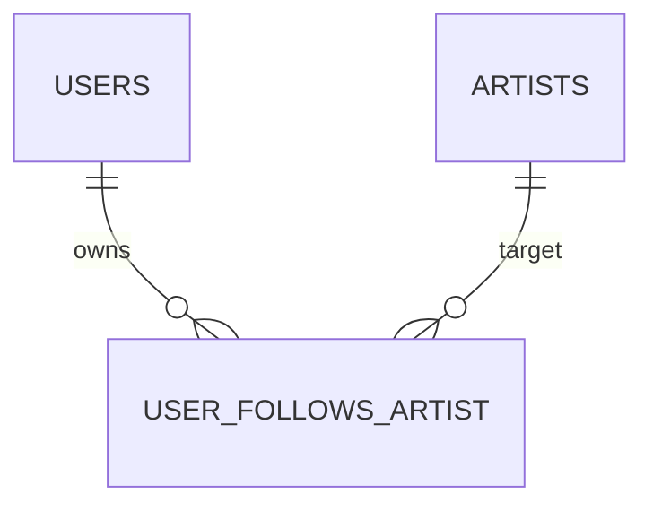

# Data Model — Feature 092 Follow Artist

**Status**: Conceptual model and transactional invariants, not DDL, a migration or approved JSON schema. Existing reference table names below are documented evidence; conceptual labels are not newly approved columns. [Decision register](./research.md#decision-register).

## Entities and mapping evidence

| Entity | Required information / relationship | Evidence / unresolved mapping |
| --- | --- | --- |
| Authenticated account | Verified stable owner, current role/ban/session validity | Existing JWT `user_id`/`session_id`, current account lookup. Auth migration has text `users.id` and unique `user_id`; reference ER calls `user_id` primary. F03 maps once. No browser-supplied owner. |
| Artist | Stable identity, existence, shared public permission, allowlisted public name/image | Reference `artists.artist_id`, optional unique linked `user_id`. Identity is separate from linked account. Actual catalog schema/public predicate F02; missing linked user is not grounds to reject following. |
| Artist follow relationship | Account + artist pair; original successful follow instant | Reference `user_follows_artist(user_id, artist_id)` composite key. Timestamp storage/type/name not documented; mock `followedAt` is not evidence of a column. F03. |
| Own followed-artists projection | Current owner's distinct relations joined to existing/public artists, with permitted own follow time | Ordered follow instant DESC, typed artist ID ASC. Hidden/deleted rows omitted without placeholders/totals. F05 wire shape/completeness. |
| UI personal-state snapshot | Owner/session generation, artist, request generation, confirmed state or unknown/pending/error | Volatile internal model, no persistent schema or new wire fields. Clear on account change. |
| Count projection, if approved | Derived from actual relationship membership using F07's eligibility/audience definition | No documented follower-count column/API. Do not equate raw relation count, visible own list length and artist aggregate. |

The supplied ER confirms composite identity and account/artist references, not follow-time columns or deletion cascades. Do not add a surrogate ID, event/tombstone table, new status relation, count column or storage retention rule without evidence/review.

## Persistent invariants

1. At most one relationship per canonical owner–artist pair. A valid follow of a public artist creates one if absent; duplicate follow preserves original time exactly.
2. Unfollow affects only that owner's relation; repeated public unfollow leaves zero. Successful follow after successful unfollow uses the new authoritative follow instant.
3. All allowed roles have identical own-account scope; no Admin cross-account access.
4. Non-public visibility suppresses projection, not membership. Original time persists across hiding and restoration unless unfollowed. No expiry/cleanup on hide.
5. Existing hidden target can be unfollowed by its relationship owner without profile disclosure. Unknown/deleted target returns the same not-found; storage cleanup after permanent deletion is F08.
6. Rejected/rolled-back operations do not change relation/time or any approved derived aggregate. Lost response is not a proved rollback.
7. Same-pair successful operations have one database processing order; last successfully committed desired-state operation wins. Duplicate follows do not create a new follow instant in that order.
8. Following grants no private-profile, Studio, song or administrative access.

No client-provided follow time, device timestamp or response-arrival time is persisted as authoritative ordering. Missing historic follow time needs reviewed migration/source resolution, not current time or a fabricated epoch. ID comparison uses canonical type shared with 091, not browser-default locale order. Display dates may be localized without changing sort precision.

## Atomic processing and concurrency

Concrete transaction transport/lock mechanism is **F04**, pending. The following is a required logical unit, not executable SQL or an approved database-function signature:

1. Establish verified owner and current eligibility; reject missing/revoked/banned identity without a mutation. F06 defines coordination with concurrent bans/revocations.
2. Enter a database-scoped serialization boundary covering the owner–artist pair even if no relationship exists. Coordinate with artist hide/delete writers for authoritative existence/public checks.
3. For follow: require existing public artist; conditionally create relation with authoritative original time. If present, leave original time unchanged. For unfollow: require an existing artist internally, allow owner removal while hidden; remove only the own pair when permitted. F05 finalizes hidden target/no-own-relation behavior, without metadata disclosure.
4. If an approved stored count exists, change it only for an actual membership transition; never for duplicate follow/no-op unfollow. Different followers racing on one artist must not lose updates.
5. Commit relation and count effects together, or roll them all back. This commit is the successful processing point; return only safe reviewed output after outcome is known.

A uniqueness constraint is required but alone does not define opposing-operation order. Locking only an existing follow row fails when the relation is absent. A per-process mutex fails across backend workers. A sequence of Supabase HTTP reads and writes without a database atomic boundary cannot be described as a transaction. Candidate mechanisms are reviewed database function/transaction with an existing artist-row lock or pair advisory locking; no mechanism/function/key/schema is approved by this artifact. Global in-process queues or new distributed lock services are not introduced.

| Initial state | Successful processing sequence | Required final state / time |
| --- | --- | --- |
| Absent | Follow → Follow | Present once; first insertion time retained |
| Present | Unfollow → Unfollow | Absent; no additional effects |
| Absent or present | Follow → Unfollow | Absent |
| Absent or present | Unfollow → Follow | Present; time of new follow if insertion occurs |
| Present | Duplicate Follow → rejected Unfollow | Present, original time unchanged |
| Present | Unfollow → Follow → delayed old response | Present with refollow time; response order cannot undo storage |
| Present | Hide → list → unhide → list | Relation/time unchanged; omitted then restored in original position |
| Hidden, own relation present | Unfollow → unhide → list | Relation absent; no restoration |
| Unknown/deleted | Unfollow | Same not-found and no unrelated mutations |

Tests control the server/database serialization order, not just click delays. Reads after operations finish must observe the latest committed state unless another later operation succeeds. No replica/cache lag may turn a successful current-state read into knowingly stale confirmation. If serializing transactions retry internally, recheck predicates and preserve insert-if-absent time; do not replay a completed transaction merely because HTTP acknowledgement was lost.

## Own-list projection and recognition

Server query order: authenticate current owner → constrain to own relations → join current existing/public artist predicate → deduplicate artist IDs → order original time DESC, artist ID ASC → project only public identity and own permitted follow metadata. Filtering happens before paging/counting; no hidden relationship totals, slots, stale names or raw relation IDs are exposed.

Absence from a complete, successful own-list read for a still-public artist can confirm Not following. Absence from a failed, partial, capped or visibility-filtered hidden-target projection cannot establish relationship absence. F05 must define safe completeness and visibility-race behavior with the existing endpoints. Until then the UI remains unresolved, not false Not following. A hidden profile never gets a new private status UI to solve this gap.

## State transitions

| Event | Personal control/list state | Required safeguard |
| --- | --- | --- |
| Auth resolving | Unresolved/loading | No mutation or stale prior-account data |
| Guest | Login CTA / LoginRequired | Public 091 remains usable |
| Valid account + state read | Loading then confirmed Following/Not following, or error | Only successful complete authoritative read gives negative state |
| Follow/unfollow click | Pending desired operation, last confirmation recorded | Disable repeat interaction; bind origin account/session |
| Confirmed commit/outcome | Reconcile current state/list; truthful feedback | Invalidate older reads; duplicate is not a new follow |
| Proven rejection before commit | Error with last confirmed state and retry | No saved mutation; revalidate state if newer remote changes may exist |
| Network/lost response/unknown commit | Unknown/reconciling | No false saved-state claim or blind inverse operation |
| List read fails | Retryable error, not empty | No hidden totals or cross-account cache |
| Hidden-only or no relations, successful list | Same normal empty state | No reason distinguishing hidden retained rows |
| Logout/account switch/session replacement | Clear all private state and pending feedback | Abort/ignore stale results; prevent refresh replay as new account |
| Parent becomes non-public/deleted | 091 clears public profile; list omits entry | Retain hidden relation internally unless owner removes it; no old metadata |

Existing local demo libraries are not migrated wholesale into production. No server-authoritative relationships/follow times are inferred from localStorage. Any legacy data/import requirement needs separate review; none is introduced here.

## Counts and indexes

F07 must decide whether and how artist follower counts are delivered. Until then no persistent counter/schema or public total exists in this design. If approved: relationships remain source of truth; new membership +1, actual removal −1, duplicate/no-op/failure 0, counts cannot go negative, and optional stored aggregate updates in the same atomic unit. Recompute aggregates from the same approved predicate for reconciliation. Count policy for hidden artists and banned/deleted accounts must not be guessed.

An owner's displayed list length, if any, describes eligible visible entries only and is not an artist aggregate. No public count response for non-public artists. Index candidates after F03 review are existing pair uniqueness, owner + original time + artist-ID traversal, and artist-target access if aggregate reads are approved. Inspect actual schema/query plans before choosing names/DDL; no speculative indexes or cascades are produced.
