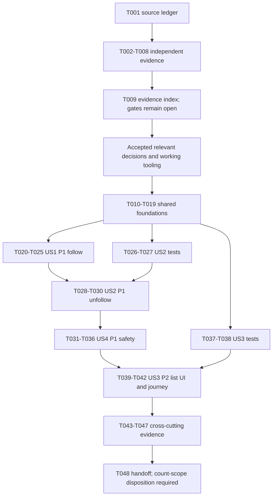

# Tasks: Feature 092 — Follow Artist

**Input:** [specification](./spec.md), [requirements checklist](./checklists/requirements.md), [plan](./plan.md), [research](./research.md), [data model](./data-model.md), [interface contract](./contracts/follow-artist.md), [validation guide](./quickstart.md), [Group 090 review](../group-090-cross-feature-review.md), and [091 Tasks](../091-artist-profile/tasks.md).  
**Branch reference:** `090-artist-profile-studio-plan-tasks`  
**Generated:** 2026-11-09  
**Disposition:** Review-ready task breakdown; **not implementation-ready**. All tasks are planned and unchecked. This document neither closes F01–F09 nor approves a technical proposal.

**Prerequisites:** The feature requirements and reviewed behavioral design exist. Actual artist/follow mappings, exact personal wire contracts, transaction execution, session-bound replay, lifecycle integration, governance and verification tooling still require the evidence below. Checklist completion and mock behavior do not establish production readiness.

**Tests:** Requested explicitly for this task generation. Written scenarios are runnable preparation; executable tests require their stated gates. After those gates close, write each relevant test before its implementation and show a meaningful failure against unfinished behavior. No feature tests, application build, database operation or task implementation have been executed by generating this document.

**Organization:** Setup → shared foundations → US1/P1 → US2/P1 → US4/P1 → US3/P2 → cross-cutting verification. Story numbers preserve the specification; priority puts US4 before US3. Foundational list retrieval supports recognition without requiring the later list-page story.

## Format and execution rules

- Every task uses `- [ ] Tnnn [P?] [USn?]`, followed by a concrete deliverable and repository-relative path. IDs are unique within this feature; qualify IDs with `092` when coordinating other features.
- **READY** means evidence/design work can run with current checked-in sources and text tools after its listed predecessors. A completed proposal is not approval. Investigation can document unavailable runtime/live-schema evidence without inventing it.
- **GATED Cxx…** means implementation or executable validation must wait for **accepted relevant closure evidence** for every named cluster and all listed predecessors. The closure table and task-specific closure text are cumulative. Merely completing T009 does not satisfy any gate.
- `[P]` permits parallel execution only after predecessors and gates, and only for distinct output files. Unmarked tasks editing shared services, hooks, routers or manifests are serialized. Shared infrastructure work must also be coordinated with 091/093.
- All paths for new work products below are **proposed future destinations**, not files created by this generation. Test filenames/layout/scripts require C15 acceptance; if the accepted layout differs, explicitly revise the affected tasks before execution rather than silently selecting a runner.
- Only this document is created now. No task is implemented. No task authorizes branch creation/switch/merge/commit/push, modification of another feature's sources, or an unapproved rewrite of specifications/plans/research/contracts. Later alignment of authoritative documents requires a separately authorized pass.

## Sources and implementation baseline

Use the current checkout, not a presumed deployment: [architecture](../../../docs/design/architecture/system-architecture.md), [module boundaries](../../../docs/design/architecture/feature-modules.md), [role navigation](../../../docs/design/architecture/role-navigation.md), [database](../../../docs/design/database/README.md), [ERD](../../../docs/design/database/er-diagram.md), [consistency](../../../docs/design/database/data-consistency.md), [database security](../../../docs/design/database/security-rules.md), [shared API](../../../docs/analysis-and-design/api-contract.md), [API conventions](../../../docs/design/api/api-conventions.md), [security](../../../docs/design/security/README.md), [Constitution](../../../.specify/memory/constitution.md), [Vision](../../../docs/proposal/Auratune_Vision_Document.md), [Proposal](../../../docs/proposal/proposal.md), [Project Plan](../../../docs/proposal/project_plan.md), [Team Contract](../../../docs/management/team-contract.md), [Spec Kit workflow](../../../docs/management/speckit-workflow-guide.md), [Tasks skill](../../../.agents/skills/speckit-tasks/SKILL.md), and [template](../../../.specify/templates/tasks-template.md).

Cross-feature inputs: [091 plan](../091-artist-profile/plan.md), [research](../091-artist-profile/research.md), [model](../091-artist-profile/data-model.md), [contract](../091-artist-profile/contracts/artist-profile.md), [quickstart](../091-artist-profile/quickstart.md), [specification](../091-artist-profile/spec.md), and the consolidated review. Reuse reviewed shared evidence; do not inherit approval merely because another backlog names the same seam.

The implemented baseline is React/Vite JavaScript with the custom router, Express and backend-only Supabase, AuraTune JWT/session checks and existing Firebase exchange/refresh. Follow behavior in [AppStore](../../../src/frontend/src/context/AppStore.jsx), [ArtistPage](../../../src/frontend/src/pages/Artist/ArtistPage.jsx) and [FollowingPage](../../../src/frontend/src/pages/Artist/FollowingPage.jsx) is a browser mock. [Server](../../../src/backend/server.js) has no implemented follow/list handlers. The reference `user_follows_artist(user_id, artist_id)` pair is documented, but [auth migration](../../../src/database/migrations/001_auth_tables.sql) does not supply follow storage or an original-time column. Do not adopt mock `followedAt`, `isPublic`, slugs or localStorage as database/wire architecture.

[Auth middleware](../../../src/backend/middleware/authMiddleware.js) and [session client](../../../src/frontend/src/services/sessionApiClient.js) are integration seams with documented error/replay drift. A late-result UI guard alone cannot stop A's request being refreshed and sent under B's token. [Supabase client](../../../src/database/supabaseClient.js) remains server-only; service-role access requires explicit owner constraints.

## Gate register: dependencies and closure evidence

Trace original decisions to [F01–F09](./research.md#decision-register) and [Group clusters](../group-090-cross-feature-review.md#3-consolidated-decision-register-with-traceability). Required evidence is not supplied or approved by this file. Responsibilities below are coordination roles established in project sources, not newly appointed approvers.

| Cluster | Original decision references | Evidence required for applicable 092 work | Established coordination |
| --- | --- | --- | --- |
| C01 — Governance | 092-F01; 091-D01; 093-S01 | Ratified principles or documented disposition of the template gap through established governance. No invented constitutional waiver/pass. | Nhựt/team |
| C02 — Artist identity and visibility | 092-F02; identity part of F03; 091-D02 and ID part of D05; 093 shared identity | Reviewed actual account/artist keys, canonical ID type/validation/comparison, shared existing/public/hidden/disabled predicate, linked-account ban relationship, safe public identity projection and representative fixtures. Artist account linkage/ownership is not required to follow a public artist. | Hoàng/Đăng; Khoa for account policy |
| C04 — Authentication and session-bound replay | 092-F06; shared 091 public-mode/093 auth seams | Reviewed current-principal/session/ban checks, error normalization and compatibility, origin-account/session-generation-bound refresh/replay, revocation/ban ordering and recovery rules. Demonstrate logout, A→B and same-account-new-session races without credential reassignment. | Khoa/Hoàng; Nhựt for architecture coordination |
| C06 — Follow persistence and authoritative state | 092-F03/F05; typed-ID part of 091-D05 | Actual deployed relationship/key mapping, pair uniqueness, original-time name/type/precision/authoritative source and reviewed historic-data treatment. Accepted existing-endpoint request/response/status examples and OpenAPI, duplicate/no-op and hidden/no-own-relation dispositions, complete ordered own-list retrieval beyond row caps and safe recognition during visibility races. No new status route/public personal fields. | Đăng/Hoàng/Khoa |
| C08 — Atomic processing | 092-F04; shared execution capability with 093, distinct invariants | Reviewed deployable atomic execution boundary, serialization even when pair absent and across workers/devices, coordinated eligibility/visibility/delete and session checks, rollback and read-your-writes. Exact migrations/function/security/transport paths must be accepted before dependent work; no guessed RPC/locks/schema. | Đăng/Hoàng/Nhựt per F04; Khoa for shared auth coordination |
| C10 — Lifecycle consistency | 092-F08; lifecycle portions of shared review | Reviewed 092 artist-deletion/reference integration and race behavior, distinguishing known outward FR-016 from unresolved physical cleanup. Show hidden retention/time, restoration, own hidden-unfollow and track hide/delete independence. No new cascade, tombstone, retention or cleanup policy. Only the relevant artist/follow slice blocks 092, not Studio media/history design. | Đăng/Hoàng/Khoa |
| C11 — Follower-count scope | 092-F07 | Record the current instruction's **no new follower-count functionality** boundary and obtain authorized disposition of the broader Vision count obligation, such as explicit deferral. This backlog has no counter/query/UI/endpoint work. Full Vision-count completion must remain unclaimed while unresolved; inclusion would require a separate authorized scope and backlog revision. | Hoàng/Nhựt/team; Đăng/Khoa technical coordination |
| C15 — Runtime and verification | 092-F09; 091-D08; 093-S12 | Supported runtime, approved shared runner/layout/scripts, disposable database fixtures and multi-worker/browser verification commands that actually run. Feature 131 proposals and auth smoke do not prove a Follow Artist harness exists. | Nhựt architecture; Hoàng feature verification; team assigns unnamed foundation responsibility |

Use accepted evidence links and reviewer/date/status in the future T009 index. C01 is repeated explicitly on every gated task. C15 governs runnable code/test work; documentation-only accepted-contract serialization does not require Node. C10 gates lifecycle-sensitive persistence/acceptance, not a new product decision about already-approved hiding behavior. C11 does not authorize counts and does not block independent core relation design; it gates final source-scope reconciliation/full-delivery claims.

C03/C05/C07/C09/C12/C13/C14 are not blanket prerequisites for 092. Consume the approved shared identity/public-profile seam without redesigning 091 catalog DTOs or waiting for album/playlist/media/song-navigation work. If a shared public interface must change, obtain that relevant contract approval separately; no such change is presumed here.

## Phase 1: Setup — Runnable preparation

**Purpose:** Produce reviewable evidence, scenarios and options without choosing unresolved production architecture. All deliverables stay under this feature when these future preparation tasks are executed.

- [ ] T001 **READY** — Create `specs/090-artist-profile-studio/092-follow-artist/preparation/source-and-scope-ledger.md` tracing FR-001–016, SC-001–006, US1–US4 and quickstart V01–V14 to authoritative sources/current implementation. Record C01 status, the fixed branch reference, no-code baseline and C11 no-count boundary versus outstanding Vision obligation; do not label F07 resolved. **Depends:** none.
- [ ] T002 [P] **READY** — Create `specs/090-artist-profile-studio/092-follow-artist/preparation/identity-and-visibility-cases.md` for public/hidden/disabled/unknown/deleted artists, canonical account versus artist identity, all three allowed personal roles, own-only access and banned/guest denial. Include hidden retained-owner DELETE versus new hidden PUT, 091 equivalent not-found and track hide/delete independence; identify C02 mapping evidence missing. **Trace:** FR-001–003/007/009/011/013/016. **Depends:** T001.
- [ ] T003 [P] **READY** — Create `specs/090-artist-profile-studio/092-follow-artist/preparation/persistence-and-lifecycle-audit.md` comparing ER pair, auth keys, checked-in migrations and browser demo; inventory missing original-time mapping, uniqueness, canonical ID comparison, historic-data evidence and artist-delete integration. Quote “duplicate follow preserves original time exactly” and “Non-public visibility suppresses projection, not membership” from the model; propose review questions, not columns/backfill/cascades. **Trace:** FR-004/006/013–016; C02/C06/C10. **Depends:** T001.
- [ ] T004 [P] **READY** — Create `specs/090-artist-profile-studio/092-follow-artist/preparation/interface-and-recognition-options.md` for the three established endpoints, envelopes/status gaps, complete-list traversal and still-public-target recognition. Include examples with a backend row cap, hidden-filtered absence, incomplete/failed reads, visibility changes and unknown commits. Show why these cannot prove Not following; mark illustrative payloads as proposals rather than inventing final fields/routes/personal public DTOs. **Trace:** FR-005/007/008/010/011/014/016; C06. **Depends:** T001.
- [ ] T005 [P] **READY** — Create `specs/090-artist-profile-studio/092-follow-artist/preparation/atomic-processing-histories.md` with initially absent/present pair histories, reversed HTTP responses, multi-worker ordering, duplicate time preservation, failed operations, hide/delete races and separate-owner isolation. Compare candidate atomic boundaries and absent-row locking limitations using existing evidence; do not select an RPC/function/lock format. **Trace:** FR-004/010/014/015; SC-001/006; C08. **Depends:** T001.
- [ ] T006 [P] **READY** — Create `specs/090-artist-profile-studio/092-follow-artist/preparation/session-replay-audit.md` tracing current JWT/session/ban verification, envelope drift, refresh replay and delayed demo account lookup. Write A→B/logout/replacement-session/revocation and uncertain-result scenarios asserting both stored owner and UI attribution; distinguish same-origin pre-write-401 recovery from ambiguous mutation retry. **Trace:** FR-003/009/010/012; C04. **Depends:** T001.
- [ ] T007 [P] **READY** — Create `specs/090-artist-profile-studio/092-follow-artist/preparation/acceptance-and-privacy-cases.md` with concrete expected states for every US acceptance scenario and quickstart V01–V14, mocked versus real-storage test boundaries, equal-time ID ties, hidden-only empty, restore/refollow, errors, uncertain outcomes and accessible navigation. Include raw-response/DOM/log/cache non-disclosure checks and explicitly exclude count implementation. **Trace:** FR-001–016; SC-001–006. **Depends:** T001.
- [ ] T008 [P] **READY** — Create `specs/090-artist-profile-studio/092-follow-artist/preparation/tooling-and-shared-file-audit.md` recording runtime/script availability and proposed test destinations against current manifests and Feature 131 proposals. Inventory shared-file coordination with 091 Tasks, especially artist router/repository, session client, ArtistPage, AppStore and manifests; document current frontend build/auth-smoke commands without calling them follow coverage. **Trace:** plan structure/quickstart; C15. **Depends:** T001.
- [ ] T009 **READY** — Assemble `specs/090-artist-profile-studio/092-follow-artist/preparation/gate-evidence-index.md` linking T001–T008, F01–F09, C01/C02/C04/C06/C08/C10/C11/C15 and blocked task IDs. Record missing decisions, established coordination roles, closure artifact requirements, exact future migration/test paths to be approved and any accepted evidence when actually supplied. Submit proposals for review and leave gates open otherwise; do not manufacture sign-off or edit original registers. **Depends:** T002–T008.

**Checkpoint:** These nine tasks are executable preparation after their predecessors. Completion does not make database/API/auth integration runnable. Final contract examples, persistence/time/history mapping, atomic deployment, origin-bound auth and tooling still need acceptance.

## Phase 2: Foundational — Shared gated capabilities

**Purpose:** Make the complete own-list read, server identity/policy and safe personal request lifecycle available before any story. The public list-page UI is not a dependency for Follow-state recognition. No incomplete placeholder read may return successful empty data.

- [ ] T010 **GATED C01, C15** — Configure the approved runtime and shared test entry points in `src/backend/package.json`, `src/frontend/package.json` and the exact accepted configuration paths recorded in T009. Establish the backend real-database, component and browser destinations below, run a harness smoke and record actual commands in `specs/090-artist-profile-studio/092-follow-artist/validation/tooling.md`; reuse shared setup already delivered for 091 where accepted. **Trace:** plan/quickstart; all automated acceptance. **Closure:** governance disposition plus accepted runtime/runner/layout/scripts and working environment. **Depends:** T009.
- [ ] T011 **GATED C01, C02, C04, C06** — Create `specs/090-artist-profile-studio/092-follow-artist/contracts/follow-artist-api.json` as OpenAPI 3.0.3 **only from accepted examples** for PUT/DELETE `/api/v1/artists/:id/follow` and GET `/api/v1/users/me/following-artists`. Encode exact ID/DTO/envelopes/no-op/error/request semantics, safe complete-list recognition and personal nonshared caching; include hidden/no-own-relation disposition. Do not add a status/count path, owner/time selector, idempotency header or public personal field; leave the existing Markdown contract unchanged. **Trace:** FR-001–005/007–012/014/016. **Closure:** accepted identity/projection, session/error behavior and F05 wire/completeness/visibility-race examples; outward deleted-ID behavior is already specified. **Depends:** T009.
- [ ] T012 [P] **GATED C01, C02, C04, C06, C15** — Add regression tests in `src/backend/tests/follow-auth.test.js` and `src/frontend/src/services/sessionApiClient.follow.test.js` for current-session validation, allowed User/Artist/Admin personal roles, banned/guest/invalid/revoked denial, owner-selector attempts, existing auth-envelope compatibility and A→B/logout/replacement during refresh. Assert no A action is sent with B credentials and public 091 requests remain auth-independent. **Trace:** FR-003/009/012; SC-002/003. **Closure:** accepted auth/replay/error contract and executable harness. **Depends:** T010, T011.
- [ ] T013 **GATED C01, C02, C04, C06, C15** — Apply the accepted shared auth normalization and origin-bound replay safeguards in `src/backend/middleware/authMiddleware.js` and `src/frontend/src/services/sessionApiClient.js`; preserve JWT/session/current-user checks and existing Firebase exchange/refresh. Retain original account/session generation through bounded pre-write-401 recovery, cancel replay after replacement, never automatically retry an ambiguous mutation, and pass T012 without adding auth to public 091 reads. **Trace:** FR-003/009/010/012. **Closure:** reviewed C04 compatibility/error/revocation design and T012's failure evidence. **Depends:** T012.
- [ ] T014 [P] **GATED C01, C02, C06, C08, C10, C15** — Add real-storage invariant tests in `src/backend/tests/follow-persistence.test.js` for canonical owner/pair uniqueness, authoritative original-time precision, duplicate preservation, refollow new time, failed rollback, complete ordered public projection beyond row caps, hidden retention and no track-driven relation changes. Use approved synthetic fixtures, not localStorage or guessed catalog flags. **Trace:** FR-003/004/006/007/013–016; SC-001/005/006. **Closure:** actual schema/time/history and fixture mapping, accepted atomic/deletion integration and test harness. **Depends:** T010, T011.
- [ ] T015 **GATED C01, C02, C06, C08, C10, C15** — Deliver the **already reviewed** minimal persistence/atomic deployment at the exact migration or existing-database deployment file paths recorded in T009 under `src/database/migrations/`; record deployment and rollback verification in `specs/090-artist-profile-studio/092-follow-artist/validation/persistence.md`. No DDL is permitted until its exact path/content, key/time/history treatment and transaction/security transport are accepted. Reuse actual existing structures when sufficient; do not add counters, surrogate/event tables, assumed cascades or import browser follows. **Trace:** FR-004/006/013–016. **Closure:** approved physical design and deployment/rollback artifact with concrete filenames, not a task to choose the schema while implementing. **Depends:** T013, T014.
- [ ] T016 **GATED C01, C02, C04, C06, C08, C10, C15** — Implement `src/backend/repositories/followArtistRepository.js` over T015's accepted persistence/execution boundary. Provide owner-constrained complete ordered reads and atomic desired-state primitives with public eligibility at processing, hidden-owner removal, absent-pair serialization, original-time preservation, rollback and read-your-writes across workers. Reuse the shared canonical artist resolver in `src/backend/repositories/artistRepository.js` by accepted mapping; coordinate/reuse 091's resolver rather than implement a competing public predicate. **Trace:** FR-001–004/006/007/011/013–016. **Closure:** accepted actual keys/predicate/time, database transport/ordering, lifecycle and auth coordination; T014 tests establish real constraints. **Depends:** T013, T015.
- [ ] T017 **GATED C01, C02, C04, C06, C10, C15** — Implement complete own-list read orchestration in `src/backend/services/followArtistService.js`, `src/backend/controllers/followArtistController.js`, `src/backend/routes/userRoutes.js` and `src/backend/server.js`. Mount existing GET before fallback, derive owner from verified identity, join only public existing artists, deduplicate canonical IDs and sort original follow time DESC then typed artist ID ASC. Return approved allowlisted DTOs and proven completeness, not raw hidden totals, capped success or fabricated empty data; distinguish storage failure from empty. **Trace:** FR-003/005/007–009/013/014/016. **Closure:** approved list schema/completeness/visibility-race protocol and lifecycle projection, not a new product pagination policy. **Depends:** T011, T013, T016.
- [ ] T018 **GATED C01, C02, C04, C06, C15** — Write adapter tests first and implement `src/frontend/src/services/followArtistService.js` with tests in `src/frontend/src/services/followArtistService.test.js`. Map only T011's own-list/PUT/DELETE contract through the origin-bound session client; distinguish definite rejection, incomplete read and uncertain commit. Do not normalize failed reads to empty, infer hidden absence as Not following, blindly retry lost mutations or migrate demo libraries into authority. **Trace:** FR-004/005/009–012/014/015. **Closure:** accepted exact DTO/error/completeness semantics, C04 recovery and working harness. **Depends:** T010, T011, T013, T017.
- [ ] T019 **GATED C01, C02, C04, C06, C15** — Write state-lifecycle tests first and implement `src/frontend/src/hooks/useArtistFollowing.js` with tests in `src/frontend/src/hooks/useArtistFollowing.test.js`. Capture owner/session/artist/request generations; clear private state on replacement, suppress stale responses/toasts, and distinguish checking/confirmed/pending/failed/uncertain states. Confirm negative state only from T011's complete authoritative read for a still-public artist; invalidate older reads after mutations and reconcile before definitive uncertain-result feedback. **Trace:** FR-005/006/009–013/015. **Closure:** accepted safe-recognition and origin-bound session/reconciliation contract; no invented persistent private cache or hidden status UI. **Depends:** T018.

**Checkpoint:** Foundations supply real read/state capabilities and atomic primitives, not yet complete mutation routes or story UI. Correct account binding, hidden projection and processing order are mandatory from the first increment; US4 adds adversarial verification rather than postponing security.

## Phase 3: User Story 1 — Follow an Artist and Recognize My State (Priority: P1)

**Goal:** A valid account can follow a public artist and truthfully recognize its own state; duplicates retain the original relationship/time. Guest/auth failure does not block anonymous profile content.

**Independent test:** With real storage and a public target, load confirmed Not following, follow, reload and sign in again: exactly one own relationship and confirmed Following. Duplicate public follow preserves original time and position. Unknown/non-public follow has the same safe not-found; failed/incomplete recognition remains unresolved. Does not require the US3 list-page UI.

### Tests first

- [ ] T020 [P] [US1] **GATED C01, C02, C04, C06, C08, C10, C15** — Add PUT contract/storage tests in `src/backend/tests/follow-create.test.js` for new/duplicate public follow, later-session persistence, unchanged original timestamp, owner isolation/all allowed roles, hidden/unknown equivalence and eligibility recheck at processing. Assert durable one-row membership and no unauthorized updates, not just a successful HTTP status. **Trace:** FR-001/003/004/006/009/011/014/015; SC-001–003. **Closure:** approved mutation/no-op DTO/status, schema/atomic/visibility lifecycle and harness. **Depends:** T010, T011, T016.
- [ ] T021 [P] [US1] **GATED C01, C02, C04, C06, C15** — Add component/request tests in `src/frontend/src/components/artist/FollowButton.follow.test.jsx` for guest login CTA, checking versus confirmed states, positive state and safe negative recognition, failed/incomplete list, disabled pending interaction, confirmed success and duplicate feedback without claiming a new relation. Keep profile content usable on personal/auth failure. **Trace:** FR-001/004/005/009–012; SC-003. **Closure:** accepted recognition/session/UI-state contract and harness. **Depends:** T010, T011, T019.

### Implementation and story verification

- [ ] T022 [US1] **GATED C01, C02, C04, C06, C08, C10, C15** — Add atomic public-follow orchestration/controller handling in `src/backend/services/followArtistService.js` and `src/backend/controllers/followArtistController.js`; register PUT in the coordinated `src/backend/routes/artistRoutes.js` and `src/backend/server.js`. Resolve current principal and artist eligibility at the accepted processing point, conditionally create only if absent and use approved generic DTO/no-op/error semantics. No global authenticated mount over 091 GET routes or time-resetting upsert. **Trace:** FR-001/003/004/006/009/011/014/015. **Closure:** T011 contract and accepted C08 execution/eligibility ordering; T020 fails meaningfully first. **Depends:** T017, T020.
- [ ] T023 [US1] **GATED C01, C02, C04, C06, C15** — Implement extracted `src/frontend/src/components/artist/FollowButton.jsx` on T019's hook for confirmed personal follow action, mockup label/icon/pressed state, keyboard/touch focus, pending/uncertain/error and retry/login feedback. Use explicit desired PUT, never a stale boolean toggle; no hidden-profile interface or follower count. **Trace:** FR-001/004/005/009–012. **Closure:** reviewed state/DTO/session contract and test harness; T021 failures recorded. **Depends:** T019, T021, T022.
- [ ] T024 [US1] **GATED C01, C02, C04, C06, C15** — Compose the 092-owned control into `src/frontend/src/pages/Artist/ArtistPage.jsx` using 091's canonical artist/public availability seam, replacing its inline simulated follow action. Keep anonymous identity/sections independent of personal hydration/failure and unchanged public DTOs; clear personal presentation when 091 marks the target unavailable. Coordinate the existing 091 ArtistPage work before editing. **Trace:** FR-005/007/009/011–013; SC-003/004. **Closure:** accepted shared identity/visibility integration and C04 public/auth separation, without requiring all 091 content decisions closed. **Depends:** T023.
- [ ] T025 [US1] **GATED C01, C02, C04, C06, C08, C10, C15** — Execute the US1 independent journey and V01/V05/V12 subset with approved fixtures, recording membership/time/response/UI assertions in `specs/090-artist-profile-studio/092-follow-artist/validation/us1-follow.md`. Include complete versus incomplete recognition, duplicate position, later login, public/hidden transition, guest profile and account isolation; failures keep this checkpoint open. **Trace:** US1 acceptance; FR-001/003–006/009/011–015; SC-001–005. **Closure:** accepted decisions and actual executable tests, not mock timers or generic fallback 404. **Depends:** T020–T024.

**Checkpoint:** US1 is a candidate first demonstration after foundations; it is not the full feature. No increment may bypass basic failure/account safety. Full release still requires US2, US4, US3 and cross-cutting evidence.

## Phase 4: User Story 2 — Stop Following an Artist (Priority: P1)

**Goal:** Remove only the caller's relationship, including a retained relationship to an existing hidden artist, without exposing hidden metadata or another account's state.

**Independent test:** From a seeded own relation, DELETE removes only it; public repeated unfollow remains absent. Hidden owner can DELETE without a hidden UI, and restoration does not resurrect the removed relation. Unknown/deleted targets share non-disclosing not-found. A later successful public refollow gets a new authoritative time.

### Tests first

- [ ] T026 [P] [US2] **GATED C01, C02, C04, C06, C08, C10, C15** — Add `src/backend/tests/follow-delete.test.js` covering own public/hidden removal, repeated absent-public outcome, approved hidden/no-own-relation disposition, unknown/deleted equivalence and untouched B/other-artist rows. Test hide/restore retention before removal and no return after hidden removal; verify refollow creates a new instant. No metadata/count/existence hints in success or error. **Trace:** FR-002–004/006/011/013–016; SC-001–003/005. **Closure:** accepted F05 hidden-no-relation response and atomic/lifecycle mapping; outward FR-016 is fixed. **Depends:** T010, T011, T016.
- [ ] T027 [P] [US2] **GATED C01, C02, C04, C06, C15** — Add `src/frontend/src/components/artist/FollowButton.unfollow.test.jsx` for confirmed Following→pending DELETE→confirmed Not following, no false success before confirmation, definite/uncertain failure, stale results and no hidden metadata toast. Verify retry expresses desired deletion, not inverse toggle. **Trace:** FR-002/004/005/010–013; SC-001/003. **Closure:** accepted delete/no-op/session/reconciliation contract and harness. **Depends:** T010, T011, T019.

### Implementation and story verification

- [ ] T028 [US2] **GATED C01, C02, C04, C06, C08, C10, C15** — Add DELETE orchestration to `src/backend/services/followArtistService.js`, `src/backend/controllers/followArtistController.js` and `src/backend/routes/artistRoutes.js`. Use existence/ownership-specific policy, **not** a universal public-parent guard; permit existing hidden retained-owner removal, preserve other rows and emit identical unknown/deleted not-found. Use the reviewed hidden/no-own-relation result, no assumed cascade. **Trace:** FR-002–004/009/011/013/015/016. **Closure:** T011 exact deletion contract and accepted atomic/lifecycle boundary; T026 red tests precede implementation. **Depends:** T022, T026.
- [ ] T029 [US2] **GATED C01, C02, C04, C06, C15** — Extend `src/frontend/src/components/artist/FollowButton.jsx` and `src/frontend/src/hooks/useArtistFollowing.js` for explicit desired DELETE, current-origin feedback and authoritative post-delete reconciliation. Keep unresolved state on unknown result and no hidden control; invalidate obsolete list/state loads instead of restoring a stale pre-request boolean over newer device activity. **Trace:** FR-002/004–006/010/012/015. **Closure:** accepted state/retry/reconciliation contract; T027's failure evidence. **Depends:** T024, T027, T028.
- [ ] T030 [US2] **GATED C01, C02, C04, C06, C08, C10, C15** — Execute independent US2 API/UI scenarios and V02/V06/V07, writing `specs/090-artist-profile-studio/092-follow-artist/validation/us2-unfollow.md`. Verify hidden removal directly with authorized API fixtures, no invented hidden UI, repeated public unfollow, deleted/unknown equivalence, refollow time and other-owner isolation. **Trace:** US2 acceptance; FR-002–004/006/011/013–016; SC-001–005. **Closure:** actual reviewed storage/response/race test evidence. **Depends:** T026–T029.

## Phase 5: User Story 4 — Keep Personal Actions Safe During Failures (Priority: P1)

**Goal:** Truthful state and recovery under auth expiry, failed and uncertain operations, account replacement, visibility changes and overlapping device requests. This phase strengthens mandatory foundation safety; it does not introduce a deferred unsafe MVP.

**Independent test:** Force known processing histories and auth/network faults in disposable storage. Fresh successful reads on both devices reflect the last successful processing event; no failed operation changes membership/time, and no A operation is sent or displayed as B. A dropped post-commit response stays uncertain until safe authoritative reconciliation.

### Tests first

- [ ] T031 [P] [US4] **GATED C01, C02, C04, C06, C08, C10, C15** — Add `src/backend/tests/follow-concurrency.test.js` with database synchronization barriers and distinct workers/sessions: absent Follow→Unfollow, absent Unfollow-no-op→Follow, concurrent duplicates, present duplicate→failed opposing operation, Unfollow→refollow with reversed response arrival, separate-owner actions and coordinated hide/delete races. Assert next successful reads, exact original/new time, unrelated rows, rollback and last-successfully-processed outcome. A Node mutex or click timer is not proof. **Trace:** FR-004/010/013–016; SC-001/005/006. **Closure:** accepted atomic/lifecycle/auth processing point and actual multi-worker fixture harness. **Depends:** T028, T030.
- [ ] T032 [P] [US4] **GATED C01, C02, C04, C06, C15** — Add `src/frontend/src/hooks/useArtistFollowing.session.test.js` covering A read/action then B login, logout, revocation, same-account new session, refresh in flight and an old success/error/toast after replacement. Inspect request bearer identity and stored relationships, not only DOM cleanup; include current User/Artist/Admin own scopes and failed refresh→sign-in. **Trace:** FR-003/009/010/012; SC-002/003. **Closure:** reviewed origin-bound replay/session replacement and error contract with executable cross-layer harness. **Depends:** T013, T029.
- [ ] T033 [P] [US4] **GATED C01, C02, C04, C06, C08, C15** — Add `src/frontend/src/hooks/useArtistFollowing.recovery.test.js` with pre-commit rejection/rollback, timeout/lost response after commit, ambiguous server error, failed reconciliation, delayed pre-mutation read and newer opposite-device success. Assert failed/incomplete/hidden-filtered absence never gives false negative, no blind retry/inverse or definitive toast, and a user retry after reconciliation is a later processing event. **Trace:** FR-004–006/010–012/015; SC-001/003/006. **Closure:** accepted certainty classification, completeness/visibility-race recognition and transaction outcomes. **Depends:** T029.

### Hardening and story verification

- [ ] T034 [US4] **GATED C01, C02, C04, C06, C08, C15** — Complete recovery handling in `src/frontend/src/hooks/useArtistFollowing.js` and `src/frontend/src/services/followArtistService.js` against T032/T033. Preserve originating identity, cancel unsafe replay, invalidate older reads and reload authoritative current state after ambiguous results; retain unresolved/retry if read fails or visibility prevents safe recognition. No realtime subscription, poll interval, exactly-once header or new status endpoint. **Trace:** FR-004–006/009–013/015. **Closure:** accepted replay/retry/completeness and commit-certainty design, with tests first. **Depends:** T031, T032, T033.
- [ ] T035 [US4] **GATED C01, C02, C04, C06, C08, C10, C15** — Run the real-database forced histories and fault injection from T031 alongside origin/reconciliation suites, recording processing barriers, commits/rollbacks, reversed-response results and both devices' next-read snapshots in `specs/090-artist-profile-studio/092-follow-artist/validation/processing-and-recovery.md`. Use disposable test controls, never public production query flags; report failures rather than relaxing the processing rule. **Trace:** V09–V11; FR-004/010/012–016; SC-001–003/005/006. **Closure:** executable accepted transaction/fixture tooling and reviewed auth/lifecycle semantics. **Depends:** T031, T034.
- [ ] T036 [US4] **GATED C01, C02, C04, C06, C08, C10, C15** — Record US4 independent acceptance in `specs/090-artist-profile-studio/092-follow-artist/validation/us4-safety.md`, reconciling T032–T035 with V03/V09–V11/V14: zero cross-owner attribution, zero false confirmed outcomes, unchanged storage on definite failure, proper login/denial and correct later-load processing results. Include any unresolved incidents and prevent handoff while they remain. **Trace:** US4 acceptance; FR-003–006/009–012/015; SC-001–003/006. **Closure:** actual passing adversarial auth/storage/UI evidence; no build-only substitution. **Depends:** T032–T035.

## Phase 6: User Story 3 — View My Followed Artists (Priority: P2)

**Goal:** Show only the authenticated account's eligible public followed artists, distinct and deterministically ordered, with truthful loading/empty/error states and existing public-profile navigation.

**Independent test:** Seed A/B lists with unequal/equal times, hidden-only/mixed records, deleted references and more rows than backend default caps. A sees every eligible own artist once in required order, safe name/image/link, and no B/hidden information. Hidden restore retains original placement; hidden owner-unfollow prevents return.

### Tests first

- [ ] T037 [P] [US3] **GATED C01, C02, C04, C06, C10, C15** — Add `src/backend/tests/follow-list.test.js` for complete own-list DTO/envelopes, explicit server owner constraints, public-only projection, canonical-ID deduplication and original follow time DESC then artist ID ASC with equal-time ties. Test beyond row caps and concurrent visibility changes under the approved protocol, hidden-only versus true empty equivalence, deleted omission and failures distinct from empty. **Trace:** FR-003/005/007–009/011/013/014/016; SC-002/003/005. **Closure:** accepted typed comparison/time/projection and complete-read/lifecycle contract. **Depends:** T010, T011, T017.
- [ ] T038 [P] [US3] **GATED C01, C02, C04, C06, C15** — Add `src/frontend/src/pages/Artist/FollowingPage.test.jsx` for auth resolving/login-required/loading/nonempty/success-empty/error/retry, hidden-only empty equivalence, safe image fallback and public-name links, order/ties, account-switch clearing and no partial data shown as a complete authoritative list. Test click/keyboard artist navigation without playback; no raw totals or hidden placeholders. **Trace:** FR-003/005/007–010/012–014; SC-002–005. **Closure:** accepted list/UI/session/completeness contract and component/router harness. **Depends:** T010, T011, T019.

### Implementation and story verification

- [ ] T039 [US3] **GATED C01, C02, C04, C06, C15** — Replace the mock list in `src/frontend/src/pages/Artist/FollowingPage.jsx` with the approved complete own-list service/hook lifecycle and existing shared login/error/empty primitives. Preserve server authoritative order/precision, show public names and existing `/artist/:id` links with neutral image fallback, clear stale account/hidden content and make retry/focus accessible. Do not derive storage state from a failed/partial list or add personal public-profile fields. **Trace:** FR-005/007–010/012–014/016. **Closure:** T011 exact list/recognition contract and T038 red tests, including current custom-router seam. **Depends:** T034, T037, T038.
- [ ] T040 [US3] **GATED C01, C02, C04, C06, C15** — Remove 092 production consumers' dependence on delayed mock `setFollow`, `isFollowing` and localStorage library authority in `src/frontend/src/context/AppStore.jsx`, coordinating `src/frontend/src/pages/Artist/ArtistPage.jsx` and `src/frontend/src/pages/Artist/FollowingPage.jsx`. Audit usages before changing shared exports; retain unrelated library/demo domains. All follow views/actions must use current-principal API state; do not import old browser relationships or affect anonymous 091 content. **Trace:** FR-003–007/010/012/015. **Closure:** accepted server-authoritative ownership/state integration and shared-file coordination; no browser-data migration implied. **Depends:** T024, T029, T039.
- [ ] T041 [US3] **GATED C01, C02, C04, C06, C08, C10, C15** — Add and run `src/frontend/tests/e2e/follow-artist.spec.js` using the approved browser harness: A follow→own list→existing public artist→unfollow→fresh list, B unchanged; restore hidden original time/order, owner hidden removal then restore, duplicate no reorder and refollow new placement. Include route/login/reload/back navigation and failed list retry; assert no automatic playback or cross-account/hidden leakage. **Trace:** V01–V08/V12; FR-001–016; SC-001–006. **Closure:** accepted fixtures/contracts/atomic lifecycle and browser tooling; no 091 song/album completion dependency. **Depends:** T025, T030, T036, T040.
- [ ] T042 [US3] **GATED C01, C02, C04, C06, C08, C10, C15** — Execute US3 independent scenarios and record `specs/090-artist-profile-studio/092-follow-artist/validation/us3-list.md`, including complete-versus-incomplete boundary, exact tied order, hidden-only/mixed/deleted cases, next successful load after remote change and navigation. Correlate T037/T038/T041 with original time in storage, not formatted display dates. **Trace:** US3 acceptance; FR-005–010/012–016; SC-002–006. **Closure:** actual full-list/UI/database acceptance evidence. **Depends:** T037–T041.

## Phase 7: Polish — Integration, security and review handoff

**Purpose:** Establish whole-feature evidence without expanding product scope. The original quickstart and planning artifacts remain unchanged; record executions in the new validation deliverables.

- [ ] T043 [P] **GATED C01, C02, C04, C06, C08, C10, C15** — Perform direct API and privacy validation and record `specs/090-artist-profile-studio/092-follow-artist/validation/security-and-privacy.md`: malicious/malformed IDs and percent encoding, owner selectors, all-role own isolation, revoked/banned/guest denial, nonshared private caches and hidden/unknown/deleted equivalence. Inspect raw success/error bodies, accessible labels, DOM/toasts/logs and network responses; no tokens, hidden identity/reason, prior-existence hints, raw relationship totals or service credentials. **Trace:** V03/V05–V08/V11/V14; FR-002/003/007/009/011–013/016; SC-002/003. **Closure:** accepted validator/auth/projection/lifecycle contracts and actual tests. **Depends:** T036, T042.
- [ ] T044 [P] **GATED C01, C02, C04, C06, C08, C10, C15** — Record `specs/090-artist-profile-studio/092-follow-artist/validation/cross-feature-integration.md` showing one canonical artist identity across 091/092/093, consistent hidden profile not-found and own hidden-unfollow, public 091 availability through personal-auth failure, and no new personal fields in public responses. Through approved fixtures/available integration seams show track hiding/deletion does not alter artist follows/time; permanent artist deletion follows reviewed FR-016 behavior. Do not implement 093 or add audio replacement, moderation, catalog or media work. **Trace:** FR-003/006/007/011/013–016; V05–V07/V12. **Closure:** accepted shared identity/artist lifecycle plus fixture evidence, not completion of unrelated 091/093 work. **Depends:** T036, T042.
- [ ] T045 [P] **GATED C01, C02, C04, C06, C15** — Validate mockup-intent states, visible focus, touch/keyboard follow/unfollow/retry and public links using shared supported browsers/responsive conditions from quickstart; record `specs/090-artist-profile-studio/092-follow-artist/validation/accessibility-and-responsive.md`. Include long names/missing images, guest, expired, failed and uncertain views with truthful feedback. No new navigation, playback or follower-count functionality. **Trace:** US1–US4 UI acceptance; FR-005/007–010/012; Vision §6.3. **Closure:** accepted UI/contract and working browser harness. **Depends:** T036, T042.
- [ ] T046 [P] **GATED C01, C02, C04, C06, C08, C10, C15** — Run the accepted feature suites, existing frontend build and auth smoke, recording exact commands/results and relevant ordered owner-query plans/measurements in `specs/090-artist-profile-studio/092-follow-artist/validation/regression-and-query-evidence.md`. Assess actual query cost beyond default caps against shared guidance, with no guessed indexes, new follow-write SLA or live-sync requirement. Auth smoke/build alone do not establish feature acceptance. **Trace:** plan verification; FR-006/007/014/015; SC-001–006. **Closure:** approved tooling/runtime, fixtures and production-mapping evidence. **Depends:** T036, T042.
- [ ] T047 **GATED C01, C02, C04, C06, C08, C10, C15** — Assemble `specs/090-artist-profile-studio/092-follow-artist/validation/requirements-coverage.md` linking every US acceptance scenario, FR-001–016, SC-001–006 and V01–V14 disposition to actual test/output evidence from T025/T030/T036/T042–T046. Distinguish designed, implemented, executed/passed and failed/blocked; mark V13 counts excluded and broader Vision obligation unresolved/deferred as supported, never tested by inference. **Trace:** complete spec/checklist/quickstart. **Closure:** accepted relevant technical gates and genuine results; missing evidence remains a readiness blocker. **Depends:** T043–T046.
- [ ] T048 **GATED C01, C02, C04, C06, C08, C10, C11, C15** — Produce `specs/090-artist-profile-studio/092-follow-artist/validation/review-handoff.md` with independent review findings, closure links for applicable original F entries, remaining group dependencies and explicit final scope/readiness disposition. Require authorized C11 count deferral/scope reconciliation without implementing counts; otherwise report scope approval still blocked. Claim feature implementation readiness/completion only after all applicable gates and acceptance results pass; never claim full Vision follower-count delivery from this backlog. **Trace:** F01–F09; SC-001–006; Group review readiness gates. **Closure:** accepted evidence and review, including documented no-count disposition; open decisions cannot be self-approved by checking this task. **Depends:** T009, T047.

## Dependencies and execution order

### Dependency graph

The graph groups work for readability; individual **Depends** and **Closure** clauses are authoritative. Gate acceptance is an external evidence condition, not an automatically executable approval task. Ranges are inclusive. There are no cyclic dependencies: foundational T017 provides complete-list API recognition before US1, while US3 later supplies the page.

### Foundation and shared-file sequencing

1. T001 → T002–T008 → T009 are runnable document tasks. Stop dependent implementation while a required gate is open; continue independent preparation/review.
2. After relevant evidence is accepted, T010 and documentation-only T011 can proceed independently where their gates permit. T012 and T014 can run concurrently after both; T013 follows T012, then T015 waits for T013/T014. T016 → T017 → T018 → T019 completes foundations.
3. Backend mutations share controller/service/router files: T017 → T022 → T028. Hook/component integration shares files: T019 → T023 → T024 → T029 → T034 → T039 → T040. T018 precedes adapter changes in T034. Do not parallelize these writers.
4. US1 and US2 can each be independently API-tested against synthetic seeded membership; neither needs the list-page UI. Delivery uses US1→US2 so shared route/control edits and refollow checks integrate safely. US4 requires real mutation endpoints; US3 API/component tests can be prepared after foundations while earlier stories progress. Its full journey waits for US4.
5. T043–T046 are independent evidence outputs after US3/US4 acceptance; coordinate access to disposable fixtures to avoid test-data interference. T047 and T048 follow their declared predecessors.

### Coordination with 091 and 093

- Reuse accepted C01/C02/C04/C15 evidence. Coordinate 091 T009's tooling, T011's canonical artist repository, T014's artist router, and its ArtistPage changes; references here are **091-qualified**, not dependencies on 092 IDs with the same number. If the shared resolver already exists, T016 integrates it; if absent, its shared identity slice must be delivered using accepted mapping before T016 completes.
- Do not require full 091 catalog implementation, C03/C07 content mappings or C13 selected-song decisions for personal follows. A fixture-backed public seam can independently verify 092; record a pending integrated public-page check honestly if 091 is unavailable.
- Coordinate C04 changes centrally so 091 stays anonymous and 093 keeps its distinct Artist-only owned-track permissions. 092 permits User/Artist/Admin own follows, with no target-artist ownership or Admin bypass.
- C08 shares a transaction capability, not a universal lock or schema for Studio. C10 artist deletion is separate from track deletion/history/media cleanup. Do not generate or implement 093 tasks or import its upload/moderation/audio replacement scope.
- C11 exclusion is explicit for this backlog. No technical task depends on choosing a counter architecture; T048 requires the outstanding source-scope obligation to be recorded/disposed, not implemented.

## Parallel examples per user story

| Story | Safe parallel work after listed prerequisites/gates | Serialized integration |
| --- | --- | --- |
| US1 | T020 backend PUT tests and T021 Follow control tests: distinct files, foundations ready | T022 → T023 → T024 → T025 |
| US2 | T026 backend DELETE tests and T027 control tests after foundations; use separate fixtures | T028 after T022; T029 after T024/T028; then T030 |
| US4 | T031 storage histories, T032 session races and T033 recovery tests after their respective prerequisites; isolate fixture ownership | T034 hook/adapter changes → T035 execution record → T036 acceptance |
| US3 | T037 list contract tests and T038 page tests after foundations, alongside earlier story work if fixtures are independent | T039 after T034, then T040 → T041 → T042 |

Example launch descriptions are task references, not shell commands: “092 T020 — backend PUT contract/storage tests” and “092 T021 — FollowButton follow tests” can be assigned concurrently only after their gates/predecessors. No automatic agent delegation or deployment is implied.

## Validation coverage and acceptance invariants

This matrix defines **planned verification**, not tests already implemented or passed. Task tests must exercise real API/storage where membership, atomicity and processing order matter; UI doubles alone cannot prove them.

| Requirement boundary | Required scenarios and assertions | Primary task evidence |
| --- | --- | --- |
| Public follow and duplicate | Public existing target; one pair, first authoritative time unchanged after duplicate/concurrent duplicate/later login; no new-follow claim or reorder on duplicate; same not-found for unknown/non-public new follow | T014, T020–T025, T031; FR-001/004/006/011/014; SC-001/003/004 |
| Unfollow and refollow | Remove only own public/retained hidden relation; repeated public unfollow absent; unknown/deleted equivalent; approved hidden/no-own-relation mapping; refollow after successful deletion has new time | T026–T030, T031, T041; FR-002–004/006/013/014/016; SC-001/002/005 |
| Hidden lifecycle and privacy | Hide retains relation/original time; omit name/image/placeholder/raw total/reason everywhere; hidden-only equals normal empty; restore returns original order unless owner removed; no hidden UI | T014, T025/T030, T037–T044; FR-007/008/011/013/014/016; SC-003/005 |
| Ordering and completeness | “follow instant DESC, typed artist ID ASC”; unequal times/equal ties/shuffled duplicates, more than backend cap, complete versus failed/unfinished/capped/visibility-filtered reads and visibility changes. Only approved complete same-account/public-target protocol permits negative state; no browser locale order or fetch-time replacement | T003/T004, T014/T017–T019, T021, T033, T037–T042; FR-005/007/008/014; SC-003/005 |
| Roles, isolation and sessions | Non-banned User/Artist/Admin own scope; no Admin exception; guest/banned/expired/revoked denial, forged owner selector ignored/rejected per approved request contract; refresh same origin only; A→B/logout/replacement suppresses stale state **and** prevents reassigned network mutation | T012/T013, T020/T026, T032, T036, T043; FR-003/009/012; SC-002/003 |
| Processing order | Force absent Follow→Unfollow = absent; absent Unfollow-no-op→Follow = present; two follows = first insertion time; duplicate followed by failed opposite = unchanged; Unfollow→refollow with old response last = new relation/time. Reverse response arrival; both devices' next successful authoritative reads observe last successful processing. Failed transactions touch nothing | T005, T014/T016, T031/T035; FR-004/010/014/015; SC-001/006 |
| Failures and retries | Proven pre-commit denial/rollback leaves storage unchanged; lost post-commit/unknown server result cannot be declared failed or saved; failed reconciliation remains uncertain; no stale boolean restore over later remote success, blind inverse or automatic ambiguous retry. Explicit later retry is a later operation, no exactly-once promise | T018/T019, T027/T029, T032–T036; FR-004/005/010/012/015; SC-001/003/006 |
| Safe list and navigation | A's distinct eligible artists only; public name/image fallback/profile links; successful empty distinct from loading/error/denial; freshness after mutations, account switch, hide/restore; existing profile navigation without automatic play | T017, T037–T042/T045; FR-005–010/012–014/016; SC-002–005 |
| Shared boundaries | Anonymous 091 survives personal auth failure; no personal follow fields on public DTOs; same artist identity across group; track hide/delete leaves follow pair/time untouched; outward artist-deletion behavior without invented cleanup | T002/T003, T024, T043/T044; FR-003/006/007/011/013–016; SC-002/003/005 |
| Counts | No follower-count endpoint/field/column/aggregate/UI implemented or claimed. Visible list length cannot expose omitted retained rows. V13 records excluded scope and C11 disposition, not simulated count coverage | T001, T009, T043/T047/T048; current request; F07/C11 |

Every numbered FR-001–016 is covered. SC-001 needs membership/time and rollback evidence; SC-002 owner/request/storage isolation; SC-003 truthful distinct states and zero restricted disclosure; SC-004 full primary journey with B unchanged; SC-005 deterministic hidden/restoration/refollow ordering; SC-006 forced processing histories and next successful loads. T047 must link all acceptance scenarios as well as these broad assertions so none are lost behind matrix grouping.

## Implementation strategy and readiness gates

**Preparation first:** Complete T001–T009 and review concrete options/evidence. Requirements already settle own-only roles, hidden retention/removal, duplicate timestamps, list order and processing-order behavior; do not reopen these merely because physical mapping is missing. Seek approval only for unresolved design/scope portions through established roles. Do not alter an original research entry silently.

**MVP candidate:** After applicable gates and foundations, demonstrate US1 independently using the complete-list API and canonical public identity seam. This is a bounded demonstration, not permission to ship missing unfollow/failure safety. Shared foundation security and safe reconciliation are mandatory from this first increment. Stop and validate T025 before integrating US2, then validate US4 before full-page journey delivery.

**Incremental completion:** US2 adds owner-safe removal; US4 proves adversarial session/uncertainty/concurrency handling; US3 adds the full followed-artists page and end-to-end journey. Complete T043–T048 before a whole-feature completion claim. No deployment, branch operation or implementation work is authorized by this document-generation result.

| Readiness claim | Minimum evidence | Current state |
| --- | --- | --- |
| Task review | Complete sources, phased dependency-aware tasks, explicit gates and coverage | This document supplies a reviewable backlog |
| Preparation execution | Current repository/text-tool access and predecessor documents | T001–T009 runnable; not executed here |
| Foundation implementation | Applicable C01/C02/C04/C06/C08/C10/C15 accepted artifacts, concrete migrations/test paths, operational tooling | HOLD — no closure evidence newly supplied |
| Safe first story | Foundation + US1 tests and T025 independent results | Planned, not executed |
| Full feature acceptance | All US acceptance/FR/SC evidence, privacy/integration/regressions, independent review and relevant lifecycle gates | HOLD |
| Scope/whole-delivery sign-off | C11 authorized no-count/deferral disposition and T048; remaining original decisions honestly recorded | HOLD — no approval inferred; full Vision-count completion excluded |

## Task-generation validation record

The task set contains **48 tasks: 9 READY preparation tasks and 39 GATED tasks**. Story counts are **US1: 6, US2: 5, US4: 6, US3: 6**; shared work is 9 setup, 10 foundation and 6 final verification tasks. All tasks are unchecked. Every gated task names clusters, closure evidence and predecessors. Parallel markers identify distinct deliverables after prerequisites; shared writers are serialized.

Generation used the installed Tasks workflow and explicit-feature setup in non-persistent mode, so the current Group branch did not select the wrong feature or rewrite feature context. Only this Tasks document is an output. Planned future files, tests and commands are not implementation evidence. Open source decisions remain open; **Feature 092 is not implementation-ready**.

Document checks confirmed sequential unique T001–T048 IDs, status/story counts, path/dependency/closure clauses, backward-only task dependencies and existing relative source-link targets. There are 22 conditional parallel markers. A checksum comparison of 1,016 baseline files found no existing-file changes and only this new file; the branch reference remained unchanged. No extension hooks file was present. These are documentation checks, not application or feature-test results.
