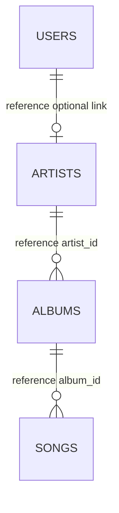
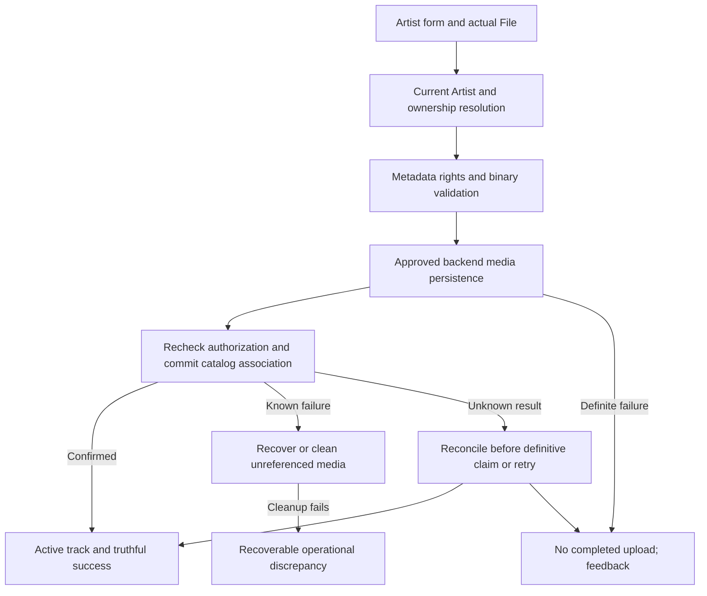

# Data Model — Feature 093 Artist Track Management

**Status**: Logical model and invariants, not DDL, approved wire fields or a selected media provider. [Decisions](./research.md#decision-register). Core FRs and supplemental G090-D decisions retain separate provenance.

## Entities and mapping evidence

| Logical entity | Required information / relationships | Confirmed evidence and gaps |
| --- | --- | --- |
| Authenticated artist principal | Current valid account/session, Artist role, server-resolved artist link | Existing JWT/session/current-user checks; reference `artists.user_id` optional/unique. Auth migration has text `users.id`/`user_id`, not a complete catalog model. S02 maps once across 091–093. |
| Managed track | Stable identity, management owner, title, optional album, genre, entered duration, cover display, plays, Artist preference, media association | Reference `songs.song_id`, `album_id`, documented `total_plays`; direct owner/status/release/filename fields not confirmed. Mock `artistId`/`uploadedBy` are not columns. S02/S03. |
| Album association | Optional album-name metadata, permitted association to artist release when applicable | Reference albums→artist and songs→album; standalone/co-credited ownership missing. Text equality is not identity; no implicit album CRUD. Blank may clear association under recorded edit decision, exact representation S03/S05. |
| Genre | Existing catalog member | Mock taxonomy referenced in spec; public `/genres` contracted, backend not implemented. Canonical server taxonomy/mapping S03. No free-form new genre creation. |
| Media asset | Actual stored bytes, stable playable URL/reference associated with track, protected backend object identity | FR-010 cloud storage requirement; no provider/object schema/SDK selected. Safe object identity may differ from display filename; exact mapping S06/S08. |
| Rights declaration | Distribution declaration and conditional rights/source/permission/attribution information | PC-04/ED-06 and recorded G090-D02/03 supply evidence; no proof documents/legal validation. Physical columns/types and public attribution projection S03/S05. |
| Admin restriction | Independent moderation constraint affecting public availability | Group 110 policy and recorded G090-D05; not an Artist-editable status or new 093 approval workflow. Mapping S10. |
| Studio metrics | Own catalog total, effective active count, historical all-time plays | FR-002; recorded D06 keeps plays after deletion. Cannot derive historical aggregate solely from remaining rows. Source/consistency S03/S09. |
| Operation/draft state | Origin account/session/artist, intended operation, request generation, pending/uncertain/result | Internal orchestration requirement, not an approved request ID, database operation table or durable draft. S07 decides dedup/reconciliation. |

This is the existing reference ER, not a proposed new schema. It fails to settle standalone-track management, collaborative attribution and album-name mapping. Do not create an album solely to force a single through the diagram, or infer management permission from an artist display credit.

## Validation model

Conceptual labels below are not JSON keys. Exact transport lives behind S05.

| Input | Established rule | Scope / pending mapping |
| --- | --- | --- |
| Title | Required on upload; edited title nonempty after edge trim | Recorded D15/D16: edit title ≤200 Unicode code points inclusive. Do not assume that maximum for upload or retain demo maxLength=100 as policy. |
| Album | Optional input; edit may clear | Recorded D15/D16 edit maximum 200 code points inclusive; empty is not an instruction to create album “Single.” Link/display mapping S03. |
| Genre | Existing system genre catalog | Server verifies membership; no client-created genre/default policy. |
| Duration | Exact `^\d{1,2}:[0-5]\d$` on create/edit | D04 says user-entered; no audio-length measurement/mismatch rule. Regex-valid zero/leading-zero values are not rejected by invented positivity/normalization rules. Storage conversion S03. |
| Binary file | Required on upload; actual bytes must persist | Recorded D01 MP3 only, ≤52,428,800 bytes inclusive; not a broad `audio/*` rule. Content checks/parser S06, source alignment S04. |
| Rights | Per-upload initially unchecked declaration, rights type, conditional source/permission/attribution | Recorded D02/03. Validate before audio/store work; declarations are not proof of license validity. Schema not selected. |
| Owner, counts, Admin state, media replacement | Never writable by the metadata form | Derive owner server-side; preserve metrics/media/restrictions. Unexpected fields cannot mutate them. |

Unicode edit lengths count code points, not bytes, UTF-16 units or grapheme clusters. Preserve user-entered duration semantics and lossless representation; no invented actual-audio-duration claim. Public output uses explicit field allowlists and omits uploaded filenames/private rights evidence unless a reviewed public purpose permits them. License-required attribution needs S03's approved projection; never expose unrelated private evidence by serializing a whole row.

## Visibility and publication states

The core product has Artist preference `active` / `hidden` and irreversible removal. These are behavioral labels, not approved database enum values. Recorded D05 distinguishes independent Admin restriction. Logical public eligibility requires current shared catalog/artist policy AND Artist-public preference AND no Admin restriction AND not deleted, plus playability for public playback. Do not equate `active` preference alone with effective public availability.

| Operation | Artist preference / track outcome | Other preserved information |
| --- | --- | --- |
| Valid completed upload | Active immediately under existing public rules; no approval stage | Owner from principal, approved metadata/media/rights committed |
| Metadata edit | Preference unchanged | ID, owner, media, valid plays/history and Admin restriction |
| Artist hide | Hidden; remains Studio member | Media and historical plays retained |
| Artist restore | Active preference, public only if no other restriction | No Admin unrestrict or deleted restoration |
| Confirmed delete | Removed from Studio/public distribution; no 093 restore | Historical aggregate preserved under D06; physical record/blob/reference strategy S09 |
| Admin restrict/unrestrict | Group 110-owned transition, not a 093 action | Artist preference remains independent; deleting content cannot be undone by unrestrict |

No draft/awaiting-review/rejected-publication state is invented. Technical uploading/unconfirmed/reconciling phases below do not become visible approval policy or a persisted enum automatically.

## Cross-service upload consistency

Recommended invariant: no public track is acknowledged until both required media persistence and catalog association are confirmed. A known media failure cannot produce a successful row with a placeholder URL. Media success + DB failure must not produce untracked public distribution. S06/S07/S08 must define non-public staging/access and cleanup/reconciliation using actual provider capability; no distributed commit or compensating delete guarantee is assumed.

Only the originating account's operation may finalize. Recheck current role/session/artist ownership at commit under approved rules; auth expiry/ban during transfer is not automatic cancellation or success. Do not accept arbitrary client URLs/object keys or a different artist in final metadata. Distinguish definite pre-commit failure, confirmed commit and unknown commit outcome. Same-submission retry maps to the already-submitted operation without duplicating a track; a separate intentional upload of identical bytes remains a separate intent unless an approved rule says otherwise. No hash/title deduplication or idempotency header is silently selected.

## Concurrent edits, visibility and deletion

Recorded G090-D08 requires successful processing order and no resurrection. The server needs an atomic conditional-write/transaction boundary using current ownership, restriction and deletion predicates. S07 must select how this is executed with the existing database integration. Separate Supabase HTTP calls and browser-local status objects do not establish atomicity.

| Race | Required invariant |
| --- | --- |
| Two valid metadata edits | Last successful applicable change prevails under approved update semantics; unrelated restricted fields untouched |
| Hide versus metadata edit | Metadata update cannot reset preference by spreading stale row |
| Artist restore versus Admin restrict | Artist preference cannot clear restriction or claim effective publication incorrectly |
| Delete versus edit/restore/upload finalize | Successful deletion cannot be reversed by a late applicable write |
| Retry after response lost | Reconcile result before resubmission; no duplicate upload or false saved/deleted claim |
| Different-account response/refresh | No draft/action/result reassigned to new account; already-committed original operation remains original owner's |
| Concurrent play recording versus hide/delete | Hiding never subtracts valid plays; historical aggregate/recording semantics coordinated with history owner |

Do not copy 092's absent-follow-row lock algorithm as track architecture. Its discovered need for database atomic execution is shared; track writes involve different lifecycle and media boundaries.

## Deletion and historical metrics

Removal from Studio/new public discovery is distinct from physical data/blob erasure. S09 must decide safe FK/history/playlist cleanup and media deletion, without adding retention periods, cascades, tombstones or event tables here. Preserve recorded historical Studio plays through whatever approved source provides them. Deleted track metadata must not remain visible publicly through counts or placeholders. Failure to physically clean up does not authorize continued public streaming; access enforcement is S08.

Logical metrics:

- Catalog total: owned non-deleted catalog members under approved management scope.
- Active count: owned non-deleted Artist-public, unrestricted tracks that satisfy approved active/public policy.
- Historical total plays: valid AuraTune plays attributed to the own artist, including later hidden/restricted/deleted tracks under recorded D06. Not simply a sum of remaining catalog rows.

Empty catalog can have active count zero and nonzero historical plays. Missing stats are unavailable, never fabricated zero. Exact source, attribution across multiple artists, row deletion and read consistency are S02/S03/S09; platform admin stats are not defined here.

## UI operation state and lifecycle

Keep transient state keyed to account/session/artist/request generation: auth resolving, login-required, forbidden/unlinked, catalog/stats loading, successful/empty, partial failure/stale, mutation pending, definite error, uncertain/reconciling, confirmed result.

Recorded D09–D14 rules: pre-submit close discards unsaved input without request; after submit departure does not cancel; retain data while form remains open/accessibly recoverable; File access is not promised across reload; same-account sign-in and authorization recheck required; different account gets no former data. Preserve successful portions on partial read failure and mark older portions not updated. No durable draft, browser audio persistence, recovery endpoint or automatic retry mechanism is selected.

Studio link to public profile always uses existing `/artist/:id`. Non-public profile result follows 091; Studio authorization does not make public profile viewable. Track hide/delete changes no profile visibility, follow membership or follow-time ordering.
