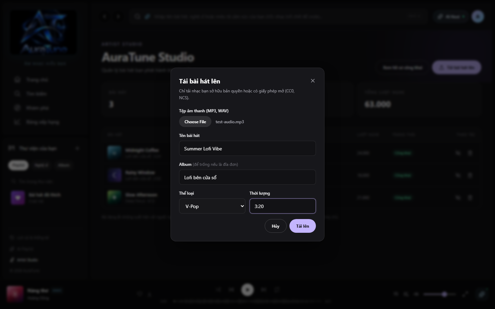
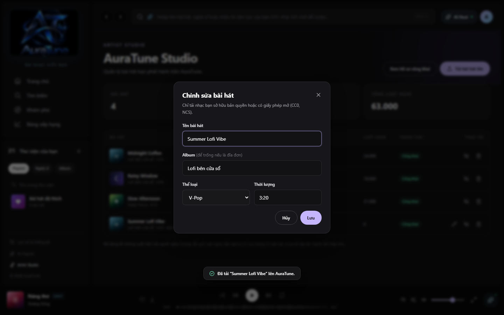
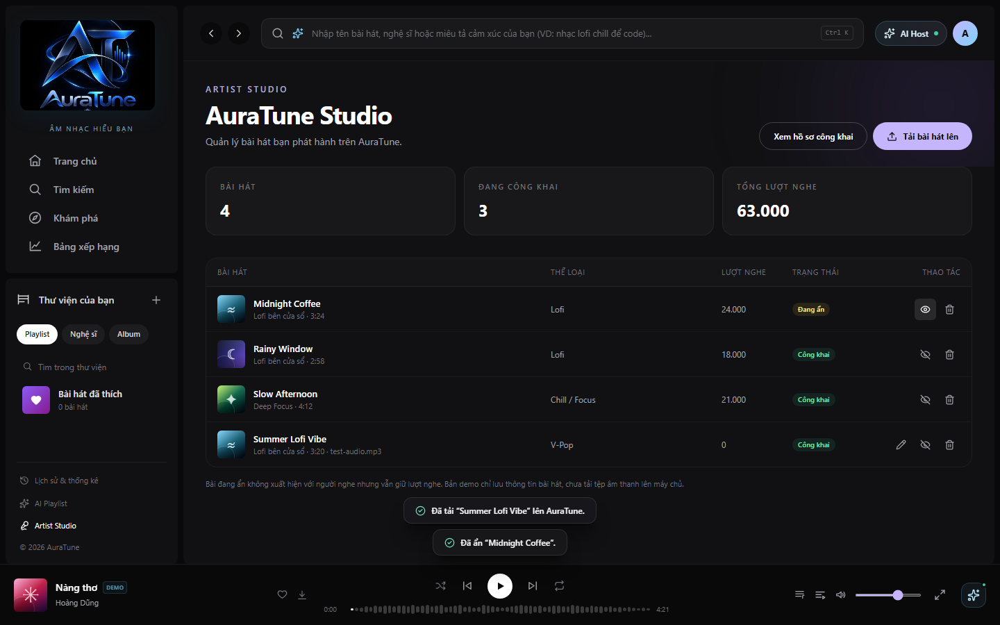
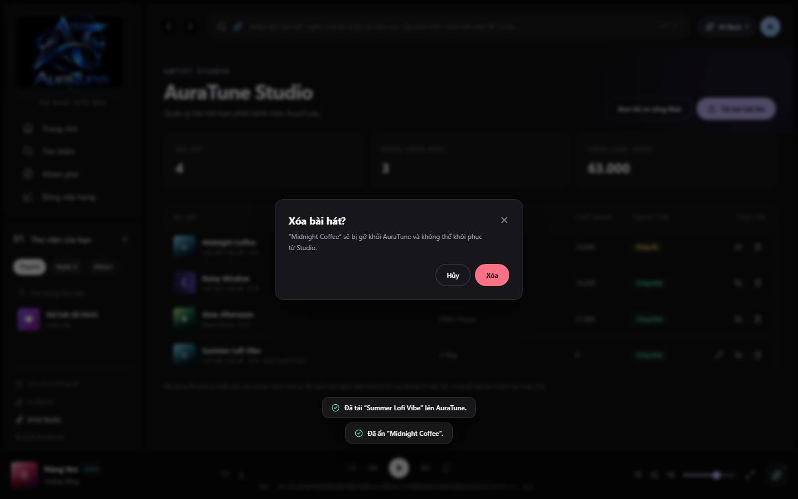

# Feature Specification: Artist Track Management

**Feature Branch**: `093-artist-track-management-spec`  
**Created**: 2026-10-31  
**Status**: Draft — Ready for Planning  
**Input**: User description: "Independent artists can manage, upload, edit, hide, and delete their own tracks via AuraTune Studio."

## Clarifications

### Session 2026-10-31

- Q: Who is authorized to access AuraTune Studio? → A: Only authenticated users with the `artist` role. Unauthenticated visitors are prompted to log in, and regular listeners receive a forbidden access message.
- Q: What happens when an artist hides a track? → A: The track status transitions to "hidden" (`Đang ẩn`). The track is excluded from public search and listener catalogs, but existing play counts and statistics remain preserved in the Studio.
- Q: How is track duration formatted? → A: Track duration must follow the `minutes:seconds` format (regex `^\d{1,2}:[0-5]\d$`, e.g., `3:45`).
- Q: Can an artist delete an existing track? → A: Yes, deleting a track requires confirmation via a modal dialog. Once confirmed, the track is removed from AuraTune Studio and public distribution.

## User Scenarios & Testing *(mandatory)*

### User Story 1 - View Studio Dashboard and Catalog (Priority: P1)

As an authenticated artist, I want to access AuraTune Studio to inspect my track statistics and browse the complete catalog of tracks I have released.

**Why this priority**: Overview of released tracks and aggregate metrics is the baseline entry point for track management.

**Independent Test**: Sign in with an artist account (`artist@auratune.vn`), navigate to `/studio`, and verify track list and metric cards.

**Acceptance Scenarios**:

1. **Given** an authenticated artist account, **When** they navigate to `/studio`, **Then** the page displays the artist studio header, artist name, public profile link, and statistics cards (Bài hát, Đang công khai, Tổng lượt nghe).
2. **Given** an artist with released tracks, **When** the studio table renders, **Then** each row displays cover art, track title, album name, audio filename (if uploaded), genre name, play count, status badge ("Công khai" or "Đang ẩn"), and action controls.
3. **Given** an artist with no released tracks, **When** the catalog renders, **Then** a clean empty state is displayed prompting the artist to upload their first track.

---

### User Story 2 - Upload New Audio Track (Priority: P1)

As an artist, I want to upload a new audio file with descriptive metadata so that my music becomes available to AuraTune listeners.

**Why this priority**: Content ingestion is necessary to expand the platform's open-copyright music catalog.

**Independent Test**: Open the upload dialog, provide audio file and required metadata, submit, and confirm new track appears in catalog.

**Acceptance Scenarios**:

1. **Given** the Studio page, **When** the artist clicks "Tải bài hát lên", **Then** a modal opens with audio file picker, track title input, album input, genre dropdown, and duration input.
2. **Given** valid inputs (title, duration in `m:ss` format, and selected audio file), **When** submitted, **Then** the track is added with "active" status, a success toast notification appears, and the track appears in the table.
3. **Given** missing required fields or invalid duration format, **When** submitted, **Then** the modal highlights the validation error without closing.

---

### User Story 3 - Edit Track Metadata (Priority: P2)

As an artist, I want to update metadata for a previously uploaded track so that corrections or updated album assignments can be applied.

**Why this priority**: Maintaining accurate song titles, genres, and album groupings ensures consistent catalog quality.

**Independent Test**: Click edit on an uploaded track, modify metadata fields, submit, and confirm changes reflected.

**Acceptance Scenarios**:

1. **Given** an uploaded track in the table, **When** the artist clicks the edit (Pencil) button, **Then** the edit dialog opens pre-populated with current title, album, genre, and duration.
2. **Given** valid updated fields, **When** the artist clicks "Lưu", **Then** the track record is updated, a toast notification confirms the change, and the table reflects the new values.

---

### User Story 4 - Toggle Track Visibility (Priority: P1)

As an artist, I want to temporarily hide or unhide a track without deleting its playback history.

**Why this priority**: Artists require control over public release status without losing cumulative play count analytics.

**Independent Test**: Click the status toggle button on an active track, verify status changes to hidden, and toggle back to active.

**Acceptance Scenarios**:

1. **Given** an active track ("Công khai"), **When** the artist clicks the hide button (EyeOff icon), **Then** the status transitions to "hidden" ("Đang ẩn"), status badge updates to amber, and a toast confirms `Đã ẩn “<Tiêu đề>”.`.
2. **Given** a hidden track ("Đang ẩn"), **When** the artist clicks the unhide button (Eye icon), **Then** the status transitions to "active" ("Công khai"), status badge updates to green, and a toast confirms `“<Tiêu đề>” đã công khai trở lại.`.

---

### User Story 5 - Delete Track (Priority: P2)

As an artist, I want to permanently delete a track that should no longer be distributed on the platform.

**Why this priority**: Content ownership requires the ability to permanently delist tracks.

**Independent Test**: Click delete on a track, confirm deletion in modal, and verify track is removed from studio catalog.

**Acceptance Scenarios**:

1. **Given** a track in the studio table, **When** the artist clicks the delete button (Trash icon), **Then** a confirmation modal displays the track title and warning that the track cannot be restored.
2. **Given** the confirmation modal, **When** the artist clicks "Hủy", **Then** the modal closes without modifying the catalog.
3. **Given** the confirmation modal, **When** the artist clicks "Xóa", **Then** the track is removed from Studio, a confirmation toast displays, and the statistics cards update.

---

### User Story 6 - Role Gating and Access Control (Priority: P1)

As a security boundary, AuraTune Studio must only allow access to accounts possessing the `artist` role.

**Why this priority**: Non-artists and guests must not manipulate music catalog entries.

**Acceptance Scenarios**:

1. **Given** an unauthenticated visitor navigating to `/studio`, **Then** the system presents the `LoginRequired` component prompting login with an artist account.
2. **Given** an authenticated user with role `user` (e.g. `demo@auratune.vn`) navigating to `/studio`, **Then** the system presents a `Forbidden` notice explaining that only artist accounts may access Studio.

## Requirements *(mandatory)*

### Functional Requirements

- **FR-001**: AuraTune MUST restrict access to `/studio` to authenticated users with `role: 'artist'`.
- **FR-002**: The Studio dashboard MUST display summary statistics for the artist: total tracks, active tracks, and total play count.
- **FR-003**: The Studio catalog MUST render all artist-associated tracks with cover art, title, album, duration, genre, play count, status, and management action buttons.
- **FR-004**: AuraTune MUST allow artists to upload new tracks by providing an audio file, title, optional album name, genre, and duration.
- **FR-005**: Duration input MUST validate against the pattern `^\d{1,2}:[0-5]\d$`.
- **FR-006**: AuraTune MUST allow artists to edit metadata (title, album, genre, duration) of uploaded tracks.
- **FR-007**: AuraTune MUST allow artists to toggle track visibility between active ("Công khai") and hidden ("Đang ẩn").
- **FR-008**: AuraTune MUST require modal confirmation before permanently deleting a track.
- **FR-009**: The system MUST provide toast notifications upon upload, update, status toggle, and deletion.

### Measurable Outcomes

- **SC-001**: 100% of non-artist accounts and unauthenticated visitors are prevented from managing or accessing artist track controls.
- **SC-002**: Track upload and metadata edit actions reflect in the studio catalog and store within 500ms of user submission.
- **SC-003**: Hidden tracks are excluded from 100% of public listener searches and catalog queries while retaining historical play counts in Studio.

## Assumptions

- Audio files in the demo environment are validated client-side and simulated in browser state without backend media streaming storage.
- Artist credentials and profiles are configured via standard authentication seed data (`artist@auratune.vn` / `Aura1234`).
- Track genres conform to the platform's standardized genre taxonomy (`mockData.js`).

## Dependencies

- Authentication context (`AppStore.jsx`) providing current user role and session state.
- Modal and common UI component library (`components/common/ui.jsx`).

## Out of Scope

- Audio waveform visualization and multi-track mastering tools.
- Direct payout, monetization, or royalty split calculations.
- Public listener review moderation (handled in platform administration Group 110).

## UI Screenshots

### 1. Artist Track Management Overview

- **Path**: `./ui/01-artist-track-management.png`
- **Description**: AuraTune Studio dashboard at `/studio` showing artist profile header, aggregate statistic cards (Bài hát, Đang công khai, Tổng lượt nghe), and the catalog table of artist-owned tracks with status badges and action controls.
- **User Story**: User Story 1 (View Studio Dashboard and Catalog) & FR-001, FR-002, FR-003.

### 2. Upload Track Modal

- **Path**: `./ui/02-upload-track.png`
- **Description**: "Tải bài hát lên" modal dialog with form fields for audio file selection, track title, album name, genre dropdown, duration input, and copyright notice.
- **User Story**: User Story 2 (Upload New Audio Track) & FR-004, FR-005.

### 3. Edit Track Metadata Modal

- **Path**: `./ui/03-edit-track.png`
- **Description**: "Chỉnh sửa bài hát" modal dialog pre-filled with existing track metadata allowing the artist to update title, album, genre, and duration.
- **User Story**: User Story 3 (Edit Track Metadata) & FR-006.

### 4. Hide Track Action

- **Path**: `./ui/04-hide-track.png`
- **Description**: Track visibility toggle action updating track status from "active" to "hidden" ("Đang ẩn" in amber badge) with toast notification confirmation.
- **User Story**: User Story 4 (Toggle Track Visibility) & FR-007, FR-009.

### 5. Delete Track Confirmation Modal

- **Path**: `./ui/05-delete-track.png`
- **Description**: Deletion confirmation modal warning that the track will be removed from AuraTune without ability to restore, offering "Hủy" and red "Xóa" confirmation buttons.
- **User Story**: User Story 5 (Delete Track) & FR-008.
