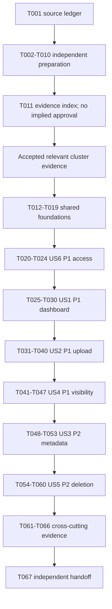

# Tasks: Feature 093 — Artist Track Management

**Inputs:** [specification](./spec.md), [requirements checklist](./checklists/requirements.md), [plan](./plan.md), [research](./research.md), [data model](./data-model.md), [interface contract](./contracts/artist-track-management.md), [quickstart](./quickstart.md), all five [UI mockups](./ui/), and [Group 090 review](../group-090-cross-feature-review.md).  
**Branch reference:** `090-artist-profile-studio-plan-tasks`  
**Generated:** 2026-11-09  
**Readiness:** Review-ready, dependency-aware backlog; **not implementation-ready**. No S01–S12 decision or shared cluster is closed by task generation.

**Prerequisites:** Requirements and behavioral design exist. Actual ownership/catalog mappings, protected Studio reads, exact wire contracts, binary-media provider/access, atomic processing, history/cleanup, source precedence, timing feasibility and verification tooling still need the evidence below. Mockups and checked checklist items do not establish production implementation or technical approval.

**Tests:** Explicitly requested. Written scenario preparation is runnable now; executable tests are gated. Once gates close, write relevant tests first and demonstrate meaningful failure before implementing the behavior. No application tests, builds, provider calls, database changes or tasks were executed by creating this document.

**Organization:** Setup → shared foundations → US6/P1 access → US1/P1 dashboard → US2/P1 upload → US4/P1 visibility → US3/P2 metadata → US5/P2 deletion → cross-cutting acceptance. Story numbers remain those of the specification. Access is scheduled first because it protects every other story; P1 visibility precedes P2 editing/deletion.

## Format, paths and execution rules

- Tasks use `- [ ] Tnnn [P?] [USn?]`, with unique sequential feature-local IDs, a concrete work product and repository-relative paths. Qualify IDs as **093 Tnnn** when comparing other features' tasks.
- **READY** means source analysis, written scenarios or review proposals can be produced with checked-in evidence and text tools after predecessors. It does not authorize declaring a proposal accepted or require unavailable Node/provider/database access.
- **GATED Cxx…** means the named clusters' **relevant accepted closure evidence** and task predecessors are mandatory before execution. Task-specific **Closure** text supplements the gate register. A completed evidence index or existing plan is not sign-off.
- `[P]` permits distinct-file work after prerequisites/gates; it does not permit concurrent edits to shared files or competing tests on shared fixtures. Unmarked implementation writers serialize. Ranges in dependencies are inclusive.
- All new preparation, validation, code and test paths below are **future proposed destinations**. They are not created now. C15 must confirm exact test/configuration paths and scripts; update affected tasks explicitly if accepted tooling uses another layout. No test library is selected by a `.test.js` suffix.
- Only this Tasks document is generated. Do not edit original specifications, checklists, UI, plans, research, model, Markdown contracts, 091/092 artifacts or application code in this pass. Later tasks are descriptions, not implementation authorization. Changes to authoritative source scope need a separately authorized alignment pass.
- No task authorizes branch creation/switch/merge/commit/push. The template's generic commit/deploy advice is overridden by this request. No Tasks for other features are generated.

## Source baseline and boundaries

Review alongside [091 plan](../091-artist-profile/plan.md), [research](../091-artist-profile/research.md), [model](../091-artist-profile/data-model.md), [contract](../091-artist-profile/contracts/artist-profile.md), [validation](../091-artist-profile/quickstart.md), [Tasks](../091-artist-profile/tasks.md), and [092 plan](../092-follow-artist/plan.md), [research](../092-follow-artist/research.md), [model](../092-follow-artist/data-model.md), [contract](../092-follow-artist/contracts/follow-artist.md), [validation](../092-follow-artist/quickstart.md), [Tasks](../092-follow-artist/tasks.md). Shared evidence is reusable only when accepted for the relevant surface; another feature's task completion alone closes no gate here.

Current project constraints come from [Constitution](../../../.specify/memory/constitution.md), [Vision](../../../docs/proposal/Auratune_Vision_Document.md), [Proposal](../../../docs/proposal/proposal.md), [Project Plan](../../../docs/proposal/project_plan.md), [architecture](../../../docs/design/architecture/system-architecture.md), [modules](../../../docs/design/architecture/feature-modules.md), [role navigation](../../../docs/design/architecture/role-navigation.md), [database](../../../docs/design/database/README.md), [ERD](../../../docs/design/database/er-diagram.md), [consistency](../../../docs/design/database/data-consistency.md), [database security](../../../docs/design/database/security-rules.md), [security](../../../docs/design/security/README.md), [shared API](../../../docs/analysis-and-design/api-contract.md), [API conventions](../../../docs/design/api/api-conventions.md), [Team Contract](../../../docs/management/team-contract.md), [Spec Kit guide](../../../docs/management/speckit-workflow-guide.md), [Tasks skill](../../../.agents/skills/speckit-tasks/SKILL.md), and [Tasks template](../../../.specify/templates/tasks-template.md). “Latest” means the versions in this checkout; no deployment/schema discovery or remote synchronization is claimed.

The [Group owner decision record](../../../docs/requirements/use-cases/090-artist-profile-studio/README.md) and linked UC-090-004–008 contain **recorded owner decisions G090-D01–D16**, not original 093 FR IDs or evidence of team technical approval. Source-precedence reconciliation remains C12/S04. Preserve their recorded content; do not reopen the MP3 limit, rights choices, edit limits or recovery behavior as if no owner decision existed. The six original stories, FR-001–010 and SC-001–003 remain unchanged.

Implemented baseline: React/Vite JavaScript/JSX and the custom router, Express, AuraTune JWT/session and Firebase exchange, backend-only Supabase client. [StudioPage](../../../src/frontend/src/pages/Studio/StudioPage.jsx) and [AppStore](../../../src/frontend/src/context/AppStore.jsx) simulate catalog/actions; filenames are not binary persistence, local artist IDs and `uploadedBy` are not ownership authority, and current-row play sums do not preserve deleted history. [Server](../../../src/backend/server.js) has auth/health/exchange, no song management/media handlers. [Auth migration](../../../src/database/migrations/001_auth_tables.sql) does not establish catalog/rights/media structures. [Auth middleware](../../../src/backend/middleware/authMiddleware.js) and [session client](../../../src/frontend/src/services/sessionApiClient.js) require coordinated error/replay alignment. [Supabase client](../../../src/database/supabaseClient.js) does not prove a selected media provider, cross-call transaction or safe service-role query.

**Hard scope boundaries:** Audio replacement is outside 093: no replacement control, route, binary update, versioning or replacement implementation task. Metadata editing is title/album/genre/duration only. No prior approval queue, Artist moderation override, full album/genre CRUD, cover upload, lyrics/release editor, legal-verification/proof-upload workflow, durable browser drafts/audio or follower-count work is added. Technical transfer/reconciliation states are not new publication states.

## Gate register and required closure evidence

Original IDs remain in [S01–S12](./research.md#decision-register); grouping follows the [shared register](../group-090-cross-feature-review.md#3-consolidated-decision-register-with-traceability). Close only the relevant slice of a shared cluster, not unrelated 091/092/110 work. Responsibilities are established coordination roles, not new assignments or assertions of completed approval.

| Gate | Original traceability | Accepted evidence required before dependent tasks | Established coordination |
| --- | --- | --- | --- |
| C01 — Governance | S01; 091-D01; 092-F01 | Ratified principles or documented disposition of the template gap through existing governance. No invented constitutional pass or waiver. | Nhựt/team |
| C02 — Identity and ownership | S02; identity parts of S03; 091-D02; 092-F02/F03 | Actual account→artist key/link and manageable-track ownership/attribution mapping, standalone/co-credit/imported scope, unlinked Artist denial behavior, canonical ID validation and profile-disabled/account-ban relationship. Server ownership/album permission examples and negative cases. | Hoàng/Đăng/Khoa |
| C03 — Catalog and metadata | S03; shared 091 attribution/count/release mappings | Reviewed catalog/schema and minimal migration/source mapping for optional/clearable album, genre, entered duration, rights, stable media reference, display filename, public metadata and canonical plays/release inputs. Exact edit constraints versus unresolved upload limits distinguished. No guessed columns or fabricated dates/counts. | Đăng/Hoàng; Khoa for history |
| C04 — Authentication/session safety | auth parts of S05/S07; 092-F06 | Reviewed current JWT/session/role/ban checks, error normalization compatibility, origin-account/session-bound refresh and replay, expiry/revocation/finalization ordering and transient-draft isolation. No A request sent as B; no blind ambiguous POST replay. | Khoa/Hoàng; Nhựt for shared architecture coordination |
| C05 — Studio interfaces | S05 and relevant S03 | Accepted protected complete own-catalog/identity/metrics read capability and deterministic collection/transport semantics, partial failure/staleness, exact multipart/metadata/preference/delete DTOs/statuses/examples and OpenAPI 3.0.3. Existing POST/PUT/DELETE song paths reused; any missing protected-read or reconciliation extension requires explicit approval, not an invented route. | Hoàng/Khoa/Đăng |
| C08 — Atomic processing/moderation | S07/S10 | Approved deployable execution boundary for ownership/current state checks, metadata/preference/delete/finalization ordering, no resurrection, distinct Artist/Admin branches and independent restriction preservation. Multi-worker race/rollback design and same-submission consistency integration; no assumed RPC, locks, operation tables or version fields. | Đăng/Hoàng/Khoa; Nhựt for architecture coordination |
| C09 — Binary persistence and delivery | S06/S08; media portions of S07 | Evidence-backed provider/config/parser selection, MP3-content/bounded input policy, stable-reference and staging semantics, safe public playback/range/CDN/cache behavior, no known-URL bypass, current-auth finalization, submission dedup/reconciliation and recoverable compensation. Exact dependency/config/adapter/deployment artifacts and operational responsibility accepted; no provider inferred from examples/spike milestone. | Hoàng/Nhựt; Huy playback; Đăng catalog/search |
| C10 — Lifecycle/history | S09; historical/source parts of S03 | Reviewed logical deletion versus physical blob/reference cleanup and FK/history/playlist behavior preserving valid plays after hiding/restriction/deletion, including concurrent recording and empty catalog with historical total. Failure/repair semantics accepted; no invented cascade, ledger, tombstone or cleanup period. Track deletion leaves profile/follows unchanged. | Đăng/Hoàng/Khoa; Huy stream/queue boundary |
| C12 — Source precedence/publication | S04/S10; shared source-lineage issue | Recorded disposition aligning original spec/checklist/mockups/Vision with G090-D01–D16 and broader deferrals; preserve immediate valid publication, no prior approval, independent Admin restriction and out-of-scope replacement. Adopted exact behavior must not be confused with approved schema/provider. | Hoàng/Nhựt/team; Đăng for shared moderation state |
| C14 — Upload timing feasibility | S11 | Accepted literal submission-to-store-and-catalog measurement plan/conditions and feasibility disposition. Existing SC-002 remains 500 ms; any change needs separate authorized requirements review. Transfer/validation/media/DB/UI phases cannot be silently excluded or optimistic insertion counted as success. | Hoàng/Huy/Nhựt |
| C15 — Runtime/verification | S12; 091-D08; 092-F09 | Supported runtime, reviewed shared unit/component/API/real-database/media/browser harness and exact file paths/scripts, disposable permitted fixtures and runnable environment. Auth smoke/build/Feature 131 proposals alone are not Studio test evidence. | Nhựt architecture; Hoàng feature verification; team assigns unnamed foundation responsibility |

Each gated task explicitly names C01 plus applicable technical gates. C15 is required for runnable code/tests; serialization of an already accepted contract can be documentation-only. C14 is not a prerequisite for writing duration scenarios or a read-only Studio increment, but blocks truthful upload/edit acceptance and final delivery claims. An accepted measurement plan permits measurement; it does not prove the 500 ms requirement met or close the feasibility entry.

C06/C11 follower persistence/count design, C07 official-playlist designation and C13 selected-song destination are not universal Studio prerequisites. Consume established public eligibility and handoff contracts without redesigning those features. If a particular cross-feature check lacks its peer implementation, record it pending rather than invent that implementation or claim integration passed.

## Phase 1: Setup — Runnable evidence and preparation

**Purpose:** Resolve what can be learned from existing sources, design concrete cases and submit explicit proposals/questions. These tasks create review evidence only when later executed; they cannot self-approve design.

- [ ] T001 **READY** — Create `specs/090-artist-profile-studio/093-artist-track-management/preparation/source-and-scope-ledger.md` mapping all six stories, FR-001–010, SC-001–003, quickstart V01–V16 and recorded G090-D01–D16 to current sources. Record fixed branch/read-only baseline, C01 template status and exclusions; separate original FR wording, owner-recorded decisions, proposals and implementation evidence. **Depends:** none.
- [ ] T002 [P] **READY** — Create `specs/090-artist-profile-studio/093-artist-track-management/preparation/source-precedence-review.md` comparing MP3/WAV mockup, Vision MP3/FLAC and recorded MP3-only ≤50 MiB; rights declarations, edit-only lengths, metrics/playback/recovery and wider deferred scope. Preserve D01–D16 provenance and identify required C12 sign-off, without editing sources or inventing prior approval/replacement behavior. **Trace:** S04/S10; FR-004–010. **Depends:** T001.
- [ ] T003 [P] **READY** — Create `specs/090-artist-profile-studio/093-artist-track-management/preparation/identity-ownership-cases.md` for guest/User/Admin/banned/linked and unlinked Artist, A/B ownership, standalone/imported/co-credit and album-permission cases. Compare actual auth key/link evidence with ER/demo and distinguish hidden profile from banned account; specify safe unlinked denial with exact mapping/message pending C02/C05, no provisioning or browser-owner authority. **Trace:** FR-001/003; SC-001; S02. **Depends:** T001.
- [ ] T004 [P] **READY** — Create `specs/090-artist-profile-studio/093-artist-track-management/preparation/catalog-and-history-audit.md` inventorying actual/reference catalog, genre/album/duration/rights/media mappings and historical metric sources. Include deleted-track plays, empty catalog with historical plays, no hidden→zero fallback, complete retrieval beyond caps and public 091 association/count/release inputs. Identify C03/C10 gaps without selecting schema/backfill/cascade/ledger. **Trace:** FR-002–007/010; D06/D14. **Depends:** T001.
- [ ] T005 [P] **READY** — Create `specs/090-artist-profile-studio/093-artist-track-management/preparation/interface-options.md` comparing current POST/PUT/DELETE/stream/genre capabilities with missing protected catalog/identity/metric and reconciliation needs. Deliver review-labelled alternatives, safe projection/error/completeness requirements and open questions; do not assert new routes, multipart fields, payload keys or public hidden-data access. **Trace:** FR-001–010; S05; C04/C05. **Depends:** T001.
- [ ] T006 [P] **READY** — Create `specs/090-artist-profile-studio/093-artist-track-management/preparation/media-and-recovery-options.md` with provider/parser evidence inventory and fault table: validation rejection, media failure, media-success/DB-rollback, cleanup failure, committed response loss, unknown commit and expired final authorization. Require same-submission retry without duplicate and distinct intentional same-bytes uploads; compare options without selecting provider, request key, operation table, TTL or cleanup guarantee. **Trace:** FR-004/009/010; D01–D03/D08; S06–S09. **Depends:** T001.
- [ ] T007 [P] **READY** — Create `specs/090-artist-profile-studio/093-artist-track-management/preparation/moderation-playback-and-race-cases.md` with successful-processing histories for edit/hide/restore/delete/Admin restriction and concurrent valid plays. Cover no stale-row overwrite/resurrection, truthful restricted restore, new player/queue/playlist/direct-URL starts and repeats denied, queue skip and already-started finish. Map code seams and required owners without implementing Group 110/player/queue or choosing transaction/stream protocol. **Trace:** FR-006–010; SC-003; D05–D08; C08–C10/C12. **Depends:** T001.
- [ ] T008 [P] **READY** — Create `specs/090-artist-profile-studio/093-artist-track-management/preparation/session-and-draft-cases.md` tracing current refresh/FormData/auth/store behavior and specifying pre-submit close versus submitted departure, open-form error preservation, same-account temporary recovery, account switch/replacement and mid-transfer revocation. Assert both stored owner and suppressed foreign draft/action/toast; no durable audio/draft storage or ambiguous automatic POST replay. **Trace:** FR-001/009/010; D08–D14; C04. **Depends:** T001.
- [ ] T009 [P] **READY** — Create `specs/090-artist-profile-studio/093-artist-track-management/preparation/validation-and-timing-cases.md` with all original acceptance scenarios, V01–V16, exact duration regex cases, MP3/52,428,800-byte inclusive boundary, spoofed/corrupt files, rights conditionals and edit 200/201 code-point cases. Preserve literal SC-002 and document the shared review's approximately 83.9-second ideal transfer for 50 MiB at 5 Mbps, separately from edit timing; propose measurement questions, not a weaker target. **Trace:** FR-001–010; SC-001–003; S11. **Depends:** T001.
- [ ] T010 [P] **READY** — Create `specs/090-artist-profile-studio/093-artist-track-management/preparation/tooling-and-shared-seams-audit.md` recording real runtime/scripts/harness status, missing parser/media adapter, current shared code writers and 091/092 Tasks dependencies. Inventory backend song/public stream seams, StudioPage/AppStore/session client, manifests, player/queue and accepted-fixture needs; distinguish proposed test tools and spike claims from installed code. No installs or source changes. **Trace:** plan/quickstart; C15. **Depends:** T001.
- [ ] T011 **READY** — Assemble `specs/090-artist-profile-studio/093-artist-track-management/preparation/gate-evidence-index.md` linking T001–T010, S01–S12 and C01/C02/C03/C04/C05/C08/C09/C10/C12/C14/C15 to missing/accepted evidence, reviewer/date/status and affected task IDs. Record required exact migration, protected-read route/module, provider/config and test paths **before** implementation can unlock. Submit reviewable decisions/options and retain open status absent actual acceptance; do not edit original registers or assign undocumented approvers. **Depends:** T002–T010.

**Checkpoint:** Eleven preparation tasks can execute after predecessors. They do not require new product decisions to document evidence. Completing T011 does not authorize implementation or resolve any original decision.

## Phase 2: Foundational — Gated shared seams

**Purpose:** Establish accepted contracts, auth, catalog mapping and private state lifecycle. Media implementation remains US2-specific so a read-only increment is not blocked by choosing a provider. Public 091 and personal 092 retain their independent access rules.

- [ ] T012 **GATED C01, C15** — Configure/reuse accepted runtime and harness through `src/backend/package.json`, `src/frontend/package.json` and exact approved configuration paths in T011; establish concrete real-database/media/component/browser destinations and record harness smoke/commands in `specs/090-artist-profile-studio/093-artist-track-management/validation/tooling.md`. Reuse shared 091/092 setup if already accepted; do not initialize a new stack/test framework by assumption. **Trace:** plan/quickstart; all automated acceptance. **Closure:** governance disposition, accepted runtime/runner/layout/scripts and working disposable environment. **Depends:** T011.
- [ ] T013 **GATED C01, C02, C03, C04, C05, C10, C12** — Create `specs/090-artist-profile-studio/093-artist-track-management/contracts/artist-track-management-api.json` as OpenAPI 3.0.3 for the **accepted access/protected-read/metrics slice**, using exact approved paths/DTOs/order/completeness/partial-error semantics. Keep public responses narrower and Artist/Admin capability branches distinct. Leave existing Markdown contract unchanged; upload/metadata/preference/delete schemas are extended by their story tasks only after relevant decisions. **Trace:** FR-001–003; D06/D14. **Closure:** reviewed actual ownership/metric source, C05 read examples/path/projection and source-precedence disposition for those supplements; no hypothetical private route. **Depends:** T011.
- [ ] T014 [P] **GATED C01, C02, C04, C05, C15** — Add shared auth regression tests in `src/backend/tests/studio-auth-integration.test.js` and `src/frontend/src/services/sessionApiClient.studio.test.js`: JWT/current session/ban checks, standard errors, originating account/session refresh, A→B/logout/replacement races and no blind submitted POST replay. Preserve existing auth callers, 091 anonymous reads and 092 User/Artist/Admin own-follow capabilities. **Trace:** FR-001; SC-001; D08/D13; S05/S07. **Closure:** accepted origin-bound recovery, envelope/status compatibility and harness. **Depends:** T012, T013.
- [ ] T015 **GATED C01, C02, C04, C05, C15** — Apply or reuse accepted shared changes in `src/backend/middleware/authMiddleware.js` and `src/frontend/src/services/sessionApiClient.js` so T014 passes. Retain existing JWT/session/Firebase exchange and FormData boundary handling, reject banned/revoked access using agreed vocabulary, bind replay to origin, and cancel unsafe replay after account/session replacement. Do not make an upload automatically repeat after ambiguous submission or add auth requirements to 091 public GETs. **Trace:** FR-001/010; D08/D13. **Closure:** reviewed C04 implementation/compatibility and meaningful T014 failures; reuse 092's accepted correction rather than competing patches. **Depends:** T014.
- [ ] T016 **GATED C01, C02, C03, C05, C10, C12, C15** — Verify/deploy only accepted **read-required** catalog/identity/metric mappings at the exact approved files recorded by T011 under `src/database/migrations/` where changes are necessary; record mapping/rollback/fixture verification in `specs/090-artist-profile-studio/093-artist-track-management/validation/catalog-mapping.md`. Before execution require concrete filenames/content, actual owner/albumless/history mapping and source approval; reuse adequate existing structures. No guessed table/column/genre default/date/zero value or physical cleanup design. **Trace:** FR-001–003; D06; S02/S03/S09. **Closure:** approved physical/source design, deployment artifacts and permitted fixtures; not an instruction to decide schema while implementing. **Depends:** T013, T015.
- [ ] T017 **GATED C01, C02, C03, C05, C10, C12, C15** — Write repository projection tests first in `src/backend/tests/artist-track-repository.test.js`, then implement the read boundary in `src/backend/repositories/artistTrackRepository.js`: explicit current-owner constraints, complete manageable catalog including own hidden/restricted tracks, accepted deterministic transport and historical metric source. Reuse shared canonical artist resolution without adopting mock `uploadedBy`, public-response filtering or current-row sums after deletion. **Trace:** FR-002/003; D06/D14. **Closure:** accepted ownership/source/schema/complete projection and executable real-storage fixtures. **Depends:** T012, T016.
- [ ] T018 **GATED C01, C02, C04, C05, C15** — Write adapter tests in `src/frontend/src/services/artistTrackService.test.js` before implementing the read/error boundary in `src/frontend/src/services/artistTrackService.js` using the accepted session client. Preserve complete-versus-incomplete and unavailable-versus-empty/zero; map only accepted wire fields and keep origin identity with requests. Mutation adapters are added in story tasks, not invented now. **Trace:** FR-001–003; D13/D14. **Closure:** accepted private-read/error/completeness contract and origin-bound auth. **Depends:** T012, T013, T015.
- [ ] T019 **GATED C01, C02, C04, C05, C12, C15** — Write lifecycle tests in `src/frontend/src/hooks/useArtistTracks.test.js` and implement `src/frontend/src/hooks/useArtistTracks.js` keyed to account/session/linked artist/request generation. Independently track identity/catalog/metrics loading, confirmed/empty/error/stale states; preserve successful peers, clear foreign state, suppress obsolete results/toasts and mark failed refresh data not updated. Establish transient operation/draft ownership without durable browser/file storage. **Trace:** FR-001–003/009; D09–D14. **Closure:** reviewed request/completeness/partial-failure and temporary recovery contract; no invented replay/reconciliation route. **Depends:** T018.

**Checkpoint:** Read foundations are not mutation approval. No placeholder successful empty/zero response stands in for missing backend capability. US6 access and US1 read validation can proceed after their own gates without waiting for media-provider delivery; code/testing still requires accepted governance and tooling.

## Phase 3: User Story 6 — Role Gating and Access Control (Priority: P1)

**Goal:** Studio is available only to current authorized linked Artists managing their own resources. Guest sees LoginRequired; User/Admin cannot use Artist Studio; unlinked Artist cannot read/manage an arbitrary artist or auto-provision a link.

**Independent test:** Use guest, User, Admin, banned/revoked Artist, linked Artists A/B and Artist without a link. Exercise the page and direct protected APIs; verify safe denial/own-only scope, no B metadata/actions and no A→B replay. Separate Admin song capability remains intact.

### Tests first

- [ ] T020 [P] [US6] **GATED C01, C02, C04, C05, C15** — Add direct API access/ownership tests in `src/backend/tests/studio-authorization.test.js` for the full role/link matrix, manipulated artist/owner/track/album selectors, hidden-profile versus ban distinction and expired/revoked sessions. Assert no query/write under a foreign artist and no auto-created artist/link; Group 110 Admin mutation authority is tested separately from Artist Studio access. **Trace:** US6; FR-001/003; SC-001; S02/S05. **Closure:** accepted current-principal/link/ownership and protected-access/error contract with harness. **Depends:** T012, T013, T015.
- [ ] T021 [P] [US6] **GATED C01, C02, C04, C05, C15** — Add `src/frontend/src/pages/Studio/StudioPage.access.test.jsx` covering auth resolving, LoginRequired, User/Admin Forbidden, accepted unlinked-Artist denial, valid Artist and account-switch/refresh races. Assert no old artist name/metrics/control/draft/toast survives replacement and public/profile/follow access rules remain separate. **Trace:** US6; FR-001; SC-001; D13. **Closure:** reviewed link/session/access states, safe error representation and component harness. **Depends:** T012, T013, T019.

### Implementation and verification

- [ ] T022 [US6] **GATED C01, C02, C04, C05, C15** — Implement/reuse server Artist/link/ownership policy in `src/backend/services/artistTrackService.js` over the canonical artist resolver and repository. Derive owner exclusively from verified current identity; reject missing link, wrong role, banned/revoked and cross-owner requests. Expose distinct Artist Studio and existing Group 110 Admin policy branches without granting Admin Artist impersonation; recheck authority at each operation's accepted processing boundary. **Trace:** FR-001/003; SC-001; S02/S05. **Closure:** approved ownership/current-auth contract and T020 failure evidence; no browser claims or service-role bypass. **Depends:** T015, T017, T020.
- [ ] T023 [US6] **GATED C01, C02, C04, C05, C15** — Replace browser-only Studio access assumptions in `src/frontend/src/pages/Studio/StudioPage.jsx` using T019 and accepted server-linked identity, retaining existing `/studio` and LoginRequired/Forbidden components. Do not derive permission from a demo artist seed/email, repair missing links or expose a hidden public profile. Ensure drafts/actions/results remain origin-bound. **Trace:** US6; FR-001; SC-001; D13. **Closure:** accepted access/link UI contract and T021 red tests. **Depends:** T019, T021, T022.
- [ ] T024 [US6] **GATED C01, C02, C04, C05, C15** — Execute independent page/direct-API access matrix and account-replacement cases, recording actual denials and storage/request identities in `specs/090-artist-profile-studio/093-artist-track-management/validation/us6-access.md`. Demonstrate no cross-owner effects and no regression to 091 anonymous/092 personal roles; don't treat hidden profile as automatic Studio revocation. **Trace:** V01/V12/V15; FR-001/003; SC-001. **Closure:** executable negative-access evidence against actual handlers/policy, not just hidden buttons or fallback 404. **Depends:** T020–T023.

## Phase 4: User Story 1 — View Studio Dashboard and Catalog (Priority: P1)

**Goal:** Show authorized own artist identity/profile link, every manageable track and total/active/historical-play metrics, with truthful empty, failure and stale-partial states.

**Independent test:** Seed beyond backend row caps with standalone/album-associated, active/hidden/restricted tracks and deleted historical plays. A sees all own allowed rows/fields, no B data, correct metrics and safe profile link. Empty catalog may retain historical plays; failed metrics are unavailable, not zero.

### Tests first

- [ ] T025 [P] [US1] **GATED C01, C02, C03, C04, C05, C10, C12, C15** — Add `src/backend/tests/studio-catalog.test.js` for complete owner-scoped read/identity/metrics contract, deterministic accepted order, caps/traversal, all required row fields and sanitized filename, active predicate and historical plays after hidden/restricted/deleted cases. Include catalog/stat independent failure and empty catalog/nonzero history. **Trace:** FR-002/003; D06/D14; V02. **Closure:** accepted source/projection/completeness/partial-error contract and historical fixtures. **Depends:** T012, T013, T017, T022.
- [ ] T026 [P] [US1] **GATED C01, C02, C03, C04, C05, C10, C12, C15** — Add `src/frontend/src/pages/Studio/StudioPage.catalog.test.jsx` for header/profile link, cover/title/album/duration/genre/plays/status/actions and optional filename, empty upload prompt, loading/error/retry and all catalog/stat success-failure combinations. Assert valid peers survive, previous data is labelled not updated, missing metrics are not zero and stale account data is cleared. **Trace:** US1; FR-002/003; D06/D14. **Closure:** accepted display/status/metric DTOs and harness. **Depends:** T012, T013, T019, T023.

### Implementation and verification

- [ ] T027 [US1] **GATED C01, C02, C03, C04, C05, C10, C12, C15** — Implement accepted protected-read/metrics orchestration in `src/backend/services/artistTrackService.js`, `src/backend/controllers/artistTrackController.js`, approved route-module paths from T011 and `src/backend/server.js`; mount before fallback with current Artist/ownership enforcement. Return complete allowlisted own data and independently truthful failures via T013's exact read capability; never repurpose public GET for hidden Studio records. **Trace:** FR-001–003; D06/D14. **Closure:** exact accepted read path/module/envelope/completeness and metric source, with T025 red tests. **Depends:** T022, T025.
- [ ] T028 [US1] **GATED C01, C02, C03, C04, C05, C10, C12, C15** — Render the remote catalog/header in `src/frontend/src/pages/Studio/StudioPage.jsx` through T019, including required row fields/status/actions, upload-first empty state and existing `/artist/:id` profile navigation. Respect accepted manageable scope rather than demo `uploadedBy`; show absent or failed values honestly and no public profile bypass. **Trace:** US1; FR-002/003. **Closure:** accepted display/ownership/read contract and T026 failures. **Depends:** T023, T026, T027.
- [ ] T029 [US1] **GATED C01, C02, C03, C04, C05, C10, C12, C15** — Complete independent metrics/catalog refresh and partial failure handling in `src/frontend/src/hooks/useArtistTracks.js`, `src/frontend/src/services/artistTrackService.js` and `src/frontend/src/pages/Studio/StudioPage.jsx`. Use authoritative historical totals, not current-row sums; preserve valid peers, mark stale data and retry only failed approved capabilities without fake zero/empty or erasing other results. **Trace:** FR-002/003; D06/D14. **Closure:** reviewed partial-read/metric consistency contract and real source mapping. **Depends:** T028.
- [ ] T030 [US1] **GATED C01, C02, C03, C04, C05, C10, C12, C15** — Run US1 independent validation and record `specs/090-artist-profile-studio/093-artist-track-management/validation/us1-catalog.md`: completeness beyond caps, own-only fields, source-derived metrics, hidden/restricted/deleted history, empty with history, partial failures and safe public-profile navigation. **Trace:** US1 acceptance; FR-001–003; V01/V02/V14/V15. **Closure:** actual backend/component evidence and accepted read/history gates; no media provider required for a fixture-backed read-only demonstration. **Depends:** T024–T029.

**Checkpoint:** US6 plus US1 is the first read-only MVP candidate. It is not full Studio delivery; uploads/management remain unavailable until their own gates close, and no placeholder local mutations may masquerade as completed capability.

## Phase 5: User Story 2 — Upload New Audio Track (Priority: P1)

**Goal:** Persist actual permitted MP3 bytes and required metadata/rights, then commit an own active track with stable playable association and truthful outcome. No prior approval queue; existing public/moderation eligibility still applies.

**Independent test:** Upload real permitted MP3 with valid declarations/metadata, then reload/relogin and verify bytes, media association and catalog persistence. Exercise content/size/rights validation, fault/uncertainty, same-submission retry and changed authorization. No filename-only/optimistic success, partial public row or duplicate submission.

### Tests first

- [ ] T031 [P] [US2] **GATED C01, C02, C03, C04, C05, C09, C12, C15** — Add `src/backend/tests/studio-upload-validation.test.js` for required title/file/genre and optional album, exact duration `^\d{1,2}:[0-5]\d$`, actual MP3-content checks and “≤52,428,800 bytes inclusive” boundaries. Test spoofed MIME/extension, corrupt/truncated content per accepted parser rules and rights: initially unchecked declaration, Self-owned/Licensed/Open license, required source/distribution basis for Licensed/Open and explicit attribution choice/text when required. Validate declarations before media write/catalog save; no legal verification or audio-duration match. **Trace:** FR-004/005/010; G090-D01–D04; V04–V06. **Closure:** accepted parser/content/metadata/rights policy and exact schema; edit-only length is not upload policy. **Depends:** T012, T013, T022.
- [ ] T032 [P] [US2] **GATED C01, C02, C03, C04, C05, C08, C09, C10, C12, C15** — Add `src/backend/tests/studio-upload-consistency.test.js` for media failure, media-success/catalog-rollback, cleanup failure, committed dropped response, unknown commit, concurrent same-submission retry and separate intentional same-bytes uploads. Test expiry/revocation/ban/link change at finalization, late writes versus deletion and no partial public asset/row or cleanup of committed/foreign media. **Trace:** FR-001/004/009/010; D05/D08/D13; V11–V13. **Closure:** approved actual atomic/media/submission/reconciliation/lifecycle mechanisms and fault harness; no invented idempotency key/table. **Depends:** T012, T013, T022.
- [ ] T033 [P] [US2] **GATED C01, C02, C03, C04, C05, C09, C12, C15** — Add `src/frontend/src/pages/Studio/StudioPage.upload.test.jsx` for actual File retention, required/conditional declarations reset each upload, validation/open-form errors, pending duplicate-submit prevention, truthful toast only after confirmation and uncertain/manual recovery. Cover pre-submit Cancel/close sends nothing, post-submit departure is not cancellation, same-account accessible draft recovery and no B draft/action/result during refresh/account change. **Trace:** US2; FR-004/005/009/010; D01–D04/D08–D14. **Closure:** accepted upload/form/session/reconciliation contract and component harness. **Depends:** T012, T013, T019, T023.

### Implementation and verification

- [ ] T034 [US2] **GATED C01, C02, C03, C04, C05, C09, C12, C15** — Extend `specs/090-artist-profile-studio/093-artist-track-management/contracts/artist-track-management-api.json` with accepted multipart/upload/error/submission-recovery schemas, then implement bounded parsing and authoritative validation in `src/backend/middleware/artistTrackUpload.js`. Use only approved parser/dependencies/config, exact MP3/50 MiB rule, duration and declaration semantics; reject owner/foreign album/arbitrary URL/object-key authority and validate before cloud persistence/save. Do not select field names, buffering/staging strategy or upload title limits during implementation. **Trace:** FR-004/005/010; D01–D04. **Closure:** accepted C05 wire schema and C09 parser/bounds/staging design plus T031 failures; C12 aligns conflicting older labels. **Depends:** T027, T031.
- [ ] T035 [US2] **GATED C01, C02, C03, C04, C05, C09, C10, C12, C15** — Write adapter tests in `src/backend/tests/media-storage.test.js` and implement `src/backend/services/mediaStorageService.js` against the **accepted** provider/config/deployment artifacts listed in T011. Verify real persisted bytes/stable playable association, protected non-public staging, current-eligibility-safe delivery/range behavior and approved recovery/cleanup primitives; no arbitrary remote fetch/key, publicly readable bypass or invented provider credentials/options/TTL. **Trace:** FR-010; D01/D07/D08; S06/S08/S09. **Closure:** joint accepted provider/parser/access/lifecycle design with real permitted-media/config evidence; examples/spike claims do not select storage. **Depends:** T032, T034.
- [ ] T036 [US2] **GATED C01, C02, C03, C04, C05, C08, C09, C10, C12, C15** — Deliver already accepted upload-related persistence/atomic deployment at exact T011-reviewed migration/execution files and implement finalization in `src/backend/services/artistTrackService.js` and `src/backend/repositories/artistTrackRepository.js`. Coordinate media persistence, current origin authorization and own metadata/rights/media association before confirmed active publication; enforce same-submission recovery/dedup, no stale resurrection, safe compensation and recoverable cleanup discrepancy under reviewed mechanisms. No guessed RPC/operation schema or unreviewed cleanup job. **Trace:** FR-001/004/009/010; D05/D08; S07/S09/S10. **Closure:** exact accepted physical/transaction/submission/reconciliation/security deployment and T032's meaningful failure evidence. **Depends:** T032, T035.
- [ ] T037 [US2] **GATED C01, C02, C03, C04, C05, C08, C09, C10, C12, C15** — Mount existing POST `/api/v1/songs` in `src/backend/routes/songRoutes.js`, `src/backend/controllers/artistTrackController.js` and `src/backend/server.js` using T034/T036 and accepted response/error semantics. Keep Artist-derived ownership and separate existing Admin capability; acknowledge success only after required media and catalog commit, with immediate active preference subject to current eligibility. No review queue, fake URL or raw provider trace. **Trace:** US2; FR-001/004/005/009/010. **Closure:** final approved upload contract and actual media/atomic/final-auth boundary. **Depends:** T036.
- [ ] T038 [US2] **GATED C01, C02, C03, C04, C05, C09, C12, C15** — Replace filename-only upload in `src/frontend/src/pages/Studio/StudioPage.jsx` and add the accepted FormData operation to `src/frontend/src/services/artistTrackService.js`. Keep the File and approved inputs/declarations, show MP3/50 MiB guidance, validate with server-authoritative parity and let the browser supply multipart boundary. Preserve open input/file on accessible failure, discard only pre-submit unsaved close, disable repeat submits and await confirmed result before success/refresh. **Trace:** FR-004/005/009/010; D01–D04/D09–D11. **Closure:** accepted wire/form/file/rights and session semantics with T033 failures; no upload extension of edit-only 200 limit. **Depends:** T030, T033, T037.
- [ ] T039 [US2] **GATED C01, C02, C03, C04, C05, C08, C09, C10, C12, C15** — Complete submitted-operation and temporary-draft recovery in `src/frontend/src/hooks/useArtistTracks.js`, `src/frontend/src/services/artistTrackService.js` and the approved volatile application-lifetime seam in `src/frontend/src/context/AppStore.jsx`. Submitted departure must not imply cancellation; reconcile actual outcomes on return, keep uncertain until verified and require manual recovery before same-submission retry. Bind draft/action/result to original account/session, retain only accessible temporary input for same-account reauthentication and expose none to B. No durable draft/audio, new recovery route or automatic POST replay. **Trace:** FR-001/009/010; D08–D14. **Closure:** accepted operation lifetime/reconciliation/dedup and C04 replay/final-auth design; AppStore is coordination, not persistence authority. **Depends:** T032, T038.
- [ ] T040 [US2] **GATED C01, C02, C03, C04, C05, C08, C09, C10, C12, C14, C15** — Run US2 validation including byte/store/link persistence after reload, all content/rights/size failures, media/DB/cleanup faults, same-intent versus separate-intent retries, response loss and changed final authorization; record `specs/090-artist-profile-studio/093-artist-track-management/validation/us2-upload.md`. Measure literal submission→store/catalog reflection alongside phase timings and retain failed SC-002 results; do not close acceptance if 500 ms is unmet. **Trace:** V03–V06/V11/V12/V16; FR-004/005/009/010; SC-002. **Closure:** accepted executable storage/contract/race gates and literal measurement plan; any target change requires separate authorization, not this task. **Depends:** T031–T039.

**Checkpoint:** Upload acceptance includes safe media delivery and recovery, not just POST success. An accepted timing procedure is not proof of feasibility; S11/C14 remains a blocker if actual target/disposition is unresolved. No public upload increment may bypass eligibility through an unrestricted raw object URL.

## Phase 6: User Story 4 — Toggle Track Visibility (Priority: P1)

**Goal:** Hide/restore own Artist preference without losing history/media, overriding Admin restriction or restoring deleted content. New public reads/play starts honor the resulting eligibility.

**Independent test:** Hide own active track: it remains in Studio with plays/media, active count decreases and fresh public surfaces/new starts exclude it. Restore unrestricted track permits eligibility again; restricted restore changes only preference and uses truthful feedback. Already-started playback can finish, while repeat/new starts cannot.

### Tests first

- [ ] T041 [P] [US4] **GATED C01, C02, C03, C04, C05, C08, C10, C12, C15** — Add `src/backend/tests/studio-visibility.test.js` for own active↔hidden preference, unchanged historical plays/media, effective active count, restricted owned edit/preference permissions, restricted restore/no false publication and deleted-target rejection. Force restore versus Admin restrict and hide versus stale metadata writes; Artist cannot clear moderation state. **Trace:** FR-007/009; SC-003; D05/D06/D08; V08/V13. **Closure:** accepted separate-state/preference DTO and atomic/lifecycle/moderation design, not one writable status flag. **Depends:** T012, T013, T022, T027.
- [ ] T042 [P] [US4] **GATED C01, C02, C03, C04, C05, C08, C09, C10, C12, C15** — Add `src/backend/tests/studio-media-visibility.test.js` and `src/frontend/tests/e2e/studio-playback-eligibility.spec.js` for freshly loaded public search/catalog/profile and new player/playlist/queue/direct-URL starts after hide/delete, known raw media links and Range/cache paths. Assert unavailable queue skip, allowed already-started completion and denied repeat/replay; coordinate Huy's accepted player/stream fixtures rather than redesign playback. **Trace:** FR-007/010; SC-003; D07; V10/V14. **Closure:** approved storage/delivery/index/cache/access and active-versus-new playback contract with executable integration harness. **Depends:** T012, T035, T037.
- [ ] T043 [P] [US4] **GATED C01, C02, C03, C04, C05, C12, C15** — Add `src/frontend/src/pages/Studio/StudioPage.visibility.test.jsx` for hide/restore labels/icons, amber hidden state, confirmed toast, pending/failed/uncertain outcomes and partial metric refresh. Assert restricted restore never claims public-again and stale/account-switched results cannot repaint another state. **Trace:** US4; FR-007/009; D05/D08/D13/D14. **Closure:** accepted effective-availability/status/feedback and session contract. **Depends:** T012, T013, T019, T028.

### Implementation and verification

- [ ] T044 [US4] **GATED C01, C02, C03, C04, C05, C08, C10, C12, C15** — Extend `specs/090-artist-profile-studio/093-artist-track-management/contracts/artist-track-management-api.json` with accepted preference PUT semantics and implement handling in `src/backend/controllers/artistTrackController.js`, `src/backend/services/artistTrackService.js`, `src/backend/repositories/artistTrackRepository.js` and `src/backend/routes/songRoutes.js`. Use current owner/state atomic checks; change only Artist preference, preserve independent Admin restriction/history and reject deleted restoration with truthful approved response. **Trace:** FR-007/009; SC-003; D05/D06/D08. **Closure:** exact C05 PUT shape plus accepted C08/C10/C12 state/race protection and T041 failures; no new visibility endpoint. **Depends:** T037, T041.
- [ ] T045 [US4] **GATED C01, C02, C03, C04, C05, C08, C09, C10, C12, C15** — Integrate accepted visibility enforcement through `src/backend/routes/songRoutes.js` for existing stream delivery, `src/backend/services/mediaStorageService.js` and reviewed public query/index seams recorded by T011. Coordinate narrow eligibility handling in `src/frontend/src/context/AppStore.jsx`, `src/frontend/src/components/player/QueuePanel.jsx`, `src/frontend/src/components/player/BottomPlayer.jsx` and `src/frontend/src/components/player/FullScreenPlayer.jsx` only where required by accepted Player/Queue integration. Deny new hidden/deleted/restricted starts/direct-link bypass and skip unavailable queue entries while allowing already-started completion; no global hard stop or new stream protocol. **Trace:** FR-007/010; SC-003; D07. **Closure:** Huy/Hoàng/Đăng accepted delivery/cache/index/queue enforcement with exact affected paths and T042 failures; do not assume catalog filtering alone suffices. **Depends:** T039, T042, T044.
- [ ] T046 [US4] **GATED C01, C02, C03, C04, C05, C08, C10, C12, C15** — Connect explicit desired hide/restore actions in `src/frontend/src/pages/Studio/StudioPage.jsx`, `src/frontend/src/services/artistTrackService.js` and `src/frontend/src/hooks/useArtistTracks.js`. Use accepted preference payloads, origin-bound pending/reconciliation, correct hidden badge and confirmed current-account toasts; effective restriction prevents public-again messaging. Refresh authoritative metrics/catalog without subtracting history or toggling from a stale row. **Trace:** US4; FR-007/009; D05/D06/D08/D13/D14. **Closure:** accepted state/error/reconciliation contract and T043 failures. **Depends:** T039, T043, T045.
- [ ] T047 [US4] **GATED C01, C02, C03, C04, C05, C08, C09, C10, C12, C15** — Execute V08/V10/V13 and relevant public checks, recording `specs/090-artist-profile-studio/093-artist-track-management/validation/us4-visibility.md`: preserved rows/media/history, effective counts, restricted restore, processing races, known-URL/range/cache denial, queue skip and already-started finish/no repeat. Delete-specific T042 fixtures are preparatory integration evidence; rerun those transitions against real DELETE after US5. **Trace:** US4 acceptance; FR-007/009/010; SC-003. **Closure:** passing actual preference/delivery integration evidence, not button state alone. **Depends:** T041–T046.

## Phase 7: User Story 3 — Edit Track Metadata (Priority: P2)

**Goal:** Prepopulate and update title/optional-clearable album/genre/entered duration only, preserving owner, media, history, Artist preference and Admin restriction.

**Independent test:** From an approved seeded own track, save permitted corrections and clear album; verify persistence and unchanged protected fields. Check Unicode 200/201 boundaries, canonical genre and exact duration, cross-owner/album denial and edit of an owned Admin-restricted track without clearing restriction. No upload story is needed to seed this test.

### Tests first

- [ ] T048 [P] [US3] **GATED C01, C02, C03, C04, C05, C08, C10, C12, C15** — Add `src/backend/tests/studio-metadata.test.js` for title/album/genre/duration allowlist: “edited title nonempty after edge trim”, “edit maximum 200 code points inclusive” for title and album, optional album clear and exact `^\d{1,2}:[0-5]\d$`. Test 200/201 non-BMP code points, genre/album ownership and unexpected binary/owner/plays/Admin fields leaving protected data unchanged. Preserve preference/media/history, including owned restricted tracks. **Trace:** FR-005/006/009; D04/D05/D15/D16; V04/V07. **Closure:** accepted metadata/album/genre/duration mapping, PUT/error semantics and atomic moderation guard; no upload length assumption. **Depends:** T012, T013, T022, T027.
- [ ] T049 [P] [US3] **GATED C01, C02, C03, C04, C05, C12, C15** — Add `src/frontend/src/pages/Studio/StudioPage.edit.test.jsx` for current saved prepopulation, four-field-only editing, code-point validation, optional album clearing, preserved input on errors and pre-submit Cancel versus submitted departure/reconciliation. Assert no audio picker/replacement path, no stale false success after account/route change and truthful confirmed toast. **Trace:** US3; FR-005/006/009; D09–D16. **Closure:** accepted metadata/session/draft/error contract and UI harness. **Depends:** T012, T013, T019, T028.

### Implementation and verification

- [ ] T050 [US3] **GATED C01, C02, C03, C04, C05, C08, C10, C12, C15** — Extend `specs/090-artist-profile-studio/093-artist-track-management/contracts/artist-track-management-api.json` with accepted metadata PUT/clear semantics and implement strict validation in `src/backend/controllers/artistTrackController.js`. Revalidate title/album lengths by Unicode code points, edge trim/nonempty title, catalog genre, album permission and exact entered duration. Unexpected binary/owner/history/preference/moderation fields cannot become editable; no auto-created “Single” album or measured-duration rule. **Trace:** FR-005/006; D04/D15/D16. **Closure:** accepted exact allowlist/schema/mapping plus T048 failures; no speculative version/concurrency fields. **Depends:** T044, T048.
- [ ] T051 [US3] **GATED C01, C02, C03, C04, C05, C08, C10, C12, C15** — Implement atomic metadata-only update in `src/backend/services/artistTrackService.js`, `src/backend/repositories/artistTrackRepository.js` and `src/backend/routes/songRoutes.js` using existing PUT `/songs/:id`. Preserve identity/owner/media/history/preference/Admin restriction and unrelated fields, allow permitted own restricted edits and prevent stale edit from recreating deleted content or undoing later preference/moderation. **Trace:** FR-006/009; D05/D08. **Closure:** accepted processing/patch/lifecycle/moderation rules and approved atomic transport. **Depends:** T050.
- [ ] T052 [US3] **GATED C01, C02, C03, C04, C05, C08, C10, C12, C15** — Replace local edit in `src/frontend/src/pages/Studio/StudioPage.jsx`, `src/frontend/src/services/artistTrackService.js` and `src/frontend/src/hooks/useArtistTracks.js` with accepted metadata-only request and reconciliation. Apply edit-only code-point limits, optional album clearing, canonical genre, exact duration and same-origin draft/feedback rules. No file selector or binary update; submitted departure does not cancel, and uncertainty is not a saved toast. **Trace:** US3; FR-005/006/009; D09–D16. **Closure:** accepted schema/draft/atomic outcome contract and T049 failures. **Depends:** T046, T049, T051.
- [ ] T053 [US3] **GATED C01, C02, C03, C04, C05, C08, C10, C12, C14, C15** — Run US3 independent/API/UI scenarios and literal edit submission→store/catalog timing; record `specs/090-artist-profile-studio/093-artist-track-management/validation/us3-edit.md`. Include protected-field preservation, restricted own edit, Unicode/duration/album boundaries, cancelled/error/uncertain/account/departure cases and no binary replacement. Report any SC-002 failure without moving start time or declaring upload timing solved. **Trace:** V04/V07/V12/V13/V16; FR-005/006/009; SC-002. **Closure:** accepted metadata/state/session/harness and literal measurement plan, with actual results required for acceptance. **Depends:** T048–T052.

## Phase 8: User Story 5 — Delete Track (Priority: P2)

**Goal:** Confirm irreversible own-track removal from Studio/public distribution while preserving required historical plays, independent moderation rules and approved cleanup safety. Deleted tracks cannot be restored by any late write in 093.

**Independent test:** Cancel confirmation sends nothing. Confirm own active/hidden/restricted deletion, then verify row/catalog/active changes, unchanged historical plays and no new public/playback access. Force late edit/restore/finalize/Admin-unrestrict and failed physical cleanup; no resurrection or unsupported erasure claim.

### Tests first

- [ ] T054 [P] [US5] **GATED C01, C02, C03, C04, C05, C08, C09, C10, C12, C15** — Add `src/backend/tests/studio-delete.test.js` for current-owner confirmed removal, own restricted/hidden tracks, cross-owner denial, accepted repeated/missing-delete result, history preserved including concurrent valid plays and empty remaining catalog. Force delete versus late edit/restore/finalize/moderation; no resurrection. Include approved distribution-removal versus blob/reference cleanup failure and foreign/committed-object safety. **Trace:** FR-002/008/009/010; D05–D08; V09/V11/V13. **Closure:** accepted deletion wire/atomic/lifecycle/history/cleanup mechanics with real fixtures; no guessed hard/soft-delete/cascade. **Depends:** T012, T013, T036, T044, T051.
- [ ] T055 [P] [US5] **GATED C01, C02, C04, C05, C12, C15** — Add `src/frontend/src/pages/Studio/StudioPage.delete.test.jsx` for title/irreversibility warning, Cancel sends no request, deliberate confirmed Delete, pending repeat prevention, truthful toast and authoritative metric/list refresh. Test error/unknown outcomes, stale modal/account replacement and no restore control; a lost response cannot be declared unchanged or successfully deleted without reconciliation. **Trace:** US5; FR-008/009; D08/D13/D14. **Closure:** accepted delete/status/retry/session contract and UI harness. **Depends:** T012, T013, T019, T028.

### Implementation and verification

- [ ] T056 [US5] **GATED C01, C02, C03, C04, C05, C08, C09, C10, C12, C15** — Implement reviewed deletion/atomic lifecycle changes at exact T011-approved persistence/deployment files and in `src/backend/repositories/artistTrackRepository.js`/`src/backend/services/artistTrackService.js`. Recheck current Artist/ownership/existence, remove distribution/catalog eligibility irreversibly, preserve historical source and protect against late writes; do not choose a cascade/retention/ledger while implementing. **Trace:** FR-002/008/009; D05/D06/D08. **Closure:** accepted physical/logical/history/moderation design and exact deployment/rollback artifact, with T054 failures. **Depends:** T051, T054.
- [ ] T057 [US5] **GATED C01, C02, C03, C04, C05, C08, C09, C10, C12, C15** — Integrate the approved media/reference cleanup and discrepancy recovery in `src/backend/services/mediaStorageService.js` and `src/backend/services/artistTrackService.js`, recording actual failure/recovery tests in `specs/090-artist-profile-studio/093-artist-track-management/validation/cleanup-recovery.md`. A cleanup failure must not allow new public starts, destroy required history or delete foreign/committed assets; honor active-stream completion and report only the approved erasure/outcome semantics. No invented periodic job, provider retention setting or recovery endpoint. **Trace:** FR-008/010; D06–D08; S07–S09. **Closure:** accepted cleanup ownership/mechanism, access/history/stream lifetime policy and fault evidence. **Depends:** T045, T056.
- [ ] T058 [US5] **GATED C01, C02, C03, C04, C05, C08, C09, C10, C12, C15** — Extend `specs/090-artist-profile-studio/093-artist-track-management/contracts/artist-track-management-api.json` with accepted DELETE outcomes and mount existing DELETE `/songs/:id` through `src/backend/routes/songRoutes.js`/`src/backend/controllers/artistTrackController.js`. Use reviewed repeat/missing/forbidden/error policy and confirmed logical/media outcome; preserve Group 110's separate authority and no deleted restore. **Trace:** FR-001/008/009/010; D05/D08. **Closure:** exact approved deletion schema/status/cleanup consistency and atomic policy; no assumed idempotent-success status. **Depends:** T057.
- [ ] T059 [US5] **GATED C01, C02, C03, C04, C05, C08, C09, C10, C12, C15** — Connect confirmation and DELETE/reconciliation in `src/frontend/src/pages/Studio/StudioPage.jsx`, `src/frontend/src/services/artistTrackService.js`, `src/frontend/src/hooks/useArtistTracks.js` and the coordinated Studio portion of `src/frontend/src/context/AppStore.jsx`. Remove only 093 production dependence on mock upload/edit/status/delete and current-row metric authority; preserve unrelated follow/library/player behavior. Cancel sends nothing; only confirmed current-origin outcome updates feedback/list, uncertainty remains unresolved and historical plays are not decremented. **Trace:** US5; FR-002/008/009; D06/D08/D13/D14. **Closure:** accepted deletion/session/state/metric contract and T055 failures; no blanket store rewrite or browser-data migration. **Depends:** T052, T055, T058.
- [ ] T060 [US5] **GATED C01, C02, C03, C04, C05, C08, C09, C10, C12, C15** — Execute US5 independent confirmation/history/cleanup/race validation and rerun delete transitions in T042 against the actual endpoint; record `specs/090-artist-profile-studio/093-artist-track-management/validation/us5-delete.md`. Assert Cancel no effect, committed removal, retained valid historical plays, denied new playback/known URLs, allowed already-started finish and no late resurrection; describe physical cleanup honestly. **Trace:** V09–V13; FR-002/008–010; D05–D08. **Closure:** real API/storage/delivery/history evidence across accepted lifecycle boundaries, not a disappeared browser row. **Depends:** T053–T059.

## Phase 9: Polish — Whole-feature verification and handoff

**Purpose:** Establish traceable actual evidence for the full approved scope. Original planning artifacts and peer features remain unchanged by this generation; future validation outputs record runs separately.

- [ ] T061 [P] **GATED C01, C02, C03, C04, C05, C08, C09, C10, C12, C15** — Add/run `src/backend/tests/studio-processing-order.test.js` with accepted database barriers and distinct workers for concurrent edit/hide/restore/delete/finalize/Admin-restrict/unrestrict and valid play recording; record commit histories in `specs/090-artist-profile-studio/093-artist-track-management/validation/processing-order.md`. Test reversed response arrival, field isolation, last successful applicable change, failure rollback, preserved restrictions/history and no resurrection. Use approved Group 110 fixtures/capability, not a new moderation implementation or follow-pair lock copied from 092. **Trace:** V11/V13; FR-006–010; D05–D08. **Closure:** reviewed real atomic/state/media/history mechanism and executable multi-worker harness. **Depends:** T040, T047, T053, T060.
- [ ] T062 [P] **GATED C01, C02, C03, C04, C05, C08, C09, C10, C12, C15** — Run direct-API security and session/long-upload races, recording `specs/090-artist-profile-studio/093-artist-track-management/validation/security-and-session.md`: forged owner/album/ID, wrong role/unlinked/banned/revoked Artist, malformed input/multipart, raw URL/range/cache bypass, cross-account refresh/late results and service-role ownership filters. Inspect JSON/network/DOM/accessibility/logs for private B data, provider keys/traces/internal object identifiers and private rights evidence; standard approved errors, no public inference or fake empty/zero. **Trace:** V01/V07/V10–V12/V15; FR-001/003/005/010; SC-001/003. **Closure:** accepted validator/projection/auth/media/delivery and actual negative tests. **Depends:** T024, T040, T047, T053, T060.
- [ ] T063 [P] **GATED C01, C02, C03, C04, C05, C08, C09, C10, C12, C15** — Add/run `src/frontend/tests/e2e/artist-studio.spec.js` and record `specs/090-artist-profile-studio/093-artist-track-management/validation/cross-feature-journey.md`: Artist access→upload→catalog→edit→hide/restore→confirmed delete. Verify canonical 091 association/plays/release inputs, eligibility before top-five/dedup/limits and related-playlist qualification loss; hidden artist public non-disclosure, unchanged 092 profile/follow membership/original time, separate personal roles, Group 110 restriction and Player/Queue new-start/active behavior. Record pending peer integration if unavailable; do not implement peers, invent release dates or claim all 091 decisions resolved. **Trace:** V01–V15; FR-001–010; SC-001/003; shared review. **Closure:** accepted peer integration/fixtures and actual available service contracts; unresolved unrelated playlist/song-navigation design is not a Studio implementation mandate. **Depends:** T030, T040, T047, T053, T060.
- [ ] T064 [P] **GATED C01, C02, C03, C04, C05, C12, C15** — Validate all five original mockups' scoped intent plus adopted declaration/error states and record `specs/090-artist-profile-studio/093-artist-track-management/validation/accessibility-and-browser.md`. Check supported latest-two-major browsers, responsive 375–2560px/tablet conditions, focus trap/return, labelled errors/file/rights controls, keyboard/touch Cancel/Delete/retry and long Unicode titles. Match older mock intent while preserving MP3-only/edit constraints and truthful restricted/uncertain feedback; no replacement or new shell/player functionality. **Trace:** V16; US1–US6 UI acceptance; FR-003–009; Vision §6.3. **Closure:** accepted current UI/source-precedence and browser harness. **Depends:** T040, T047, T053, T060.
- [ ] T065 [P] **GATED C01, C02, C03, C04, C05, C08, C09, C10, C12, C14, C15** — Run accepted feature suites, frontend build/auth smoke and actual query/timing verification; record `specs/090-artist-profile-studio/093-artist-track-management/validation/performance-and-regression.md`. Assert SC-002 upload **and** edit within 500 ms from submission to backend store/catalog reflection with separate transfer/validation/media/DB/UI phases and documented bytes/network/warm-cold conditions, including approved maximum size. Measure relevant metadata-query p95 against Vision's <100 ms guidance. Keep failures visible, no optimistic/post-transfer stopwatch or reduced payload scope; build/auth smoke do not prove Studio compliance. **Trace:** SC-002; V16; S11/C14. **Closure:** accepted literal measurement/feasibility disposition and runnable tooling; a target revision needs separate authorization/source alignment, not reinterpretation. **Depends:** T030, T040, T047, T053, T060.
- [ ] T066 **GATED C01, C02, C03, C04, C05, C08, C09, C10, C12, C14, C15** — Assemble `specs/090-artist-profile-studio/093-artist-track-management/validation/requirements-coverage.md` linking every original acceptance scenario, FR-001–010, SC-001–003 and V01–V16 to actual tests/results. Separately track G090-D01–D16, scope exclusions and S01–S12/cluster evidence. Distinguish written/planned, implemented, executed/passed and failed/blocked, especially SC-002 and missing peer checks; no silent “pass” from checklist ticks. **Trace:** full feature/checklist/quickstart. **Closure:** accepted relevant gates plus genuine evidence from story/cross-cutting checks; unmet acceptance remains a blocker. **Depends:** T061–T065.
- [ ] T067 **GATED C01, C02, C03, C04, C05, C08, C09, C10, C12, C14, C15** — Produce `specs/090-artist-profile-studio/093-artist-track-management/validation/review-handoff.md` with independent reviewer findings, accepted dispositions linked to original S IDs, remaining group dependencies, media/config provenance without secrets, exact runnable commands and acceptance status. Keep implementation/completion claim on HOLD for any critical open design or unmet SC, including literal upload timing; explicitly preserve replacement/approval/album/moderation exclusions. Do not self-approve decisions or claim full broader Vision coverage. **Trace:** S01–S12; FR-001–010; SC-001–003; Group readiness gates. **Closure:** actual accepted governance/source/design/runtime evidence and independent review, with all applicable acceptance blockers resolved. **Depends:** T011, T066.

## Dependencies and execution order

This groups delivery increments; each task's **Depends** and **Closure** clauses are authoritative. Individual story test tasks can start after their own foundations/gates, before the prior story's acceptance, using independently seeded fixtures. The default integration sequence serializes shared writers; it does not make upload a logical requirement to edit/hide/delete a seeded owned track. An external approval node is not a task that auto-closes a decision.

### Concrete dependency rules

1. T001 → T002–T010 → T011 is runnable preparation. Accept relevant evidence through established governance; continue independent written work while a dependent implementation gate is open.
2. T012 tooling and T013 accepted read-contract serialization can proceed separately where their gates permit. T014 → T015 protects shared auth; T016 → T017 provides approved catalog sources. T018 → T019 establishes private frontend lifecycle. Actual role/read implementation then uses these seams; no media-provider decision is needed for a read-only fixture-backed increment.
3. Access US6 and dashboard US1 precede production mutation integration. US2 needs exact metadata/rights/media/deployment/reconciliation decisions, not just a route list. C14 timing is a distinct acceptance gate; it must never be “solved” by shifting the start time.
4. US4 handles Artist preference and public delivery together, with Admin restriction independent. T042's deletion fixture checks do not replace actual DELETE verification after T058/T060. US3 shares PUT routing with visibility and serializes updates; metadata never overwrites preference/restriction. US5 waits for accepted history/cleanup/no-resurrection mechanisms and reruns delivery constraints.
5. T061–T065 can execute concurrently after prerequisites with isolated fixtures and distinct result files; test orchestration must not mutate one another's accounts/assets. T066 → T067 follows all desired acceptance evidence. A failed runtime check remains failed/blocked, not implicitly waived by a document existing.

### Shared-file writer scheduling

| Surface | Default 093 writer order / constraint |
| --- | --- |
| New OpenAPI JSON | T013 read slice → T034 upload → T044 preference → T050 metadata → T058 delete; validate complete final document after extensions. Original Markdown contract is not rewritten. |
| Auth middleware/session client/manifests | T012/T015 coordinate with accepted 091/092 infrastructure before edits; do not concurrently patch the same files or fork auth behavior. |
| Track repository/service/controller/routes/server | T017/T022 → T027 → T034–T037 → T044/T045 → T050/T051 → T056–T058. Restrict each update to its approved operation/schema. |
| Media adapter / delivery | T035 → T045 → T057; coordinate stream/cache/index and Player/Queue paths with established owners. |
| StudioPage / private service / hook / AppStore | T018/T019 → T023 → T028/T029 → T038/T039 → T045/T046 → T052 → T059. No same-file parallel writes or full-store rewrite. |
| Original sources / other features | No writer in this generation; any future authoritative alignment needs separate authorization. |

### Cross-feature dependencies

- **091:** Coordinate canonical artist resolver with 091 T011 and catalog association/public source work with its C02/C03 evidence. Upload/edit/hide/delete must feed the same approved song attribution/playability/count/release data; never invent an upload-date release date, zero plays fallback or forced placeholder album. Eligibility must be applied before featured ranking/limits and public playlist existence tests. Public profile remains anonymous; Studio authorization does not unlock hidden profiles. C07 designation and C13 selected-song navigation are not blanket Studio prerequisites.
- **092:** Reuse accepted origin-bound shared auth work from 092 T012/T013 and C04, runtime from 092 T010/091 T009 if available. References are feature-qualified, not dependencies on identically numbered 093 tasks. Same canonical artist identity, separate permissions: personal follow accepts User/Artist/Admin, Studio requires linked Artist. Track actions leave profile visibility, follow rows and original times unchanged. No follower count or follow-schema work here.
- **110:** Hoàng/Đăng coordinate independent restriction representation/shared mutation branches. Artist can perform existing own metadata/preference/delete actions on restricted tracks without clearing restriction or promising public delivery. Preserve separate Admin API authority; do not create moderation UI, approval queue or force Admin into Artist Studio.
- **Player/Queue/history/search:** Huy/Hoàng/Đăng/Khoa coordinate accepted access/stream/index/history mechanisms. Known URLs and byte ranges cannot bypass new-start eligibility; already-started playback may finish. No new global hard stop, subscription requirement or repeat allowance for unavailable tracks. Historical total cannot be computed from remaining rows after delete.
- Reuse approved schema/runtime/atomic infrastructure rather than duplicating it. Shared capability does not imply using 092's absent-pair locks or lifecycle rules for songs. Peer implementation absence blocks the corresponding integration check, not permission to invent routes or claim it passed.

## Parallel opportunities by story

| Story | Distinct work that may run concurrently after its own gates/predecessors | Serialized implementation / independent validation |
| --- | --- | --- |
| US6 | T020 API ownership and T021 page access tests | T022 → T023 → T024; validate direct APIs as well as page |
| US1 | T025 catalog/storage contract and T026 display/partial-failure tests | T027 → T028 → T029 → T030; complete catalog and authoritative historical metrics |
| US2 | T031 validation, T032 media/commit faults and T033 form/recovery tests | T034 → T035 → T036 → T037 → T038 → T039 → T040; real bytes/persistence/dedup and literal timing |
| US4 | T041 preference/moderation, T042 delivery/queue and T043 UI tests | T044 → T045 → T046 → T047; truthful effective visibility/new versus active playback |
| US3 | T048 metadata API and T049 edit UI tests | T050 → T051 → T052 → T053; four-field boundary and protected-field preservation |
| US5 | T054 lifecycle/history API and T055 modal tests | T056 → T057 → T058 → T059 → T060; cancel/confirmed deletion/no resurrection |

For example, “093 T031 — upload validation tests”, “093 T032 — upload consistency faults”, and “093 T033 — upload form tests” are parallelizable only once their individual gates and prerequisites are met and fixtures are isolated. This is a scheduling example, not automated delegation or execution. T002–T010 and T061–T065 similarly have distinct outputs; shared implementation writers are deliberately unmarked.

## Requirement and scenario traceability

Every row below describes **planned verification**, not passed tests. Original feature FR/SC IDs and recorded G090-D IDs retain distinct provenance.

| Authority / boundary | Required assertions | Primary task coverage |
| --- | --- | --- |
| FR-001; US6; SC-001 | Current linked Artist only; guests login, User/Admin forbidden in Studio; banned/revoked/unlinked denied, no A/B ownership/link repair; separate Admin capability intact | T003/T008, T014/T015, T020–T024, T062 |
| FR-002; US1; D06/D14 | Own total/active/historical plays; active excludes hidden/restricted/deleted under shared policy; hidden/deleted plays preserved, concurrent history safe; empty may retain history, failure not zero | T004, T016/T017, T025–T030, T054/T056/T060/T061 |
| FR-003; US1 | Complete own manageable catalog, required display metadata/cover/duration/status/actions, safe filename, beyond row caps, no B data; independent read failures/stale peers and profile link | T003–T005, T017–T019, T025–T030, T063 |
| FR-004; US2 | Actual File/title/optional album/genre/entered duration; declared rights before cloud/save, owner from principal, real persistence and no partial public row | T006/T009, T031–T040 |
| FR-005; US2/3; D04 | Exact `^\d{1,2}:[0-5]\d$`; regex-valid zero/leading-zero inputs not rejected by invented positivity rules, no audio-duration measurement/matching rule | T009, T031/T034/T038, T048/T050/T052 |
| FR-006; US3; D15/D16 | Prepopulate/save title/album/genre/duration only; edge-trim/nonempty edit title, title/album ≤200 Unicode code points, clearable album, catalog genre, preserved protected fields; no automatic album CRUD | T002/T004/T009, T048–T053 |
| FR-007; US4; SC-003 | Hide keeps own row/media/history; fresh public search/browse/profile omits track with eligibility before ranking/limits; restore only preference, not Admin-unrestrict/deleted restore | T007, T041–T047, T061/T063 |
| FR-008; US5 | Title/irreversibility modal; Cancel sends nothing; confirmed own deletion removes Studio/public distribution, no restore via late write; physical cleanup as accepted, history retained | T007, T054–T060, T061 |
| FR-009; all mutation stories | Toasts only for confirmed origin-account outcome, no false public-again on restriction or false saved/failed after unknown commit; pending/manual retry and current-data reconciliation | T008/T009, T033/T038–T040, T043/T046, T049/T052, T055/T059 |
| FR-010; US2; D01 | Persist actual permitted MP3, stable playable association, ≤52,428,800 bytes inclusive, server content validation, no filename/URL-only success or public raw-object bypass | T002/T006/T009, T031–T040, T042/T045/T057/T062 |
| D02/D03 rights | Initially unchecked each upload; Self-owned/Licensed/Open; source + permission basis for latter two, explicit attribution required/not-required and text if required; no proof review/legal guarantee | T002/T006/T009, T031/T033/T034/T038/T040 |
| D05/D08 concurrency/moderation | Artist permitted own actions on restricted track preserve restriction; successful applicable processing order, field isolation, no stale resurrection by edit/restore/finalize/unrestrict | T007, T032/T036, T041/T044, T048/T051, T054/T056/T061 |
| D07 playback | Deny all new hidden/deleted starts/direct URLs/range/cache bypass/repeat, skip unavailable queue; already-started may finish; no global hard stop | T006/T007, T035/T042/T045/T047, T057/T060/T062/T063 |
| D08 recovery/dedup | Known rejection no completed side effects; media failure, rollback/cleanup failure, dropped committed response and unknown result distinguished; reconcile before manual retry; same submission one track, separate same-bytes intent not collapsed | T006/T008, T032/T035/T036/T039/T040, T054/T057/T060/T061 |
| D09–D13 drafts/account sessions | Pre-submit close discards/no request, open-form failures retain accessible input/File, post-submit departure not cancel; same-account temporary recovery only, no B draft/action/result/replay; final authorization after transfer | T008, T014/T015/T019, T033/T036/T038–T040, T049/T052/T055/T059/T062 |
| D14 partial failures | Catalog/stats independent success/error; preserve peers and mark old data not updated; no fake empty/zero, manual retry | T004/T009, T017–T019/T025–T030, T046/T059 |
| SC-002; C14 | Upload AND edit reflect in catalog/store within literal 500 ms of submission; include transfer, validation, media, catalog and confirmed UI; record conditions/failures and outstanding feasibility | T009/T011, T040/T053/T065/T066/T067 |
| Cross-feature privacy / exclusions | Canonical 091/092 identity, public visibility independent of Studio, unchanged follows/time, no private public fields, no replacement/approval/album/moderation expansion | T001–T005, T020–T024/T048/T050/T052/T062/T063/T066/T067 |

T066 must link all original acceptance scenarios individually: US1's header/rows/empty, US2's dialog/valid-active/validation-retained, US3's prepopulation/save, US4's hide/restore, US5's modal/Cancel/confirmed removal and US6's guest/User denial. Supplemental restricted-restore behavior refines truthful feedback after source alignment; it does not silently rewrite those scenarios or fabricate team approval. Quickstart V01–V16 and original FR-001–010 are fully allocated above.

### Fault and processing evidence minimum

For each accepted mechanism record synthetic fixture/media provenance, initial storage/history/preference/restriction, forced processing point/order, final data and safe response/UI. Include:

1. Validation/auth/rights rejection before cloud/save; definite media failure; successful media then catalog rollback; compensation failure with recoverable discrepancy.
2. Confirmed catalog commit with response lost; unknown commit; reconciliation unavailable; safe manual same-submission retry; independent upload of identical bytes; no exactly-once header invented.
3. Expiry/revocation/ban or Artist-link change mid-transfer and before final commit; account A→B/logout/same-account replacement during refresh; no reassigned mutation, draft or toast.
4. Concurrent metadata edits; hide versus stale metadata; restore versus Admin restrict; delete versus edit/restore/finalize/unrestrict; concurrent valid plays versus hide/delete. Last successful applicable change wins without protected-field overwrite/resurrection/history subtraction.
5. Known playable reference/URL and 200/206/range/cache paths before/after hide/delete; new/repeat denied, queued item skipped, active playback can finish. Cleanup failure cannot authorize new distribution.
6. Complete catalog beyond transport cap; independently failed identity/catalog/stat requests according to accepted contract; empty catalog with historical plays; unavailable metric source distinct from zero; no public leakage of hidden/deleted rows or private rights/provider details.

These are test designs, not evidence that a provider, schema, transaction method or retention policy has been approved.

## Implementation strategy and readiness gates

**Prepare first:** T001–T011 can produce a reviewable package now. Source-backed duration/role/ownership/publication/hidden-history/no-restoration rules do not need new product invention. Resolve C01/C12 provenance and C14 acceptance disposition early, establish C02/C03 canonical mapping and C05 interfaces, then media/lifecycle/moderation and atomic/session integration together. C15 evidence work can progress in parallel.

**MVP candidate:** After applicable governance/identity/read/history/auth/tooling closure, US6 + US1 demonstrate a protected, complete, read-only Studio with truthful metrics/partial failures. This does not require selecting media storage or claiming SC-002 upload acceptance. No mock mutation may remain presented as production success. Validate T024/T030 independently before integrating uploads.

**Incremental delivery:** US2 supplies real upload/declarations/persistence and recovery; US4 proves visibility with media/player/queue enforcement; US3 adds bounded metadata editing; US5 supplies irreversible confirmation/history/cleanup. Seeded fixtures allow each story's independent tests. Full feature delivery requires every story plus T061–T067; no test can be marked passed just because its implementation task was completed.

| Claim | Required evidence | Current disposition |
| --- | --- | --- |
| Review-ready Tasks | Phased concrete tasks, explicit closure gates, traceability and dependency scheduling | This document supplies the backlog |
| Preparation execution | Checked-in evidence/text access, listed predecessors | T001–T011 runnable; not executed by generation |
| Read-only implementation | Applicable C01/C02/C03/C04/C05/C10/C12/C15 accepted mappings/contracts and operational tooling | HOLD |
| Upload/publication | Accepted parser/provider/protected delivery/atomic/submission/lifecycle/final-auth design; actual media/store fault evidence | HOLD C08/C09 plus relevant shared gates |
| Management/delete | Metadata/preference/moderation/no-resurrection/history/cleanup acceptance; direct-link/player/queue proof | HOLD |
| SC-002 compliance | Literal actual upload/edit timing evidence, C14 disposition and separate authorization for any requirement change | HOLD — unresolved 500 ms issue remains explicit |
| Whole feature acceptance | All original FR/SC/story results, recorded supplemental scope alignment, privacy/integration/regressions and independent review | HOLD; no implementation-readiness claim |

## Task-generation record

There are **67 tasks: 11 READY preparation tasks and 56 GATED tasks**. Story counts: **US6: 5; US1: 6; US2: 10; US4: 7; US3: 6; US5: 7**. Shared work comprises 11 setup, 8 foundation and 7 final tasks. All are unchecked; each gated task names blocking clusters, required closure evidence and predecessors.

Generation uses the installed Tasks skill/template and explicit Feature 093 setup in non-persistent mode. Proposed future files and test cases are not current implementation. This generation creates only this document, preserves original decision registers and claims review readiness only. **Feature 093 is not implementation-ready.**

Document validation confirmed sequential unique T001–T067 IDs, matching READY/GATED/story totals, concrete path/dependency clauses, closure evidence on every gated task, backward-only task dependencies and existing relative source-link targets. There are 29 conditional parallel markers. A checksum comparison found all 1,017 baseline files unchanged and only this new Tasks document added; the branch reference remained unchanged. No extension hooks file was present. All five feature PNG mockups were visually inspected. These are documentation checks, not passed application, media, storage, concurrency or timing tests.
