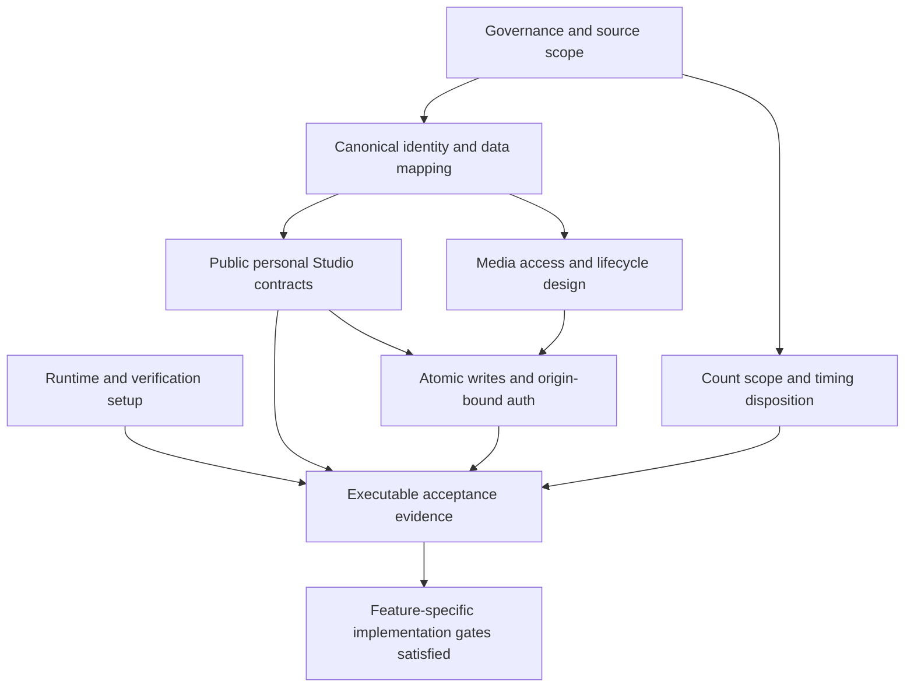

# Group 090 — Cross-Feature Technical Review

**Date:** 2026-11-09  
**Branch reference:** `090-artist-profile-studio-plan-tasks`  
**Scope:** Features 091, 092 and 093; documentation and checked-in implementation review only.  
**Disposition:** Suitable for joint technical review and constrained preparatory task planning; **not ready for unconditional implementation**. No existing decision is marked approved or closed by this review.

## 1. Executive summary

The three packages describe compatible core boundaries: anonymous public artist discovery (091), authenticated own-account following (092), and Artist-only owned-track Studio management (093). They correctly identify that browser mocks, route inventories and reference ER diagrams do not establish production authorization, deployed catalog tables or approved payloads. Audio replacement remains outside 093.

The **30 reported entries comprise nine 091-D entries, nine 092-F entries and twelve 093-S entries**. They are grouped below into **15 dependency clusters**, not 15 independently sufficient approvals. Governance and tooling entries are direct duplicates; identity, contracts, atomicity and lifecycle entries overlap only in part. Broad original entries remain traceable and may require several closure artifacts. No ID is removed, renumbered or silently resolved.

Most blocking uncertainty is technical, not a lack of product behavior: actual artist/track identity and ownership, catalog and follow persistence, safe and complete read interfaces, transaction execution, media storage/access, and deletion/history consistency. Several policy fragments are already settled by specifications or explicitly recorded owner decisions; repeating an approval request for those exact behaviors would be unnecessary. Their physical/API mappings are still open.

The main findings are:

- **High — Missing shared executable contracts:** all three interface artifacts deliberately stop before exact wire schemas; protected all-own-track/metrics retrieval is not defined. A route list cannot support final controller/service implementation or schema validation.
- **High — Cross-account mutation/replay risk:** current demo follow mutation resolves the account after a timer, and shared auth refresh can replay without an explicit originating-account check. Clearing a late UI response alone does not prevent a mutation under the wrong account.
- **High — Media publication/access is unproven:** filename-only Studio persistence is not binary upload; an openly readable permanent blob URL would bypass hide/delete playback rules. Provider selection and public-delivery authorization must be designed together.
- **High — Historical plays and deletion are not representable by a current-row sum:** recorded Studio behavior retains valid plays after track deletion, while current Studio sums remaining rows. A reviewed source and deletion strategy are required; this review selects neither a new ledger nor a retention policy.
- **High — Source lineage is inconsistent:** 093 uses supplemental G090-D01–D16 while 091 explicitly leaves G090-D17/D18 outside its plan. The later Group 090 record calls these owner-confirmed current-scope decisions, not team approval. Reconcile precedence/delivery scope rather than silently treating one subset as binding and another as irrelevant.
- **High — Upload acceptance timing needs formal disposition:** 093 SC-002 says 500 ms from submission for upload/store/catalog reflection. The recorded 50 MiB maximum at the Vision's 5 Mbps broadband condition has an ideal transfer time of approximately **83.9 seconds**, excluding processing. Measuring only post-transfer time or optimistic insertion would change the requirement.
- **Medium — Follow state cannot be inferred from arbitrary list absence:** an incomplete or visibility-filtered own list may omit a retained relationship. A complete-list protocol and visibility-race behavior are prerequisites for confirmed Not following.

No application build, live database/provider test, concurrency test or implementation acceptance result is claimed. Current source evidence supports a React/Vite/JavaScript + Express + backend Supabase/JWT integration baseline, not formal approval of every technology/provider listed in older project documents.

### Review evidence and authority

All three specifications, checklists and five planning artifacts per feature were read. Research registers were compared with the contracts/models/validation guides, not treated as the sole source of truth.

| Feature | Reviewed artifacts |
| --- | --- |
| 091 | [Spec](./091-artist-profile/spec.md), [requirements](./091-artist-profile/checklists/requirements.md), [plan](./091-artist-profile/plan.md), [research](./091-artist-profile/research.md), [data model](./091-artist-profile/data-model.md), [interface contract](./091-artist-profile/contracts/artist-profile.md), [validation guide](./091-artist-profile/quickstart.md) |
| 092 | [Spec](./092-follow-artist/spec.md), [requirements](./092-follow-artist/checklists/requirements.md), [plan](./092-follow-artist/plan.md), [research](./092-follow-artist/research.md), [data model](./092-follow-artist/data-model.md), [interface contract](./092-follow-artist/contracts/follow-artist.md), [validation guide](./092-follow-artist/quickstart.md) |
| 093 | [Spec](./093-artist-track-management/spec.md), [requirements](./093-artist-track-management/checklists/requirements.md), [plan](./093-artist-track-management/plan.md), [research](./093-artist-track-management/research.md), [data model](./093-artist-track-management/data-model.md), [interface contract](./093-artist-track-management/contracts/artist-track-management.md), [validation guide](./093-artist-track-management/quickstart.md) |

Cross-references: [Constitution](../../.specify/memory/constitution.md); [Vision](../../docs/proposal/Auratune_Vision_Document.md), particularly §3.3, §5.3.9 and §6; [Proposal](../../docs/proposal/proposal.md); [Project Plan](../../docs/proposal/project_plan.md), PC-03/04, ED-04–06, §3.2 and §4.3–4.6; [architecture](../../docs/design/architecture/system-architecture.md), [module responsibilities](../../docs/design/architecture/feature-modules.md), [role navigation](../../docs/design/architecture/role-navigation.md); [database guidance](../../docs/design/database/README.md), [ER](../../docs/design/database/er-diagram.md), [consistency](../../docs/design/database/data-consistency.md), [data security](../../docs/design/database/security-rules.md), [Firestore status](../../docs/design/database/firestore-collections.md); [API Contract](../../docs/analysis-and-design/api-contract.md), [API conventions](../../docs/design/api/api-conventions.md); [security](../../docs/design/security/README.md); [Team Contract](../../docs/management/team-contract.md); [Spec Kit guide](../../docs/management/speckit-workflow-guide.md); [current Group 090 owner decisions and linked UCs](../../docs/requirements/use-cases/090-artist-profile-studio/README.md).

“Latest” means the versions in this checkout; no fetch, merge, deployment or live-schema discovery occurred. Source priority must distinguish original FRs, explicit later owner decisions, unreviewed proposals and observed demo behavior. The Constitution is an unfilled template. Checklist ticks establish requirements review only. The shared API source actually resides in analysis-and-design; links in older documents naming a design/api contract are stale. No such document is created here.

## 2. Feature readiness matrix

| Feature | Requirements/design review readiness | Current implementation evidence | Critical implementation gates | Tasks-generation assessment |
| --- | --- | --- | --- | --- |
| 091 — Artist Profile | Core public states, exact ranking, privacy and partial failure are specified. Later owner-supplement lineage still needs reconciliation. | Existing artist route/UI, mock collections and one simulated load. No artist backend handlers or final wire schemas. | C02/C03/C05/C07; C13 selected-song handoff; C15 runnable verification; C01 governance disposition. | Prepare public-state/ranking/negative-authorization scenarios now. Full API/repository/navigation implementation decomposition waits for those contracts and mappings. |
| 092 — Follow Artist | Roles, ownership, hidden retention/unfollow, ordering, duplicate time and successful-processing order are explicit. Count scope remains conflicted. | Local follows/list and auth-backed shared client; no persistent follow routes/schema/transaction or final DTO. | C02/C04/C06/C08; C10 deletion integration; C11 count disposition; C15 verification. | Prepare personal state/account isolation/concurrency histories now. Persistent mutation and definitive negative-state implementation wait for identity, storage, completeness and transaction decisions. |
| 093 — Track Management | Core Studio flows plus separately sourced owner supplements are documented. No audio replacement or approval queue. | Existing Studio/local metadata/filename forms. No binary upload, media adapter, protected catalog/stat API or catalog migration. | C02/C03/C04/C05/C08/C09/C10/C12/C14/C15. | Prepare exact validation/confirmation/state/fault scenarios now. Storage, migrations, shared moderation updates, deduplication and distribution/deletion implementation remain gated. |

Review-ready does not mean peer-approved, implemented, measured or ratified. These are distinct capabilities with distinct gates; 091 identity need not wait for all Studio delivery, and 092 does not depend on playlists or song navigation.

## 3. Consolidated decision register with traceability

### Classification and ownership

**E — Evidence-resolvable fragment:** existing source can settle that fragment without a new product vote. **A — Approval/design required:** actual shared technical or product choice is absent/conflicted. **V — Verification required:** implementation/live evidence must demonstrate the selected design. Entries can contain all three; E never automatically closes an entire bundled original entry.

Owners below are coordination responsibilities established by the [Team Contract](../../docs/management/team-contract.md) and [Project Plan §3.2](../../docs/proposal/project_plan.md): **Hoàng** — 090/110/cloud media; **Đăng** — database/search/albums; **Khoa** — auth/history/playlists; **Huy** — player/queue; **Nhựt** — architecture/deployment/team leader. These are not new task assignments or invented approvers. A named frontend-foundation decision owner is not established; use the team's normal assignment process rather than infer a person. Team Contract §6 uses majority decisions, with Nhựt for ties/critical technical disputes; this review does not exercise that authority.

### Shared dependency clusters

| Cluster | Original entries / overlap | Evidence-resolvable portion | Remaining choice and evidence required to close | Established coordination roles | Work blocked |
| --- | --- | --- | --- | --- | --- |
| **C01 — Governance** | 091-D01, 092-F01, 093-S01: direct duplicates | E: Constitution contains placeholders, not ratified gates; Team Contract workflow exists. | A: ratified constitution or documented interim disposition under established governance. Acknowledge that no constitutional sign-off currently exists; do not fabricate a waiver. | Nhựt/team | Formal governance/implementation approval claims; does not prohibit evidence gathering or review. |
| **C02 — Identity, artist visibility and management ownership** | 091-D02; 092-F02 and identity part of F03; 093-S02 and identity part of S03: partial overlaps | E: public artist privacy, own-account follows, Artist-only Studio, optional account→artist reference, current auth principal fields. | A/V: canonical account/artist key mapping against actual catalog; public/disabled predicate and ban relationship; artist link; co-credit versus management permission; behavior for unlinked Artist. Reviewed mapping/policy and negative access tests. Do not infer profile hidden = user banned or credit = owner. | Hoàng, Đăng, Khoa | Artist validation/projections, protected follow/Studio queries and writes, cross-feature authorization. |
| **C03 — Catalog attribution, metadata and deterministic comparison** | 091-D03/D05 and catalog part of D02; 093-S03 and attribution part of S02 | E: 091 exact sorting/limits; no external popularity; optional album input and bounded edit scope; reference album-only relationships. | A/V: standalone/multi-artist attribution, album-name/ID/clear semantics, genre/duration/rights/media mappings, canonical song release/count source, missing-value policy and typed ID/title collation. Schema/migration evidence plus deterministic fixtures; no new table/column is selected here. | Đăng, Hoàng; Khoa for plays/history | Faithful featured/albums/related-playlist reads, albumless own uploads, metadata repositories and sort execution. |
| **C04 — Shared auth, session-bound replay and errors** | 092-F06; auth portions of 093-S05/S07; public-mode integration from 091-D06 | E: current JWT/session/Firebase exchange and refresh exist; shared envelope and banned 403 vocabulary established; public 091 has no required auth. | A/V: account/session-bound refresh and replay, revocation/long-upload finalization ordering, normalization without breaking auth callers; agreed generic outage handling if extending shared vocabulary. Demonstrate A→B/logout/same-account-new-session races and no unsafe POST replay. | Khoa, Hoàng; Nhựt for shared architecture dispute | Safe 092/093 client integration, consistent auth middleware failures; must not block anonymous 091 content. |
| **C05 — Public/Studio interfaces, failure isolation and complete collections** | 091-D06/D07; interface/read portions of 093-S05: related infrastructure, not one DTO | E: existing public artist paths and song mutations, response envelope, all eligible albums and all own Studio tracks, empty ≠ error. | A/V: exact public and protected wire contracts/OpenAPI, identity/featured failure composition and targeted retry, protected own catalog/metrics read capability, PUT/visibility/delete shape, album/Studio completeness under row caps and concurrent changes. Preserve different public/private projections; no new path/field assumed. | Hoàng, Đăng; Khoa for auth/API integration | Controllers/adapters, protected reads, full album/catalog integration, final schema-validation tests. |
| **C06 — Follow persistence, original time and authoritative state recognition** | 092-F03/F05; canonical artist-ID portion of 091-D05 | E: composite reference pair, duplicate follow retains time, refollow creates new time, exact order, only existing follow/list capabilities. | A/V: actual relation schema/timestamp and historic mapping, mutation/no-op responses, safe hidden-unfollow/no-own-relation result, complete own-list semantics and visibility-race proof. Absence from partial/hidden-filtered list is not negative proof. No status endpoint or public personal field silently added. | Hoàng, Đăng, Khoa | Durable follows/list/order, confirmed Not following, reconciliation after uncertain outcomes. |
| **C07 — Official related playlists** | 091-D04; 093-S08 consumes resulting eligibility only | E: official AND public, at least one eligible artist song, ≤6 by update DESC/ID ASC; qualifying song need not be featured. | A/V: authoritative official designation, public-state mapping and update-time semantics; schema/source evidence and stale-membership fixtures. Admin owner/creation route alone does not establish designation. | Khoa, Hoàng, Đăng | Correct 091 related-playlist query; does not block personal follows or Studio metadata forms. |
| **C08 — Atomic database processing and concurrent moderation** | 092-F04; atomicity portion of 093-S07; race protection in 093-S10: shared execution capability, distinct invariants | E: 092 successful-processing order and duplicate time; recorded G090-D08 Studio processing/no-resurrection rule; Artist cannot clear Admin restriction. | A/V: actual atomic transaction/function/conditional execution boundary, serialization when relation absent, multi-worker ordering, moderation coordination and durable rollback; review any introduced database capability. Locking a relation row/Node mutex alone is insufficient; no RPC/lock key/table chosen. | Đăng, Hoàng, Khoa; Nhựt architectural coordination | Persistent opposing follow writes; safe edit/hide/delete/finalize and count atomicity if approved. |
| **C09 — Binary media persistence, delivery and cross-service recovery** | 093-S06/S08 and storage portion of S07 | E: actual audio persistence and stable playable association required; recorded MP3/size and D07 new-start behavior have evidence; storage examples are not selection. | A/V: selected provider/parser/content checks/config, stable-reference versus public-delivery semantics, range behavior, no raw-URL bypass, safe upload staging, media→DB failure/cleanup reconciliation and same-submission identity. Provider spike/milestone claim alone is insufficient; no cleanup TTL or idempotency header invented. | Hoàng, Huy, Đăng; Nhựt provider/architecture coordination | Real uploads, public streaming enforcement, safe retries, hide/delete distribution acceptance. |
| **C10 — Lifecycle, plays and deletion consistency** | 092-F08; 093-S09; lifecycle/metrics parts of S03 and 091-D05 | E: retain follows/time on hiding; deleted artists absent and unknown/deleted unfollow equivalent; hidden song plays preserved; recorded Studio historical total includes deleted tracks. | A/V: approved user/artist/track deletion references and object cleanup, source preserving historical Studio plays, FK/history/playlist behavior, attribution and recording/aggregate consistency. Separate artist deletion from track deletion; no guessed cascades, tombstones, ledger or retention. | Đăng, Hoàng, Khoa; Huy for active queue/stream boundary | Reliable delete integration and metrics after deletion; lifecycle migrations. Existing hidden-follow behavior need not wait for a new product decision. |
| **C11 — Follower-count scope** | 092-F07, not 093 track/plays metrics | E: Vision FR-090-002 requests realtime follower counts; 092 assumes no counts and requires next-successful-load cross-device behavior. No count API/column exists in contract evidence. | A: reconcile count scope/audience/freshness and membership policy (including banned/deleted accounts) or explicitly defer Vision coverage through authorized scope decision. V: if included, authoritative aggregate/no-op/race tests. No stored counter chosen. | Hoàng, Nhựt/team; Đăng/Khoa technical coordination | Any count feature and full Vision-count completion claim; core follow semantics are already fixed and can be designed independently after explicit scope disposition. |
| **C12 — Source lineage, publication and Admin boundary** | 093-S04/S10; 091 handling of G090-D17/D18 is a related conflict, not a new original ID | E: immediate valid active upload/no prior approval; audio replacement deferred; later owner D01–D18 are explicitly recorded, not group approval. | A: one documented source-precedence/delivery-scope disposition, especially 091 share/selection supplements, file-format drift and broader Vision gaps. V/design: restriction representation and truthful restore responses; separate Admin/Artist branches. Do not reopen recorded exact decisions without an explicit change request. | Hoàng, Nhựt/team; Đăng for shared state design | Final scope baseline and safe common song updates; no Artist approval/unrestrict/replacement workflow may be generated meanwhile. |
| **C13 — Selected-song handoff** | 091-D09 | E: current full-player callback, album/playlist routes and share helper exist; there is no song route. | A/V: Hoàng/Huy confirm intended existing selected-song destination satisfies FR-015, document handoff and unavailable behavior. Do not fabricate `/song/:id` or assume search is the selected song. | Huy, Hoàng | 091 song selection acceptance; does not block album/playlist links, following or Studio. |
| **C14 — Upload timing feasibility** | 093-S11 | E: literal 500ms submission-to-store/catalog target; owner-recorded 50MiB; Vision network guidance. | A: agree measurement envelope consistent with literal requirement, or separately authorize a requirements change if infeasible; V: real timing, not optimistic UI/post-transfer stopwatch. | Hoàng, Huy, Nhựt | Credible SC-002 implementation/acceptance claim and final performance design. |
| **C15 — Runtime and verification tooling** | 091-D08, 092-F09, 093-S12: direct duplicate shared setup need, different scenario coverage | E: current manifests/scripts and absent feature harness/runtime pin; Feature 131 test tools are proposals. | A/V: supported runtime and reviewed shared harness, actual unit/component/API/database/media/browser commands, runnable environment and evidence. Do not label planned tools as installed. | Nhựt architecture; Hoàng feature verification; team assigns unnamed foundation role | Executable automated checks and test infrastructure-dependent work; written scenarios/review remain possible. |

### Original-ID coverage ledger: 30 of 30

Each link preserves the original register location. The mapping is many-to-many; clusters are grouping labels, not replacements or approval IDs. Every original entry remains open in its source artifact.

| Original ID and source | Consolidated coverage | Review disposition |
| --- | --- | --- |
| [091-D01](./091-artist-profile/research.md#unresolved-decisions-and-implementation-gates) | C01 | Governance duplicate; current missing status established, ratification/disposition open |
| [091-D02](./091-artist-profile/research.md#unresolved-decisions-and-implementation-gates) | C02/C03 | Split identity/visibility from catalog mapping; partial E, A/V open |
| [091-D03](./091-artist-profile/research.md#unresolved-decisions-and-implementation-gates) | C03 | Attribution/source design open |
| [091-D04](./091-artist-profile/research.md#unresolved-decisions-and-implementation-gates) | C07 | Eligibility rule known; designation/update mapping open |
| [091-D05](./091-artist-profile/research.md#unresolved-decisions-and-implementation-gates) | C03/C06/C10 | Sorting rules known; input/null/type/history mappings open |
| [091-D06](./091-artist-profile/research.md#unresolved-decisions-and-implementation-gates) | C04/C05 | Public independence known; composition/DTO integration open |
| [091-D07](./091-artist-profile/research.md#unresolved-decisions-and-implementation-gates) | C05 | All albums required; complete transport open |
| [091-D08](./091-artist-profile/research.md#unresolved-decisions-and-implementation-gates) | C15 | Shared tooling duplicate |
| [091-D09](./091-artist-profile/research.md#unresolved-decisions-and-implementation-gates) | C13 | Existing mechanisms observed; selected-song contract not confirmed |
| [092-F01](./092-follow-artist/research.md#decision-register) | C01 | Governance duplicate |
| [092-F02](./092-follow-artist/research.md#decision-register) | C02 | Shared artist policy; follow permission itself already known |
| [092-F03](./092-follow-artist/research.md#decision-register) | C02/C06 | Owner/artist key mapping and original-time persistence open |
| [092-F04](./092-follow-artist/research.md#decision-register) | C08 | Processing rule known; database mechanism/evidence open |
| [092-F05](./092-follow-artist/research.md#decision-register) | C06 | DTO/no-op/completeness/hidden-negative-state gap open |
| [092-F06](./092-follow-artist/research.md#decision-register) | C04 | Normative auth/error behavior known; safe implementation/replay open |
| [092-F07](./092-follow-artist/research.md#decision-register) | C11 | Product/source scope conflict requires disposition |
| [092-F08](./092-follow-artist/research.md#decision-register) | C10 | Observable outcomes known; storage/cleanup open |
| [092-F09](./092-follow-artist/research.md#decision-register) | C15 | Shared tooling duplicate |
| [093-S01](./093-artist-track-management/research.md#decision-register) | C01 | Governance duplicate |
| [093-S02](./093-artist-track-management/research.md#decision-register) | C02/C03 | Artist/track management identity and attribution mapping open |
| [093-S03](./093-artist-track-management/research.md#decision-register) | C02/C03/C10 | Broad catalog/rights/media/metrics mapping; do not close from one schema fact |
| [093-S04](./093-artist-track-management/research.md#decision-register) | C12 | Exact owner decisions evidenced; source/delivery reconciliation open |
| [093-S05](./093-artist-track-management/research.md#decision-register) | C04/C05 | Safe Studio read and mutation contracts missing; shared auth drift |
| [093-S06](./093-artist-track-management/research.md#decision-register) | C09 | Cloud media required; provider/parser/config open |
| [093-S07](./093-artist-track-management/research.md#decision-register) | C04/C08/C09 | Distinct auth/atomicity/media-reconciliation mechanisms; no single follow lock resolves all |
| [093-S08](./093-artist-track-management/research.md#decision-register) | C09 | Required public outcomes evidenced; delivery/cache enforcement open |
| [093-S09](./093-artist-track-management/research.md#decision-register) | C10 | Delete/history invariants evidenced; physical lifecycle open |
| [093-S10](./093-artist-track-management/research.md#decision-register) | C08/C12 | No moderation override known; shared state/race mechanism open |
| [093-S11](./093-artist-track-management/research.md#decision-register) | C14 | Target exists; feasible acceptance envelope/change approval unresolved |
| [093-S12](./093-artist-track-management/research.md#decision-register) | C15 | Shared tooling duplicate |

## 4. Shared dependencies and integration conflicts

### 4.1 Identity, visibility and role boundaries

There are three separate questions: which account is authenticated, which Artist/track that account may manage, and what content the public may see. The reference ER's optional artist-account link does not prove every `artist` role has a valid artist record, and display credit alone does not establish management permission. Current auth migration uses `users.id` plus unique `user_id`, whereas the ER describes `user_id` as primary; reconcile the actual key, do not choose an arbitrary cast or browser slug.

The correct shared behavior is already stated in the feature sources:

| Surface | Allowed principal / policy | Critical distinction |
| --- | --- | --- |
| 091 artist detail and children | Anonymous public eligible data; no private role bypass | Non-public and nonexistent artist have identical not-found; every child rechecks parent |
| 092 own follows/list | Authenticated non-banned User/Artist/Admin, own account only | Admin has no cross-account following privilege |
| 092 follow | Existing public artist | Visibility rechecked at processing, not only when button rendered |
| 092 unfollow | Own relation may target an existing hidden artist | A universal public-parent guard would incorrectly reject approved hidden-owner removal |
| 093 Studio | Authenticated non-banned linked Artist managing own tracks | User/Admin Studio access denied; separate shared Admin song capability remains Group 110-owned |

Track hiding/deletion does not hide/delete an Artist profile or change follow relationships/time. Conversely, a non-public Artist profile does not automatically revoke linked Artist Studio access; missing ban/profile-disable linkage remains C02. Public Artist viewability and track public preference/moderation must not become one overloaded client-editable flag.

### 4.2 Authentication and current-code drift

[Auth middleware](../../src/backend/middleware/authMiddleware.js) verifies JWT/session/current user and role but returns ad hoc `status` bodies, uses 401 for banned users, and a generic storage 503. [Shared API Contract](../../docs/analysis-and-design/api-contract.md) requires its standard envelope and defines 403/USER_BANNED; its listed 503/AI_SERVICE_UNAVAILABLE is AI-specific. Align established failures, and obtain agreement before adding general outage vocabulary. Do not copy drift into new feature contracts or rewrite auth wholesale.

[Session API client](../../src/frontend/src/services/sessionApiClient.js) attaches current credentials and shares a refresh promise, then retries using the returned access token without an explicit origin-account/session comparison. [AppStore](../../src/frontend/src/context/AppStore.jsx) mock follow resolves `stateRef.current.session` after its delay. These are concrete checked-in integration risks, not demonstrated production incidents. Verify storage effects as well as displayed state in A→B/logout/refresh races. A fetch abort or stale-response guard cannot reverse an already executed mutation.

091's auth-independent public mode and 092/093's protected mode are compatible requirements, not reasons to fork credential systems. Account binding belongs in one coordinated session integration. No bearer token, Firebase token, cookie or service-role mechanism is invented here.

### 4.3 Follow recognition, counts and lifecycle

An own-list response intentionally filters hidden profiles. Therefore its absence of the target does not prove the relationship was removed if visibility changed between 091 identity load and 092 recognition. A backend row cap also invalidates negative inference. C06 closure must demonstrate recognition under both conditions and uncertainty recovery using approved existing capabilities. Do not “solve” this by leaking hidden relations or adding an unapproved status endpoint/public personal field.

There are three distinct quantities: an artist's follower total, the owner's visible followed-artist list length, and Studio track/play metrics. They cannot substitute for one another. Vision count scope conflicts with 092's explicit no-count assumption; new count semantics require C11 disposition. Duplicate/no-op relation writes cannot change any eventual approved aggregate. Hidden relationship retention/restoration and original time are already settled; deletion cleanup is not.

### 4.4 Catalog representation and metric continuity

The reference catalog traverses songs through albums, but 093 permits no album and 091 allows songs associated with one or more artists. Neither a forced placeholder album nor a new direct owner/join structure is approved. Album-name entry/clear behavior must map to canonical releases without granting album CRUD or cross-owner assignment. This is a shared C03 dependency, not an independent schema per page.

091 exact ordering is settled. Inputs are not: release dates, canonical plays, nulls, typed IDs and title collation need agreed mapping. [AppStore](../../src/frontend/src/context/AppStore.jsx) currently invents upload-date release values and mock ownership/zero-play metadata; those are prototype defaults, not authority. Admin creation is not sufficient evidence of official playlist designation. Count-producing listening logic remains history-owned.

Recorded G090-D06 keeps Studio historical plays after track deletion. [StudioPage](../../src/frontend/src/pages/Studio/StudioPage.jsx) sums current manageable rows, so using that implementation as final metrics would violate the supplemental behavior. Preserving the observable history does not select physical-row retention, a ledger, cascade policy or platform-stat formula. Deleted-artist follow cleanup and deleted-track media/history cleanup must be reviewed separately.

### 4.5 Public, personal and Studio API composition

[Server](../../src/backend/server.js) currently mounts auth, Firebase exchange and health, with generic fallback; the catalog/follow/media paths in shared documentation are not implemented handlers. [Auth migration](../../src/database/migrations/001_auth_tables.sql) does not establish a catalog/follow deployment. [Supabase client](../../src/database/supabaseClient.js) service-role credentials are server-only; they do not supply a safe public projection or prove Supabase Storage was selected.

091 detail is documented as identity plus featured songs. Its plan properly leaves partial-featured failure and targeted retry unresolved rather than invent embedded section keys or silently repurpose general artist-song retrieval. 093 needs private own-catalog/metrics reads absent from the current API inventory; public `/songs?artist_id=...` or Admin catalog endpoints are not safe substitutes. 092 must not append personal state to public 091 DTOs.

All three Markdown contracts are interface requirements awaiting concrete wire design. They satisfy review documentation needs but **not** Vision's final OpenAPI 3.0.3/schema-validation requirement. Decide exact payloads/statuses/complete transport with owners; no assumption of a field, cursor, limit or route is made in this review.

### 4.6 Publication, moderation, storage and retry

093 specification/checklist support active publication immediately after validation, with no prior Admin approval. Separate existing Admin restriction may still prevent effective public availability. Artist restore changes preference only; it cannot clear restriction, recreate deleted content or truthfully claim public availability while restricted. Sharing this policy is mandatory; sharing one writable status value is not an approved implementation.

[StudioPage](../../src/frontend/src/pages/Studio/StudioPage.jsx) captures filename only; [backend manifest](../../src/backend/package.json) has no multipart/media adapter dependency. A cloud-storage example or Project Plan BLD-02 spike claim does not close provider selection/integration evidence. Media persistence, catalog commit and uncertain retries require a recoverable boundary: no partial public row, no duplicate same-submission retry, no mistaken cleanup of committed assets. A title/file hash is not an approved submission identity.

Recorded G090-D07 denies new starts after hide/delete, including direct URL/repeat, while allowing playback already started to finish. A permanent publicly readable raw object URL may evade backend eligibility. Evaluate storage and stream/range/CDN/cache enforcement together; do not choose a provider first and defer this acceptance constraint. A multi-call Supabase sequence or in-process mutex alone proves neither multi-worker transaction order nor media/database atomicity.

### 4.7 Source lineage, timing and scope conflicts

The [Group 090 decision record](../../docs/requirements/use-cases/090-artist-profile-studio/README.md) preserves owner-confirmed G090-D01–D18 and explicitly says this is not source-spec modification or group approval. 093 incorporates D01–D16 with provenance; 091 explicitly excludes D17 selection-return and D18 share additions from its plan. **This is an unresolved delivery/source-precedence conflict**, not proof those owner decisions never occurred. Apply one documented treatment across the group. Preserve the current authoritative FRs until an authorized alignment pass; do not silently add share UI or silently discard recorded owner scope.

Other differences must be labelled accurately:

- MP3/WAV mock label and `audio/*` implementation versus Vision MP3/FLAC versus recorded MP3-only ≤50 MiB: owner decision is evidenced; shared source reconciliation is pending.
- Demo edit maxLength 100 versus recorded edit-only 200 Unicode code points: a known mismatch; do not extend the latter to upload automatically.
- Vision broader cover/lyrics/release-date/full-album goals versus 093 bounded fields: recorded deferrals/scope gaps, not authority to expand 093.
- Artist delete confirmation versus potentially different Admin removal behavior: separate actors/actions are not inherently contradictory. Do not transplant Group 110 one-click/approval semantics into Studio.
- Audio replacement: unsupported by 093 and explicitly future scope in the Group record. No replacement form, endpoint, version policy or task is eligible.

For C14, the transfer estimate is an inference from documented values: `52,428,800 × 8 / 5,000,000 = 83.88608 seconds`. Completing just that transfer in 0.5 seconds would need about 839 Mbps before overhead. This does not establish a new SLA or prove every upload is impossible; it demonstrates that the full allowed maximum cannot meet the literal target at the Vision's broadband condition. Measurement conditions or requirements disposition must be explicit; do not narrow acceptance silently.

A further current-prototype hardening case is malformed percent-encoded route IDs: [AppRouter](../../src/frontend/src/routes/AppRouter.jsx) decodes matched IDs with `decodeURIComponent` without an explicit local error boundary. Include frontend malformed-ID handling in C02/C05 verification, not just backend validation tests. This is a verification gap, not a 31st approved product decision.

## 5. Decisions requiring team approval or shared design agreement

The following approvals are absent from the reviewed sources. Existing owner responsibilities identify coordination, not evidence of a completed vote or architecture sign-off.

| Approval/disposition needed | Clusters | Required recorded result |
| --- | --- | --- |
| Constitution/governance disposition | C01 | Ratified principles or explicit handling of the template gap through established governance |
| Shared identity/visibility/ownership and actual catalog/follow model | C02/C03/C06 | Reviewed key/predicate/association/time mapping and minimal required persistence design, including unlinked/co-credited cases |
| Exact interfaces and read completeness | C05/C06/C07 | Reviewed public/personal/Studio request-response contracts, safe collection traversal and official designation/update source; final OpenAPI before wire implementation |
| Transaction, moderation and media consistency architecture | C08/C09/C10/C12 | Approved database execution and storage/delivery/lifecycle mechanism; concurrency/retry/cleanup/security evidence |
| Follower count scope and freshness | C11 | Scope inclusion with defined semantics or explicit authorized deferral of Vision coverage; no count field assumed |
| Group source lineage/delivery alignment | C12 | Uniform treatment of owner supplements and documented broader Vision deferrals; no invented legal/license/approval behavior |
| Existing selected-song handoff | C13 | Confirmation by established feature/player owners of the existing destination and correct unavailable behavior |
| 500ms feasibility and acceptance envelope | C14 | Measurable literal acceptance conditions, or separately authorized requirement change; no stopwatch redefinition |
| Runtime/test harness selection where not already established elsewhere | C15 | Actual supported runtime, installed/selected shared tooling and commands; local environment repair is verification, not product policy |

Source-only fixes such as using the actual API documentation location, established role rules or standard banned error mapping do not need a new product decision. Their implementation can still depend on coordinated shared-code design and tests. No decision is approved by this review, and no stakeholder is contacted.

## 6. Decisions resolvable from existing sources

These evidence-backed fragments can be documented in a later authorized alignment pass without inventing policy. They do **not** close their entire original technical entry.

| Settled fragment | Evidence | What remains open |
| --- | --- | --- |
| Public profile anonymous access, hidden/not-found equivalence, no private fields | [091 FR-006–008/018/018A/023](./091-artist-profile/spec.md) | Actual predicate/key/projection and safe DTO/error implementation C02/C05 |
| Featured ≤5, albums all, official playlists ≤6; exact order/filter-before-limit/dedup; AuraTune plays only | [091 FR-009–014A/022/027](./091-artist-profile/spec.md) | Canonical inputs, collation/nulls, source designation, complete queries C03/C05/C07 |
| Personal roles, own-account scope, hidden retention/owner unfollow, original time and processing order | [092 FR-001–016](./092-follow-artist/spec.md) and [checklist](./092-follow-artist/checklists/requirements.md) | Persistence/time, safe state recognition, transaction and lifecycle C02/C06/C08/C10 |
| Artist-only Studio, no Admin Studio bypass, immediate active upload/no prior review, no deleted restore | [093 FR-001/007/008](./093-artist-track-management/spec.md) and [checklist resolved decisions](./093-artist-track-management/checklists/requirements.md) | Management mapping, shared Admin branch/state and physical lifecycle C02/C10/C12 |
| Existing bearer/session mechanism, shared JSON vocabulary, API source path | [Shared API](../../docs/analysis-and-design/api-contract.md), [auth helpers](../../src/backend/utils/authHelpers.js), [auth middleware](../../src/backend/middleware/authMiddleware.js) | Fix implementation drift and bind origin refresh/replay C04; do not reopen auth-provider selection |
| Reference relationship uniqueness and nullable artist link | [ER](../../docs/design/database/er-diagram.md) | Actual deployed mappings, timestamp and standalone ownership; no catalog migration supplied C02/C03/C06 |
| Recorded MP3-only/50MiB, rights declaration, entered duration, edit-only 200-code-point rules | [G090-D01–D04/D15/D16](../../docs/requirements/use-cases/090-artist-profile-studio/README.md) | Uniform provenance alignment, DTO/storage/parser mapping C03/C09/C12; no proof of team approval |
| Recorded independent restriction, historical plays, new-start playback, uncertainty/manual recovery and draft lifecycle | [G090-D05–D14](../../docs/requirements/use-cases/090-artist-profile-studio/README.md) | Actual shared state, persistence, media/transaction/recovery design C04/C08/C09/C10/C12 |
| Recorded selection-return and share-owner decisions exist | [G090-D17/D18](../../docs/requirements/use-cases/090-artist-profile-studio/README.md) | Resolve explicit 091 planning/delivery exclusion through C12; existence is not new shared-contract approval |
| Audio replacement is outside current 093 | [093 metadata-edit scope](./093-artist-track-management/spec.md), [093 plan boundary](./093-artist-track-management/plan.md#metadata-edit-and-audio-replacement-boundary), [Group deferred scope](../../docs/requirements/use-cases/090-artist-profile-studio/README.md) | No replacement implementation work; scope change would require separate authorization |
| React/Vite/Express/JWT/server Supabase integration exists; Firebase does not prove Firestore/media provider | [Frontend manifest](../../src/frontend/package.json), [backend manifest](../../src/backend/package.json), [server](../../src/backend/server.js), [Supabase client](../../src/database/supabaseClient.js), [Firestore note](../../docs/design/database/firestore-collections.md) | Catalog/media deployment and shared runtime/test choices remain open; installed baseline is not all-provider ratification |

No complete original bundled decision is newly declared closed. The useful reduction is avoiding repeated votes for already stated behavioral rules while concentrating approvals on absent mappings and genuine conflicts.

## 7. Recommended resolution order

1. **Establish provenance and scope disposition:** C01/C12, including recorded supplements, count scope C11 and upload acceptance C14. This avoids designing against incompatible delivery assumptions. Keep audio replacement excluded.
2. **Confirm one identity/catalog source:** C02/C03, including actual account/artist keys, ownership/attribution, albumless songs, public/track/Admin predicates, canonical count/release sources and follow time. Use permitted synthetic data; no guessed migration.
3. **Define observable interfaces jointly:** C05/C06/C07/C13. Keep public, personal and Studio projections separate. Specify completeness, partial failures, safe negative-state recognition and song handoff. Public identity/basic 092 contracts can proceed independently of playlist details.
4. **Resolve media and lifecycle together:** C09/C10/C12, with Huy/Hoàng/Đăng/Khoa responsibilities as applicable. Verify permanent-reference delivery, new-start denial, historical metrics and cleanup before committing to storage.
5. **Select shared atomic execution and auth integration:** C04/C08, using the chosen model/storage requirements. Define authorization at processing/finalization and no resurrection/duplicate submission. Follows do not need to await audio upload implementation once their own subset is resolved.
6. **Establish verification early and throughout:** C15 may progress in parallel with the earlier design discussions; it is not a reason to defer written scenario work. Run identity/privacy, complete-read, concurrency/media-fault and timing checks once corresponding designs exist.
7. **Record closure against all affected original IDs:** one accepted evidence artifact may satisfy duplicate fragments across features. After authorized plan alignment, regenerate readiness assessments; do not independently invent the same shared policy three times.

This is resolution ordering, not a deployment plan or a generated Tasks file. Shared verification may run as soon as its prerequisites are available.

## 8. Implementation readiness gates

| Gate | Required closure evidence | Current status / blocked surface |
| --- | --- | --- |
| G1 — Governance and delivery baseline | C01/C12 disposition and explicit count/timing treatment where relevant | Open; no group-wide implementation approval |
| G2 — Identity, ownership and viewability | C02/C03 reviewed mapping and negative matrix across anonymous/all roles/Artist owners | Open; real repository/policy implementation gated |
| G3 — Executable contracts/completeness | Approved per-surface OpenAPI 3.0.3, exact examples, safe errors, targeted partial retry, complete albums/follows/Studio | Open C05/C06/C07; final wire integration/schema validation gated |
| G4 — Safe sessions and atomic processing | Origin-bound refresh/replay, current auth checks, multi-worker commit histories, original follow time and no resurrection | Open C04/C08; mutation correctness unproven |
| G5 — Media, distribution and lifecycle | Actual binary persistence, selected safe access/range delivery, response-loss recovery, delete/history/cleanup consistency | Open C09/C10; 093 upload/hide/delete delivery gated |
| G6 — Shared moderation boundary | Artist preference cannot clear Admin restriction; correct role branches and truthful restore output | Behavior evidenced, implementation design/tests open C12/C08 |
| G7 — Runnable verification | Actual runtime/harness plus passed feature-specific tests, browser/keyboard/privacy/query/latency evidence | Open C15; planned guide is not passed tests |
| G8 — Feature acceptance | 091 song handoff/usability/performance; 092 own-state/ordering/concurrency; 093 literal timing and media lifecycle | Open C13/C14 and feature validations; no SC pass claimed |

Not every gate blocks every line of preparatory work. For example, C07 does not block follow-only schema research; C14 does not block a documented duration-validation scenario. It does block asserting a completed implementation/acceptance package.

## 9. Tasks-generation readiness assessment

The [Spec Kit Tasks workflow](../../.agents/skills/speckit-tasks/SKILL.md) reads plans/specs and requires generated tasks to be specific and immediately executable; the [project workflow](../../docs/management/speckit-workflow-guide.md) also requires coherent design and dependencies. File presence is sufficient for mechanical discovery, not evidence that unresolved wire schemas can be implemented. No setup/tasks generation command was run during this review.

**Assessment:** limited preparatory/discovery work can be planned without further product approval. An unconditional end-to-end implementation task set for any feature is premature. The categories below assess eligibility for a later authorized Tasks pass; they are not task IDs, checkboxes, assignments or Tasks output.

| Work category | Can safely be decomposed now? | Boundary / dependency to preserve |
| --- | --- | --- |
| Source inventory, original-ID traceability, gathering existing schema/config/spike evidence without secrets | Yes | Investigation/recording only; discovery must not select absent provider/schema as approved |
| Draft proposed contracts/decision alternatives for review | Yes | Deliver a reviewable design; acceptance requires named existing responsibility process, not implicit approval |
| Written 091 eligibility/order/dedup/empty/error/privacy cases and conceptual fixtures | Yes | Exact FR comparators/limits known; no physical columns, null defaults or canonical ID collation guessed |
| Written 092 account/role/hidden/duplicate/original-time/processing histories and UI state scenarios | Yes | No state endpoint/payload, hidden disclosure or list-prefix false negative; runtime execution later depends on C15/model/contracts |
| Core duration validation, form cancellation/confirmation/state behavior using existing UI seams | Yes, within confirmed scope | Exact regex and delete confirmation already specified; supplemental source-dependent controls remain subject to C12 alignment; no binary replacement |
| Read-only audit/proof of shared-client account-replay and malformed-route risks | Yes | Demonstrate existing behavior with safe fixtures; code repair execution is outside this review and may depend on shared auth design |
| Harness/runtime discovery and documenting candidate setup | Yes | Selecting/installing a new shared runner/runtime is C15 design agreement; do not claim proposed tooling installed |
| Production catalog/follow migrations and concrete repository queries | No | C02/C03/C06 and lifecycle dependencies; no guessed timestamp, join/owner table or cascade |
| Final public partial-success/Studio read/personal state adapters and handlers | No | C05/C06/C07 exact contracts/completeness; do not invent field names/routes |
| Persistent follow transaction/reconciliation implementation | No | C04/C06/C08 actual identity/atomic/read protocol; UI timer is not a valid substitute |
| Binary upload/provider/parser/dedup/access/cleanup implementation | No | C09/C10/C12 and C14 acceptance disposition; no guessed storage/limits or unsafe direct URL |
| Follow counts, new approval states, new lyric/cover/full-album or audio-replacement workflows | No | Count scope needs C11; other additions exceed current scope; replacement explicitly excluded |
| Declaring completed feature tests, performance or implementation approval | No | Requires actual G1–G8 evidence, not checklist ticks or prototype screenshots |

If preparatory work is later included in Tasks, distinguish an executable evidence/design deliverable from an implementation promise. Do not write a broad “implement API/schema; decide details later” task. After a decision closes, downstream user-story work may be decomposed with explicit dependencies; unrelated open clusters should not unnecessarily block that subset. No whole-group rewrite, router migration or new infrastructure is justified by this review.

## 10. Final recommendations for proceeding to `/speckit.tasks`

Proceed first with the evidence/design-resolution subset under explicit later authorization. Preserve original IDs and use the clusters here to coordinate closure; approve shared facts once and link their evidence into each affected plan in a separately authorized alignment pass. Prioritize identity/visibility, contracts/read completeness, origin-bound auth, and media/lifecycle architecture over page-level implementation.

Before requesting a full implementation-oriented `/speckit.tasks` pass, provide: a consistent source/delivery baseline; reviewed key/schema/policy mappings; exact public/personal/Studio contracts; concrete transaction/media/reconciliation designs; count and 500ms dispositions; and selected runnable verification tooling. Require review of any changes to product requirements instead of silently modifying scope. No audio-replacement work should appear.

091 public identity and 092 core follows can be sequenced before 093 media delivery once their own gates close. Protect 091 from personal-auth failures, protect 092 from hidden/partial-list false negatives, and protect 093 from moderation overwrite and public-object bypass. Neither follower counts nor broad album management should be smuggled into those increments.

This review makes **no approval, task-generation or runtime-completion claim**. It creates only this document, leaves all 30 original decision entries and all feature artifacts unchanged, and does not alter application code or Git branches.

### Review validation record

Validation is limited to source inspection, original-ID accounting, document links and file-scope preservation. Automated ledger checks found exactly 30 unique original IDs, matching all 30 source-register rows, with no missing or extra IDs; all 15 clusters and ten requested sections are present. All relative file links resolve and referenced section anchors match their target headings. Before/after CRC/byte-length comparison found all 1,014 pre-existing checked files unchanged, including 091/092/093 specs/checklists/plans and application code, with this review document the sole addition. The branch reference remains `090-artist-profile-studio-plan-tasks`; no Git mutation or Tasks generation was invoked. No application tests or live provider/schema checks were executed; the current shell has no available Node executable.
