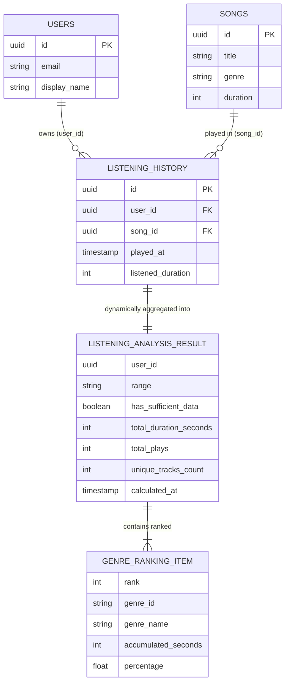
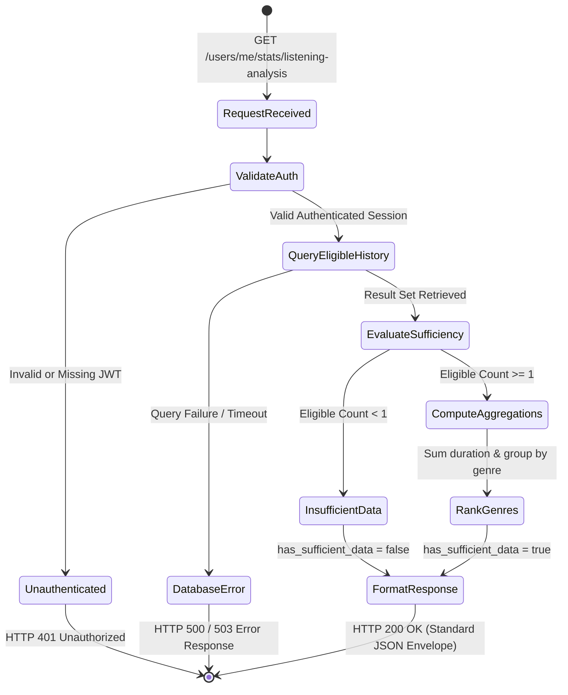

# Data Model: Listening History Analysis (Feature 101)

## Overview

This document specifies the logical data model, entity relationships, validation rules, and state transitions for **Feature 101: Listening History Analysis**.

The feature extracts statistical metrics (total listening duration and ranked top genres) directly from existing playback history records. It does not introduce new persistent database tables; instead, it defines domain aggregation entities and query contracts over the existing schema.

---

## 1. Source Database Entities

### 1.1. `listening_history` (Underlying Source Table)

Represents individual playback events recorded by Group 070 (Listening History).

| Field | Type | Nullable | Description | Feature 101 Eligibility Constraint |
|---|---|---|---|---|
| `id` | `UUID` | No | Primary Key | Required |
| `user_id` | `UUID` | Yes (schema) | Foreign Key -> `users(id)` | **Must NOT be NULL**; must match authenticated user |
| `song_id` | `UUID` | Yes (schema) | Foreign Key -> `songs(id)` | **Must NOT be NULL**; must reference an existing song |
| `played_at` | `TIMESTAMPTZ` | No | Timestamp of playback start | Must fall within requested range (`7`, `30`, or `all`) |
| `listened_duration` | `INTEGER` | Yes (schema) | Duration listened in seconds | **Must be > 0** seconds |

### 1.2. `songs` (Metadata Dependency Table)

Provides track and genre metadata associated with each playback event.

| Field | Type | Nullable | Description | Feature 101 Impact |
|---|---|---|---|---|
| `id` | `UUID` | No | Primary Key | Joined with `listening_history.song_id` |
| `title` | `VARCHAR(255)` | No | Song title | Used for unique track count |
| `artist_id` | `UUID` | No | Foreign Key -> `artists(id)` | Preserved for context (Group 070 domain) |
| `genre` | `VARCHAR(100)` | Yes | Musical genre of the track | Used for genre aggregation and ranking |
| `duration` | `INTEGER` | No | Total track length in seconds | Integrity boundary check |

---

## 2. Derived Domain Entities (Analysis DTOs)

Feature 101 produces computed analytical representations from the source tables.

### 2.1. `ListeningAnalysisResult`

The root aggregation entity returned to the listener.

| Field | Type | Required | Description |
|---|---|---|---|
| `user_id` | `UUID` | Yes | ID of the authenticated user whose history was analyzed. |
| `range` | `String` | Yes | Time filter applied: `"7"`, `"30"`, or `"all"`. |
| `has_sufficient_data`| `Boolean` | Yes | `true` if eligible entries >= 1; `false` otherwise. |
| `total_duration_seconds` | `Integer` | Yes | Sum of `listened_duration` across all eligible entries. |
| `formatted_total_duration` | `String` | Yes | Human-readable duration (e.g., `"14 giờ 25 phút"`). |
| `total_plays` | `Integer` | Yes | Total count of eligible playback events in the range. |
| `unique_tracks_count` | `Integer` | Yes | Count of distinct songs played in the range. |
| `top_genres` | `List<GenreRankingItem>` | Yes | Ranked list of top genres by accumulated listening duration. |
| `calculated_at` | `TIMESTAMPTZ` | Yes | Timestamp when analysis was generated. |

### 2.2. `GenreRankingItem`

Represents an individual genre's accumulated listening statistics.

| Field | Type | Required | Description |
|---|---|---|---|
| `rank` | `Integer` | Yes | 1-based ranking position (1 = highest duration). |
| `genre_id` | `String` | Yes | Normalized genre identifier/slug (e.g., `"lo-fi"`, `"pop"`). |
| `genre_name` | `String` | Yes | Display name of the genre (e.g., `"Lo-Fi"`, `"Pop"`). |
| `accumulated_seconds` | `Integer` | Yes | Sum of `listened_duration` for tracks belonging to this genre. |
| `formatted_duration` | `String` | Yes | Human-readable duration (e.g., `"6 giờ 10 phút"`). |
| `percentage` | `Float` | Yes | Percentage of total genre duration (0.0 to 100.0). |

---

## 3. Entity Relationships

---

## 4. Business Validation & Eligibility Rules

1. **Account Isolation (FR-005, FR-006)**:
   - Data must strictly filter on `user_id = :authenticated_user_id`.
   - Never accept `user_id` as a client-modifiable query parameter.

2. **Record Eligibility (FR-012)**:
   - An entry in `listening_history` is **eligible** if and only if:
     - `user_id IS NOT NULL`
     - `song_id IS NOT NULL`
     - `listened_duration > 0`
     - Corresponding record exists in `songs` table (`INNER JOIN`).

3. **Sufficiency Gate (FR-007, FR-012)**:
   - If count of eligible entries `< 1`:
     - `has_sufficient_data` = `false`
     - `total_duration_seconds` = `0`
     - `total_plays` = `0`
     - `unique_tracks_count` = `0`
     - `top_genres` = `[]`
   - The UI displays the empty state card: *"Chưa có đủ dữ liệu để phân tích"*.

4. **Ranking & Tie-Breaking (FR-014)**:
   - Genres are sorted by `accumulated_seconds` descending.
   - If two genres have identical `accumulated_seconds`, sort by `plays_count` descending, then by `genre_name` ascending (alphabetical).
   - Songs with missing or empty genre metadata (`NULL` or `""`) are excluded from `top_genres` ranking, as required by FR-012.

---

## 5. Lifecycle & State Transitions

