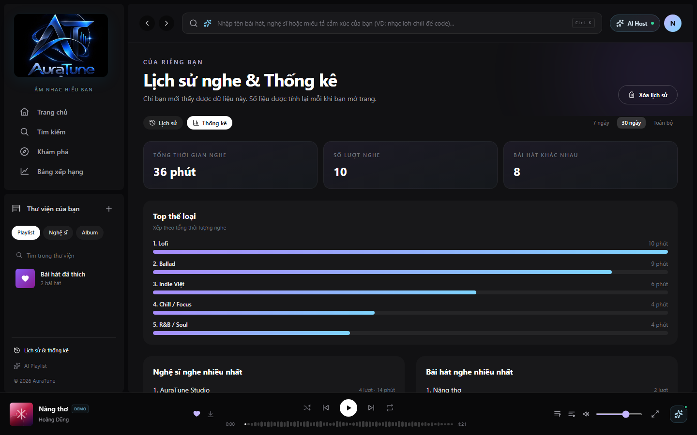
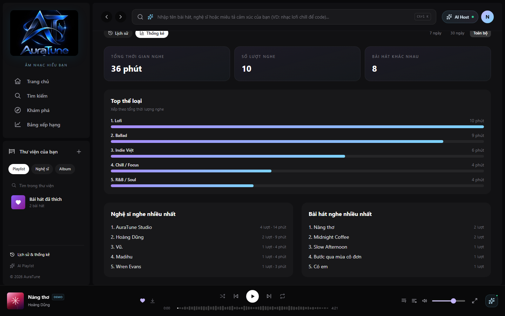
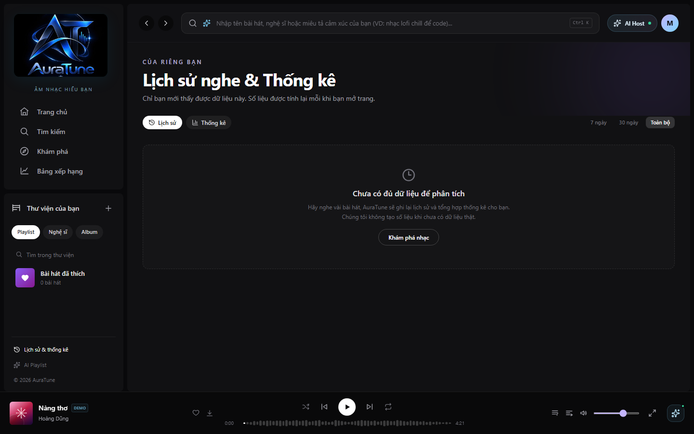
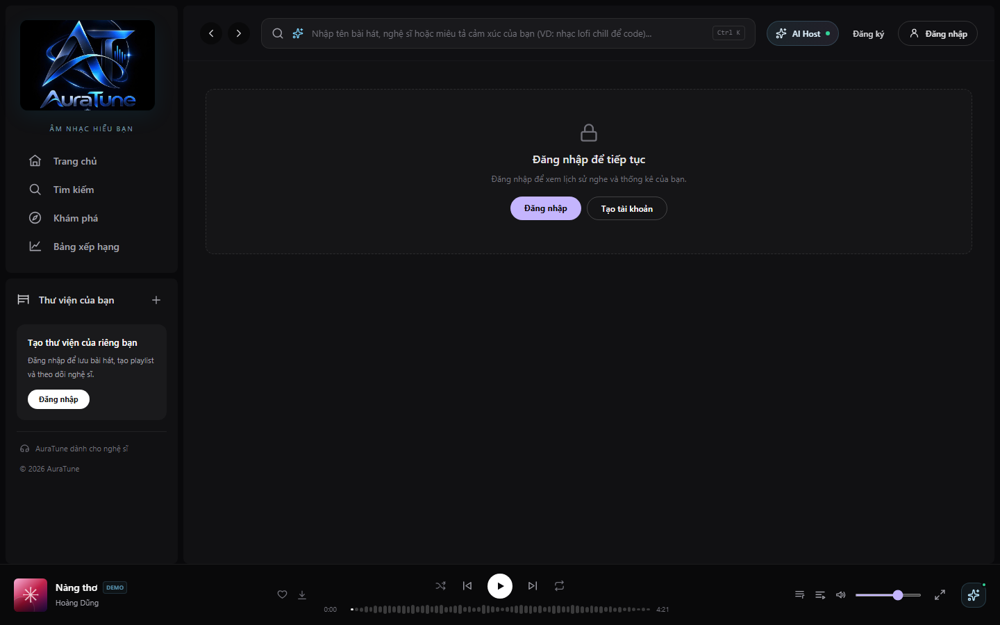

# Feature Specification: Listening History Analysis

**Feature Branch**: `100-ai-recommendations-spec`  
**Created**: 2026-10-20  
**Status**: Draft  
**Input**: User description: "Người dùng AuraTune sử dụng tính năng phân tích lịch sử nghe nhạc để hiểu thói quen và sở thích âm nhạc của mình. Hệ thống phân tích dữ liệu lịch sử nghe hiện có để xác định các thông tin hữu ích về hoạt động nghe nhạc của người dùng, trong phạm vi được tài liệu dự án cho phép. Làm rõ người dùng có thể xem những thông tin phân tích nào, dữ liệu lịch sử nghe được sử dụng ra sao, và hành vi khi người dùng chưa có đủ lịch sử nghe hoặc dữ liệu không khả dụng. Kết quả phân tích phải gắn với đúng tài khoản và không được để người dùng truy cập dữ liệu nghe của tài khoản khác. Không bao gồm: tạo danh sách gợi ý bài hát cá nhân hóa (spec `102-personalized-recommendations`), gợi ý dựa trên tâm trạng hoặc ngữ cảnh (spec `103-mood-and-context-recommendations`), phát nhạc, tìm kiếm nhạc hoặc quản lý lịch sử nghe gốc. Không tự đặt thuật toán phân tích, chỉ số thống kê hoặc mô hình AI nếu tài liệu nguồn chưa xác định. Dữ liệu và quy tắc: đối chiếu `docs/proposal/proposal.md`, `docs/management/team-contract.md`, `docs/design/database/README.md`, API contract và các spec liên quan. Làm rõ dependency với Listening History và các dữ liệu người dùng hiện có. Nếu chưa xác định được dữ liệu đầu vào, chỉ số phân tích hoặc cách hiển thị kết quả, ghi nhận là điểm cần clarification."

## Clarifications

### Session 2026-10-20

- Q: Bạn muốn feature 101 cung cấp những insight nào, xét đến proposal đã nêu tổng thời lượng nghe và top nghệ sĩ/thể loại còn API Listening History đã có top bài hát/nghệ sĩ? → A: Tổng thời lượng nghe và top thể loại; Group 070 tiếp tục sở hữu top bài hát/nghệ sĩ.
- Q: Feature 101 nên dùng nguồn dữ liệu nào để tính tổng thời lượng nghe và top thể loại? → A: Chỉ dùng `listening_history`; không dùng likes, follows hay `user_listening_stats`.
- Q: Những lượt nghe nào nên được tính là dữ liệu hợp lệ để tạo insight, và cần tối thiểu bao nhiêu lượt? → A: Chỉ lượt có user và song hợp lệ; tối thiểu một lượt. Insight thiếu metadata thì báo chưa có.
- Q: Bạn muốn xem tổng thời lượng và top thể loại dưới dạng nào, trong khoảng thời gian nào, và khi có lượt nghe mới thì kết quả cần cập nhật khi nào? → A: Tóm tắt và danh sách; toàn bộ lịch sử hiện có; cập nhật khi người dùng mở lại phân tích.
- Q: “Top thể loại” nên được xếp hạng theo tiêu chí nào? → A: Xếp hạng theo tổng thời lượng đã nghe.

## User Scenarios & Testing *(mandatory)*

### User Story 1 - Review listening insights (Priority: P1)

As an authenticated listener, I want to review analysis derived from my own available listening history so that I can understand my listening habits and music preferences.

**Why this priority**: Personal listening analytics is the core value of this feature, and the proposal explicitly includes listening habits analytics.

**Independent Test**: With an account that has eligible listening data, open its analysis view and verify that only that account's defined analysis is shown.

**Acceptance Scenarios**:

1. **Given** an authenticated user has listening data eligible for analysis, **When** they request their listening analysis, **Then** the system returns only analysis associated with their account.
2. **Given** a user has eligible history, **When** they open the analysis, **Then** the result presents total listening duration and genres ranked by accumulated listening duration as a summary and list over all available history.

---

### User Story 2 - Understand insufficient or unavailable data (Priority: P2)

As a listener, I want a clear outcome when my history is empty, insufficient, or unavailable so that I know why no analysis is shown.

**Why this priority**: A truthful empty or unavailable state prevents misleading conclusions from missing personal data.

**Independent Test**: Request analysis for accounts with no history, not-yet-sufficient history, and temporarily unavailable history, and verify each outcome is understandable and does not present fabricated results.

**Acceptance Scenarios**:

1. **Given** the user has no listening history, **When** they request analysis, **Then** the system communicates that analysis cannot yet be provided and does not invent listening insights.
2. **Given** the required history or analysis data cannot be retrieved, **When** the user requests analysis, **Then** the system communicates that the result is unavailable and does not present it as current analysis.
3. **Given** the user's history has fewer than one eligible entry, **When** they request analysis, **Then** no analysis is presented as available.

---

### User Story 3 - Keep analysis private to its account (Priority: P1)

As a listener, I want analysis requests to be scoped to my authenticated account so that no other listener can view my listening activity or derived insights.

**Why this priority**: Listening history and its analysis are private personal data; account isolation is an explicit feature constraint and shared security rule.

**Independent Test**: Authenticate as one user and attempt to request another user's history analysis; verify no data or derived insight for the other account is returned.

**Acceptance Scenarios**:

1. **Given** a user is authenticated, **When** they request their analysis, **Then** the account identity used for access is the authenticated user's identity.
2. **Given** a user attempts to access analysis belonging to another account, **When** access is evaluated, **Then** the request is denied and no other user's listening data or derived results are disclosed.
3. **Given** a request is unauthenticated, **When** private analysis is requested, **Then** no personal analysis is disclosed.

### Edge Cases

- The history contains records whose `user_id` or `song_id` is null, which the current schema permits; these records are excluded from analysis.
- A history record references a song that is no longer available; the feature must not fabricate song metadata or treat missing metadata as a confirmed preference.
- Some input data is available while another required source is unavailable; the feature must not imply that a partial result is complete unless that behavior is defined.
- Listening history changes after an analysis result was produced; the result is refreshed when the user opens the analysis again.
- A user's history has no eligible entries, or has entries but lacks metadata needed for one or more insights; unavailable insights are reported as unavailable.

## Requirements *(mandatory)*

### Functional Requirements

- **FR-001**: The system MUST provide authenticated listeners access to analysis of their own listening activity, within the analysis scope confirmed by project documentation.
- **FR-002**: The system MUST use a listener's listening history as the feature's primary dependency; the existing `listening_history` data records user, song, play time, and listened duration, subject to the schema's documented nullable fields.
- **FR-003**: The system MUST derive analysis in this feature from `listening_history` only; it MUST NOT use `user_listening_stats`, likes, follows, or other account data as analysis inputs.
- **FR-004**: The system MUST distinguish this feature's listening analysis from Group 070 history browsing and top-song/top-artist statistics, and MUST NOT duplicate or redefine those existing API capabilities without an explicit project decision.
- **FR-011**: The analysis outputs in this feature MUST include total listening duration and top genres; top songs and top artists remain within the existing Group 070 statistics scope.
- **FR-005**: The system MUST associate every analysis result with the account whose eligible history was analyzed.
- **FR-006**: The system MUST enforce ownership checks for every request and MUST NOT disclose a different user's listening history or derived analysis to a listener.
- **FR-007**: The system MUST communicate when analysis is not available because history is empty, insufficient, or unavailable, without presenting fabricated insights.
- **FR-012**: The system MUST count only listening-history entries linked to the authenticated user and a valid song; at least one eligible entry is required to present analysis, and an individual insight without the metadata it requires MUST be reported as unavailable.
- **FR-008**: The system MUST NOT generate personalized song recommendations, mood/context recommendations, playback behavior, music search behavior, or original-history management as part of this feature.
- **FR-009**: The system MUST NOT assume a specific analysis algorithm, AI model, or statistical measure beyond the confirmed total listening duration and top genres.
- **FR-010**: The system MUST NOT use likes, follows, profile data, or other account data to supplement listening-history analysis.
- **FR-013**: The system MUST present total listening duration and top genres in a summary and list covering all available eligible history, and MUST refresh the result when the user opens the analysis again.
- **FR-014**: The system MUST rank genres by the accumulated listening duration of eligible history entries associated with each genre.

### Key Entities

- **Listening History Entry**: A recorded listening event associated with a user and song, with play time and listened duration; the schema currently permits nullable user and song references.
- **User Listening Statistics**: An optional per-user aggregate record containing total listening duration, text-form top genres, and last update time; the database documentation flags genre representation and update rules for confirmation.
- **Listening Analysis Result**: Summary and list of total listening duration and genres ranked by accumulated listening duration, derived from all available eligible listening history, associated with exactly one account, and refreshed when the user opens the analysis.
- **Account**: The authenticated listener identity that owns the source history and may access its associated analysis.

## Success Criteria *(mandatory)*

### Measurable Outcomes

- **SC-001**: In all acceptance checks, a listener can retrieve only analysis tied to their authenticated account; attempts to access another account's analysis disclose zero of that account's history or results.
- **SC-002**: In all empty, insufficient, or unavailable data scenarios, users receive an explicit no-result/unavailable outcome and receive no fabricated analysis.
- **SC-003**: Before implementation begins, every user-facing output, permitted input source, and sufficiency rule is either confirmed in project documentation or resolved through clarification.
- **SC-004**: Users can identify from the analysis experience which account's listening activity the displayed results describe.

## Assumptions

- AuraTune's existing authentication identity is available to scope private user data; this feature does not define authentication.
- The Group 070 Listening History feature owns recording and browsing original listening events. This feature depends on its data and does not change it.
- The database README describes a PostgreSQL-oriented schema as supplied context and warns that it is not confirmed as a final implementation schema.
- `user_listening_stats` is a documented data concept, not proof that aggregate generation or its use by this feature has been approved.
- Project documentation is maintained in English Markdown; this specification is therefore written in English despite the Vietnamese feature request.
- `102-personalized-recommendations` and `103-mood-and-context-recommendations` are separate scope boundaries; this feature produces understanding/analysis only, not song suggestions.

## UI Screenshots

### 1. Listening Analysis Overview

**Related workflow:** Review listening insights (User Story 1 & FR-001, FR-002, FR-013).

- **Path**: `./ui/01-listening-analysis-overview.png`
- **Description**: Listening analysis dashboard on the "Thống kê" tab of `/history` for the authenticated account, showing page header, view mode switcher ("Lịch sử" / "Thống kê"), time range filters (7 ngày, 30 ngày, Toàn bộ), summary metric cards, and top genres ranking.

### 2. Total Listening Duration

**Related workflow:** Review total listening duration (User Story 1 & FR-011, FR-013).

- **Path**: `./ui/02-total-listening-duration.png`
- **Description**: Aggregate listening metrics displaying "Tổng thời gian nghe" calculated from eligible listening history entries, alongside total play counts and unique track counts.

### 3. Top Genres

**Related workflow:** Review top genres (User Story 1 & FR-011, FR-014).

- **Path**: `./ui/03-top-genres.png`
- **Description**: "Top thể loại" section ranking genres by accumulated listening duration, presenting genre rank, genre name, formatted duration, and proportional gradient progress bars.

### 4. Insufficient Listening History

**Related workflow:** Understand insufficient or unavailable data (User Story 2 & FR-007, FR-012).

- **Path**: `./ui/04-insufficient-history.png`
- **Description**: Empty state displayed when an account has fewer than one eligible history entry, communicating "Chưa có đủ dữ liệu để phân tích" without generating fabricated insights.

### 5. Analysis Unavailable / Login Required

**Related workflow:** Access control and unavailable analysis (User Story 3 & FR-005, FR-006).

- **Path**: `./ui/05-analysis-unavailable.png`
- **Description**: State presented when an unauthenticated guest attempts to access listening analysis, requiring login to protect private listening data.

