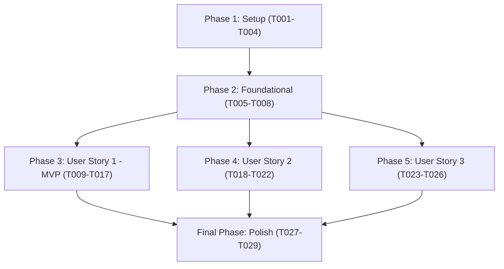

# Tasks: Listening History Analysis (Feature 101)

**Branch**: `101-listening-history-analysis` | **Group**: 100 – AI Recommendations (Owner: Lê Công Minh Nhựt)  
**Input**: Design documents from `specs/100-ai-recommendations/101-listening-history-analysis/` (`plan.md`, `spec.md`, `data-model.md`, `research.md`, `quickstart.md`, `contracts/listening-analysis-api.json`)  
**Prerequisites**: `plan.md` (required), `spec.md` (required for user stories), `data-model.md`, `research.md`, `contracts/listening-analysis-api.json`, `quickstart.md`

---

## Format: `[ID] [P?] [Story] Description with file path`

- **Checkbox**: `- [ ]` markdown checkbox
- **[P]**: Can run in parallel (different files, no dependencies on incomplete tasks)
- **[Story]**: User story identifier (`[US1]`, `[US2]`, `[US3]`) for story-phase tasks; omitted for Setup, Foundational, and Polish phases
- **File Paths**: Explicit absolute/relative source file path included in every task

---

## Path Conventions

- **Backend**: `src/backend/` (Node.js / Express API server)
  - Repositories: `src/backend/repositories/`
  - Services: `src/backend/services/`
  - Controllers: `src/backend/controllers/`
  - Routes: `src/backend/routes/`
  - Middleware: `src/backend/middleware/`
  - Tests: `src/backend/tests/`
- **Frontend**: `src/frontend/` (React 18 / Vite 5 Client)
  - Services: `src/frontend/src/services/`
  - Mock Services: `src/frontend/src/services/mock/`
  - Pages/Views: `src/frontend/src/pages/History/`
  - Tests: `src/frontend/src/pages/History/__tests__/`
- **Database**: `src/database/migrations/`

---

## Phase 1: Setup (Shared Infrastructure & Environment)

**Purpose**: Initialize database index migration, backend test harness dependencies, and common response/mock utilities required across all feature components.

- [X] T001 Configure backend test harness dependencies by adding `vitest` and `supertest` to `devDependencies` in `src/backend/package.json` and adding a `"test": "vitest run"` script per `plan.md`.
- [X] T002 [P] Create database migration script `src/database/migrations/002_listening_history_index.sql` adding compound index `CREATE INDEX IF NOT EXISTS idx_listening_history_user_played ON listening_history(user_id, played_at)` to support sub-1.5s aggregations on accounts with up to 10,000 records.
- [X] T003 [P] Create mock stats service file skeleton in `src/frontend/src/services/mock/mockStatsService.js` with stubbed `getMockListeningAnalysis(range)` matching the OpenAPI contract structure.
- [X] T004 [P] Implement response helper and envelope formatter in `src/backend/utils/statsResponse.js` enforcing standard response envelope `{ success, message, data, error }` per `contracts/listening-analysis-api.json`.

---

## Phase 2: Foundational (Blocking Prerequisites)

**Purpose**: Core infrastructure and database access foundation that MUST be completed before ANY user story can begin.

**⚠️ CRITICAL**: No user story implementation can proceed until this phase is verified.

- [X] T005 Setup dynamic aggregation SQL execution helper in `src/backend/repositories/historyRepository.js` importing PostgreSQL pool connection from `src/backend/db.js` with parameterized query execution and error propagation.
- [X] T006 [P] Verify and adapt `authenticateToken` middleware in `src/backend/middleware/authMiddleware.js` ensuring `req.user.user_id` is extracted from verified JWT tokens and standardizing unauthorized error responses on stats routes to return HTTP 401 with standard envelope `{ success: false, message: "Yêu cầu đăng nhập để truy cập thông tin phân tích", data: null, error: { code: "UNAUTHORIZED", details: [] } }` conforming to `contracts/listening-analysis-api.json`.
- [X] T007 [P] Create stats router module in `src/backend/routes/statsRoutes.js` and mount route `/api/v1/users/me/stats` in `src/backend/server.js`.
- [X] T008 [P] Create frontend API client adapter in `src/frontend/src/services/statsService.js` supporting dynamic toggle between live API calls and mock adapter based on `import.meta.env.VITE_USE_MOCKS`.

**Checkpoint**: Foundation ready — database repository runner, authentication middleware with standard error envelope, and route mounting are established.

---

## Phase 3: User Story 1 - Review Listening Insights (Priority: P1) 🎯 MVP

**Goal**: Authenticated listeners can review their personal listening metrics: total listening duration and top genres ranked by accumulated listening duration across selectable time windows (`'7'`, `'30'`, `'all'`), refreshed upon request.

**Independent Test**: Authenticate as a user with eligible playback events, request `GET /api/v1/users/me/stats/listening-analysis?range=all`, and verify that the response contains `hasSufficientData: true`, accurate `totalDurationSeconds`, formatted duration string (e.g., `"14 giờ 25 phút"`), and genres sorted strictly by accumulated duration descending.

### Tests for User Story 1

> **NOTE: Write these tests FIRST and ensure they FAIL before implementing services and controllers.**

- [X] T009 [P] [US1] Create unit test suite in `src/backend/tests/listeningAnalysisService.test.js` covering duration formatting (`0` -> `"0 phút"`, `3660` -> `"1 giờ 1 phút"`), genre duration summation, tie-breaking rules, and date window boundary filtering (`'7'`, `'30'`, `'all'`).
- [X] T010 [P] [US1] Create contract test in `src/backend/tests/contract/listeningAnalysisContract.test.js` validating that `GET /api/v1/users/me/stats/listening-analysis` conforms to `ListeningAnalysisApiResponse` in `contracts/listening-analysis-api.json`.

### Implementation for User Story 1

- [X] T011 [US1] Implement dynamic aggregation query `findListeningAnalysis(userId, range)` in `src/backend/repositories/historyRepository.js` joining `listening_history` with `songs` using strict eligibility filters: `lh.user_id = $1`, `lh.user_id IS NOT NULL`, `lh.song_id IS NOT NULL`, `lh.listened_duration > 0`, and time window bounds (`played_at >= NOW() - INTERVAL '7 days'` for `'7'`, `played_at >= NOW() - INTERVAL '30 days'` for `'30'`, and no lower bound for `'all'`). Quoting constraint: "Derive analysis in this feature from `listening_history` only; it MUST NOT use `user_listening_stats`, likes, follows, or other account data as analysis inputs" (FR-003).
- [X] T012 [US1] Implement business calculation service `calculateListeningAnalysis(userId, range)` in `src/backend/services/listeningAnalysisService.js` to compute `totalDurationSeconds`, `formattedTotalDuration`, `totalPlays`, `uniqueTracksCount`, and ranked `topGenres`. Enforce tie-breaking: `accumulated_seconds DESC` -> `plays_count DESC` -> `genre_name ASC`. Exclude tracks with `genre IS NULL` or `genre = ''` from `topGenres` while keeping their duration in `totalDurationSeconds` (FR-012). Compute relative genre share: `percentage = (accumulated_seconds / total_genre_duration) * 100`.
- [X] T013 [US1] Implement controller handler `getListeningAnalysis` in `src/backend/controllers/statsController.js` validating query parameter `range` with enum values `["7", "30", "all"]` (default `"all"`), invoking `listeningAnalysisService`, and returning HTTP 200 with standard envelope.
- [X] T014 [US1] Register route handler `router.get('/listening-analysis', authenticateToken, statsController.getListeningAnalysis)` in `src/backend/routes/statsRoutes.js`.
- [X] T015 [P] [US1] Implement HTTP client method `getListeningAnalysis(range = 'all')` in `src/frontend/src/services/statsService.js` sending `GET /api/v1/users/me/stats/listening-analysis?range=${range}` with `Authorization: Bearer <token>` header.
- [X] T016 [P] [US1] Implement in-memory aggregation fallback in `src/frontend/src/services/mock/mockStatsService.js` calculating `totalDurationSeconds`, formatted durations, and ranked `topGenres` from `mockHistory` when `VITE_USE_MOCKS=true`.
- [X] T017 [US1] Update "Thống kê" tab in `src/frontend/src/pages/History/HistoryPage.jsx` to fetch analysis data via `statsService.getListeningAnalysis(range)`, rendering summary cards ("Tổng thời gian nghe", "Số lượt nghe", "Bài hát khác nhau") and ranked "Top thể loại" list with proportional progress bars (`width_pct = max(4, (item.accumulatedSeconds / maxGenreSeconds) * 100)`). Explicitly remove local store computations and UI sections for "Nghệ sĩ nghe nhiều nhất" and "Bài hát nghe nhiều nhất" (lines 133-163) to strictly preserve Group 070 domain boundaries (FR-004, FR-011).

**Checkpoint**: User Story 1 is fully functional as the MVP increment. Authenticated listeners with history can view their total duration and top genres without Group 070 domain overlap.

---

## Phase 4: User Story 2 - Understand Insufficient or Unavailable Data (Priority: P2)

**Goal**: When a user's listening history has fewer than 1 eligible playback event (`hasSufficientData: false`) or data is unavailable, provide a clear, truthful empty state without fabricating insights, accompanied by a call-to-action button "Khám phá nhạc".

**Independent Test**: Authenticate as a newly created account with 0 playback events or clear all history; request analysis and verify that HTTP 200 returns `hasSufficientData: false`, `topGenres: []`, `totalDurationSeconds: 0`, and the UI displays the empty state card "Chưa có đủ dữ liệu để phân tích" with CTA link "Khám phá nhạc" to `/`.

### Tests for User Story 2

- [X] T018 [P] [US2] Implement unit test in `src/backend/tests/insufficientData.test.js` verifying that accounts with 0 eligible records or only invalid records (`listened_duration = 0`, `song_id = NULL`) return `hasSufficientData: false`, `topGenres: []`, and `totalDurationSeconds: 0`, and simulated database timeouts return HTTP 500 with error code `"DATABASE_ERROR"`.

### Implementation for User Story 2

- [X] T019 [US2] Add sufficiency threshold evaluation in `src/backend/services/listeningAnalysisService.js` setting `hasSufficientData: false`, `totalDurationSeconds: 0`, `formattedTotalDuration: "0 phút"`, `totalPlays: 0`, `uniqueTracksCount: 0`, and `topGenres: []` whenever count of eligible playback entries `< 1` (FR-007, FR-012).
- [X] T020 [US2] Add database failure and timeout catch block in `src/backend/controllers/statsController.js` returning HTTP 500 with `code: "DATABASE_ERROR"` and Vietnamese message `"Thông tin phân tích tạm thời không khả dụng, vui lòng thử lại sau"` conforming to `contracts/listening-analysis-api.json`.
- [X] T021 [P] [US2] Implement zero-record condition in `src/frontend/src/services/mock/mockStatsService.js` returning `{ hasSufficientData: false, totalDurationSeconds: 0, topGenres: [] }` when mock history is empty.
- [X] T022 [US2] Connect empty state rendering in `src/frontend/src/pages/History/HistoryPage.jsx` displaying `<EmptyState icon={Clock3} title="Chưa có đủ dữ liệu để phân tích" description="Hãy nghe vài bài hát, AuraTune sẽ ghi lại lịch sử và tổng hợp thống kê cho bạn. Chúng tôi không tạo số liệu khi chưa có dữ liệu thật."><Link to="/">Khám phá nhạc</Link></EmptyState>` when `hasSufficientData === false`. Add error state notification when API returns HTTP 500.

**Checkpoint**: User Stories 1 and 2 operate independently. Empty and error states truthfully inform the user without fabricated metrics.

---

## Phase 5: User Story 3 - Privacy and Account Data Isolation (Priority: P1)

**Goal**: Guarantee strict account isolation and privacy compliance under Vietnamese Decree 13/2023/NĐ-CP: enforce JWT verification on `GET /api/v1/users/me/stats/listening-analysis`, deny unauthenticated access (HTTP 401), and strictly scope all queries by `WHERE user_id = :authenticated_user_id`.

**Independent Test**: Send `GET /api/v1/users/me/stats/listening-analysis` without an `Authorization` header and verify HTTP 401 response. Authenticate as User A and verify that User B's playback records are never included in User A's calculated metrics.

### Tests for User Story 3

- [X] T023 [P] [US3] Implement integration test in `src/backend/tests/security/accountIsolation.test.js` validating that requests without a Bearer token receive HTTP 401 `UNAUTHORIZED`, requests with expired tokens receive HTTP 401, and aggregation queries for User A strictly exclude listening events belonging to User B.

### Implementation for User Story 3

- [X] T024 [US3] Enforce strict account boundary parameterization in `src/backend/repositories/historyRepository.js` by binding SQL query parameter `$1` strictly to `req.user.user_id` resolved by `authMiddleware`, prohibiting any client-supplied `user_id` override from query params or request bodies (FR-005, FR-006).
- [X] T025 [US3] Apply `authenticateToken` middleware to the router in `src/backend/routes/statsRoutes.js` ensuring unauthenticated requests are rejected immediately with HTTP 401 and JSON envelope code `"UNAUTHORIZED"` (`{ success: false, message: "Yêu cầu đăng nhập để truy cập thông tin phân tích", data: null, error: { code: "UNAUTHORIZED", details: [] } }`) before touching the database repository.
- [X] T026 [P] [US3] Enforce authentication guard in `src/frontend/src/pages/History/HistoryPage.jsx` displaying `<LoginRequired description="Đăng nhập để xem lịch sử nghe và thống kê của bạn." />` when `store.currentUser` is null, preventing unauthenticated API dispatches.

**Checkpoint**: User Stories 1, 2, and 3 are complete. Data privacy and account isolation are strictly enforced end-to-end.

---

## Final Phase: Polish & Cross-Cutting Concerns

**Purpose**: Documentation synchronization, automated test verification, and complete scenario validation from `quickstart.md`.

- [X] T027 [P] Update API documentation in `specs/100-ai-recommendations/101-listening-history-analysis/contracts/README.md` reflecting final route configuration, query parameters, and error envelopes.
- [X] T028 [P] Create frontend component test in `src/frontend/src/pages/History/__tests__/HistoryPage.test.jsx` verifying tab switching between "Lịch sử" và "Thống kê", range filtering button clicks ('7', '30', 'all'), loading indicators, and empty state CTA rendering.
- [X] T029 Validate all 4 scenarios from `specs/100-ai-recommendations/101-listening-history-analysis/quickstart.md`: Scenario 1 (Happy Path - Review Insights), Scenario 2 (Insufficient History State), Scenario 3 (Account Isolation & Privacy), and Scenario 4 (Dynamic Refresh on New Playback Events).

---

## Dependencies & Execution Order

### Phase Dependencies



- **Phase 1 (Setup)**: Can start immediately. Configures test dependencies, database index migration, mock service, and response helper.
- **Phase 2 (Foundational)**: Depends on Phase 1 completion. **BLOCKS** all User Stories.
- **Phase 3 (User Story 1 - MVP)**: Depends on Phase 2 completion. Can proceed independently of US2 and US3.
- **Phase 4 (User Story 2)**: Depends on Phase 2 completion and integrates with Phase 3 calculation logic.
- **Phase 5 (User Story 3)**: Depends on Phase 2 completion. Can be implemented and verified in parallel with US1/US2.
- **Final Phase (Polish)**: Depends on completion of all desired user stories.

### User Story Dependencies

- **User Story 1 (P1 - MVP)**: Starts after Foundational phase. Delivers the core listening analytics end-to-end.
- **User Story 2 (P2)**: Augments the calculation service and UI from US1 with empty/error state handling.
- **User Story 3 (P1)**: Hardens authentication guards and isolation rules in the router, repository, and frontend view.

---

## Parallel Execution Examples

### Parallel Opportunities within Setup & Foundation

```bash
# Launch independent setup tasks together:
Task T002: "Create database migration script in src/database/migrations/002_listening_history_index.sql"
Task T003: "Create mock stats service skeleton in src/frontend/src/services/mock/mockStatsService.js"
Task T004: "Implement response helper in src/backend/utils/statsResponse.js"

# Launch independent foundational tasks together:
Task T006: "Verify authMiddleware in src/backend/middleware/authMiddleware.js"
Task T007: "Setup stats router in src/backend/routes/statsRoutes.js and mount in src/backend/server.js"
Task T008: "Create statsService adapter in src/frontend/src/services/statsService.js"
```

### Parallel Opportunities within User Story 1 (MVP)

```bash
# Launch test creation tasks together (write tests first):
Task T009: "Unit test suite in src/backend/tests/listeningAnalysisService.test.js"
Task T010: "Contract test in src/backend/tests/contract/listeningAnalysisContract.test.js"

# Launch client-side tasks in parallel with server implementation:
Task T015: "HTTP client getListeningAnalysis in src/frontend/src/services/statsService.js"
Task T016: "Mock aggregation fallback in src/frontend/src/services/mock/mockStatsService.js"
```

### Parallel Opportunities across User Stories (Multi-Developer)

```bash
# Once Phase 2 (Foundational) is complete:
Developer A: Works on Phase 3 (User Story 1 - Core metrics & top genres)
Developer B: Works on Phase 4 (User Story 2 - Empty state & error handling)
Developer C: Works on Phase 5 (User Story 3 - JWT auth & account isolation tests)
```

---

## Independent Test Criteria per User Story

| User Story | Verification Procedure | Pass Criteria |
|---|---|---|
| **User Story 1 (P1 - MVP)** | Authenticate as user with history; send `GET /api/v1/users/me/stats/listening-analysis?range=all`; inspect `/history` "Thống kê" tab. | `hasSufficientData === true`; `totalDurationSeconds` matches sum of eligible `listened_duration`; top genres ordered by `accumulatedSeconds DESC`; progress bars render proportionally. |
| **User Story 2 (P2)** | Authenticate as account with 0 history entries; open `/history` "Thống kê" tab; simulate 500 database error. | `hasSufficientData === false`; `topGenres === []`; empty card displays *"Chưa có đủ dữ liệu để phân tích"* with CTA link *"Khám phá nhạc"* to `/`; 500 error displays friendly toast without crashing UI. |
| **User Story 3 (P1)** | Send unauthenticated request to `/api/v1/users/me/stats/listening-analysis`; authenticate as User A and attempt to query User B's history. | Unauthenticated request returns `HTTP 401 Unauthorized` with code `"UNAUTHORIZED"`; User A sees only their own history metrics (`WHERE user_id = :auth_id`), completely isolating User B's data. |

---

## Implementation Strategy

### MVP First (User Story 1 Only)

1. Complete **Phase 1: Setup** (T001-T004: test harness dependencies, migration script, response envelope, mock skeleton).
2. Complete **Phase 2: Foundational** (T005-T008: database runner, JWT auth middleware with standard envelope, route registration).
3. Complete **Phase 3: User Story 1** (T009-T017: dynamic query, service calculations, controller, frontend service, and UI tab cleaning Group 070 metrics).
4. **STOP and VALIDATE**: Verify User Story 1 with an account that has history data. Deploy/demo the MVP increment.

### Incremental Delivery

1. Foundation ready (Phases 1 + 2: T001-T008).
2. Add User Story 1 -> Deliver MVP insights dashboard (Phase 3: T009-T017).
3. Add User Story 2 -> Deliver truthful empty state and error resilience (Phase 4: T018-T022).
4. Add User Story 3 -> Deliver verified account isolation and security test suite (Phase 5: T023-T026).
5. Finalize Polish -> Run full `quickstart.md` validation and finalize documentation (Final Phase: T027-T029).
