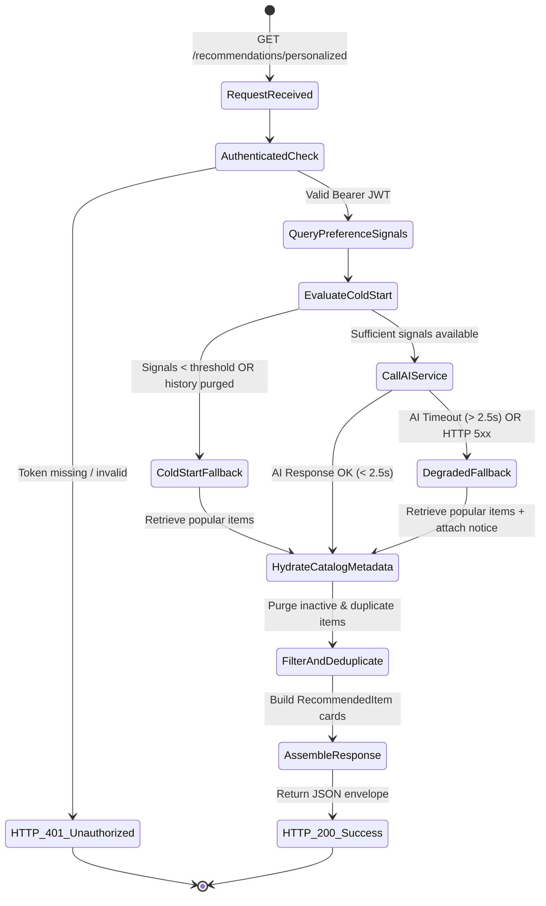

# Data Model: Personalized Recommendations (Feature 102)

## Overview

This document defines the logical data model, entity structures, validation rules, state transitions, and data integrity constraints for **Feature 102: Personalized Recommendations** in AuraTune.

Feature 102 aggregates user preference signals across listening history, liked songs, and followed artists, combines them with candidate scoring from an internal AI inference service (or fallback popular queries), hydrates active catalog metadata, and produces a deduplicated multi-entity recommendation feed.

---

## 1. Source Database Entities (PostgreSQL)

Feature 102 queries existing database tables in PostgreSQL matching `docs/design/database/README.md` and `er-diagram.md`. It does not create new persistence tables.

### 1.1. User Preference Signal Tables

#### `listening_history`
Captures historical audio playback events.

| Field | Type | Nullable | Eligibility Constraint for Feature 102 |
|---|---|---|---|
| `id` | `UUID` | No | Primary Key |
| `user_id` | `UUID` | Yes (schema) | **Must NOT be NULL**; strictly scoped to authenticated user |
| `song_id` | `UUID` | Yes (schema) | **Must NOT be NULL**; references active catalog song |
| `played_at` | `TIMESTAMPTZ` | No | Lookback window (e.g., last 90 days preferred) |
| `listened_duration` | `INTEGER` | Yes (schema) | **Must be $\ge 30$ seconds** (skips < 30s ignored per FR-009) |

#### `user_liked_songs`
Captures explicit positive affinity toward songs.

| Field | Type | Nullable | Description |
|---|---|---|---|
| `user_id` | `UUID` | No | Composite PK; scoped to authenticated user |
| `song_id` | `UUID` | No | Composite PK; references liked song |
| `liked_at` | `TIMESTAMPTZ` | No | Timestamp of like action |

#### `user_follows_artist`
Captures explicit interest in artists.

| Field | Type | Nullable | Description |
|---|---|---|---|
| `user_id` | `UUID` | No | Composite PK; scoped to authenticated user |
| `artist_id` | `UUID` | No | Composite PK; references followed artist |
| `created_at` | `TIMESTAMPTZ` | No | Timestamp of follow action |

---

### 1.2. Catalog Hydration Tables

Used to validate catalog active status (FR-008) and hydrate display metadata for recommended items:

#### `songs`
| Field | Type | Constraint | Usage in Feature 102 |
|---|---|---|---|
| `id` | `UUID` | PK | Song identity validation |
| `title` | `VARCHAR(255)` | NOT NULL | Display title in `RecommendedItem` |
| `artist_id` | `UUID` | FK -> `artists(id)` | Subtitle artist resolution |
| `album_id` | `UUID` | FK -> `albums(id)` | Album link & artwork resolution |
| `duration` | `INTEGER` | NOT NULL | Duration in seconds in `extra` |
| `genre` | `VARCHAR(100)` | Nullable | Metadata tag / genre weighting |
| `total_plays` | `INTEGER` | DEFAULT 0 | Ordering metric for popular fallback (FR-005) |
| `is_active` | `BOOLEAN` | DEFAULT TRUE | Deactivated/deleted tracks filtered out (FR-008) |

#### `albums`
| Field | Type | Constraint | Usage in Feature 102 |
|---|---|---|---|
| `id` | `UUID` | PK | Album identity validation |
| `title` | `VARCHAR(255)` | NOT NULL | Display title in `RecommendedItem` |
| `artist_id` | `UUID` | FK -> `artists(id)` | Subtitle artist resolution |
| `cover_url` | `VARCHAR(512)` | Nullable | Artwork image |
| `release_date` | `DATE` | Nullable | Metadata context |
| `is_active` | `BOOLEAN` | DEFAULT TRUE | Inactive albums filtered out |

#### `artists`
| Field | Type | Constraint | Usage in Feature 102 |
|---|---|---|---|
| `id` | `UUID` | PK | Artist identity validation |
| `name` | `VARCHAR(255)` | NOT NULL | Display name in `RecommendedItem` |
| `avatar_url` | `VARCHAR(512)` | Nullable | Artist profile avatar |
| `is_active` | `BOOLEAN` | DEFAULT TRUE | Inactive artists filtered out |

#### `playlists`
| Field | Type | Constraint | Usage in Feature 102 |
|---|---|---|---|
| `id` | `UUID` | PK | Playlist identity validation |
| `title` | `VARCHAR(255)` | NOT NULL | Display title in `RecommendedItem` |
| `user_id_creator`| `UUID` | FK -> `users(id)` | Creator attribution |
| `cover_url` | `VARCHAR(512)` | Nullable | Playlist artwork |
| `status` | `VARCHAR(20)` | `CHECK IN ('Public','Private','Shared')` | Must be `'Public'` for recommendation feed |
| `is_official` | `BOOLEAN` | DEFAULT FALSE | Prioritized for cold-start starter collections |
| `is_active` | `BOOLEAN` | DEFAULT TRUE | Inactive playlists filtered out |

---

## 2. Derived Domain Entities & Data Transfer Objects (DTOs)

### 2.1. `RecommendationFeedResult` (Root Response Payload)

The unified container delivered to the client in response to `GET /api/v1/recommendations/personalized`.

| Field | Type | Required | Description |
|---|---|---|---|
| `user_id` | `UUID` | Yes | Authenticated listener identifier |
| `is_fallback` | `Boolean` | Yes | `true` if content is non-personalized fallback |
| `fallback_reason` | `String` | No | Null if personalized; `"COLD_START"`, `"INSUFFICIENT_HISTORY"`, `"HISTORY_PURGED"`, or `"AI_SERVICE_UNAVAILABLE"` |
| `message` | `String` | No | Human-readable explanation or non-intrusive alert notice |
| `generated_at` | `TIMESTAMPTZ` | Yes | ISO 8601 timestamp of feed generation |
| `total_items` | `Integer` | Yes | Count of valid items in the feed |
| `items` | `List<RecommendedItem>` | Yes | Deduplicated ordered list of recommendation cards |

---

### 2.2. `RecommendedItem` (Polymorphic Card Entity)

Represents an individual card on the Home Dashboard recommendation feed.

| Field | Type | Required | Values / Format | Description |
|---|---|---|---|---|
| `id` | `UUID` | Yes | UUID string | Canonical catalog ID of the recommended entity |
| `type` | `String` | Yes | `"song"` \| `"album"` \| `"artist"` \| `"playlist"` | Entity discriminator (FR-002) |
| `title` | `String` | Yes | Text ($\le 255$ chars) | Display title or artist name |
| `subtitle` | `String` | Yes | Text ($\le 255$ chars) | Artist name (song/album), creator or follower info |
| `image_url` | `String` | No | URI or cover asset key | Cover art or profile image |
| `badge` | `String` | Yes | `"Gợi ý"`, `"Phổ biến"`, `"Thịnh hành"` | Visual badge indicator |
| `target_id` | `UUID` | Yes | UUID string | Navigation / playback target identifier |
| `extra` | `Object` | No | Key-value dictionary | Type-specific auxiliary data (see below) |

#### Type-specific `extra` attributes:
- **`type: "song"`**:
  - `duration`: `Integer` (track duration in seconds)
  - `audio_url`: `String` (streamable endpoint `/api/v1/songs/:id/stream`)
  - `artist_id`: `UUID`
  - `album_id`: `UUID`
- **`type: "album"`**:
  - `artist_id`: `UUID`
  - `track_count`: `Integer`
  - `release_year`: `Integer`
- **`type: "artist"`**:
  - `follower_count`: `Integer`
  - `monthly_listeners`: `Integer`
- **`type: "playlist"`**:
  - `track_count`: `Integer`
  - `is_official`: `Boolean`

---

### 2.3. `InternalAIRecommendRequest` & `InternalAIRecommendResponse`

Payload exchange between Backend API and internal Python AI Service over `POST /ai/recommend`.

#### Request Schema
```json
{
  "user_id": "3fa85f64-5717-4562-b3fc-2c963f66afa6",
  "signals": {
    "played_song_ids": ["c123...", "d456..."],
    "liked_song_ids": ["e789..."],
    "followed_artist_ids": ["f012..."]
  },
  "requested_types": ["song", "album", "artist", "playlist"],
  "limit": 20
}
```

#### Response Schema
```json
{
  "status": "success",
  "model_version": "v1.2.0-hybrid",
  "candidates": [
    { "type": "song", "id": "1111...", "score": 0.94 },
    { "type": "playlist", "id": "2222...", "score": 0.89 },
    { "type": "artist", "id": "3333...", "score": 0.82 },
    { "type": "album", "id": "4444...", "score": 0.78 }
  ]
}
```

---

## 3. Feed Generation State Machine



---

## 4. Validation & Integrity Rules

1. **User Identity Boundary (FR-003, FR-004)**:
   - `user_id` MUST be sourced directly from the verified JWT payload (`req.user.id`).
   - Any client parameter attempting to specify `user_id` in path, header, or query is rejected or ignored.
2. **Signal Filtering (FR-009)**:
   - Entries in `listening_history` with `user_id IS NULL`, `song_id IS NULL`, or `listened_duration < 30` MUST be excluded.
   - Likes with `song_id IS NULL` and follows with `artist_id IS NULL` MUST be excluded.
3. **Catalog Active State (FR-008)**:
   - Every candidate entity MUST be validated against current catalog tables (`is_active = true` and `deleted_at IS NULL`).
   - If a recommended item has been deleted or disabled, it is quietly removed from the result set.
4. **Deduplication (FR-015)**:
   - No two items in the returned `items` array may share the same `(type, id)`.
5. **Cold-Start Determination (FR-005, UC-070-004)**:
   - If qualifying playback count $= 0$ AND liked songs count $= 0$ AND followed artists count $= 0$, system MUST flag `is_fallback: true` with `fallback_reason: "COLD_START"`.
6. **Graceful Degradation Guarantee (FR-006, EF-01)**:
   - When AI Service times out ($> 2.5$s) or errors out, response MUST return HTTP 200 with `is_fallback: true`, `fallback_reason: "AI_SERVICE_UNAVAILABLE"`, and non-blocking notification text.
