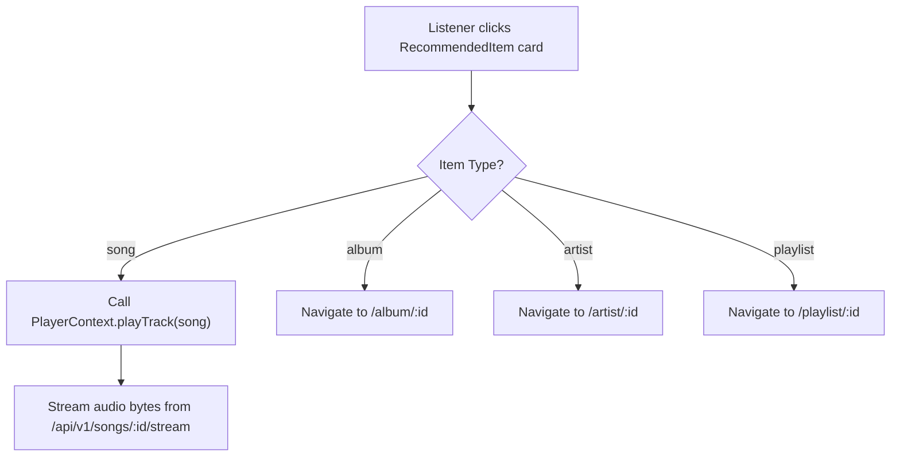

# Implementation Plan: Personalized Recommendations (Feature 102)

**Branch**: `102-personalized-recommendations` | **Date**: 2026-11-03 | **Spec**: [spec.md](./spec.md)

**Input**: Feature specification from `/specs/100-ai-recommendations/102-personalized-recommendations/spec.md`

---

## 1. Summary

Feature 102 provides authenticated listeners with a tailored music recommendation feed on the AuraTune Home Dashboard. The recommendation engine derives personal affinity from qualifying playback activity (`listening_history.listened_duration >= 30` seconds), liked tracks (`user_liked_songs`), and followed artists (`user_follows_artist`). It outputs multi-entity recommendations across Songs, Albums, Artists, and Playlists (Clarification 1B).

The technical approach implements a resilient tiered architecture:
1. **Signal Aggregation**: Backend queries user preference signals strictly scoped by the caller's JWT identity (`WHERE user_id = :authenticated_user_id`).
2. **Cold-Start Policy**: If preference signals are absent or insufficient (< 3 playback events, or following history purge), the system immediately serves platform-wide popular items with a `"Phổ biến"` badge (Clarification 2A).
3. **AI Inference & Graceful Degradation**: For users with sufficient data, Backend requests candidates from the internal Python AI Service (`POST /ai/recommend`) with a strict **2.5-second timeout**. If the AI service times out or fails, the backend catches the error and degrades gracefully to popular content with an informative notice ("Hiển thị nội dung thịnh hành do hệ thống gợi ý đang bảo trì"), preventing dashboard rendering failure (Clarification 3A, EF-01).
4. **Hydration & Deduplication**: Candidate entity IDs are validated against active catalog tables (filtering out inactive/deleted items per FR-008) and deduplicated before delivery (FR-015).
5. **Frontend Presentation & Interaction**: The Home Dashboard renders multi-entity recommendation cards; clicking a song triggers immediate playback in the Music Player, while albums, artists, and playlists route to their respective detail pages (FR-007, SC-004).

---

## 2. Technical Context

**Language/Version**:
- Frontend: JavaScript (ES Modules, JSX), Node.js >= 18
- Backend: JavaScript / Node.js (ES Modules), runtime Node.js >= 18
- Internal AI Service: Python 3.10+ (FastAPI)
- Database: PostgreSQL (SQL syntax matching `docs/design/database/README.md`)

**Primary Dependencies**:
- Frontend: React 18 (`react`, `react-dom`), Vite 5, Tailwind CSS 3, `lucide-react`
- Backend: Express.js (or NestJS REST framework), `pg` / `knex` (or equivalent PostgreSQL client), `jsonwebtoken`, `axios` or native `fetch` with `AbortController`
- AI Microservice: FastAPI, Uvicorn, NumPy / Scikit-learn (or candidate ranking heuristics)
- Shared/Dev: Vitest, Supertest, ESLint

**Storage**:
- PostgreSQL database: existing `listening_history`, `user_liked_songs`, `user_follows_artist`, `songs`, `albums`, `artists`, `playlists` tables
- Browser memory for active JWT access token; `localStorage` demo state only in standalone mock mode

**Testing**:
- Unit Tests: Vitest for signal filtering logic, cold-start threshold evaluation, and deduplication logic
- Contract Tests: Supertest validating endpoint responses against OpenAPI contract ([`personalized-recommendations-api.json`](./contracts/personalized-recommendations-api.json))
- Fault-Tolerance Tests: Integration tests verifying graceful degradation when AI service times out (> 2.5s) or returns 5xx
- Security Tests: Integration tests verifying that cross-account access attempts are strictly denied (HTTP 401 / scoped `WHERE user_id`)

**Target Platform**:
- Web application running on modern desktop and mobile browsers (Chrome, Edge, Firefox, Safari)

**Project Type**:
- Full-stack Web Application (Client + Backend API + PostgreSQL Database + Internal AI Microservice)

**Performance Goals**:
- Recommendation feed response time $\le 2.0$ seconds under standard server load (per `UC-100-002`).
- AI service timeout enforced at **2.5 seconds**; total fallback response completed $\le 2.6$ seconds.

**Constraints**:
- Strict compliance with Vietnamese Personal Data Protection Decree 13/2023/ND-CP: account data isolation is non-negotiable (FR-003, FR-004, SC-001).
- Input signals restricted to qualifying `listening_history` ($\ge 30$s), `user_liked_songs`, and `user_follows_artist` (FR-009).
- Must NOT include listening history analysis metrics, total duration stats, or top genres (reserved for Feature 101).
- Must NOT include mood or contextual environment filters (reserved for Feature 103).
- Must NOT implement AI conversational host chat (reserved for Feature 120).
- Must NOT crash the Home Dashboard or display blank sections upon AI service downtime (FR-006, SC-002, SC-003).

**Scale/Scope**:
- 1 feature (Feature 102) within Group 100. Primary endpoint `GET /api/v1/recommendations/personalized` (with alias `GET /api/v1/recommendations/songs`) + Home Dashboard recommendation section integration.

---

## 3. Current Implementation Baseline vs Planned Work

To prevent confusion and maintain strict project boundaries, the codebase baseline is categorized below:

| Component / Layer | What Currently Exists | What Will Be Implemented in Feature 102 | What Needs Future Confirmation |
|---|---|---|---|
| **Frontend UI** | Prototype in `src/frontend/src/pages/Home/HomePage.jsx` with static mock playlists and `store.aiAvailable` boolean toggle. | Real-time recommendation cards container rendering multi-entity items (songs, albums, artists, playlists), non-intrusive alert notice on AI outage, and click action dispatchers. | Design of infinite scroll vs fixed carousel pagination on Home view. |
| **Frontend Service** | Ad-hoc static fixtures in `src/frontend/src/utils/aiMockData.js`. | `src/frontend/src/services/recommendationService.js` and `mock/mockRecommendationService.js` supporting `getPersonalizedRecommendations({ type, limit })`. | Global cache invalidation when a user likes/unlikes a track. |
| **Backend API** | Route concept in `docs/analysis-and-design/api-contract.md` (`GET /recommendations/songs`). `src/backend` currently has `.gitkeep`. | `recommendationController.js`, `recommendationRoutes.js`, and `recommendationService.js` implementing `GET /api/v1/recommendations/personalized` and fallback logic. | Centralized rate limiting rules across recommendation endpoints. |
| **Database** | Reference schema in `docs/design/database/README.md` (`listening_history`, `user_liked_songs`, `user_follows_artist`, `songs`, `albums`, `artists`, `playlists`). | Parameterized SQL queries for signal extraction, catalog hydration, and popular fallback ranking (`songs.total_plays`). | Index tuning for `listening_history(user_id, listened_duration, played_at)` on high concurrency. |
| **Internal AI Service** | Architectural concept in `docs/design/architecture/system-architecture.md` (`POST /ai/recommend`). | Internal FastAPI endpoint `POST /ai/recommend` with candidate ranking based on input signals, wrapped with 2.5s client timeout. | Collaborative filtering vs hybrid vector model tuning (offline pipeline). |

---

## 4. Constitution Check

Checking compliance against repository principles, Team Contract, Proposal, and Project Plan:

| Gate | Status | Notes |
|---|---|---|
| **No New Product Scope** | **PASS** | Scope strictly matches Feature 102 in `spec.md` and Proposal Section 6.10. No feature creep. |
| **Group Ownership Boundary** | **PASS** | Group 100 (Nhựt) owns Personalized Recommendations. Music Player playback is delegated to Group 040 (Huy); Home Dashboard embedding is aligned with Group 020 (Huy); History logging is owned by Group 070 (Khoa). |
| **Multi-Entity Alignment** | **PASS** | Multi-entity scope (songs, albums, artists, playlists) strictly adheres to Clarification 1B (2026-10-30). |
| **Data Privacy & Isolation** | **PASS** | SQL queries enforce `WHERE user_id = :authenticated_user_id`. Unauthenticated requests yield 401. No PII is sent to internal AI service. |
| **Resilient Fault-Tolerance** | **PASS** | Complies with EF-01: AI timeout or 5xx returns HTTP 200 with popular fallback and warning notice; dashboard never crashes. |
| **No Secrets Committed** | **PASS** | No API keys, credentials, or `.env` entries are committed. |
| **Language & Conventions** | **PASS** | Documentation in English Markdown; diagrams in Mermaid; API conventions match `/api/v1` standard envelope. |
| **Test-First & Verifiable** | **PASS** | Unit, contract, privacy, and fault-tolerance test scenarios established before implementation. |

---

## 5. Project Structure

### Documentation (`specs/100-ai-recommendations/102-personalized-recommendations/`)

```text
specs/100-ai-recommendations/102-personalized-recommendations/
├── spec.md                                     # Feature specification (Source of truth)
├── plan.md                                     # This implementation plan
├── research.md                                 # Phase 0 architectural research & decisions
├── data-model.md                               # Phase 1 data model & state machine
├── quickstart.md                               # Phase 1 validation & test scenarios
├── checklists/
│   └── requirements.md                         # Quality checklist
├── contracts/
│   ├── README.md                               # API integration guide & microservice contract
│   └── personalized-recommendations-api.json   # OpenAPI 3.0 specification
└── ui/
    ├── 01-personalized-recommendations-entry.png
    ├── 02-personalized-recommendations-list.png
    └── 03-personalized-recommendation-details.png
```

### Source Code Layout (`src/`)

```text
src/
├── backend/
│   └── src/
│       ├── controllers/
│       │   └── recommendationController.js     # Handles GET /api/v1/recommendations/personalized
│       ├── services/
│       │   ├── recommendationService.js        # Business logic: signal check, cold-start, AI invocation, fallback
│       │   └── catalogHydrationService.js      # Hydrates metadata and validates active status
│       ├── repositories/
│       │   ├── preferenceSignalRepository.js   # SQL queries on listening_history, likes, follows
│       │   └── catalogRepository.js            # SQL queries on songs, albums, artists, playlists
│       ├── clients/
│       │   └── aiServiceClient.js              # HTTP client to Python AI service with 2.5s timeout
│       ├── routes/
│       │   └── recommendationRoutes.js         # Express route mounting for /recommendations/*
│       └── middlewares/
│           └── authMiddleware.js               # JWT verification & req.user assignment
│
└── frontend/
    └── src/
        ├── services/
        │   ├── recommendationService.js        # HTTP API client for personalized recommendations
        │   └── mock/
        │       └── mockRecommendationService.js# Mock adapter for standalone demo mode
        ├── components/
        │   └── recommendation/
        │       ├── RecommendationFeed.jsx      # Multi-entity recommendation cards container
        │       ├── RecommendedItemCard.jsx     # Polymorphic card (song, album, artist, playlist)
        │       └── FallbackNoticeBanner.jsx    # Subtle notification banner for AI degradation
        └── pages/
            └── Home/
                └── HomePage.jsx                # Connects RecommendationFeed into Home view
```

**Structure Decision**: Preserves the established `src/frontend` and `src/backend` separation. Reuses existing shared UI components (`CoverArt`, `Icon`) and Contexts (`PlayerContext`, `AppStore`).

---

## 6. Architecture & Data Flow

### 6.1. Recommendation Flow Architecture

```mermaid
sequenceDiagram
    autonumber
    actor Listener as Listener (Browser)
    participant Frontend as HomePage (React)
    participant Backend as Backend API (Node.js)
    participant DB as PostgreSQL
    participant AIService as Python AI Service

    Listener->>Frontend: Access Home Dashboard (/)
    Frontend->>Backend: GET /api/v1/recommendations/personalized
    Note over Backend: Authenticate JWT (req.user.id)
    
    alt Unauthenticated
        Backend-->>Frontend: 401 Unauthorized
        Frontend->>Listener: Display public trending content
    else Authenticated
        Backend->>DB: Query qualifying signals (history >= 30s, likes, follows)
        DB-->>Backend: Return signals
        
        alt Cold-Start (< 3 plays, 0 likes, 0 follows, or history purged)
            Backend->>DB: Query platform popular songs & official playlists
            DB-->>Backend: Return popular items
            Backend-->>Frontend: 200 OK (is_fallback: true, reason: "COLD_START")
        else Sufficient Signals Available
            Backend->>AIService: POST /ai/recommend (timeout: 2.5s)
            
            alt AI Service Responds within 2.5s
                AIService-->>Backend: 200 OK with candidate tuples (type, id, score)
                Backend->>DB: Hydrate metadata & filter inactive/deleted items
                DB-->>Backend: Active catalog details
                Backend->>Backend: Deduplicate items (type:id)
                Backend-->>Frontend: 200 OK (is_fallback: false, items: [...])
            else AI Service Timeout (> 2.5s) or 5xx Error
                Note over Backend: Catch error; do NOT return 5xx to client
                Backend->>DB: Query fallback popular songs & starter playlists
                DB-->>Backend: Popular items
                Backend-->>Frontend: 200 OK (is_fallback: true, reason: "AI_SERVICE_UNAVAILABLE")
            end
        end
        
        Frontend->>Frontend: Render RecommendationFeed cards & banners
        Frontend-->>Listener: Interactive recommendation cards displayed
    end
```

### 6.2. Card Interaction & Navigation Flow



---

## 7. Complexity Tracking

No constitution violations detected. The architecture maintains minimal complexity while fulfilling all requirements:

| Aspect | Solution | Simpler Alternative Rejected Because |
|---|---|---|
| **Polymorphic Cards** | Single `RecommendedItem` schema with `type` discriminator | Separate endpoints for songs, albums, playlists would require multiple network round-trips from Home. |
| **Fault Tolerance** | Internal 2.5s timeout with popular fallback (HTTP 200) | Returning HTTP 503 breaks the Home Dashboard with error toasts, violating FR-006 and EF-01. |
| **Catalog Hydration** | Hydrate from PostgreSQL post-candidate generation | Storing metadata in AI vector store results in stale titles, broken covers, or references to deleted tracks. |

---

## 8. Verification & Test Strategy

1. **Unit Testing**:
   - Signal extraction tests: ignore records with `listened_duration < 30`, `user_id IS NULL`, or `song_id IS NULL`.
   - Cold-start condition evaluator: triggers cold-start when signals are below threshold.
   - Deduplication utility: eliminates duplicate `(type, id)` pairs.
2. **Contract Testing**:
   - Supertest validation of `GET /api/v1/recommendations/personalized` against `personalized-recommendations-api.json`.
3. **Resilience Testing**:
   - Simulated AI outage: mock AI service delay of 3000ms; verify backend returns HTTP 200 within 2.6s with `fallback_reason: "AI_SERVICE_UNAVAILABLE"`.
4. **Security & Privacy Testing**:
   - User A cannot receive User B's recommendations; verify unauthenticated requests return HTTP 401.
