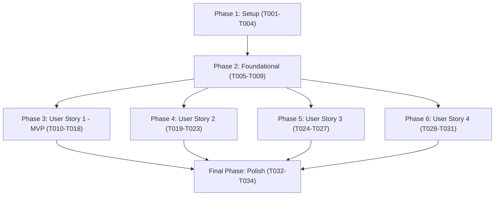

# Tasks: Personalized Recommendations (Feature 102)

**Branch**: `102-personalized-recommendations` | **Group**: 100 – AI Recommendations (Owner: Lê Công Minh Nhựt)  
**Input**: Design documents from `specs/100-ai-recommendations/102-personalized-recommendations/` (`plan.md`, `spec.md`, `data-model.md`, `research.md`, `quickstart.md`, `contracts/personalized-recommendations-api.json`)  
**Prerequisites**: `plan.md` (required), `spec.md` (required for user stories), `data-model.md`, `research.md`, `contracts/personalized-recommendations-api.json`, `quickstart.md`

---

## Format: `[ID] [P?] [Story] Description with file path`

- **Checkbox**: `- [ ]` markdown checkbox
- **[P]**: Can run in parallel (different files, no dependencies on incomplete tasks)
- **[Story]**: User story identifier (`[US1]`, `[US2]`, `[US3]`, `[US4]`) for story-phase tasks; omitted for Setup, Foundational, and Polish phases
- **File Paths**: Explicit source file path included in every task

---

## Path Conventions

- **Backend**: `src/backend/` (Node.js / Express API server)
  - Repositories: `src/backend/repositories/`
  - Services: `src/backend/services/`
  - Clients: `src/backend/clients/`
  - Controllers: `src/backend/controllers/`
  - Routes: `src/backend/routes/`
  - Middleware: `src/backend/middleware/`
  - Tests: `src/backend/tests/`
- **Frontend**: `src/frontend/` (React 18 / Vite 5 Client)
  - Services: `src/frontend/src/services/`
  - Mock Services: `src/frontend/src/services/mock/`
  - Components: `src/frontend/src/components/recommendation/`
  - Pages/Views: `src/frontend/src/pages/Home/`
  - Tests: `src/frontend/tests/`

---

## Phase 1: Setup (Shared Infrastructure & Client Configuration)

**Purpose**: Initialize external AI service connection configuration, timeout abort controllers, and common response/mock utilities.

- [X] T001 Configure AI microservice connection settings and environment variables (`AI_SERVICE_URL`, `AI_SERVICE_TIMEOUT_MS=2500`) in `src/backend/config/aiConfig.js`.
- [X] T002 [P] Implement internal AI microservice HTTP client in `src/backend/clients/aiServiceClient.js` calling `POST /ai/recommend` with a strict 2.5-second `AbortController` timeout per `plan.md`.
- [X] T003 [P] Create mock recommendation service file skeleton in `src/frontend/src/services/mock/mockRecommendationService.js` with stubbed multi-entity fixtures (`song`, `album`, `artist`, `playlist`) matching OpenAPI schema.
- [X] T004 [P] Implement response helper and envelope formatter in `src/backend/utils/recommendationResponse.js` enforcing standard response envelope `{ success, message, data, error }` per `contracts/personalized-recommendations-api.json`.

---

## Phase 2: Foundational (Blocking Prerequisites)

**Purpose**: Core data repositories, catalog hydration, and routing infrastructure that MUST be completed before ANY user story can begin.

**⚠️ CRITICAL**: No user story implementation can proceed until this phase is verified.

- [X] T005 Implement user preference signal repository in `src/backend/repositories/preferenceSignalRepository.js` querying qualifying `listening_history` entries (`listened_duration >= 30` seconds, `user_id IS NOT NULL`, `song_id IS NOT NULL`), `user_liked_songs`, and `user_follows_artist` strictly scoped to the authenticated caller (FR-009).
- [X] T006 [P] Implement catalog repository in `src/backend/repositories/catalogRepository.js` querying active catalog entities from `songs`, `albums`, `artists`, `playlists` (`is_active = true` and `deleted_at IS NULL`) and querying platform-wide popular songs (ordered by `total_plays DESC`) and official starter playlists (`is_official = true`) for fallback.
- [X] T007 [P] Implement catalog hydration service in `src/backend/services/catalogHydrationService.js` to hydrate candidate entity IDs with display metadata (`title`, `subtitle`, `image_url`, `badge`, `target_id`, `extra`) and silently filter out any deactivated, deleted, or missing catalog entities (FR-008).
- [X] T008 [P] Create recommendation router module in `src/backend/routes/recommendationRoutes.js` and mount `/api/v1/recommendations` in `src/backend/server.js`.
- [X] T009 [P] Create frontend API client adapter in `src/frontend/src/services/recommendationService.js` supporting dynamic toggle between live API calls and mock adapter based on `import.meta.env.VITE_USE_MOCKS`.

**Checkpoint**: Foundation ready — signal extraction, catalog hydration, popular fallback repository, and route mounting are established.

---

## Phase 3: User Story 1 - Browse and Select Personalized Recommendations (Priority: P1) 🎯 MVP

**Goal**: Authenticated listeners receive a personalized multi-entity recommendation feed (songs, albums, artists, playlists) and can interact with items in 1 click (play song via PlayerContext or navigate to detail page).

**Independent Test**: Log in with an account having established listening history, call `GET /api/v1/recommendations/personalized?limit=10`, verify that multi-entity cards are returned with `is_fallback: false`, zero duplicated items, and 1-click interactions immediately start audio playback or navigate to target entity detail views.

### Tests for User Story 1

> **NOTE: Write these tests FIRST and ensure they FAIL before implementing services and controllers.**

- [X] T010 [P] [US1] Create unit test suite in `src/backend/tests/services/recommendationService.test.js` validating candidate hydration, multi-entity routing, and deduplication eliminating identical `(type, id)` pairs (FR-015).
- [X] T011 [P] [US1] Create contract test in `src/backend/tests/contracts/personalizedRecommendationsContract.test.js` validating that `GET /api/v1/recommendations/personalized` and alias `GET /api/v1/recommendations/songs` conform to `RecommendationApiResponse` in `contracts/personalized-recommendations-api.json`.

### Implementation for User Story 1

- [X] T012 [US1] Implement core personalized recommendation workflow in `src/backend/services/recommendationService.js` passing extracted preference signals (`played_song_ids`, `liked_song_ids`, `followed_artist_ids`) to `aiServiceClient.getRecommendations()`, validating active entities via `catalogHydrationService`, and deduplicating items by `type:id` (FR-002, FR-015).
- [X] T013 [US1] Implement controller handler `getPersonalizedRecommendations` and alias `getRecommendedSongs` in `src/backend/controllers/recommendationController.js` validating query params `type` (enum: `["all", "song", "album", "artist", "playlist"]`, default `"all"`) and `limit` (integer 1-50, default 20).
- [X] T014 [US1] Register route handlers for `router.get('/personalized', authenticateToken, recommendationController.getPersonalizedRecommendations)` and `router.get('/songs', authenticateToken, recommendationController.getRecommendedSongs)` in `src/backend/routes/recommendationRoutes.js`.
- [X] T015 [P] [US1] Implement frontend HTTP client method `getPersonalizedRecommendations({ type = 'all', limit = 20 })` in `src/frontend/src/services/recommendationService.js` sending Bearer JWT header.
- [X] T016 [P] [US1] Implement polymorphic card component `src/frontend/src/components/recommendation/RecommendedItemCard.jsx` rendering artwork, title, subtitle, badge ("Gợi ý"), and handling 1-click interactions: playing songs via `player.playTrack(song)` or navigating to `/album/:id`, `/artist/:id`, `/playlist/:id` (FR-007, SC-004).
- [X] T017 [US1] Implement recommendation feed container `src/frontend/src/components/recommendation/RecommendationFeed.jsx` managing loading skeleton, empty states, and responsive grid layout of `RecommendedItemCard` components.
- [X] T018 [US1] Embed `RecommendationFeed` into the "Có thể bạn sẽ thích" / "Gợi ý cho bạn" section of `src/frontend/src/pages/Home/HomePage.jsx` delegating song playback to `PlayerContext` and navigation to app router.

**Checkpoint**: User Story 1 is fully functional as the MVP increment. Authenticated listeners with history receive personalized multi-entity recommendations on Home Dashboard.

---

## Phase 4: User Story 2 - Cold-Start Experience for New or Low-Data Listeners (Priority: P2)

**Goal**: New accounts or accounts with < 3 plays (>= 30s), 0 likes, 0 follows, or purged history receive popular songs and official playlists with "Phổ biến"/"Thịnh hành" badges, without blank screens or unhandled errors.

**Independent Test**: Authenticate as a newly created account with 0 playback events or clear history; request recommendations and verify HTTP 200 returns `is_fallback: true`, `fallback_reason: "COLD_START"`, and the UI displays popular cards with `"Phổ biến"` or `"Thịnh hành"` badges without blank screens.

### Tests for User Story 2

- [X] T019 [P] [US2] Create unit test in `src/backend/tests/services/coldStartEvaluation.test.js` validating that users with zero qualifying plays, zero likes, zero follows, or purged history trigger cold-start fallback returning `is_fallback: true` and `fallback_reason: "COLD_START"`.

### Implementation for User Story 2

- [X] T020 [US2] Implement cold-start detection logic in `src/backend/services/recommendationService.js`: if qualifying playback count `< 3` AND liked songs count `=== 0` AND followed artists count `=== 0`, bypass internal AI service and immediately query platform popular songs and official playlists from `catalogRepository` (FR-005, FR-009).
- [X] T021 [US2] Ensure popular fallback items in `src/backend/services/catalogHydrationService.js` are assigned badges `"Phổ biến"` or `"Thịnh hành"` and response payload sets `is_fallback: true` with `fallback_reason: "COLD_START"`.
- [X] T022 [P] [US2] Implement mock cold-start data generator in `src/frontend/src/services/mock/mockRecommendationService.js` returning popular fallback fixtures when user profile has zero history.
- [X] T023 [US2] Verify `RecommendationFeed.jsx` and `RecommendedItemCard.jsx` in `src/frontend/src/components/recommendation/` render `"Phổ biến"` / `"Thịnh hành"` badges without displaying error banners or blank states when `is_fallback === true` and `fallback_reason === "COLD_START"`.

**Checkpoint**: User Stories 1 and 2 operate smoothly. New listeners immediately discover popular music on Home Dashboard without blank containers.

---

## Phase 5: User Story 3 - Resilient Handling of Service Unavailability (Priority: P2)

**Goal**: When the internal AI service is unreachable, fails, or times out (> 2.5s), gracefully degrade to popular content with an informative notice banner without disrupting Home Dashboard or throwing 5xx errors (EF-01).

**Independent Test**: Mock AI service delay > 2500ms or simulate 500 error; request recommendations and verify HTTP 200 returns within 2.6s with `is_fallback: true`, `fallback_reason: "AI_SERVICE_UNAVAILABLE"`, and banner message `"Hiển thị nội dung thịnh hành do hệ thống gợi ý đang bảo trì"`.

### Tests for User Story 3

- [X] T024 [P] [US3] Create resilience test in `src/backend/tests/faultTolerance/aiDowntimeResilience.test.js` simulating AI service network failure, 500 error, and 3000ms delay, verifying backend returns HTTP 200 within 2.6s with `is_fallback: true`, `fallback_reason: "AI_SERVICE_UNAVAILABLE"`, and banner message.

### Implementation for User Story 3

- [X] T025 [US3] Implement `try...catch` fault-tolerance block in `src/backend/services/recommendationService.js` around `aiServiceClient.getRecommendations()`: on `AbortError` (timeout > 2.5s) or HTTP 5xx from AI service, log warning, fallback to popular items, set `is_fallback: true`, `fallback_reason: "AI_SERVICE_UNAVAILABLE"`, and attach message `"Hiển thị nội dung thịnh hành do hệ thống gợi ý đang bảo trì"` (FR-006, EF-01).
- [X] T026 [P] [US3] Implement subtle alert banner component `src/frontend/src/components/recommendation/FallbackNoticeBanner.jsx` displaying the non-intrusive maintenance notice when `fallback_reason === "AI_SERVICE_UNAVAILABLE"`.
- [X] T027 [US3] Connect `FallbackNoticeBanner` inside `src/frontend/src/components/recommendation/RecommendationFeed.jsx` above the cards grid when `is_fallback === true` and `fallback_reason === "AI_SERVICE_UNAVAILABLE"`, ensuring card grid remains playable without blocking home navigation.

**Checkpoint**: User Stories 1, 2, and 3 are complete. AI microservice outages cause zero dashboard downtime or 5xx crashes.

---

## Phase 6: User Story 4 - Private and Isolated Recommendation Access (Priority: P1)

**Goal**: Enforce strict account boundary and privacy under Vietnamese Decree 13/2023/NĐ-CP: require JWT token on `GET /api/v1/recommendations/personalized`, return HTTP 401 if unauthenticated, and scope all preference signals `WHERE user_id = :authenticated_user_id`.

**Independent Test**: Send `GET /api/v1/recommendations/personalized` without an `Authorization` header and verify HTTP 401 response. Authenticate as User A and verify User B's history, likes, and recommendations are completely inaccessible to User A.

### Tests for User Story 4

- [X] T028 [P] [US4] Create security and account isolation test suite in `src/backend/tests/security/recommendationPrivacy.test.js` validating that requests without Bearer token return HTTP 401 code `"UNAUTHORIZED"`, and User A's signals/feed cannot be accessed by User B.

### Implementation for User Story 4

- [X] T029 [US4] Enforce strict account parameterization in `src/backend/repositories/preferenceSignalRepository.js` binding query parameters exclusively to `req.user.user_id`, prohibiting any client-supplied `user_id` in query params or headers (FR-003, FR-004).
- [X] T030 [US4] Apply `authenticateToken` middleware to all routes in `src/backend/routes/recommendationRoutes.js` returning HTTP 401 with standard envelope `{ success: false, message: "Yêu cầu đăng nhập để nhận gợi ý cá nhân hóa", data: null, error: { code: "UNAUTHORIZED", details: [] } }` conforming to `contracts/personalized-recommendations-api.json`.
- [X] T031 [P] [US4] Update `src/frontend/src/components/recommendation/RecommendationFeed.jsx` to check `currentUser` from `AppStore`: if unauthenticated, display public trending content or prompt for sign-in without calling private personalized endpoint.

**Checkpoint**: All User Stories 1 to 4 are complete. Private listener signals and recommendations are strictly isolated end-to-end.

---

## Final Phase: Polish & Cross-Cutting Concerns

**Purpose**: Documentation synchronization, frontend component tests, and verification of all 5 scenarios from `quickstart.md`.

- [X] T032 [P] Update API integration documentation in `specs/100-ai-recommendations/102-personalized-recommendations/contracts/README.md` reflecting endpoints, parameters, fallback semantics, and error schemas.
- [X] T033 [P] Implement frontend unit & component tests in `src/frontend/tests/components/RecommendationFeed.test.jsx` verifying 1-click playback, navigation routing, cold-start badge display, and notice banner rendering.
- [X] T034 Validate all 5 scenarios from `specs/100-ai-recommendations/102-personalized-recommendations/quickstart.md`: Scenario 1 (Standard Feed & 1-Click Interaction), Scenario 2 (Cold-Start Fallback), Scenario 3 (AI Downtime & Graceful Degradation), Scenario 4 (Account Privacy & Boundary Isolation), and Scenario 5 (Transition to Cold-Start Following History Purge).

---

## Dependencies & Execution Order

### Phase Dependencies



- **Phase 1 (Setup)**: Can start immediately. Configures AI client timeout, environment variables, mock service, and response helper.
- **Phase 2 (Foundational)**: Depends on Phase 1 completion. **BLOCKS** all User Stories.
- **Phase 3 (User Story 1 - MVP)**: Depends on Phase 2 completion. Delivers personalized multi-entity recommendations and 1-click playback/navigation.
- **Phase 4 (User Story 2)**: Depends on Phase 2 completion. Implements cold-start fallback for new/low-data accounts.
- **Phase 5 (User Story 3)**: Depends on Phase 2 completion. Implements 2.5s timeout catch block and graceful degradation banner.
- **Phase 6 (User Story 4)**: Depends on Phase 2 completion. Hardens JWT authentication and account signal isolation.
- **Final Phase (Polish)**: Depends on completion of all desired user stories.

### User Story Dependencies

- **User Story 1 (P1 - MVP)**: Starts after Foundational phase. Core recommendation flow and polymorphic card UI.
- **User Story 2 (P2)**: Extends recommendation service and card badges for cold-start listeners.
- **User Story 3 (P2)**: Adds fault-tolerance wrapper around AI client call and notice banner UI.
- **User Story 4 (P1)**: Enforces authentication guard and query isolation across all recommendation routes.

---

## Parallel Execution Examples

### Parallel Opportunities within Setup & Foundation

```bash
# Launch independent setup tasks together:
Task T002: "Implement AI microservice HTTP client in src/backend/clients/aiServiceClient.js"
Task T003: "Create mock recommendation service skeleton in src/frontend/src/services/mock/mockRecommendationService.js"
Task T004: "Implement response helper in src/backend/utils/recommendationResponse.js"

# Launch independent foundational tasks together:
Task T006: "Implement catalog repository in src/backend/repositories/catalogRepository.js"
Task T007: "Implement catalog hydration service in src/backend/services/catalogHydrationService.js"
Task T008: "Create recommendation router module in src/backend/routes/recommendationRoutes.js"
Task T009: "Create frontend API client adapter in src/frontend/src/services/recommendationService.js"
```

### Parallel Opportunities within User Story 1 (MVP)

```bash
# Launch test creation tasks together (write tests first):
Task T010: "Unit test suite in src/backend/tests/services/recommendationService.test.js"
Task T011: "Contract test in src/backend/tests/contracts/personalizedRecommendationsContract.test.js"

# Launch client-side tasks in parallel with server implementation:
Task T015: "Frontend HTTP client getPersonalizedRecommendations in src/frontend/src/services/recommendationService.js"
Task T016: "Polymorphic card component in src/frontend/src/components/recommendation/RecommendedItemCard.jsx"
```

### Parallel Opportunities across User Stories (Multi-Developer)

```bash
# Once Phase 2 (Foundational) is complete:
Developer A: Works on Phase 3 (User Story 1 - Personalized multi-entity feed & 1-click interactions)
Developer B: Works on Phase 4 (User Story 2 - Cold-start detection & popular fallback)
Developer C: Works on Phase 5 (User Story 3 - AI timeout resilience & fallback notice banner)
Developer D: Works on Phase 6 (User Story 4 - JWT authentication & account boundary isolation)
```

---

## Independent Test Criteria per User Story

| User Story | Verification Procedure | Pass Criteria |
|---|---|---|
| **User Story 1 (P1 - MVP)** | Authenticate as user with history; send `GET /api/v1/recommendations/personalized?limit=10`; inspect Home Dashboard feed. | `is_fallback === false`; cards contain songs, albums, artists, playlists; clicking a song plays immediately in Music Player; clicking an album/artist/playlist navigates to detail page (SC-004). |
| **User Story 2 (P2)** | Authenticate as account with 0 history entries; request `GET /api/v1/recommendations/personalized`. | `is_fallback === true`; `fallback_reason === "COLD_START"`; cards display `"Phổ biến"` or `"Thịnh hành"` badges; zero blank screens or crashes (SC-002). |
| **User Story 3 (P2)** | Disconnect internal AI microservice or mock delay > 2500ms; request `GET /api/v1/recommendations/personalized`. | Request returns `HTTP 200 OK` within 2.6s; `is_fallback === true`; `fallback_reason === "AI_SERVICE_UNAVAILABLE"`; UI renders subtle notice banner without blocking home navigation (SC-003). |
| **User Story 4 (P1)** | Send unauthenticated request to `/api/v1/recommendations/personalized`; authenticate as User A and attempt to query User B's feed. | Unauthenticated request returns `HTTP 401 Unauthorized` with code `"UNAUTHORIZED"`; User A receives feed derived exclusively from their own history and likes (`WHERE user_id = :auth_id`), completely isolating User B's data (SC-001). |

---

## Implementation Strategy

### MVP First (User Story 1 Only)

1. Complete **Phase 1: Setup** (T001-T004: AI client with timeout, mock service skeleton, response helper).
2. Complete **Phase 2: Foundational** (T005-T009: signal repository, catalog repository, hydration service, router).
3. Complete **Phase 3: User Story 1** (T010-T018: AI integration, multi-entity cards, 1-click playback/navigation on HomePage).
4. **STOP and VALIDATE**: Test User Story 1 with an account that has listening history. Deploy/demo the MVP increment.

### Incremental Delivery

1. Foundation ready (Phases 1 + 2: T001-T009).
2. Add User Story 1 -> Deliver MVP personalized recommendations on Home Dashboard (Phase 3: T010-T018).
3. Add User Story 2 -> Deliver smooth onboarding and cold-start fallback (Phase 4: T019-T023).
4. Add User Story 3 -> Deliver AI downtime resilience and graceful degradation (Phase 5: T024-T027).
5. Add User Story 4 -> Deliver verified JWT authentication and account privacy (Phase 6: T028-T031).
6. Finalize Polish -> Run full `quickstart.md` validation and finalize documentation (Final Phase: T032-T034).
