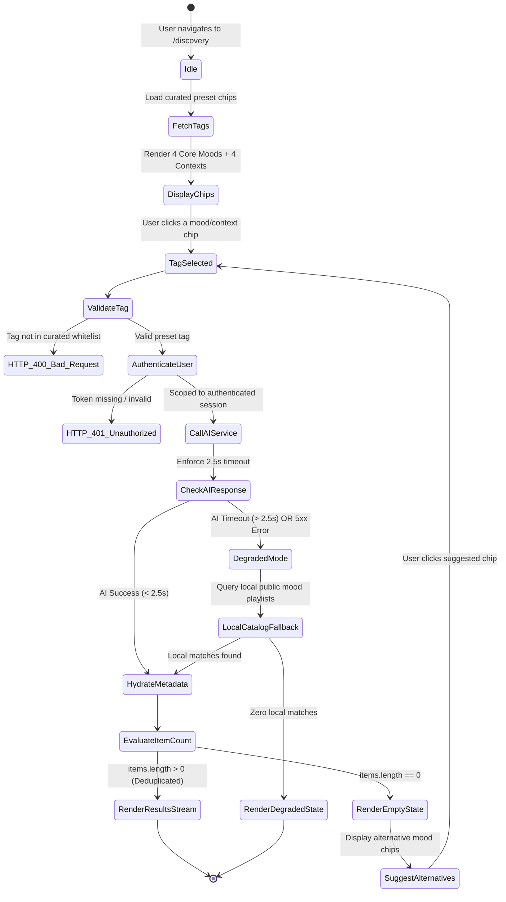

# Data Model: Mood and Context Recommendations (Feature 103)

## Overview

This document defines the logical data model, entity structures, validation rules, state transitions, and data integrity constraints for **Feature 103: Mood and Context Recommendations** in AuraTune.

Feature 103 delivers music recommendations filtered by curated mood and situational context preset tags. The output is strictly scoped to individual **Songs** and theme-curated **Mood Playlists** (FR-003).

---

## 1. Domain Entities & Taxonomies

### 1.1. `MoodTag` (Curated Taxonomy Entity)

Defines the system-supported preset tags representing emotional states and activity contexts.

| Field | Type | Required | Values / Format | Description |
|---|---|---|---|---|
| `id` | `String` | Yes | Kebab/snake case token | Unique identifier for query binding |
| `label` | `String` | Yes | Human-readable string | Localized display label (Vietnamese) |
| `category` | `String` | Yes | `"mood"` \| `"context"` | Category grouping (FR-002) |
| `icon` | `String` | Yes | Icon identifier | Visual icon asset / token |
| `color_gradient` | `String` | No | CSS gradient tokens | Card/chip accent styling |
| `is_active` | `Boolean` | Yes | Default `true` | Active status in catalog |

#### Preset Catalog Seed:
```json
[
  { "id": "chill", "label": "Chill / Thư giãn", "category": "mood", "icon": "coffee", "color_gradient": "from-teal-500 to-emerald-700" },
  { "id": "energetic", "label": "Năng lượng / Hưng phấn", "category": "mood", "icon": "zap", "color_gradient": "from-amber-500 to-orange-600" },
  { "id": "melancholy", "label": "Trầm lắng / U buồn", "category": "mood", "icon": "cloud-rain", "color_gradient": "from-indigo-600 to-blue-900" },
  { "id": "focus", "label": "Tập trung", "category": "mood", "icon": "target", "color_gradient": "from-violet-600 to-purple-800" },
  { "id": "study_work", "label": "Học tập / Làm việc", "category": "context", "icon": "book-open", "color_gradient": "from-cyan-600 to-blue-700" },
  { "id": "workout", "label": "Tập luyện / Thể thao", "category": "context", "icon": "flame", "color_gradient": "from-rose-500 to-red-700" },
  { "id": "late_night", "label": "Đêm muộn", "category": "context", "icon": "moon", "color_gradient": "from-purple-900 to-slate-950" },
  { "id": "travel_commute", "label": "Di chuyển / Đi lại", "category": "context", "icon": "compass", "color_gradient": "from-sky-500 to-indigo-700" }
]
```

---

### 1.2. `MoodRecommendationResult` (Root Response Payload)

The unified response container delivered to the client for `GET /api/v1/recommendations/mood-context`.

| Field | Type | Required | Description |
|---|---|---|---|
| `tag` | `String` | Yes | Echo of the requested tag (e.g. `"chill"`) |
| `tag_category` | `String` | Yes | `"mood"` or `"context"` |
| `is_service_degraded` | `Boolean` | Yes | `true` if AI backend is offline and degraded mode is served |
| `total_items` | `Integer` | Yes | Total count of recommendation items in feed |
| `items` | `List<MoodRecommendedItem>` | Yes | Deduplicated list of recommended cards |
| `alternative_suggestions`| `List<String>` | Yes | 2–3 active alternative tag IDs served when matches are empty or sparse (FR-004) |
| `fallback_shortcuts` | `List<FallbackShortcut>` | No | Quick navigation links served during AI service degradation |
| `generated_at` | `TIMESTAMPTZ` | Yes | Timestamp of feed assembly |

---

### 1.3. `MoodRecommendedItem` (Polymorphic Item Entity)

Represents an individual card within the recommendation results stream. Restricted to `"song"` and `"playlist"`.

| Field | Type | Required | Values / Format | Description |
|---|---|---|---|---|
| `id` | `UUID` | Yes | UUID string | Canonical catalog ID |
| `type` | `String` | Yes | `"song"` \| `"playlist"` | Entity discriminator (FR-003) |
| `title` | `String` | Yes | String ($\le 255$ chars) | Song title or playlist title |
| `subtitle` | `String` | Yes | String ($\le 255$ chars) | Artist name (song) or creator/curator (playlist) |
| `image_url` | `String` | No | URI or asset token | Cover artwork |
| `badge` | `String` | Yes | String (e.g. `"Chill"`, `"Tập trung Playlist"`) | Category/tag badge |
| `target_id` | `UUID` | Yes | UUID string | Playback ID (song) or navigation ID (playlist) |
| `extra` | `Object` | No | Key-value dictionary | Type-specific auxiliary metadata |

#### Type-Specific `extra` attributes:
- **`type: "song"`**:
  - `duration`: `Integer` (track duration in seconds)
  - `audio_url`: `String` (`/api/v1/songs/:id/stream`)
  - `artist_id`: `UUID`
  - `album_id`: `UUID`
- **`type: "playlist"`**:
  - `track_count`: `Integer`
  - `is_official`: `Boolean`

---

## 2. Source Database Catalog Dependencies

Feature 103 queries PostgreSQL to hydrate display metadata and enforce active catalog availability:

### 2.1. `songs`
- `id` (PK), `title`, `artist_id`, `album_id`, `duration`, `genre`, `audio_url`, `cover_url`, `is_active`.
- Constraint: `is_active = true` and `deleted_at IS NULL` (FR-008).

### 2.2. `playlists`
- `id` (PK), `title`, `user_id_creator`, `cover_url`, `status`, `is_official`, `is_active`.
- Constraint: `status = 'Public'` and `is_active = true` (FR-008).

---

## 3. Mood Recommendation State Machine



---

## 4. Validation & Integrity Rules

1. **Tag Whitelist Validation (FR-002)**:
   - Input `tag` MUST strictly match one of the 8 curated taxonomy IDs: `chill`, `energetic`, `melancholy`, `focus`, `study_work`, `workout`, `late_night`, `travel_commute`.
   - Any other input string yields HTTP 400 with code `INVALID_MOOD_TAG`.
2. **Entity Restriction (FR-003)**:
   - Recommendation candidates MUST belong exclusively to `"song"` or `"playlist"`.
   - Individual albums and artists MUST NOT be served in mood streams.
3. **Catalog Active State Filtering (FR-008, SC-005)**:
   - Inactive songs, unplayable audio files, or private playlists (`status != 'Public'`) MUST be filtered out prior to response assembly.
4. **Deduplication Guarantee (FR-014)**:
   - No two items in the returned `items` array may share the identical `(type, id)`.
5. **Alternative Suggestions Generation (FR-004, AF-02)**:
   - If `items` is empty, the system MUST return at least 2 alternative active tags in `alternative_suggestions`.
6. **Graceful Degradation Guarantee (FR-004, EF-01, SC-003)**:
   - When AI Service fails or times out ($> 2.5$s), response MUST return HTTP 200 with `is_service_degraded: true` and navigation shortcuts; never throw HTTP 500 or 503.
